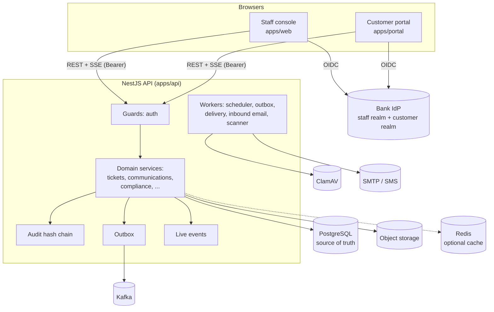

# Bank Case Platform documentation

The documentation is organised **by topic**. Everything about one subject (concepts, backend code walkthrough, frontend, flows, tests and interview answers) lives in **one folder**. Every folder starts with a `README.md` that is its index.

Every page links to the exact source lines it explains (for example [auth.guard.ts#L45-L79](../apps/api/src/auth/auth.guard.ts#L45-L79)), so you can read the explanation and the code side by side.

---

## How the system fits together

---

## Topic folders

### Security and evidence
| Topic | What it covers |
|---|---|
| [Auth](auth/README.md) | OIDC + PKCE login, the JWT guard, token hardening, step-up, `PolicyService` (RBAC + ABAC), roles matrix, maker-checker |
| [Audit](audit/README.md) | Transactional audit events, SHA-256 hash chain, append-only database, verification, signed anchors, archiving, auditor search |

### Case management
| Topic | What it covers |
|---|---|
| [Tickets](tickets/README.md) | The case aggregate: create (idempotent), list (keyset paging), search, detail, mutations, optimistic concurrency, status change end to end, queue and case screens |
| [SLA](sla/README.md) | Deadlines, business-hours calendar, pause/resume, status formula, reconciliation |
| [Workflow](workflow/README.md) | Status lifecycle as data (state machine), graph validation, the background scheduler |
| [Assignment and routing](assignment-and-routing/README.md) | Auto-assignment strategies, manual assignment, escalation rules, routing administration |
| [Communications](communications/README.md) | Template-based customer messages, maker-checker approval, resolution notice, delivery worker, receipts |
| [Notifications](notifications/README.md) | Staff inbox (the bell): audience targeting, per-user read state, live push |
| [Attachments](attachments/README.md) | Presigned direct-to-storage uploads, malware scanning, customer documents, secure upload links |
| [Compliance](compliance/README.md) | Complaint and privacy regulatory clocks, AFCA, communication block (tipping-off), subject access, complaints register |
| [Retention](retention/README.md) | Legal hold and de-identification of closed cases |

### Channels and customers
| Topic | What it covers |
|---|---|
| [Intake](intake/README.md) | Channel adapters, the idempotent intake ledger, inbound email, customer replies |
| [Portal](portal/README.md) | The customer app and API: separate identity, ownership by reference, safe projections |

### Integration and real time
| Topic | What it covers |
|---|---|
| [Outbox](outbox/README.md) | Transactional outbox, skip-locked dispatcher, Kafka publisher, retries, dead letters, receipts, [event catalogue](outbox/event-catalogue.md) |
| [Live updates](live-updates/README.md) | PostgreSQL LISTEN/NOTIFY + Server-Sent Events, policy-filtered fan-out |

### Administration and reporting
| Topic | What it covers |
|---|---|
| [Configuration](configuration/README.md) | Configuration as data, the admin console, scope checks, before-value audit |
| [Dashboard](dashboard/README.md) | Scoped aggregate SQL, trends, accessible charts |
| [Directory](directory/README.md) | Subject IDs → staff names, batched lookups |

### Platform
| Topic | What it covers |
|---|---|
| [API bootstrap](api-bootstrap/README.md) | `main.ts`, the module graph, the request pipeline, validation, errors |
| [Database](database/README.md) | Pool and transactions, the **locking and concurrency catalogue**, migrations, roles |
| [Cache](cache/README.md) | Optional fail-open Redis |
| [Observability](observability/README.md) | Prometheus metrics, health and readiness, logs, correlation IDs, alerts |
| [Frontend architecture](frontend-architecture/README.md) | App shell, routing, API client, TanStack Query patterns, UI conventions |

---

## General sections

| Section | Contents |
|---|---|
| [Interview prep](interview-prep/README.md) | Cross-topic answer playbook and a one-line answer per topic, with links to each topic's Q&A |
| [Reference maps](reference/README.md) | Cross-module maps: runtime wiring, data consistency, frontend↔backend, failure and test; source coverage |
| [Learn NestJS](learn-nestjs/README.md) | A 10-lesson NestJS course built on this code |
| [Architecture](architecture/README.md) | System architecture, boundaries, decisions |
| [Security](security/README.md) | Security pack (threat model, APRA CPS 234, Privacy Act mapping) |
| [Operations](operations/README.md) | Deployment, runbooks, disaster recovery, capacity, production readiness |
| [Product](product/README.md) | User guide, bank onboarding |
| [Project](project/README.md) | First increment, implementation log, status |

---

## How to read any topic folder

Each folder follows the same shape:

| File | Purpose |
|---|---|
| `README.md` | **Index**: a one-line technical definition plus a plain-language one, a picture, a code map, reading order, the 30-second answer, related topics |
| `concepts.md` | Glossary: technical term → plain meaning → analogy → where in our code (larger topics; smaller topics keep the glossary in the README) |
| walkthrough pages | Backend and frontend code explained line by line with links |
| `testing.md` | Which tests prove what (larger topics) |
| `interview-qa.md` | 30-second / 2-minute / code-level answers, likely questions, follow-up traps, honest limitations |

**Suggested study path for interviews:** [Auth](auth/README.md) → [Tickets: status change end to end](tickets/status-change-flow.md) → [Audit](audit/README.md) → [Outbox](outbox/README.md) → [Database locking catalogue](database/locking-and-concurrency.md) → [Attachments](attachments/README.md) → [Communications](communications/README.md) → [Frontend architecture](frontend-architecture/README.md).
