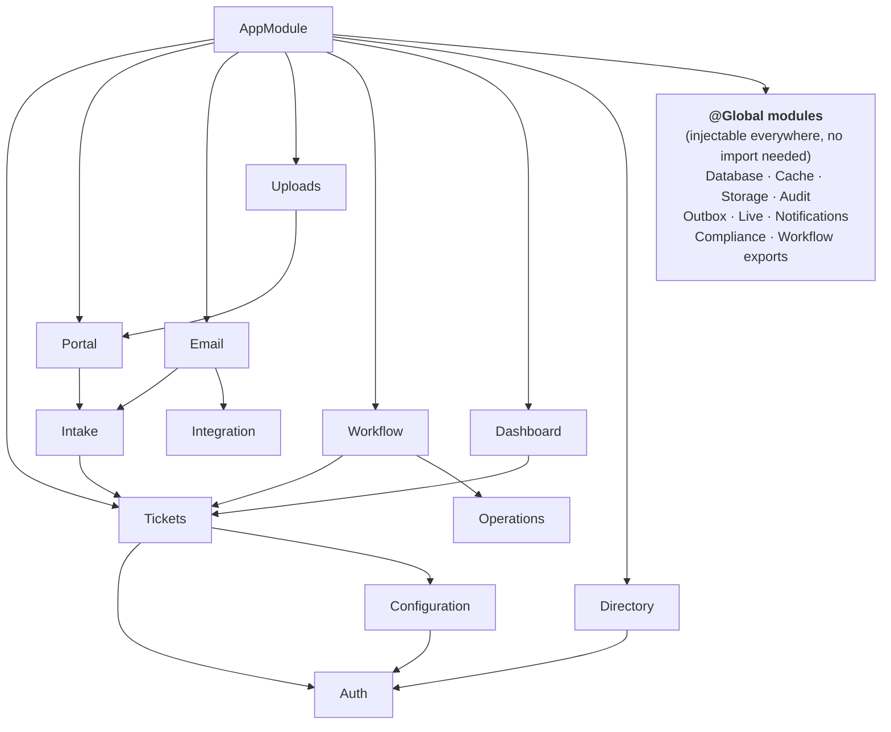

# Bootstrap and module graph

[Back to API bootstrap index](README.md)

---

## 1. `main.ts` line by line

[main.ts#L13-L25](../../apps/api/src/main.ts#L13-L25):

| Line | Code (short) | What & why |
|---|---|---|
| [1-2](../../apps/api/src/main.ts#L1-L2) | `reflect-metadata`, `dotenv/config` | Decorator metadata for DI and validation; load `.env` locally |
| [14](../../apps/api/src/main.ts#L14) | `assertProductionSafety()` | **Before** anything else: refuse dev issuers, dev secrets, missing client allow-list, unrestricted DB role ([token-hardening](../auth/token-hardening.md#5-production-safety-gate)) |
| [15](../../apps/api/src/main.ts#L15) | `NestFactory.create(AppModule, new FastifyAdapter({ logger: { redact: [...] }, bodyLimit, trustProxy }))` | **Fastify** instead of Express (faster, schema-friendly); logs redact Authorization and Cookie; body ≤ `MAX_BODY_BYTES` (1 MiB, files go direct to S3); `TRUST_PROXY` explicit |
| [17](../../apps/api/src/main.ts#L17) | `helmet({ contentSecurityPolicy: { defaultSrc: ['none'], frameAncestors: ['none'] }, hsts, referrerPolicy: no-referrer })` | The API only returns JSON, so the CSP allows nothing to load or frame it; HSTS forces HTTPS for a year; no referrer leakage |
| [18](../../apps/api/src/main.ts#L18) | `rateLimit({ max: RATE_LIMIT_PER_MINUTE (600), timeWindow: '1 minute', allowList: health, metrics, SSE })` | Per-client flood protection; probes and long-lived streams excluded |
| [19](../../apps/api/src/main.ts#L19) | `registerRequestContext(fastify)` | `onRequest` hook starts an `AsyncLocalStorage` with IP and user agent ([request-context.ts#L18-L23](../../apps/api/src/audit/request-context.ts#L18-L23)) |
| [20](../../apps/api/src/main.ts#L20) | `acceptEmptyJsonBodies(app)` | Browsers send `Content-Type: application/json` with an empty body on actions like "replay"; treat it as `{}` instead of a 400 ([L10-L15](../../apps/api/src/audit/request-context.ts#L10-L15)) |
| [21](../../apps/api/src/main.ts#L21) | `setGlobalPrefix('v1')` | API versioning in the path |
| [22](../../apps/api/src/main.ts#L22) | `enableCors({ origin: CORS_ORIGIN list or false, credentials, methods, allowedHeaders: [authorization, content-type, idempotency-key, x-correlation-id, x-upload-token], exposedHeaders: [x-next-cursor], maxAge: 600 })` | **Off unless configured**; exact origins only; only the custom headers our protocol uses; expose the paging cursor |
| [23](../../apps/api/src/main.ts#L23) | `useGlobalPipes(new ValidationPipe({ whitelist: true, forbidNonWhitelisted: true, transform: true }))` | Every DTO validated; unknown fields → 400 (mass-assignment protection); types converted |
| [24](../../apps/api/src/main.ts#L24) | `listen({ port, host: '0.0.0.0' })` | Containers need 0.0.0.0 |

**Order matters:** the safety check before startup; request context before guards (which add token facts to it); validation before controllers.

## 2. `AppModule`

[app.module.ts#L27](../../apps/api/src/app.module.ts#L27):

```ts
@Module({
  imports: [DatabaseModule, CacheModule, StorageModule, AuditModule, AuthModule, TicketsModule, DashboardModule, OutboxModule,
            ConfigurationModule, IntegrationModule, LiveModule, WorkflowModule, IntakeModule, ComplianceModule, MetricsModule,
            NotificationsModule, EmailModule, PortalModule, OperationsModule, UploadsModule, DirectoryModule],
  controllers: [HealthController],
  providers: [{ provide: APP_INTERCEPTOR, useClass: DeniedAuthorizationInterceptor }]
})
```

### Global vs imported modules

`@Global()` makes a module's **exports** injectable everywhere without importing it. It does **not** make routes public.

| Global (infrastructure everyone needs) | Imported explicitly (domain ownership visible) |
|---|---|
| Database, Cache, Storage, Audit, Outbox, Live, Notifications, Compliance, Workflow | Auth, Tickets, Configuration, Dashboard, Integration, Intake, Email, Portal, Operations, Uploads, Directory, Metrics |

### Module dependency sketch



Notable wiring decisions:

| Decision | Where | Why |
|---|---|---|
| `ProfileController` (`/me`) registered in `DirectoryModule` | [directory.module.ts#L8](../../apps/api/src/directory/directory.module.ts#L8) | Needs `DirectoryService`; registering it in Auth would create a cycle |
| `RetentionService` registered in `WorkflowModule` | [workflow.module.ts#L12](../../apps/api/src/workflow/workflow.module.ts#L12) | Only the scheduler uses it |
| `OUTBOX_PUBLISHER` symbol provider with a factory | [outbox.module.ts#L7](../../apps/api/src/outbox/outbox.module.ts#L7) | Swap Kafka/log by environment |
| `CONTACT_RESOLVER` symbol provider | [email.module.ts#L8](../../apps/api/src/email/email.module.ts#L8) | Swap CRM/direct resolver |
| Two `APP_INTERCEPTOR`s (denied-audit in AppModule, metrics in MetricsModule) | | Cross-cutting behaviour without per-controller decorators |

## 3. Lifecycle hooks (what starts on boot)

| Provider | Hook | Starts if |
|---|---|---|
| `DatabaseGuardService` | `onModuleInit` | always (checks the audit role) |
| `AttachmentStorageService` | `onModuleInit` | `OBJECT_STORAGE_CREATE_BUCKET=true` (dev) |
| `LiveEventsService` | `onModuleInit` | `DATABASE_URL` (LISTEN connection) |
| `OutboxDispatcher` | `onModuleInit` | `OUTBOX_DISPATCHER_ENABLED=true` |
| `WorkflowScheduler` | `onModuleInit` | `WORKFLOW_SCHEDULER_ENABLED=true` |
| `DeliveryWorker` | `onModuleInit` | a deliverable channel is configured |
| `InboundEmailWorker` | `onModuleInit` | IMAP + secret configured |
| `AttachmentScanWorker` | `onModuleInit` | ClamAV + storage configured |
| `PgService`, `RedisCacheService`, workers | `onModuleDestroy` | close pools, quit Redis, stop timers |

**Plain:** every background loop is **opt-in by configuration**, so the same image can run as an API-only pod or as a worker pod.

Next: [Request lifecycle](request-lifecycle.md)
