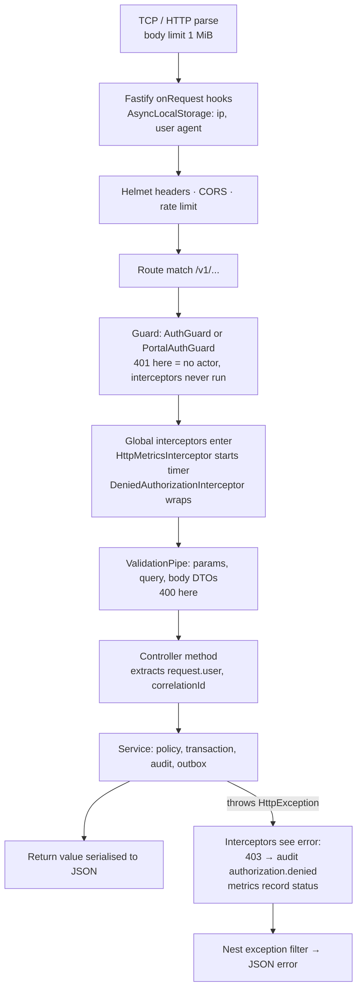

# Request lifecycle

[Back to API bootstrap index](README.md) · Deeper framework lesson: [Learn NestJS → request lifecycle](../learn-nestjs/06-request-lifecycle/README.md)

---

## 1. The order

**Interview tip:** Nest's order is middleware/hooks → **guards** → interceptors (before) → pipes → handler → interceptors (after) → exception filters. A 401 thrown by a guard happens before any interceptor runs, which is why it doesn't appear in route metrics and why `DeniedAuthorizationInterceptor` only ever sees errors from pipes, handlers and services. A service's 403 always has a known `request.user`.

## 2. One request traced: `POST /v1/tickets/:id/notes`

| Step | Code | Outcome |
|---|---|---|
| Fastify parses JSON | [request-context.ts#L10-L15](../../apps/api/src/audit/request-context.ts#L10-L15) | Empty body → `{}`; invalid JSON → 400 |
| ALS context starts | [L18-L23](../../apps/api/src/audit/request-context.ts#L18-L23) | `{ ip, userAgent }` |
| `@UseGuards(AuthGuard)` | [tickets.controller.ts#L40](../../apps/api/src/tickets/tickets.controller.ts#L40) | `request.user`, `request.correlationId`, ALS gets `jti`/`acr` |
| `ValidationPipe` → `AddNoteDto` | [ticket.dto.ts#L41](../../apps/api/src/tickets/ticket.dto.ts#L41) | `visibility ∈ {internal, customer}`, body 1-10,000 |
| Controller | [L127-L138](../../apps/api/src/tickets/tickets.controller.ts#L127-L138) | `tickets.addNote(user, id, dto, correlationId)` |
| Service | [tickets.service.ts#L154-L166](../../apps/api/src/tickets/tickets.service.ts#L154-L166) | transaction: policy → rules → insert → audit (with `ctx_ip`, `ctx_jti` from ALS) → outbox → notify |
| Response | n/a | `201 { id, visibility, createdAt }` |
| Metrics | [interceptor](../../apps/api/src/metrics/http-metrics.interceptor.ts) | `route="/v1/tickets/:ticketId/notes", status="201"` |

## 3. Validation pipe in detail

`new ValidationPipe({ whitelist: true, forbidNonWhitelisted: true, transform: true })`:

| Option | Plain meaning | Example |
|---|---|---|
| `whitelist` | Drop properties without decorators | n/a |
| `forbidNonWhitelisted` | ...and reject the request if any were present | `{ "status": "resolved", "isAdmin": true }` on a DTO without `isAdmin` → 400 |
| `transform` | Turn plain JSON into DTO class instances and convert types (`@Type(() => Number)`) | `?limit=20` becomes the number 20 |

Nested DTOs need `@ValidateNested` + `@Type` (e.g. ticket references). Without them, nested objects are not validated. See [Learn NestJS → DTOs](../learn-nestjs/03-dtos-and-validation/README.md).

## 4. Errors

Services throw Nest `HttpException`s; Nest's default exception filter turns them into JSON:

| Exception | Status | Typical use |
|---|---|---|
| `BadRequestException` | 400 | Missing idempotency key, invalid cursor, missing root cause |
| `UnauthorizedException` | 401 | Guard failures (always a generic message) |
| `ForbiddenException` | 403 | Policy; step-up uses a structured body `{ code: 'step_up_required' }` |
| `NotFoundException` | 404 | Missing rows; hidden portal requests; disabled features |
| `ConflictException` | 409 | Stale edit `{ code: 'stale_ticket' }`, illegal transition, idempotency conflict, already decided |
| `HttpException(..., 413/429)` | 413 / 429 | Upload too large; customer rate limits; too many SSE streams |
| `ServiceUnavailableException` | 503 | Storage or upload links not configured |

**Structured error codes** (`step_up_required`, `stale_ticket`) let the frontend react without parsing English messages ([api.ts#L70-L77](../../apps/web/src/api.ts#L70-L77)).

**Known gap:** raw database errors (e.g. a malformed UUID cast, or a unique violation in the idempotency race) surface as 500s. A small exception filter mapping SQLSTATE codes (`22P02` → 400, `23505` → 409) would give stable responses.
