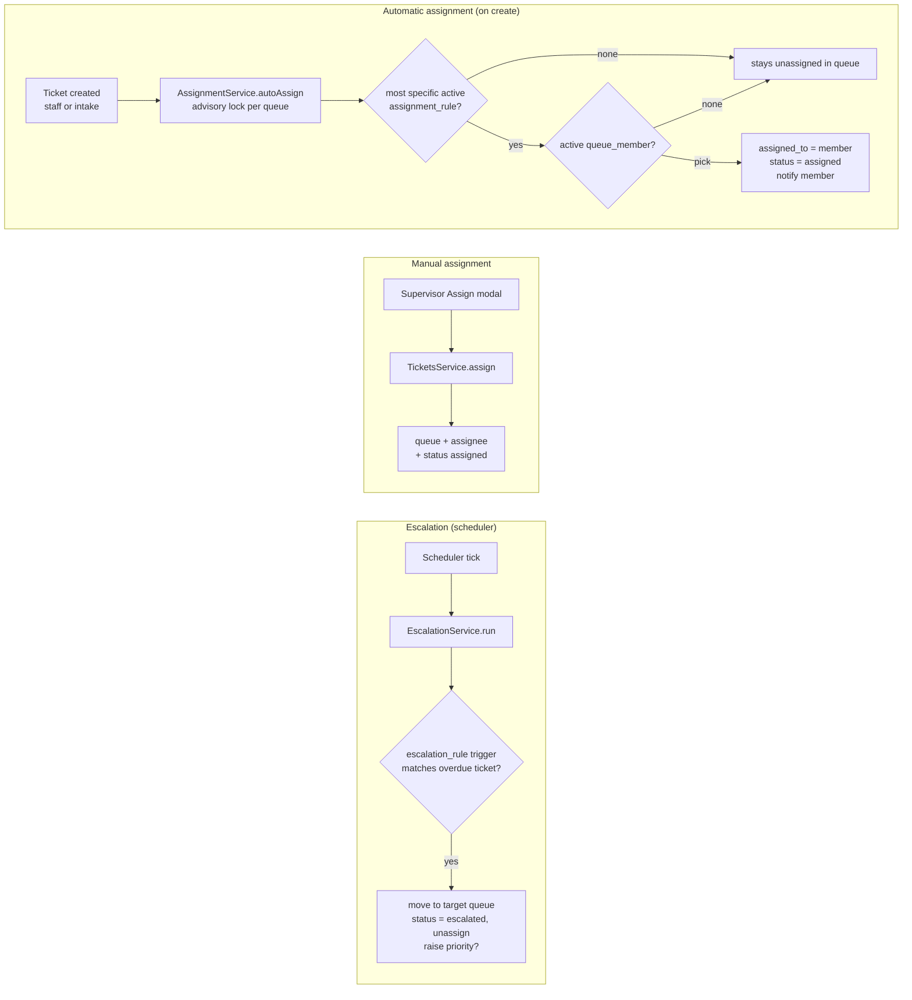

# Assignment and routing

> **Routing**: deciding *which queue* a ticket belongs to and *who* works it.
> **Auto-assignment**: when a ticket is created, a rule picks a person from the queue using a strategy (least loaded or round robin).
> **Escalation**: when a ticket misses a deadline, a rule moves it to another queue (and can raise its priority).
> In plain words: a dispatcher who hands each new case to the least busy person, and a supervisor who pulls overdue cases up to a senior team.

## Picture

## Where it lives

| File | Role |
|---|---|
| [tickets/assignment.service.ts](../../apps/api/src/tickets/assignment.service.ts) | Auto-assignment on create |
| [tickets/tickets.service.ts#L131-L142](../../apps/api/src/tickets/tickets.service.ts#L131-L142) | Manual assignment |
| [workflow/escalation.service.ts](../../apps/api/src/workflow/escalation.service.ts) | Escalation rules |
| [configuration/routing.service.ts](../../apps/api/src/configuration/routing.service.ts) | Admin CRUD: queue members, assignment rules, escalation rules, intake channels |
| [directory/directory.service.ts#L53-L62](../../apps/api/src/directory/directory.service.ts#L53-L62) | `people()` for assignee pickers |
| [ticket/assign-modal.tsx](../../apps/web/src/features/ticket/assign-modal.tsx) | Supervisor assign UI |
| [admin/sections/routing-section.tsx](../../apps/web/src/features/admin/sections/routing-section.tsx) | Members, assignment rules, escalation rules UI |
| Tables | `queue_members`, `assignment_rules`, `escalation_rules`, `ticket_escalations` ([migration …15000](../../apps/api/migrations/1710000015000_routing_and_escalation.cjs)) |

## Read in this order

1. [Auto-assignment](auto-assignment.md): rule specificity, strategies, the per-queue advisory lock.
2. [Manual assignment](manual-assignment.md): the supervisor flow, directory picker, and the known validation gap.
3. [Escalation](escalation.md): triggers, idempotency, re-locking, notifications.
4. [Routing administration](routing-admin.md): how administrators configure members and rules, with scope checks.
5. [Interview Q&A](interview-qa.md)

## Glossary

| Term | Plain meaning |
|---|---|
| **Queue** | A team inbox (`payments`, `fraud`), owned by one legal entity + country |
| **Queue member** | A person (IdP subject) eligible for auto-assignment in a queue, can be active/inactive |
| **Least loaded** | Pick the member with the fewest open tickets in that queue |
| **Round robin** | Pick the member who was assigned longest ago (take turns) |
| **Rule specificity** | A rule for queue + category + priority beats a rule for queue + category, which beats queue only |
| **Advisory lock (per queue)** | A lock named after the queue (`hashtext('assign:payments')`) so two simultaneous creations don't both pick the same "least loaded" person |
| **Escalation trigger** | The condition that fires a rule: first response overdue, resolution breached, or a regulatory state |
| **Idempotent escalation** | A unique `(ticket_id, rule_key)` row means a ticket escalates at most once per rule, whatever the number of ticks or instances |

## 30-second answer

> On creation, `AssignmentService` takes a per-queue advisory lock, picks the most specific active rule for queue, category and priority, and selects an active member: fewest open tickets for least-loaded, oldest last-assignment for round robin. It assigns them and records history, audit, outbox and a notification, all in the creation transaction. Supervisors can reassign manually. Escalation runs on the scheduler: for each active rule it finds overdue candidates, re-locks each ticket, claims a unique ticket-rule row, then moves it to the target queue, unassigns it, optionally raises priority, and notifies the target supervisors and the previous assignee.

## Related

[Tickets](../tickets/README.md) · [SLA](../sla/README.md) · [Workflow scheduler](../workflow/scheduler.md) · [Directory](../directory/README.md) · [Notifications](../notifications/README.md) · [Configuration](../configuration/README.md)
