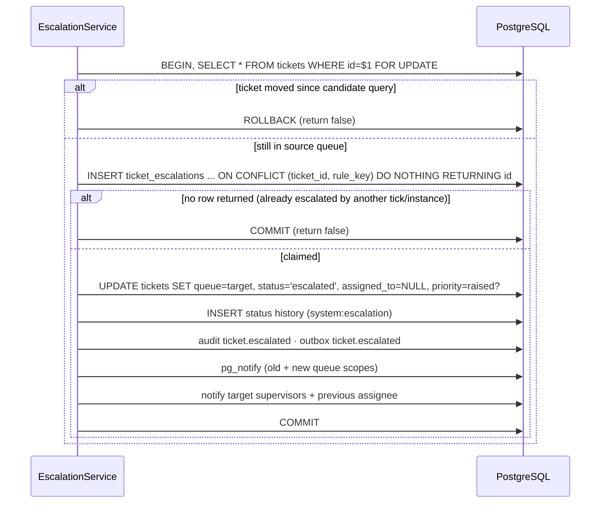

# Escalation

[Back to Assignment index](README.md) · Code: [escalation.service.ts](../../apps/api/src/workflow/escalation.service.ts)

---

## 1. Rules and triggers

`escalation_rules(rule_key, queue_key, trigger, escalate_to_queue, raise_priority, active)` ([migration …15000](../../apps/api/migrations/1710000015000_routing_and_escalation.cjs)).

Triggers map to **fixed SQL fragments in code** ([TRIGGER_SQL, L12-L18](../../apps/api/src/workflow/escalation.service.ts#L12-L18)), never built from configuration text:

| Trigger | Condition (plain) |
|---|---|
| `first_response_overdue` | open, no first response yet, first-response deadline passed |
| `breached` | open, clock not paused, resolution deadline passed |
| `regulatory_ack_overdue` | complaint, regulatory status `ack_overdue` |
| `regulatory_at_risk` | complaint, `at_risk` or `final_response_overdue` |
| `regulatory_breached` | complaint, `final_response_overdue` |

The admin UI currently offers the first two ([routing-section.tsx#L146](../../apps/web/src/features/admin/sections/routing-section.tsx#L146)); the DTO accepts all five ([routing.dto.ts#L18](../../apps/api/src/configuration/routing.dto.ts#L18)).

## 2. The run

[run(), L32-L43](../../apps/api/src/workflow/escalation.service.ts#L32-L43), called every scheduler tick:

```ts
for (const rule of activeRules) {
  const candidates = await db.query(`
    SELECT t.id FROM tickets t, case_queues target
    WHERE t.queue=$1 AND target.queue_key=$2
      AND t.legal_entity=target.legal_entity AND t.country=target.country      -- never escalate across entities
      AND ${TRIGGER_SQL[rule.trigger]}
      AND NOT EXISTS (SELECT 1 FROM ticket_escalations e WHERE e.ticket_id=t.id AND e.rule_key=$3)
    ORDER BY t.created_at LIMIT 100`, [rule.queue_key, rule.escalate_to_queue, rule.rule_key]);
  for (const { id } of candidates.rows) if (await this.escalateOne(id, rule, correlationId)) escalated++;
}
```

## 3. Escalating one ticket (its own transaction)

[escalateOne, L45-L62](../../apps/api/src/workflow/escalation.service.ts#L45-L62):



| Technique | Plain reason |
|---|---|
| Candidate query outside a transaction, then **re-read `FOR UPDATE`** | Between selecting and acting, a person may have resolved or moved the ticket; re-check under lock |
| `ON CONFLICT DO NOTHING RETURNING id` | "Claim" the escalation atomically; a second instance or tick gets zero rows and stops. **At most once per rule** |
| One transaction per ticket | A failure on one ticket doesn't block the others; locks are held briefly |
| `LIMIT 100` per rule | Bounded work per tick |
| Unassign on escalation | The ticket goes to the target team's pool for a fresh owner |
| `PRIORITY_STEP` ([L10](../../apps/api/src/workflow/escalation.service.ts#L10)) | low → normal → high → critical → critical |
| Notifications | Target queue supervisors ("escalated to your queue"); previous assignee ("a ticket you were working was escalated") |

## 4. Admin configuration and scope

[routing.service.ts#L69-L85](../../apps/api/src/configuration/routing.service.ts#L69-L85): a queue can't escalate to itself; **both** queues must exist, be active and be in the administrator's entity and country; an existing rule can only be edited by an admin of the owning entity (`assertRuleOwnedInScope`). The save is audited with the previous row.

## 5. Tests

[workflow.integration-spec.ts#L31](../../apps/api/test/workflow.integration-spec.ts#L31) covers escalation as part of "assigns, escalates, de-duplicates intake...". The run is idempotent: running the tick again doesn't escalate the same ticket twice.

## 6. Interview answer

> Escalation is a scheduled, bounded scan per rule. The trigger conditions are fixed SQL fragments chosen by an enum, so configuration can't inject SQL. Each candidate gets its own transaction: re-lock the ticket and confirm it's still in the source queue, then claim a unique `(ticket_id, rule_key)` row with `ON CONFLICT DO NOTHING`. Only the claimer moves it, unassigns it, optionally raises priority, and writes history, audit, outbox, a live hint and notifications. Repeated ticks or multiple instances can't double-escalate.

Next: [Routing administration](routing-admin.md)
