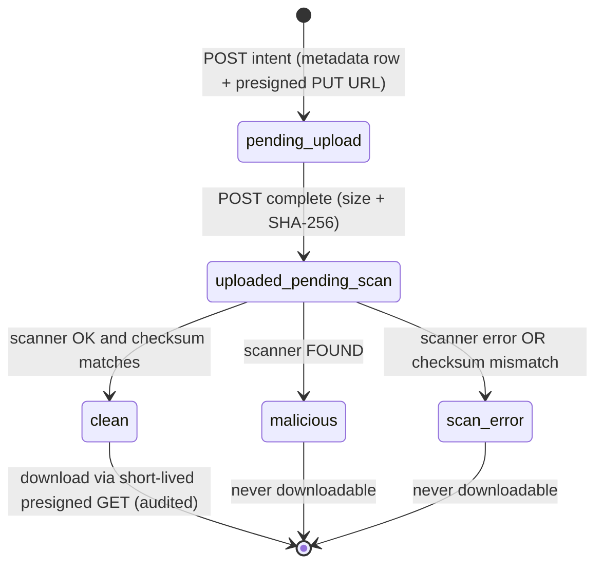

# Attachments: files, scanning and secure upload links

> **Direct-to-storage upload with presigned URLs**: the API never receives file bytes. It authorises the upload, records metadata, and hands the browser a short-lived URL that allows uploading **one specific object** straight to S3-compatible storage.
> **Malware scanning gate**: every file stays unavailable until a scanner (ClamAV) marks it clean, and the scanner re-hashes the stored bytes to make sure they are exactly what the uploader declared.
> **Secure upload link**: a signed, expiring link emailed to a customer without a portal account, allowing them to send a few documents to one request.
> In plain words: the bank gives you a one-time locker key for one locker, checks what you put in it with a scanner, and only then lets staff open it.

## Picture

## Where it lives

| File | Role |
|---|---|
| [tickets/tickets.service.ts#L198-L255](../../apps/api/src/tickets/tickets.service.ts#L198-L255) | Staff: intent, complete, scan result, download |
| [storage/attachment-storage.service.ts](../../apps/api/src/storage/attachment-storage.service.ts) | S3 adapter: presigned PUT/GET, streams, JSON/text, delete |
| [storage/clamav.client.ts](../../apps/api/src/storage/clamav.client.ts) | Minimal clamd INSTREAM client + SHA-256 |
| [tickets/attachment-scan.worker.ts](../../apps/api/src/tickets/attachment-scan.worker.ts) | Background scanner |
| [portal/portal-attachments.service.ts](../../apps/api/src/portal/portal-attachments.service.ts) | Customer uploads (portal + link) via `UploadAuthority` |
| [tickets/upload-link-token.ts](../../apps/api/src/tickets/upload-link-token.ts), [upload-link.service.ts](../../apps/api/src/tickets/upload-link.service.ts) | HMAC tokens; issue/revoke links |
| [uploads/uploads.controller.ts](../../apps/api/src/uploads/uploads.controller.ts), [uploads.service.ts](../../apps/api/src/uploads/uploads.service.ts) | No-login endpoints for link holders |
| [web/.../attachments-tab.tsx](../../apps/web/src/features/ticket/tabs/attachments-tab.tsx), [portal documents.tsx](../../apps/portal/src/components/documents.tsx), [upload-page.tsx](../../apps/portal/src/upload-page.tsx) | UIs |
| Tables | `attachments`, `upload_links` |

## Read in this order

1. [Staff upload flow and storage](staff-upload-flow.md): intent → PUT → complete → download; the storage adapter.
2. [Malware scanning](malware-scanning.md): the worker, clamd INSTREAM, checksum verification.
3. [Customer documents](customer-documents.md): portal uploads with ownership, quotas and rate limits.
4. [Secure upload links](secure-upload-links.md): HMAC capability tokens in the URL fragment.
5. [Frontend](frontend.md): the three UIs and the Web Crypto checksum.
6. [Interview Q&A](interview-qa.md)

## Glossary

| Term | Plain meaning |
|---|---|
| **Object storage (S3-compatible)** | A key → bytes store (AWS S3, MinIO, SeaweedFS). We store only keys in PostgreSQL |
| **Object key** | Server-chosen path `tickets/<ticketId>/attachments/<attachmentId>`, never supplied by the client |
| **Presigned URL** | A URL with a time-limited signature that authorises exactly one operation (PUT or GET) on one key |
| **SHA-256 checksum** | The file's fingerprint; the browser computes it, the scanner recomputes it from stored bytes |
| **ClamAV / clamd** | Open-source antivirus daemon; INSTREAM sends a file over TCP in chunks without writing it to disk |
| **EICAR** | A harmless test string every antivirus flags as a virus, used in tests |
| **Capability token** | A secret that *is* the permission (like a key), as opposed to identity-based access |
| **URL fragment (`#...`)** | The part of a URL after `#`, which browsers never send to servers, so it stays out of server logs |
| **Classification** | `confidential` (default) or `restricted` (supervisors only) |

## 30-second answer

> File bytes never touch the API. The API checks access, creates a metadata row with a server-chosen object key, and returns a short-lived presigned PUT for that one key. The browser uploads directly, then confirms size and SHA-256. A worker streams the stored object through ClamAV over INSTREAM while re-hashing it; a mismatch or any error is never released. Only clean files get a short-lived, audited presigned GET. Customers use the same state machine, with ownership, quotas and rate limits, and callers without an account use HMAC-signed links kept in the URL fragment and sent as a header.

## Related

[Tickets](../tickets/README.md) · [Portal](../portal/README.md) · [Communications (document-request messages)](../communications/creating-and-approving.md) · [Retention (file deletion)](../retention/README.md) · [Observability (scan-age metric)](../observability/README.md)
