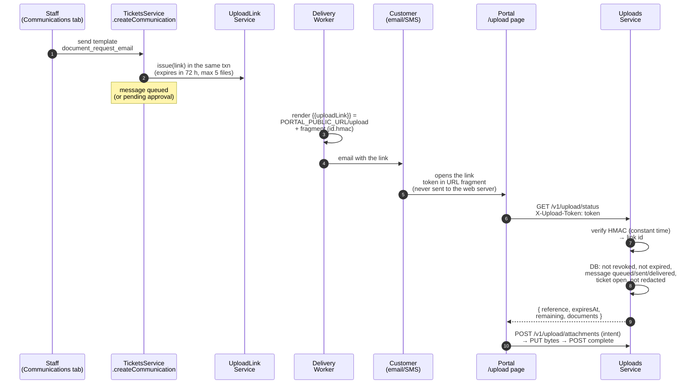

# Secure upload links

A caller who has no portal account (for example someone who phoned the bank) needs to send a document. Staff send a "document request" message containing a **link**. The link is the only credential: it works for one request, for a limited time, for a limited number of files, and only after the message carrying it was approved and queued.

[Back to Attachments index](README.md)

---

## 1. Lifecycle



## 2. The token

[upload-link-token.ts](../../apps/api/src/tickets/upload-link-token.ts):

```ts
const sign = (id) => createHmac('sha256', process.env.UPLOAD_LINK_SECRET!).update(`upload-link:${id}`).digest('base64url');
export const uploadLinkToken = (linkId) => `${linkId}.${sign(linkId)}`;
export const uploadLinkUrl = (linkId) => `${PORTAL_PUBLIC_URL}/upload#${uploadLinkToken(linkId)}`;
export function verifyUploadLinkToken(token) {
  const [id, signature, extra] = token.split('.');
  if (!id || !signature || extra !== undefined || !UUID.test(id)) return null;
  const expected = Buffer.from(sign(id)); const given = Buffer.from(signature);
  return expected.length === given.length && timingSafeEqual(expected, given) ? id : null;
}
```

| Design | Plain reason |
|---|---|
| Token = `linkId.HMAC(secret, "upload-link:"+linkId)` | Only the server can make a valid one; it can't be guessed |
| **Not stored** in the database ([migration comment](../../apps/api/migrations/1710000029000_upload_links.cjs#L2-L4)) | A database leak doesn't reveal usable links; changing the secret invalidates all of them |
| `"upload-link:"` prefix | Domain separation: an HMAC made for another purpose with the same secret can't be reused here |
| `timingSafeEqual` | Comparison time doesn't reveal how many characters matched (timing attack) |
| Strict format (exactly two parts, UUID) | Rejects extended or edited tokens |
| After `#` (fragment) | Browsers never send the fragment to servers, so it never appears in web-server, CDN or proxy logs |
| Sent to the API as the `X-Upload-Token` **header** | Not in a URL path or query, so it isn't in API access logs either |

Tests: [upload-link-token.spec.ts](../../apps/api/test/upload-link-token.spec.ts): accepts genuine ([L6](../../apps/api/test/upload-link-token.spec.ts#L6)); rejects forged, edited, extended, missing ([L7](../../apps/api/test/upload-link-token.spec.ts#L7)); all invalid when the secret changes or is missing ([L11](../../apps/api/test/upload-link-token.spec.ts#L11)); token kept after `#` ([L16](../../apps/api/test/upload-link-token.spec.ts#L16)).

## 3. Issuing and revoking

[upload-link.service.ts](../../apps/api/src/tickets/upload-link.service.ts):

- `assertConfigured()`: needs `UPLOAD_LINK_SECRET` **and** `PORTAL_PUBLIC_URL`, else 503 ([L20-L22](../../apps/api/src/tickets/upload-link.service.ts#L20-L22)).
- `issue()`: insert `upload_links(id, ticket_id, communication_id, expires_at = now + UPLOAD_LINK_TTL_HOURS (72), max_files = UPLOAD_LINK_MAX_FILES (5))`, audit `upload_link.created`, outbox ([L24-L30](../../apps/api/src/tickets/upload-link.service.ts#L24-L30)). It is called **inside** `createCommunication`'s transaction ([tickets.service.ts#L292](../../apps/api/src/tickets/tickets.service.ts#L292)).
- `revoke()`: `DELETE /v1/tickets/:id/upload-links/:linkId` (staff with `ticket:update`); lock, refuse a double revoke, set `revoked_at/by`, audit and outbox ([L32-L39](../../apps/api/src/tickets/upload-link.service.ts#L32-L39)).

## 4. Resolving a token on each request

[UploadsService.resolve, L22-L31](../../apps/api/src/uploads/uploads.service.ts#L22-L31):

```sql
SELECT l.id, l.ticket_id, l.max_files, l.expires_at FROM upload_links l
JOIN ticket_communications c ON c.id = l.communication_id
JOIN tickets t ON t.id = l.ticket_id
WHERE l.id=$1 AND l.revoked_at IS NULL AND l.expires_at > now()
  AND c.status IN ('queued','sent','delivered')            -- message approved and released
  AND t.redacted_at IS NULL AND t.status NOT IN ('closed','cancelled')
```

**Every** failure (forged, expired, revoked, message still pending or rejected, ticket closed, redacted) returns the **same** 404 "This link is not valid or has expired. Please contact the bank." Nobody can use the endpoint to learn what exists.

What a valid link can do: see the request reference, expiry, remaining count and the status of **its own** documents ([status L33-L37](../../apps/api/src/uploads/uploads.service.ts#L33-L37)), and upload. It **cannot** read the ticket, notes or anyone else's documents.

## 5. Endpoints (no guard)

[uploads.controller.ts#L10-L17](../../apps/api/src/uploads/uploads.controller.ts#L10-L17): `GET /v1/upload/status`, `POST /v1/upload/attachments`, `POST /v1/upload/attachments/:attachmentId/complete`, all `no-store`. Because no guard runs, the controller makes its own correlation ID ([L8](../../apps/api/src/uploads/uploads.controller.ts#L8)).

## 6. Delivery-time check

The delivery worker re-checks the link is unrevoked and unexpired when rendering `{{uploadLink}}`; otherwise the message fails with `LINK_UNAVAILABLE` ([delivery.worker.ts#L65-L69](../../apps/api/src/email/delivery.worker.ts#L65-L69)).

## 7. Tests

| Claim | Test |
|---|---|
| Token properties | [upload-link-token.spec.ts](../../apps/api/test/upload-link-token.spec.ts) |
| Staff send a link; a caller with no account uses it (browser) | [e2e/tests/upload-link.spec.ts#L19](../../e2e/tests/upload-link.spec.ts#L19) |

## 8. Interview answer

> Document-request messages carry a capability link: the link ID plus an HMAC of it under a server secret, so it can't be guessed and isn't stored. It lives in the URL fragment, which browsers never send to servers, and the page sends it to the API in a header. Each request verifies the HMAC in constant time, then checks the database: not revoked, not expired, message approved, ticket open. Every failure gives the same 404. A valid link can only upload a bounded number of files to that one request, through the same scanned upload path as everyone else.

Next: [Frontend](frontend.md)
