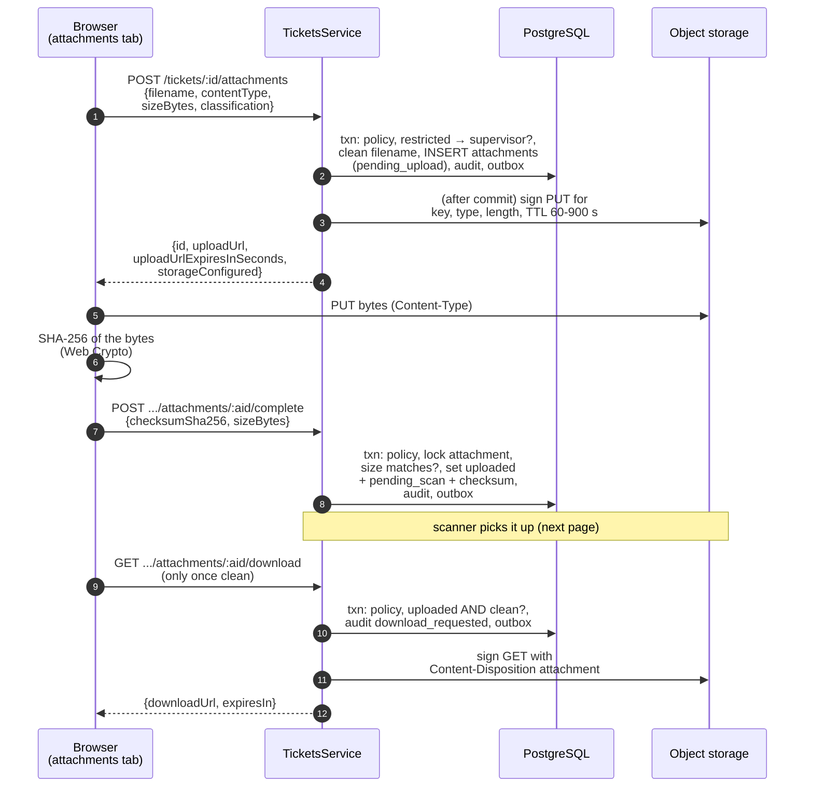

# Staff upload flow and the storage adapter

[Back to Attachments index](README.md)

---

## 1. The three-step upload

### Step 1: intent

[createAttachment, tickets.service.ts#L198-L212](../../apps/api/src/tickets/tickets.service.ts#L198-L212)

| Lines | Rule | Why |
|---|---|---|
| [L200](../../apps/api/src/tickets/tickets.service.ts#L200) | `ticket:update` on the ticket | Only people who can work the case |
| [L201](../../apps/api/src/tickets/tickets.service.ts#L201) | `restricted` needs supervisor | Need-to-know |
| [L202](../../apps/api/src/tickets/tickets.service.ts#L202) | Strip `\ / control chars`, trim, ≤ 255 | `../../etc/passwd` becomes `....etcpasswd`, so there is no path trick in the download filename |
| [L203](../../apps/api/src/tickets/tickets.service.ts#L203) | Key `tickets/<ticketId>/attachments/<uuid>` | Server-chosen; clients can't overwrite other objects |
| DTO [L46-L51](../../apps/api/src/tickets/ticket.dto.ts#L46-L51) | PDF/JPEG/PNG/text, ≤ 25 MiB | Allow-list, not block-list |
| [L208-L210](../../apps/api/src/tickets/tickets.service.ts#L208-L210) | Sign the URL **after** the transaction (`.then`) | Never do network work while holding DB locks |

If storage isn't configured, the response says `storageConfigured: false` and the UI explains "no file bytes were stored". The API **never falls back to local disk**.

### Step 2: complete

[completeAttachment, L214-L225](../../apps/api/src/tickets/tickets.service.ts#L214-L225): lock the row (`FOR UPDATE`), compare the declared size, store the lowercase checksum, set `uploaded` / `pending_scan`.

At this point the checksum is only the **browser's claim**. The scanner independently verifies it against the stored bytes.

### Step 3: download

[downloadAttachment, L242-L255](../../apps/api/src/tickets/tickets.service.ts#L242-L255): `ticket:read` (anyone who can read the ticket); must be `uploaded` **and** `clean`, else 409; audit `attachment.download_requested` **before** returning the URL; sign the GET outside the transaction.

---

## 2. The storage adapter

[attachment-storage.service.ts](../../apps/api/src/storage/attachment-storage.service.ts), a provider-neutral S3 seam (AWS SDK v3):

| Method | Lines | Purpose |
|---|---|---|
| `createUploadUrl(key, type, size)` | [L31-L41](../../apps/api/src/storage/attachment-storage.service.ts#L31-L41) | Presigned `PutObject` with `ContentType`, `ContentLength`, optional SSE |
| `createDownloadUrl(key, type, filename)` | [L43-L53](../../apps/api/src/storage/attachment-storage.service.ts#L43-L53) | Presigned `GetObject` with `ResponseContentDisposition: attachment; filename="..."` (CR/LF/quotes sanitised) |
| `getObjectStream(key)` | [L56-L60](../../apps/api/src/storage/attachment-storage.service.ts#L56-L60) | Server-side stream (scanner) |
| `putJson` / `putText` | [L63-L74](../../apps/api/src/storage/attachment-storage.service.ts#L63-L74) | Audit anchors, scheduled reports |
| `deleteObject` | [L77-L80](../../apps/api/src/storage/attachment-storage.service.ts#L77-L80) | Idempotent (retention) |

Design details worth explaining:

| Detail | Plain reason |
|---|---|
| Two clients: internal `client` and `signingClient` ([L15-L18](../../apps/api/src/storage/attachment-storage.service.ts#L15-L18)) | Inside Docker or Kubernetes the API reaches storage at `http://seaweedfs:8333`, but the browser must use `https://files.bank.example`. A presigned URL is only valid for the host it was signed for |
| TTL bounded to 60-900 s ([L98-L101](../../apps/api/src/storage/attachment-storage.service.ts#L98-L101)) | Short exposure if a URL leaks; a misconfiguration can't create day-long URLs |
| `requestChecksumCalculation: 'WHEN_REQUIRED'` ([L91-L93](../../apps/api/src/storage/attachment-storage.service.ts#L91-L93)) | The SDK's default CRC32 would be baked into the presigned URL for an empty body, and the real upload would fail with BadDigest. Integrity is checked by the scanner's SHA-256 instead |
| SSE only if configured ([L104-L107](../../apps/api/src/storage/attachment-storage.service.ts#L104-L107)) | Prefer bucket-default encryption (portable); allow `aws:kms` when the bank requires it |
| `ResponseContentDisposition: attachment` | The browser downloads rather than renders, so a malicious HTML/SVG can't run in our origin |
| Dev-only bucket creation with versioning ([L21-L29](../../apps/api/src/storage/attachment-storage.service.ts#L21-L29)) | Production buckets are provisioned by the bank |

`StorageModule` is `@Global` ([storage.module.ts](../../apps/api/src/storage/storage.module.ts)), so tickets, portal, audit anchors, retention and reports all share it.

## 3. Tests

| Claim | Test |
|---|---|
| No local-disk fallback; bounded presigned URLs | [attachment-storage.service.spec.ts#L15-L35](../../apps/api/test/attachment-storage.service.spec.ts#L15) |
| Filename cleaned; download blocked until scan; only the scanner may scan; clean → URL | [ticket.integration-spec.ts#L43](../../apps/api/test/ticket.integration-spec.ts#L43) |
| Real storage + ClamAV: clean released, EICAR blocked, checksum mismatch refused | [storage.integration-spec.ts#L40](../../apps/api/test/storage.integration-spec.ts#L40) (`STORAGE_TEST=1`) |

Next: [Malware scanning](malware-scanning.md)
