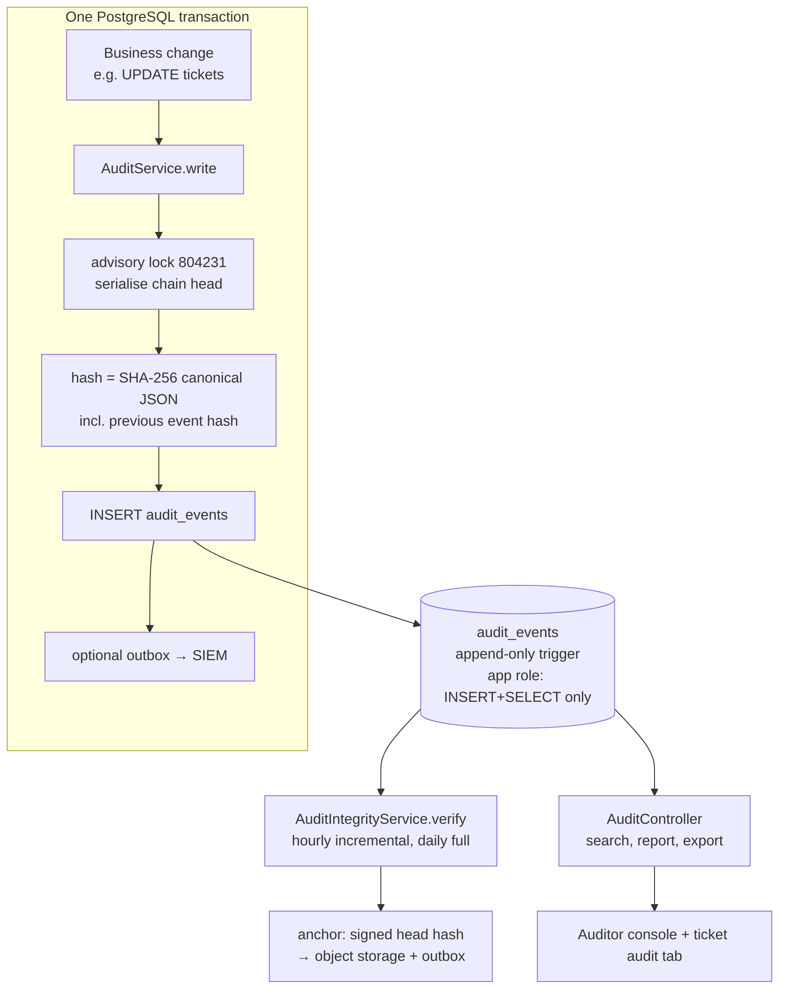

# Audit: tamper-evident evidence

> **Audit trail**: an append-only record of who did what, to which thing, when, under which request, and with what outcome.
> **Tamper-evident**: if anyone later changes, deletes or reorders a record, verification will notice.
> In plain words: a bank ledger written in pen, where every page carries a fingerprint of the page before, and a photocopy of the latest page is locked in a different building every day.

This folder covers everything about audit: how an event is written inside the business transaction, how the SHA-256 hash chain works, how the database stops the app from rewriting history, how verification and signed anchors detect tampering, how auditors search and export evidence, and how archiving keeps the chain verifiable.

## The whole thing in one picture

## Where it lives in the code

| Layer | File | What it does |
|---|---|---|
| Event writer | [apps/api/src/audit/audit.service.ts](../../apps/api/src/audit/audit.service.ts) | Appends a hashed event using the caller's transaction |
| Canonical hash | [apps/api/src/audit/audit-hash.ts](../../apps/api/src/audit/audit-hash.ts) | Stable JSON + SHA-256 (hash version 2) |
| Request context | [apps/api/src/audit/request-context.ts](../../apps/api/src/audit/request-context.ts) | `AsyncLocalStorage` carrying IP, user agent, token ID, ACR |
| Denied actions | [apps/api/src/audit/denied-authorization.interceptor.ts](../../apps/api/src/audit/denied-authorization.interceptor.ts) | Records every 403 in its own transaction |
| Integrity | [apps/api/src/audit/audit-integrity.service.ts](../../apps/api/src/audit/audit-integrity.service.ts) | Verifies links, recomputes hashes, checks anchors, publishes anchors |
| Anchor signing | [apps/api/src/audit/anchor-signer.ts](../../apps/api/src/audit/anchor-signer.ts) | Ed25519 signatures over the chain head |
| Archive | [apps/api/src/audit/audit-archive.ts](../../apps/api/src/audit/audit-archive.ts) + [scripts/archive-audit.mjs](../../apps/api/scripts/archive-audit.mjs) | Owner-only export + prune that keeps verification working |
| Audit API | [apps/api/src/audit/audit.controller.ts](../../apps/api/src/audit/audit.controller.ts) | Chain status, verify, anchors, scoped search, ticket report, export |
| DB protections | [migrations/…audit_immutability](../../apps/api/migrations/1710000010000_audit_immutability.cjs), [truncate guard](../../apps/api/migrations/1710000023000_audit_truncate_guard.cjs), [infra/postgres/roles.sql](../../infra/postgres/roles.sql) | Triggers + least-privilege runtime role |
| Startup role check | [apps/api/src/database/database-guard.service.ts](../../apps/api/src/database/database-guard.service.ts) | Refuses to run as an account that could rewrite audit |
| Scheduler | [apps/api/src/workflow/workflow-scheduler.ts#L48-L53](../../apps/api/src/workflow/workflow-scheduler.ts#L48-L53) | Hourly verify, daily anchor |
| Frontend | [audit-page.tsx](../../apps/web/src/features/audit/audit-page.tsx), [audit-tab.tsx](../../apps/web/src/features/ticket/tabs/audit-tab.tsx) | Integrity status, search, per-ticket trail, export |

## Read in this order

| # | Document | What you will be able to explain |
|---|---|---|
| 1 | [Concepts and glossary](concepts.md) | Hash, hash chain, canonical JSON, advisory lock, anchor, Ed25519, WORM, SIEM... |
| 2 | [Event model and write path](event-model.md) | Exactly what one event contains and how it is written atomically with the business change |
| 3 | [Integrity, verification and anchors](integrity-and-anchors.md) | The verification algorithm, why anchors catch tail deletion, signing, archiving |
| 4 | [Database protection](database-protection.md) | Triggers, owner vs runtime roles, the startup privilege check, the reporting role |
| 5 | [Audit API and reports](audit-api-and-reports.md) | Scoped cross-ticket search, ticket report, step-up export, the self-auditing of audit |
| 6 | [Frontend](frontend.md) | Auditor console, ticket audit tab, export, verify buttons |
| 7 | [Testing](testing.md) | How tests tamper with the chain on purpose and prove it is caught |
| 8 | [Interview Q&A](interview-qa.md) | 30-second / 2-minute / code-level answers, follow-ups, limitations |

## The 30-second interview answer

> Every material change calls `AuditService.write` with the **same transaction client** as the business update, so the change and its evidence commit or roll back together. The writer takes a PostgreSQL advisory lock, reads the previous event's hash, and stores a SHA-256 over canonical JSON of the event (including its timestamp and the previous hash), which forms a hash chain. The database refuses UPDATE, DELETE and TRUNCATE through triggers, and the app runs as a role that can only INSERT and SELECT. A scheduled verifier recomputes every hash. A daily, optionally Ed25519-signed anchor of the chain head is published outside the database, which is what catches someone deleting the newest events. Auditors search within their scope, and every search, view and export is itself audited.

## Related topics

- [Auth](../auth/README.md): where `actorId`, ACR and step-up come from; denied 403s.
- [Outbox](../outbox/README.md): optional SIEM stream and anchor events use the outbox.
- [Database](../database/README.md): `PgService.transaction`, locking primitives, runtime-role safety.
- [Observability](../observability/README.md): `audit_chain_valid` and `audit_runtime_role_safe` metrics.
- [Retention](../retention/README.md): why de-identification never touches the audit trail.
- [Operations runbooks](../operations/runbooks.md): what to do when verification fails.
