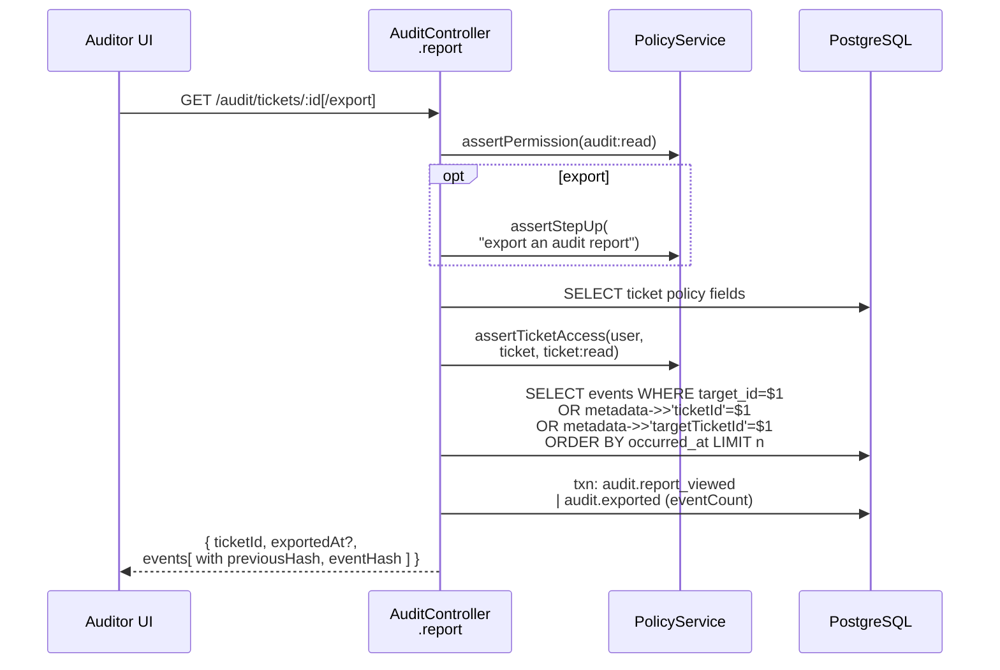

# Audit API: search, ticket report, export

How auditors read evidence safely: scoped cross-ticket search, the per-ticket report, step-up export, and the rule that **reading the audit trail is itself audited**.

[Back to Audit index](README.md) · Code: [audit.controller.ts](../../apps/api/src/audit/audit.controller.ts)

---

## 1. Routes

All routes use `@UseGuards(AuthGuard)` ([L10-L11](../../apps/api/src/audit/audit.controller.ts#L10-L11)) and then `assertPermission(user, 'audit:read')`. Only the **auditor** role has it.

| Route | Purpose | Extra rule | Writes audit | Lines |
|---|---|---|---|---|
| `GET /v1/audit/chain-status` | Last verification + last anchor | | n/a | [L16-L17](../../apps/api/src/audit/audit.controller.ts#L16-L17) |
| `POST /v1/audit/verify?full=true` | Run verification now | | `audit.verification_run` | [L20-L26](../../apps/api/src/audit/audit.controller.ts#L20-L26) |
| `GET /v1/audit/anchors` | Published anchors | | n/a | [L28-L29](../../apps/api/src/audit/audit.controller.ts#L28-L29) |
| `GET /v1/audit/events` | Cross-ticket scoped search | DTO-validated filters | `audit.searched` | [L35-L51](../../apps/api/src/audit/audit.controller.ts#L35-L51) |
| `GET /v1/audit/tickets/:ticketId` | One ticket's trail, oldest first | ticket read policy | `audit.report_viewed` | [L53-L56](../../apps/api/src/audit/audit.controller.ts#L53-L56) |
| `GET /v1/audit/tickets/:ticketId/export` | Same, as an export | + **step-up** | `audit.exported` | [L58-L61](../../apps/api/src/audit/audit.controller.ts#L58-L61) |

---

## 2. Search filters (DTO)

[audit-search.dto.ts#L4-L14](../../apps/api/src/audit/audit-search.dto.ts#L4-L14):

| Filter | Validation | Meaning |
|---|---|---|
| `actor` | string, 1-160 | Exact actor ID |
| `action` | string, 1-100 | **Prefix**, e.g. `ticket.` or `ticket.status_changed` |
| `outcome` | `success` \| `denied` | |
| `from`, `to` | ISO 8601 | Time range (`to` exclusive) |
| `limit` | int 1-200 (default 50) | Page size |
| `before` | int ≥ 1 | Cursor: events with a lower `sequence` |

The global `ValidationPipe` (`whitelist`, `forbidNonWhitelisted`, `transform`) rejects unknown query parameters and converts numbers.

---

## 3. The scoped search query

[audit.controller.ts#L39-L47](../../apps/api/src/audit/audit.controller.ts#L39-L47):

```sql
SELECT e.* FROM audit_events e
LEFT JOIN tickets t ON t.id::text = CASE WHEN e.target_type='ticket' THEN e.target_id ELSE e.metadata->>'ticketId' END
WHERE ((t.id IS NOT NULL AND t.legal_entity=$1 AND t.country=$2 AND t.queue = ANY($3::text[])
        AND (t.sensitivity <> 'restricted' OR $4::boolean))
       OR (e.target_type='ticket_list' AND e.target_id = $12))
  AND ($5 IS NULL OR e.actor_id = $5)
  AND ($6 IS NULL OR e.action LIKE $6 ESCAPE '\')
  AND ($7 IS NULL OR e.outcome = $7)
  AND ($8 IS NULL OR e.occurred_at >= $8) AND ($9 IS NULL OR e.occurred_at < $9)
  AND ($10 IS NULL OR e.sequence < $10)
ORDER BY e.sequence DESC LIMIT $11
```

What each piece means:

| Piece | Plain meaning |
|---|---|
| `LEFT JOIN tickets ... CASE` | Find the ticket an event is about, either directly (`target_type='ticket'`) or through `metadata.ticketId` (attachments, approvals, communications) |
| entity + country + queue | An auditor sees only evidence about tickets **in their scope**, the same rule as ticket access |
| `sensitivity <> 'restricted' OR $4` | `$4` is always `true` here: auditors may read restricted evidence (deliberate) |
| `ticket_list` + `${entity}:${country}` | List and search events are kept per entity/country, so auditors see "who browsed lists" in their jurisdiction only |
| `($5::text IS NULL OR ...)` | The "optional filter" idiom: one prepared query, any combination of filters |
| `LIKE $6 ESCAPE '\'` | Prefix search with `%`, `_` and `\` escaped ([L47](../../apps/api/src/audit/audit.controller.ts#L47)) |
| `sequence < $10` + `ORDER BY sequence DESC` | Keyset pagination, newest first |

Response: `{ events, nextBefore }`. `nextBefore` is the lowest sequence on the page if the page was full, else `null` ([L50](../../apps/api/src/audit/audit.controller.ts#L50)).

Events not tied to a ticket (configuration changes, `audit.*`) are not returned by this search. They are visible to the platform team through the database, SIEM or reporting. A future "configuration audit" view would need its own scope rule.

---

## 4. Audit of the audit

[L48](../../apps/api/src/audit/audit.controller.ts#L48): after the query, a separate transaction writes:

```ts
{ action: 'audit.searched', targetType: 'audit_chain', targetId: 'search',
  metadata: { resultCount, filteredByActor: Boolean(query.actor), filteredByAction: Boolean(query.action) } }
```

It records **that** a search happened and **which kinds** of filter were used, not the filter values or results. Who watches the watchers? The audit trail does.

---

## 5. Per-ticket report and export

[report()](../../apps/api/src/audit/audit.controller.ts#L63-L72):



- `limit` is parsed and clamped to 1-500 (default 100) ([L68](../../apps/api/src/audit/audit.controller.ts#L68)).
- Each event carries `previousHash` and `eventHash`, so an auditor can see the chain links.
- The export JSON is saved by the browser ([api.ts#L270-L273](../../apps/web/src/api.ts#L270-L273)). The file is evidence; its handling after download is a bank procedure.

**Note:** if the ticket ID does not exist, the report returns `{ events: [] }` ([L66](../../apps/api/src/audit/audit.controller.ts#L66)); if it exists but is out of scope, policy returns 403. That difference reveals existence to an auditor. It is low risk for this role, but worth knowing.

---

## 6. Failure map

| Condition | Result |
|---|---|
| No or invalid token | 401 before anything |
| Not an auditor | 403 (and `authorization.denied` is audited) |
| Bad filter / limit / date | 400 from the DTO pipe |
| Ticket outside scope | 403 |
| Export without recent or strong login | 403 `step_up_required` → banner |
| Query ok but the "audit of search" write fails | The request fails: evidence-of-access is required |

## 7. Interview answer

> Audit routes are guarded and need `audit:read`, which only auditors have. Cross-ticket search joins each event to its ticket, directly or through metadata, and filters by the auditor's entity, country and queues in SQL, with escaped prefix matching and keyset pagination. The per-ticket report applies the normal ticket-read policy, and export also needs step-up. Every search, view, export and verification run writes its own audit event, recording that access happened without copying the results.

Next: [Frontend](frontend.md)
