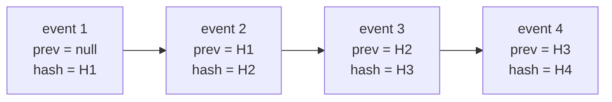

# Audit concepts and glossary

Technical term → plain meaning → analogy (where helpful) → where it is in our code.

[Back to Audit index](README.md)

---

## 1. Evidence vs logging

### Audit event vs application log
**Technical:** An audit event is a structured, durable, integrity-protected record of a business-relevant action. An application log is operational diagnostics (errors, timings), often sampled, rotated or deleted.
**Plain:** Logs answer "why is the server slow?". Audit answers "who approved this payment complaint, and can you prove it?".
**In our code:** audit rows go to `audit_events` via [audit.service.ts](../../apps/api/src/audit/audit.service.ts); logs go to stdout via Nest's `Logger`.

### Actor, action, target, outcome
| Field | Plain meaning | Example |
|---|---|---|
| `actor_id` | Who did it: the stable IdP `sub`, or a `system:*` robot | `dd8a043a-...`, `system:sla-timer` |
| `action` | What, as a dotted verb | `ticket.status_changed` |
| `target_type` / `target_id` | To what | `ticket` / `4f1c...` |
| `outcome` | `success` or `denied` | `denied` for a 403 |
| `correlation_id` | Which request or click | the browser's `X-Correlation-Id` |
| `metadata` | Small facts needed to understand it | `{ fromStatus, toStatus }` |

### Data minimisation
**Plain:** Put the *fact* in the audit trail, not the *content*. An immutable trail that copies customer free text becomes a second copy of personal data that can never be deleted.
**In our code:** description edits are recorded as lengths plus SHA-256 fingerprints, not text ([tickets.service.ts#L372-L379](../../apps/api/src/tickets/tickets.service.ts#L372-L379)); communication-block reasons stay in audit but never go to outbox events ([compliance.service.ts#L84](../../apps/api/src/compliance/compliance.service.ts#L84)).

---

## 2. Hashing

### Cryptographic hash (SHA-256)
**Technical:** A one-way function that maps any input to a fixed 256-bit digest. Changing one bit of input changes the output unpredictably, and finding two inputs with the same digest is computationally infeasible.
**Plain:** A fingerprint of data. Same data, same fingerprint; any change, a completely different fingerprint.
**In our code:** `createHash('sha256')` in [audit-hash.ts#L19](../../apps/api/src/audit/audit-hash.ts#L19).

### Canonical (stable) JSON
**Technical:** A deterministic serialisation in which object keys are sorted recursively and `undefined` values are dropped, so logically equal objects produce byte-identical strings.
**Plain:** `{a:1,b:2}` and `{b:2,a:1}` mean the same thing, but `JSON.stringify` may produce different text. If the text differs, the hash differs, and verification would falsely report tampering. Sorting the keys fixes that.
**In our code:** `stableStringify` ([audit-hash.ts#L4-L9](../../apps/api/src/audit/audit-hash.ts#L4-L9)).

### Hash chain
**Technical:** Each record stores `previous_hash` (the previous record's `event_hash`), and its own `event_hash` covers that value. This is a linked list in which each link commits to all history before it.
**Plain:** Each page of the ledger has a fingerprint that includes the fingerprint of the previous page. Change page 50 and the fingerprints of pages 51, 52, ... no longer line up.
**Analogy:** the same idea as blockchain blocks or Git commits, without the distributed consensus.

### Hash version (v1 vs v2)
**Plain:** Early events (v1) did not include the timestamp in the hash, and their metadata key order cannot be reproduced, so they can only be link-checked. Version 2 hashes every stored field, including `occurred_at` and `id`, so it can be fully recomputed.
**In our code:** column `hash_version` ([migration 1710000021000](../../apps/api/migrations/1710000021000_audit_integrity.cjs#L3-L5)); new writes always use 2 ([audit.service.ts#L25](../../apps/api/src/audit/audit.service.ts#L25)).

### What a hash chain does NOT prove
- It does not prove the original event was **true**. It proves the record has not changed since it was written.
- On its own, it cannot detect deletion of the **newest** events: the remaining shorter chain is still internally consistent. That is why we need **anchors**.

---

## 3. Concurrency

### Advisory lock (`pg_advisory_xact_lock`)
**Technical:** An application-defined lock identified by a number. The `_xact_` variant is held until the surrounding transaction commits or rolls back.
**Plain:** A "talking stick". Only the transaction holding stick #804231 may read the latest hash and append the next event. Without it, two concurrent requests could both read H3 as "previous" and fork the chain.
**In our code:** [audit.service.ts#L16](../../apps/api/src/audit/audit.service.ts#L16). The scheduler uses a different number (`804232`) with the *try* variant.
**Trade-off:** all audited writes serialise on this one lock for a short moment, which caps write throughput. It is the price of a single linear chain (see [interview-qa.md](interview-qa.md#4-honest-limitations)).

### Sequence (`bigserial`)
**Plain:** A database-generated, ever-increasing number giving the chain its order. Verification walks by `sequence`.

---

## 4. Immutability

### Append-only table
**Technical:** A table that permits INSERT and SELECT but rejects UPDATE, DELETE and TRUNCATE.
**In our code:** two triggers call `deny_audit_mutation()`: a row-level `BEFORE UPDATE OR DELETE` trigger ([migration …10000](../../apps/api/migrations/1710000010000_audit_immutability.cjs#L3-L8)) and a statement-level `BEFORE TRUNCATE` trigger ([migration …23000](../../apps/api/migrations/1710000023000_audit_truncate_guard.cjs#L4)). TRUNCATE needs its own trigger because it bypasses row triggers.

### Least privilege / owner vs runtime role
**Technical:** PostgreSQL lets a table's **owner** disable its triggers. So the app must **not** run as the owner.
**Plain:** The person who can switch off the alarm must not be the person who works in the vault every day.
**In our code:** `case_owner` runs migrations; `case_app` runs the API with UPDATE/DELETE/TRUNCATE revoked on audit tables ([roles.sql#L34-L40](../../infra/postgres/roles.sql#L34-L40)).

### Defence in depth
**Plain:** No single control is trusted alone. Triggers stop accidents, roles stop the app, hashes detect anything that got past both, and external anchors detect a database administrator who controls everything inside the database.

---

## 5. Anchoring and signing

### Anchor
**Technical:** A copy of `(sequence, head_hash)` at a point in time, stored outside the database (object storage, the bank's event bus or SIEM).
**Plain:** A photocopy of today's last ledger page, kept in another building. If someone tears out the last ten pages, the photocopy no longer matches.
**In our code:** `anchor()` ([audit-integrity.service.ts#L81-L95](../../apps/api/src/audit/audit-integrity.service.ts#L81-L95)).

### Digital signature (Ed25519)
**Technical:** An elliptic-curve signature scheme. The holder of the private key signs a message, and anyone with the public key can verify it.
**Plain:** A wax seal only our platform can make. Auditors can check the seal without being able to forge it.
**In our code:** [anchor-signer.ts](../../apps/api/src/audit/anchor-signer.ts). Message format `audit-anchor:v1:<sequence>:<headHash>:<signedAt>` ([L9](../../apps/api/src/audit/anchor-signer.ts#L9)). Keys come from `scripts/generate-anchor-keys.mjs`.

### KMS / HSM
**Plain:** A Key Management Service or Hardware Security Module keeps private keys inside tamper-resistant hardware and signs on request. The code comment says to replace `anchor-signer.ts` with a KMS call for production ([L4-L6](../../apps/api/src/audit/anchor-signer.ts#L4-L6)).

### WORM / Object Lock
**Plain:** "Write once, read many" storage: once written, an object cannot be changed or deleted until its retention period ends, even by an administrator. Anchor objects should go to a bucket with S3 Object Lock ([audit-integrity.service.ts#L77-L79](../../apps/api/src/audit/audit-integrity.service.ts#L77-L79)).

### SIEM
**Plain:** Security Information and Event Management (Splunk, Sentinel, QRadar): the bank's central security log analysis. With `AUDIT_STREAM_ENABLED=true`, every audit event is also sent there through the outbox ([audit.service.ts#L27-L29](../../apps/api/src/audit/audit.service.ts#L27-L29)).

---

## 6. Archiving

### Chain base
**Plain:** When old events are moved out of the live table, we record "the chain now starts after sequence N, whose hash was X". Verification then links the remaining events to X instead of reporting the missing start as tampering.
**In our code:** table `audit_chain_bases` ([migration …24000](../../apps/api/migrations/1710000024000_audit_archive_and_signing.cjs#L8-L17)); written by [audit-archive.ts#L49](../../apps/api/src/audit/audit-archive.ts#L49).

### Manifest
**Plain:** A small JSON file next to the archive saying how many events it holds, up to which sequence, the last hash, and the SHA-256 of the archive file itself, so the archive can be proven complete later.

---

## 7. Request context

### AsyncLocalStorage (ALS)
**Technical:** A Node.js API that keeps a value available throughout one asynchronous call chain without passing it as a parameter.
**Plain:** A backpack the request carries. Anything deep in the code can look inside and see "this request came from IP x, browser y, token z", without every function having an extra argument.
**In our code:** created per request in a Fastify `onRequest` hook ([request-context.ts#L18-L23](../../apps/api/src/audit/request-context.ts#L18-L23)), enriched by the guard ([auth.guard.ts#L66-L71](../../apps/api/src/auth/auth.guard.ts#L66-L71)), read by the writer ([audit.service.ts#L21-L22](../../apps/api/src/audit/audit.service.ts#L21-L22)).

### Correlation ID
**Plain:** One random ID per click, stored on every audit event, outbox event and log line it produced, so an investigator can reconstruct "everything that happened because of that one request".

---

## 8. Search

### Keyset (cursor) pagination
**Technical:** Instead of `OFFSET 10000`, ask for `WHERE sequence < :lastSeen ORDER BY sequence DESC LIMIT 50`.
**Plain:** "Give me the 50 events before the last one I saw." It is fast at any depth and stable while new events arrive.
**In our code:** `before` cursor in [audit-search.dto.ts#L13](../../apps/api/src/audit/audit-search.dto.ts#L13) and [audit.controller.ts#L45-L50](../../apps/api/src/audit/audit.controller.ts#L45-L50).

### LIKE escaping
**Plain:** In SQL `LIKE`, `%` and `_` are wildcards. If a user searches for `ticket_`, the underscore would match any character. We escape them so the search is a literal prefix ([audit.controller.ts#L47](../../apps/api/src/audit/audit.controller.ts#L47)).
