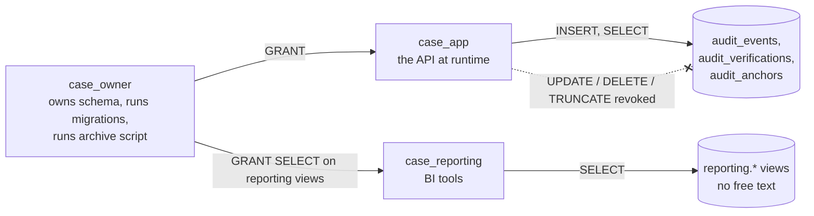

# Database protection for the audit trail

A hash chain *detects* tampering. These controls *prevent* it in the first place: triggers, least-privilege roles, a startup self-check, and a separate reporting account.

[Back to Audit index](README.md) · Terms: [concepts](concepts.md)

---

## 1. Triggers

**Row trigger**, [migration 1710000010000_audit_immutability.cjs#L3-L8](../../apps/api/migrations/1710000010000_audit_immutability.cjs#L3-L8):

```sql
CREATE OR REPLACE FUNCTION deny_audit_mutation() RETURNS trigger LANGUAGE plpgsql AS $$
  BEGIN RAISE EXCEPTION 'audit_events is append-only'; END; $$;
CREATE TRIGGER audit_events_append_only BEFORE UPDATE OR DELETE ON audit_events FOR EACH ROW EXECUTE FUNCTION deny_audit_mutation();
```

**Statement trigger**, [migration 1710000023000_audit_truncate_guard.cjs#L4](../../apps/api/migrations/1710000023000_audit_truncate_guard.cjs#L4):

```sql
CREATE TRIGGER audit_events_no_truncate BEFORE TRUNCATE ON audit_events FOR EACH STATEMENT EXECUTE FUNCTION deny_audit_mutation();
```

**Why two?** `TRUNCATE` empties a table without firing row-level triggers. Plain words: the row trigger guards each page, and the truncate trigger guards against throwing away the whole book.

**Limitation:** a table **owner** (or superuser) can `ALTER TABLE ... DISABLE TRIGGER`. Triggers alone stop accidents and the app, not a determined owner. That is why layer 2 exists, and why anchors exist for the owner case.

---

## 2. Owner vs runtime vs reporting roles

[infra/postgres/roles.sql](../../infra/postgres/roles.sql) creates three accounts:



| Account | Can | Cannot | Lines |
|---|---|---|---|
| `case_owner` | Own tables, run migrations, disable triggers (inside the archive transaction only) | n/a | [L10-L13](../../infra/postgres/roles.sql#L10-L13), [L19-L26](../../infra/postgres/roles.sql#L19-L26) |
| `case_app` | SELECT/INSERT/UPDATE/DELETE on case tables; **INSERT + SELECT only** on audit tables | Update, delete or truncate audit; disable triggers; drop tables | [L28-L40](../../infra/postgres/roles.sql#L28-L40) |
| `case_reporting` | SELECT on `reporting.*` views | Read `tickets`, notes or audit directly | [L44-L51](../../infra/postgres/roles.sql#L44-L51) |

`ALTER DEFAULT PRIVILEGES` ([L31-L32](../../infra/postgres/roles.sql#L31-L32)) ensures that tables created by future migrations get the same grants automatically.

How to apply:

```bash
OWNER_PASSWORD=... APP_PASSWORD=... REPORTING_PASSWORD=... envsubst < infra/postgres/roles.sql | psql -d case_platform -v ON_ERROR_STOP=1
# migrations run as case_owner; the API's DATABASE_URL uses case_app
```

The reporting views ([migration 1710000025000_paging_and_reporting.cjs#L8-L15](../../apps/api/migrations/1710000025000_paging_and_reporting.cjs#L8-L15)) expose classifications, dates, outcomes and opaque IDs only: no subject, description, notes, references or free-text reasons.

---

## 3. The app checks its own privileges at startup

[database-guard.service.ts#L7-L15](../../apps/api/src/database/database-guard.service.ts#L7-L15) asks PostgreSQL itself:

```sql
SELECT current_user AS role,
  has_table_privilege(current_user,'audit_events','UPDATE')   AS can_update,
  has_table_privilege(current_user,'audit_events','DELETE')   AS can_delete,
  has_table_privilege(current_user,'audit_events','TRUNCATE') AS can_truncate,
  (SELECT rolsuper FROM pg_roles WHERE rolname=current_user)  AS superuser,
  (SELECT pg_get_userbyid(relowner)=current_user FROM pg_class WHERE oid = to_regclass('public.audit_events')) AS owner
```

`onModuleInit` ([L27-L34](../../apps/api/src/database/database-guard.service.ts#L27-L34)):
- safe → logs "Runtime database role ... cannot alter the audit trail";
- unsafe and `AUDIT_REQUIRE_RESTRICTED_DB_ROLE=true` → **throws, so the app does not start**;
- unsafe otherwise → warning (local development).

The result feeds the `audit_runtime_role_safe` gauge ([metrics.service.ts#L51](../../apps/api/src/metrics/metrics.service.ts#L51)). Production safety also refuses to start unless the flag is `true` ([production-safety.ts#L18](../../apps/api/src/production-safety.ts#L18)).

**Plain:** the application checks "am I accidentally holding the master key?" and refuses to work if it is.

---

## 4. Proven by a real-database test

[roles.integration-spec.ts](../../apps/api/test/roles.integration-spec.ts) (run with `ROLES_TEST=1` and a superuser URL) creates a throwaway database, applies `roles.sql`, runs migrations as the owner, then connects as the app account:

| Test | Asserts | Line |
|---|---|---|
| App can add and read but not change | INSERT ok; UPDATE, DELETE, TRUNCATE → `permission denied`; DISABLE TRIGGER, DROP → `must be owner`; UPDATE anchors denied | [L25-L34](../../apps/api/test/roles.integration-spec.ts#L25-L34) |
| App still does its normal work | SELECT tickets, UPDATE case_queues ok | [L36-L39](../../apps/api/test/roles.integration-spec.ts#L36-L39) |
| Self-check is accurate | app → safe; owner → unsafe, "owns the audit table" | [L41-L44](../../apps/api/test/roles.integration-spec.ts#L41-L44) |
| Reporting account sees views only | `reporting.tickets` ok; `tickets`, `ticket_notes`, `audit_events` denied; no `subject`/`description` columns | [L46-L56](../../apps/api/test/roles.integration-spec.ts#L46-L56) |
| Truncate guard holds even for the owner | owner TRUNCATE → `append-only` | [L58-L60](../../apps/api/test/roles.integration-spec.ts#L58-L60) |

---

## 5. What a determined superuser could still do, and how it is caught

| Attack by someone with superuser | Prevented? | Detected by |
|---|---|---|
| Edit an old event | No | Full verification (hash mismatch) |
| Delete a middle event | No | Verification (link broken) |
| Delete the newest events | No | Anchor mismatch |
| Rewrite the whole chain consistently from some point | No | Anchor mismatch (external copy disagrees) + signature check |
| Rewrite anchors in the DB too | No | Copies in Object-Lock storage and the SIEM/bus don't match; signatures need the private key |

**Plain:** nothing inside one database can stop its own superuser. The defence is to keep evidence copies and keys **outside** the reach of that superuser: separate storage credentials, Object Lock, the SIEM, and the private key in a vault or HSM.

Next: [Audit API and reports](audit-api-and-reports.md)
