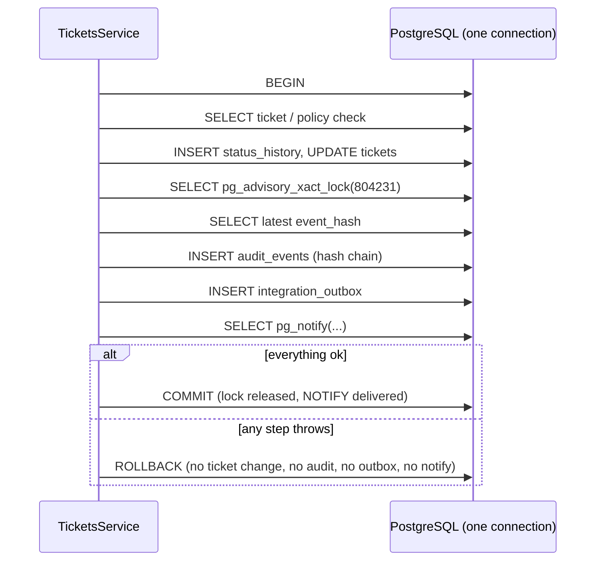

# Audit event model and write path

What exactly is stored, how it is written atomically with the business change, and how denied actions are recorded.

[Back to Audit index](README.md) · Terms: [concepts](concepts.md)

---

## 1. The table

Created in [migration 1710000000000_initial.cjs#L9-L10](../../apps/api/migrations/1710000000000_initial.cjs#L9-L10), extended by [1710000021000_audit_integrity.cjs](../../apps/api/migrations/1710000021000_audit_integrity.cjs#L5-L8).

| Column | Type | Meaning |
|---|---|---|
| `sequence` | `bigserial` PK | Order of the chain |
| `id` | `uuid` unique | Event identity (also hashed) |
| `occurred_at` | `timestamptz` | When (hashed since v2) |
| `actor_id` | `varchar(160)` | IdP subject or `system:*` / `customer:*` / `intake:*` |
| `action` | `varchar(100)` | Dotted verb, e.g. `ticket.status_changed` |
| `target_type`, `target_id` | `varchar` | What it was done to |
| `correlation_id` | `varchar(128)` | Request trace ID |
| `outcome` | `varchar(20)` | `success` / `denied` |
| `metadata` | `jsonb` | Minimised facts + request context (`ctx_ip`, `ctx_ua`, `ctx_jti`, `ctx_acr`) |
| `previous_hash` | `varchar(64)` | Previous event's hash (null for the genesis event) |
| `event_hash` | `varchar(64)` | SHA-256 of this event's canonical form |
| `hash_version` | `smallint` | 1 = legacy link-only, 2 = fully recomputable |

Indexes support the auditor search: `(target_type, target_id, occurred_at)`, `(actor_id, sequence)`, `(action, sequence)`, `(occurred_at)`.

---

## 2. The input type

[audit.service.ts#L8](../../apps/api/src/audit/audit.service.ts#L8):

```ts
export interface AuditInput {
  actorId: string; action: string; targetType: string; targetId: string; correlationId: string;
  outcome: 'success' | 'denied';
  metadata?: Record<string, string | number | boolean | null>;
}
```

Metadata values are **flat primitives only**. That is a type-level nudge towards minimisation: you can't accidentally drop a whole ticket object in.

---

## 3. `write()`, line by line

[audit.service.ts#L14-L30](../../apps/api/src/audit/audit.service.ts#L14-L30)

```ts
async write(client: PoolClient, input: AuditInput): Promise<void> {
  await client.query('SELECT pg_advisory_xact_lock($1)', [804231]);                         // (1)
  const previous = await client.query('SELECT event_hash FROM audit_events ORDER BY sequence DESC LIMIT 1'); // (2)
  const previousHash = previous.rows[0]?.event_hash ?? null;
  const id = randomUUID(); const occurredAt = new Date();                                      // (3)
  const context = requestContext.getStore();                                                    // (4)
  const metadata = JSON.parse(JSON.stringify({ ...(input.metadata ?? {}),
    ...(context?.ip ? { ctx_ip: context.ip } : {}), ...(context?.userAgent ? { ctx_ua: context.userAgent } : {}),
    ...(context?.tokenId ? { ctx_jti: context.tokenId } : {}), ...(context?.acr ? { ctx_acr: context.acr } : {}) }));
  const eventHash = computeEventHashV2({ id, occurredAt, ...input, metadata, previousHash });  // (5)
  await client.query(`INSERT INTO audit_events (...) VALUES ($1..$11, 2)`, [...]);            // (6)
  if (process.env.AUDIT_STREAM_ENABLED === 'true') await this.outbox.enqueue(client, {...});   // (7)
}
```

| Step | What | Why |
|---|---|---|
| (1) | Advisory lock `804231`, held until COMMIT | Serialise "read head → append" so two transactions can't both link to the same previous hash |
| (2) | Read the latest `event_hash` | The new event commits to it |
| (3) | Generate `id` and time in the app | Both are hashed, so they must be known before INSERT |
| (4) | Merge request context from ALS | Every event records IP, user agent, token `jti` and `acr` without changing 40 call sites |
| (4) | `JSON.parse(JSON.stringify(...))` | **Normalise exactly as PostgreSQL will store it**, so a later recomputation from the row matches (undefined dropped, Dates turned into strings) |
| (5) | `computeEventHashV2` | Canonical JSON → SHA-256 ([audit-hash.ts#L17-L20](../../apps/api/src/audit/audit-hash.ts#L17-L20)) |
| (6) | INSERT with `hash_version = 2` | |
| (7) | Optional SIEM stream via outbox, **same client** | The SIEM copy exists if and only if the event does. Metadata is excluded unless `AUDIT_STREAM_INCLUDE_METADATA=true` |

### What is hashed

[audit-hash.ts#L17-L20](../../apps/api/src/audit/audit-hash.ts#L17-L20):

```ts
stableStringify({ v: 2, id, occurredAt: occurredAt.toISOString(), actorId, action, targetType, targetId, correlationId, outcome, metadata, previousHash })
```

Every stored field except `sequence` and `hash_version` is covered, including the timestamp and the previous hash.

---

## 4. The transaction boundary

The writer takes a `PoolClient`, not the pool. **That single design choice is what makes audit atomic.** A service passes the client of its open transaction:

[tickets.service.ts#L168-L196](../../apps/api/src/tickets/tickets.service.ts#L168-L196) (status change, abbreviated):

```ts
return this.db.transaction(async (client) => {
  const ticket = await this.ticket(client, ticketId);
  this.policy.assertTicketAccess(user, ticket, 'ticket:update');
  ...
  const updated = await client.query('UPDATE tickets SET status=... RETURNING *', [...]);
  await this.audit.write(client, { actorId: user.subject, action: 'ticket.status_changed', targetType: 'ticket',
    targetId: ticketId, correlationId, outcome: 'success', metadata: { fromStatus: ticket.status, toStatus: dto.toStatus } });
  await this.outbox.enqueue(client, { eventType: 'ticket.status_changed', ... });
  await this.live.notify(client, 'ticket.status_changed', updated.rows[0]);
  ...
});
```



**Guarantee:** there is no committed business change without its audit event, and no audit event for a change that did not happen. [`PgService.transaction`](../../apps/api/src/database/pg.service.ts#L16-L21) does BEGIN / COMMIT / ROLLBACK / release.

---

## 5. Denied actions

A 403 means the business transaction rolled back, so there is nothing to join. [denied-authorization.interceptor.ts#L10-L23](../../apps/api/src/audit/denied-authorization.interceptor.ts#L10-L23):

```ts
return next.handle().pipe(catchError((error) => {
  const status = typeof error?.getStatus === 'function' ? error.getStatus() : 500;
  const request = context.switchToHttp().getRequest<FastifyRequest>();
  if (status === 403 && request.user && request.correlationId) {
    const ticketId = request.params?.ticketId ?? 'not-applicable';
    return from(this.db.transaction((client) => this.audit.write(client, {
      actorId: request.user!.subject, action: 'authorization.denied', targetType: 'ticket', targetId: ticketId,
      correlationId: request.correlationId!, outcome: 'denied', metadata: { path: request.url.slice(0, 160) } })))
      .pipe(mergeMap(() => throwError(() => error)), catchError(() => throwError(() => error)));
  }
  return throwError(() => error);
}));
```

| Detail | Plain reason |
|---|---|
| Registered globally as `APP_INTERCEPTOR` ([app.module.ts#L27](../../apps/api/src/app.module.ts#L27)) | No controller can forget it |
| Only when `request.user` exists | A 403 has a known actor; a 401 does not |
| **New** transaction | The failed business transaction is gone |
| Path truncated to 160 characters, no body | Minimised evidence |
| Inner `catchError` rethrows the **original** 403 | If the audit write fails, the client still gets the correct 403, never a confusing 500 |
| Not a 401 | Unauthenticated noise belongs in edge logs |

**Trade-off:** success evidence is strict (audit failure fails the operation). Denial evidence is best effort (audit failure does not change the 403). Both choices are deliberate.

---

## 6. Before-values for configuration changes

[audit.service.ts#L36-L41](../../apps/api/src/audit/audit.service.ts#L36-L41):

```ts
async previous(client, table, where, values): Promise<string> {
  const row = (await client.query(`SELECT * FROM ${table} WHERE ${where}`, values)).rows[0];
  if (!row) return 'none';
  delete row.updated_at; delete row.updated_by;
  return JSON.stringify(row).slice(0, 1500);
}
```

Configuration services call it before an upsert and store the result as `metadata.previous`, e.g. [configuration.service.ts#L63](../../apps/api/src/configuration/configuration.service.ts#L63). An auditor can then see "SLA for *normal* changed from 400/2000 to 480/2880 minutes, by X". `table` and `where` are fixed code strings, never user input (the comment says so), so the string interpolation is safe.

---

## 7. Minimisation in practice

| Change | What audit stores | What it deliberately does not store |
|---|---|---|
| Description edit | `descriptionChanged`, old/new length, old/new SHA-256 ([L374](../../apps/api/src/tickets/tickets.service.ts#L374)) | The text |
| Custom fields edit | Names of changed keys ([L375-L377](../../apps/api/src/tickets/tickets.service.ts#L375-L377)) | Values |
| Note added | `visibility` | Body |
| Reference reveal | `count` | The revealed values |
| Search | result count, first 50 IDs, `hadSearchTerm` ([L65](../../apps/api/src/tickets/tickets.service.ts#L65)) | The search term |
| Retention change | hold flag, date, `hasHoldReason`, previous values ([L113](../../apps/api/src/tickets/tickets.service.ts#L113)) | Hold reason text |
| Communication block | `blocked`, `reason` (audit only) | Reason never in outbox |
| Subject-access export | released / withheld counts ([compliance.service.ts#L129](../../apps/api/src/compliance/compliance.service.ts#L129)) | Customer reference (`targetId: 'redacted'`) |

The test [workflow.integration-spec.ts#L247](../../apps/api/test/workflow.integration-spec.ts#L247) asserts the edit metadata contains lengths and never the rewritten text.

---

## 8. Action catalogue

| Area | Actions |
|---|---|
| Tickets | `ticket.created`, `ticket.viewed`, `ticket.list_viewed`, `ticket.search_performed`, `ticket.updated`, `ticket.assigned`, `ticket.auto_assigned`, `ticket.status_changed`, `ticket.note_added`, `ticket.relationship_created`, `ticket.reference_revealed`, `ticket.retention_control_updated`, `ticket.escalated`, `ticket.customer_replied`, `ticket.redacted` |
| SLA / regulatory (system) | `ticket.sla_<status>`, `ticket.regulatory_<status>`, `ticket.regulatory_clock_started` |
| Compliance | `ticket.complaint_classified`, `ticket.afca_updated`, `ticket.communication_block_changed`, `privacy.subject_access_exported`, `report.complaints_register`, `report.exported_scheduled` |
| Attachments / links | `attachment.upload_intent_created`, `attachment.upload_completed`, `attachment.scan_completed`, `attachment.download_requested`, `upload_link.created`, `upload_link.revoked` |
| Communications / approvals | `customer_communication.queued`, `.approval_requested`, `.rejected`, `.delivery_receipt_recorded`, `.resolution_notice_skipped`, `approval.requested`, `approval.approved`, `approval.rejected` |
| Configuration | `configuration.queue_updated`, `.category_updated`, `.sla_policy_updated`, `.communication_template_updated`, `.workflow_updated`, `.queue_member_updated`, `.assignment_rule_updated`, `.escalation_rule_updated`, `.intake_channel_updated`, `.regulatory_profile_updated`, `.business_hours_updated`, `.holiday_updated` |
| Audit itself | `audit.searched`, `audit.report_viewed`, `audit.exported`, `audit.verification_run`, `audit.anchor_created` |
| Operations / integration / dashboard | `outbox.replayed`, `integration.receipt_recorded`, `dashboard.viewed`, `dashboard.trends_viewed` |
| Security | `authorization.denied` |

Next: [Integrity, verification and anchors](integrity-and-anchors.md)
