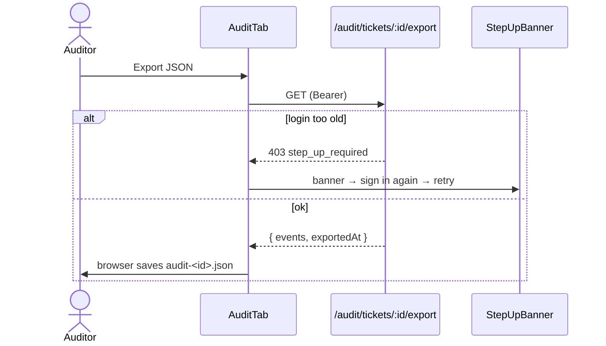

# Audit frontend

The auditor console (`/audit`) and the per-ticket **Audit trail** tab. The frontend only *displays* evidence and *asks the server* to verify. It never builds audit truth in the browser.

[Back to Audit index](README.md)

---

## 1. Files

| File | What it renders |
|---|---|
| [features/audit/audit-page.tsx](../../apps/web/src/features/audit/audit-page.tsx) | Left: chain integrity + verify buttons. Right: scoped search with a detail drawer |
| [features/ticket/tabs/audit-tab.tsx](../../apps/web/src/features/ticket/tabs/audit-tab.tsx) | One ticket's trail as a timeline with short hashes, Refresh and Export JSON |
| [api.ts#L262-L281](../../apps/web/src/api.ts#L262-L281) | Typed calls: `getAuditTrail`, `exportAuditTrail`, `getChainStatus`, `verifyChain`, `searchAudit` |
| [lib/query-keys.ts#L16-L21](../../apps/web/src/lib/query-keys.ts#L16-L21) | `ticketAudit(id)`, `chainStatus`, `auditSearch(filters)` |
| [components/person-name.tsx](../../apps/web/src/components/person-name.tsx) | Shows names for actor IDs, while keeping the ID visible in tooltips |

Who sees them: route `/audit` requires the `viewAudit` capability ([app.tsx#L49](../../apps/web/src/app.tsx#L49)); the tab appears only when `can('viewAudit')` ([ticket-page.tsx#L73](../../apps/web/src/features/ticket/ticket-page.tsx#L73)). That's presentation; the API enforces `audit:read`.

---

## 2. Chain integrity panel

[audit-page.tsx#L37-L75](../../apps/web/src/features/audit/audit-page.tsx#L37-L75):

```ts
const status = useQuery({ queryKey: queryKeys.chainStatus, queryFn: () => getChainStatus(user) });
const verify = useMutation({
  mutationFn: (full: boolean) => verifyChain(user, full),
  onSuccess: () => queryClient.invalidateQueries({ queryKey: queryKeys.chainStatus })
});
```

| UI element | Behaviour |
|---|---|
| Green shield "Chain verified" / red "INTEGRITY FAILURE" | From `verification.status` |
| Red alert "Broken at event N... Escalate to security immediately and do not modify the database" | Shown when invalid ([L61-L63](../../apps/web/src/features/audit/audit-page.tsx#L61-L63)) |
| "N events checked; M older events were link-checked only" | Legacy v1 events explained |
| Last published anchor with a short head hash | From `lastAnchor` |
| **Verify new events** / **Full re-verification** | Mutation with `full=false/true`; both buttons are disabled while one is running, so there are no duplicate runs |

---

## 3. Search

[audit-page.tsx#L77-L165](../../apps/web/src/features/audit/audit-page.tsx#L77-L165):

```ts
const [submitted, setSubmitted] = useState<AuditFilters | null>(null);   // nothing runs until "Search"
const results = useInfiniteQuery({
  queryKey: queryKeys.auditSearch(submitted ?? {}),
  queryFn: ({ pageParam }) => searchAudit(user, { ...submitted, before: pageParam }),
  initialPageParam: undefined as number | undefined,
  getNextPageParam: (last) => last.nextBefore ?? undefined,   // keyset cursor from the API
  enabled: submitted !== null, staleTime: 0
});
```

| Design decision | Plain reason |
|---|---|
| Query runs only after **Search** | Every search is audited server-side, so don't fire one on every keystroke |
| Filters are part of the **query key** | Different filters give separate cache entries; old pages never mix with new ones |
| `useInfiniteQuery` + `nextBefore` | "Load older events" follows the server's keyset cursor |
| `staleTime: 0` | Evidence should be fresh when re-opened |
| `datetime-local` → `toISOString()` ([L98](../../apps/web/src/features/audit/audit-page.tsx#L98)) | The browser gives local time; the API wants ISO |
| Row click opens a **Drawer** with metadata JSON + full hash | Metadata is rendered as text in `<Code>`, never as HTML |
| Actor shows name **and** exact ID ([L152](../../apps/web/src/features/audit/audit-page.tsx#L152)) | "The ID is what the evidence records" |

---

## 4. Ticket audit tab

[audit-tab.tsx#L19-L49](../../apps/web/src/features/ticket/tabs/audit-tab.tsx#L19-L49):

- `useQuery(queryKeys.ticketAudit(id), staleTime: 0)`.
- Each timeline item shows the action, the outcome badge (red for `denied`), the actor and the time, plus `hash abc123… ← def456…` so the chain link is visible.
- **Export JSON** calls the dedicated export endpoint (step-up + audited). It does **not** serialise what is on screen.
- After any ticket change, `refreshTicket` invalidates `ticketAudit(id)` ([ticket-cache.ts#L62](../../apps/web/src/features/tickets/ticket-cache.ts#L62)), so the trail updates live.



---

## 5. Names vs IDs

[person-name.tsx#L47-L53](../../apps/web/src/components/person-name.tsx#L47-L53) maps machine actors to labels ("Automatic (sla-timer)", "Customer (portal)"). Human IDs are resolved in batches through `/directory/lookup`. The stored `actor_id` never changes. If a person is renamed, history still points to the same subject. See [directory](../directory/README.md).

## 6. Interview answer

> The audit UI never filters or verifies in the browser. Search sends bounded filters to a server-scoped endpoint, and the filters are the React Query key, with keyset pagination from `nextBefore`. Search only runs on submit, because every search is audited. Verify buttons call a server command and then refresh chain status. Export calls the dedicated, step-up-protected endpoint instead of dumping the screen. Names are display sugar over immutable actor IDs.

Next: [Testing](testing.md)
