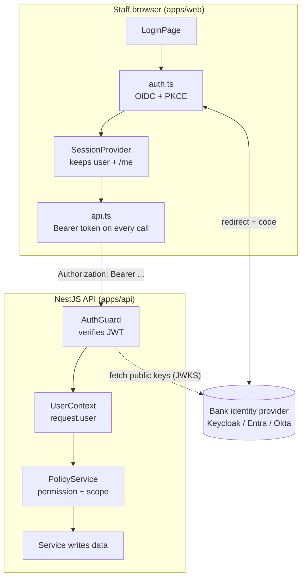

# Auth: authentication and authorization

> **Authentication (AuthN)** proves *who* is calling. **Authorization (AuthZ)** decides *what that caller may do to this specific thing*.
> In plain words: authentication is showing your ID card at the bank door; authorization is the guard checking whether that ID lets you into the vault room.

This folder covers everything about identity and access in the platform: how staff sign in, how the API verifies every request, how roles and organisational scope become a yes/no decision, step-up (re-login for sensitive actions), maker-checker, and how the browser keeps its session. The customer portal has its own identity provider. Its guard is explained here, and the rest of the portal is in [../portal/](../portal/README.md).

## The whole thing in one picture

## Where it lives in the code

| Layer | File | What it does |
|---|---|---|
| Browser sign-in | [apps/web/src/auth.ts](../../apps/web/src/auth.ts) | OIDC Authorization Code + PKCE, safe return path, step-up re-login |
| Browser session | [apps/web/src/session/session-provider.tsx](../../apps/web/src/session/session-provider.tsx) | Finishes the redirect, loads `/me`, reacts to token renewal, expiry and step-up |
| Browser capabilities | [apps/web/src/session/roles.ts](../../apps/web/src/session/roles.ts) | Maps roles to buttons/screens (presentation only) |
| Browser API calls | [apps/web/src/api.ts#L66-L83](../../apps/web/src/api.ts#L66-L83) | Adds `Authorization: Bearer` + correlation ID, handles 401 and step-up |
| Staff guard | [apps/api/src/auth/auth.guard.ts](../../apps/api/src/auth/auth.guard.ts) | Verifies the access token and builds `UserContext` |
| Token hardening | [apps/api/src/auth/token-checks.ts](../../apps/api/src/auth/token-checks.ts) | Allowed clients, revocation (introspection), live entitlements, step-up |
| Identity shape | [apps/api/src/auth/user-context.ts](../../apps/api/src/auth/user-context.ts) | The only identity object services trust |
| Authorization | [apps/api/src/auth/policy.service.ts](../../apps/api/src/auth/policy.service.ts) | Role → permission map, ticket scope rules, maker-checker, step-up |
| `/me` endpoint | [apps/api/src/auth/profile.controller.ts](../../apps/api/src/auth/profile.controller.ts) | Returns the normalised identity and refreshes the staff directory |
| Customer guard | [apps/api/src/portal/portal-auth.guard.ts](../../apps/api/src/portal/portal-auth.guard.ts) | Separate issuer/audience for customers |
| Startup safety | [apps/api/src/production-safety.ts](../../apps/api/src/production-safety.ts) | Refuses to boot in production with development identity settings |
| Denied-access evidence | [apps/api/src/audit/denied-authorization.interceptor.ts](../../apps/api/src/audit/denied-authorization.interceptor.ts) | Writes every 403 to the audit trail |

## Read in this order

| # | Document | What you will be able to explain afterwards |
|---|---|---|
| 1 | [Concepts and glossary](concepts.md) | Every term used here (OIDC, JWT, JWKS, PKCE, `aud`, `azp`, ACR, RBAC, ABAC...) in plain words |
| 2 | [Login flow, end to end](login-flow.md) | The full journey from "Sign in" button to a verified API request, with a sequence diagram |
| 3 | [Frontend session](frontend-session.md) | How the React app finishes the redirect, stores tokens, renews them and handles 401/step-up |
| 4 | [Backend guard walkthrough](backend-guard.md) | `AuthGuard.canActivate` line by line, plus the separate customer guard |
| 5 | [Token hardening](token-hardening.md) | Allowed clients, revocation, central entitlements, step-up, production safety |
| 6 | [Authorization policy](authorization-policy.md) | `PolicyService`: permission matrix, scope rules, sensitivity, maker-checker |
| 7 | [Roles and access matrix](roles-and-access.md) | Who can do what, role by role, action by action |
| 8 | [`/me` and the profile](profile-and-me.md) | Why `/me` exists and why it is not used as proof |
| 9 | [Testing](testing.md) | How the tests prove the guard, the hardening and the policy |
| 10 | [Interview Q&A](interview-qa.md) | 30-second, 2-minute and code-level answers, follow-ups and honest limitations |

## The 30-second interview answer

> The staff console uses OpenID Connect Authorization Code with PKCE, so it never handles a password. It keeps the token in tab-scoped sessionStorage and sends it only as a Bearer header. On the API, a NestJS `AuthGuard` verifies the JWT signature against the identity provider's JWKS with an asymmetric algorithm allow-list, checks issuer, audience and expiry, can also check revocation and live entitlements, and turns the allow-listed claims into a typed `UserContext`. Authorization happens later in `PolicyService`, which combines a role-to-permission map with the ticket's legal entity, country, queue, branch, ownership and sensitivity. Sensitive actions add step-up and maker-checker. The frontend's role checks only hide buttons; the API decides everything.

## Related topics

- [Audit](../audit/README.md): every 403 and every sensitive action is written to the tamper-evident trail.
- [Portal](../portal/README.md): the customer identity boundary and ownership rules.
- [Attachments → secure upload links](../attachments/secure-upload-links.md): a capability token used instead of a login.
- [API bootstrap](../api-bootstrap/README.md): where the guard sits in the request pipeline.
- [Directory](../directory/README.md): turning subject IDs into names (never used for access).
- [Learn NestJS → Guards](../learn-nestjs/04-guards/README.md): the framework mechanics behind `CanActivate`.
