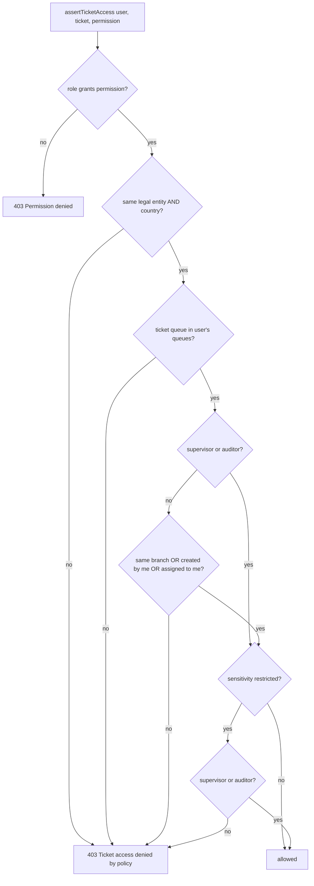
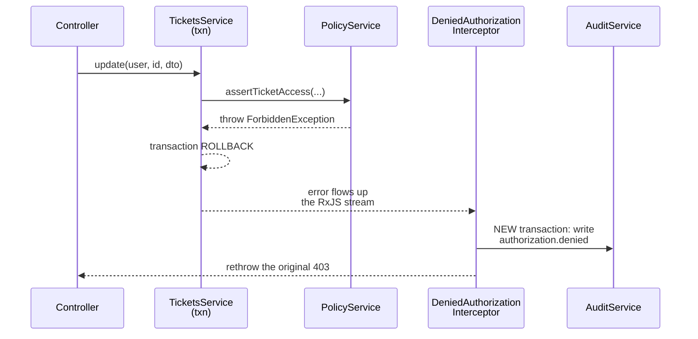

# Authorization policy (`PolicyService`)

Authentication produced a trusted `UserContext`. Authorization answers: **may this identity do this action to this resource, right now?** The answer lives in one small file: [apps/api/src/auth/policy.service.ts](../../apps/api/src/auth/policy.service.ts).

[Back to Auth index](README.md) · Terms used here: [concepts](concepts.md) · Full matrix: [roles-and-access.md](roles-and-access.md)

---

## 1. The idea in one sentence

**RBAC decides the verb, ABAC decides the row.** The role says *what kind* of action you may take (`ticket:update`). The ticket's attributes say *which* tickets you may take it on (same entity and country, your queue, your branch or yours, not restricted unless you're senior).



---

## 2. Permissions are a closed list

[policy.service.ts#L5](../../apps/api/src/auth/policy.service.ts#L5):

```ts
export type Permission = 'ticket:create' | 'ticket:read' | 'ticket:update' | 'ticket:assign' | 'ticket:approve'
  | 'ticket:reveal' | 'ticket:hold' | 'sla:reconcile' | 'attachment:scan' | 'integration:reconcile'
  | 'communication:deliver' | 'intake:create' | 'audit:read' | 'dashboard:read' | 'configuration:write';
```

A TypeScript **union type** means a typo like `'ticket:udpate'` fails to compile. Plain words: there is a fixed menu of permissions, and code can only ask for items on the menu.

## 3. Role → permission map

[policy.service.ts#L8-L13](../../apps/api/src/auth/policy.service.ts#L8-L13)

| Role | Permissions | In plain words |
|---|---|---|
| `branch-agent`, `call-center-agent` | create, read | Log the issue and follow it |
| `case-agent` | create, read, update | Do the work |
| `supervisor` | create, read, update, **assign, approve, reveal, hold**, sla:reconcile, dashboard:read | Run the queue and make the sensitive decisions |
| `auditor` | read, **audit:read**, dashboard:read | Look at everything in scope, change nothing |
| `administrator` | **configuration:write**, sla:reconcile | Configure the system, **no case access** |
| `attachment-scanner` | attachment:scan | Robot: record scan results |
| `integration-reconciler` | integration:reconcile | Robot: confirm downstream receipt |
| `notification-provider` | communication:deliver | Robot: report delivery status |
| `intake-gateway` | intake:create | Robot: create tickets from channels |

`has()` ([L17](../../apps/api/src/auth/policy.service.ts#L17)) returns true if **any** of the user's roles grants it. Roles are additive for permissions, but scope still applies.

**Administrators deliberately have no `ticket:read`.** Separation of duties: the person who sets the rules does not handle customer data. The test [security.policy.spec.ts#L23](../../apps/api/test/security.policy.spec.ts#L23) proves it.

---

## 4. The five public methods

| Method | Line | Use it when... |
|---|---|---|
| `has(user, perm)` | [L17](../../apps/api/src/auth/policy.service.ts#L17) | You need a boolean (e.g. "may see either list") |
| `assertPermission(user, perm)` | [L18](../../apps/api/src/auth/policy.service.ts#L18) | No specific resource (search, dashboard, configuration) |
| `assertTicketAccess(user, ticket, perm)` | [L22-L32](../../apps/api/src/auth/policy.service.ts#L22-L32) | Acting on one ticket |
| `assertStepUp(user, action)` | [L20](../../apps/api/src/auth/policy.service.ts#L20) | Sensitive action (delegates to [token-checks.ts](token-hardening.md#4-step-up-authentication)) |
| `assertMakerChecker(requestedBy, approver)` | [L21](../../apps/api/src/auth/policy.service.ts#L21) | Approving something someone requested |

### `assertTicketAccess` line by line

```ts
assertTicketAccess(user, ticket, permission) {
  this.assertPermission(user, permission);                                              // 1. verb allowed?
  const sameEntity = user.legalEntity === ticket.legal_entity && user.country === ticket.country; // 2. tenant wall
  const queueAllowed = user.queues.includes(ticket.queue);                               // 3. operational population
  const branchAllowed = user.branch === ticket.branch_code;
  const ownsCase = ticket.created_by === user.subject || ticket.assigned_to === user.subject;
  const scopeAllowed = user.roles.includes('auditor') || user.roles.includes('supervisor')
    ? queueAllowed                                                                       // seniors: queue-wide
    : queueAllowed && (branchAllowed || ownsCase);                                       // agents: + branch or own
  const sensitivityAllowed = ticket.sensitivity !== 'restricted'
    || user.roles.includes('supervisor') || user.roles.includes('auditor');              // 4. need-to-know
  if (!sameEntity || !scopeAllowed || !sensitivityAllowed) throw new ForbiddenException('Ticket access denied by policy');
}
```

The resource shape it needs is small and explicit ([L6](../../apps/api/src/auth/policy.service.ts#L6)):

```ts
interface TicketPolicySubject { queue; branch_code; department; legal_entity; country; sensitivity; created_by; assigned_to; }
```

That same shape is reused by the live-event fan-out to decide who may receive an SSE hint ([live-events.service.ts#L124-L126](../../apps/api/src/live/live-events.service.ts#L124-L126)). **One policy, applied identically to REST and push.**

### Worked examples

| User | Ticket | Permission | Result | Which check |
|---|---|---|---|---|
| case-agent, BLR-01, queues [payments], IN | payments, BLR-01, IN, standard | update | ✅ | all pass |
| case-agent, BLR-01, [payments] | payments, **MUM-02**, created by someone else | update | ❌ | branch/ownership |
| case-agent, BLR-01, [payments] | payments, MUM-02, **assigned to me** | update | ✅ | ownership rescues it |
| case-agent | **restricted** ticket in my branch | read | ❌ | sensitivity |
| auditor, [payments] | restricted payments ticket | read | ✅ | auditors may read restricted |
| auditor | any ticket | **update** | ❌ | role lacks `ticket:update` |
| supervisor, country IN | ticket in country **AU** | read | ❌ | entity/country wall |
| administrator | any ticket | read | ❌ | no `ticket:read` at all |

These are the cases in [security.policy.spec.ts](../../apps/api/test/security.policy.spec.ts#L8-L30).

---

## 5. Where the check is called (and why there)

The rule: **the service loads the current row, then checks policy, then writes**, all inside the same transaction. Example: [tickets.service.ts#L120-L129](../../apps/api/src/tickets/tickets.service.ts#L120-L129):

```ts
return this.db.transaction(async (client) => {
  const ticket = await this.ticket(client, ticketId);
  this.policy.assertTicketAccess(user, ticket, 'ticket:update');
  this.assertFresh(ticket, dto.expectedUpdatedAt);
  ...
});
```

**Why not in the controller or a decorator?** Queue, branch, owner and sensitivity are properties of the *row*. You cannot know them until you load it. A route-level `@Roles('supervisor')` decorator would only answer the RBAC half.

### Per-action permissions used by tickets

| Action | Permission | Extra rules |
|---|---|---|
| Create | `ticket:create` | DTO scope must equal the user's own branch/department/entity/country and a queue they hold ([L33-L35](../../apps/api/src/tickets/tickets.service.ts#L33-L35)) |
| List / search | `ticket:read` | SQL filters entity/country/queue; `canRead` filters the rest in memory ([L81](../../apps/api/src/tickets/tickets.service.ts#L81)) |
| View / download | `ticket:read` | |
| Edit, note, status, link, attach, communicate | `ticket:update` | Workflow, redaction, comms block |
| Assign | `ticket:assign` | Target queue must be in the supervisor's queues ([L134](../../apps/api/src/tickets/tickets.service.ts#L134)) |
| Reveal references | `ticket:reveal` | + step-up |
| Approve | `ticket:approve` | + step-up + maker-checker |
| Legal hold | `ticket:hold` | + step-up |
| Upload *restricted* attachment | `ticket:update` | + must be supervisor ([L201](../../apps/api/src/tickets/tickets.service.ts#L201)) |

### Lists: SQL first, policy second

[tickets.service.ts#L78-L81](../../apps/api/src/tickets/tickets.service.ts#L78-L81) filters by entity, country and queues **in SQL** (fast, uses the paging index), then runs the full policy in memory (`canRead`) for branch, ownership and sensitivity. The response is always safe. Some fetched rows may be discarded, so a page can hold fewer than 50 items. Pushing the full predicate into SQL is the scalable improvement.

Dashboards and audit search push their whole scope into SQL, because they return aggregates or joined events ([dashboard.service.ts#L14](../../apps/api/src/dashboard/dashboard.service.ts#L14), [audit.controller.ts#L39-L47](../../apps/api/src/audit/audit.controller.ts#L39-L47)).

---

## 6. Layers on top of policy

The checks are not all "RBAC". The system combines:

| Layer | Example | Code |
|---|---|---|
| RBAC | supervisor may approve | `PERMISSIONS` |
| ABAC | same queue/branch/entity/country/sensitivity | `assertTicketAccess` |
| Step-up | approve needs a recent login | `assertStepUp` |
| Separation of duties | cannot approve own request | `assertMakerChecker` |
| Workflow roles | only supervisors may cancel | [workflow-definition.service.ts#L42](../../apps/api/src/workflow/workflow-definition.service.ts#L42) |
| Domain state | redacted ticket can't change; communications blocked | [tickets.service.ts#L157-L158](../../apps/api/src/tickets/tickets.service.ts#L157-L158) |
| Optimistic concurrency | stale edit → 409 | [tickets.service.ts#L369-L371](../../apps/api/src/tickets/tickets.service.ts#L369-L371) |

---

## 7. What happens on a 403



[denied-authorization.interceptor.ts#L10-L23](../../apps/api/src/audit/denied-authorization.interceptor.ts#L10-L23) is registered globally ([app.module.ts#L27](../../apps/api/src/app.module.ts#L27)). It writes in a **separate** transaction because the business transaction rolled back, and it preserves the original 403 even if the audit write fails. More in [audit/event-model.md](../audit/event-model.md#5-denied-actions).

---

## 8. Frontend: same rules, different purpose

[roles.ts](../../apps/web/src/session/roles.ts#L12-L23) mirrors the matrix to **hide** buttons. For example, `can('supervise')` shows the Assign button ([ticket-header.tsx#L48](../../apps/web/src/features/ticket/ticket-header.tsx#L48)). A supervisor may still get 403 for a ticket outside their queue. The UI handles that by showing the same "not available" page for 403 and 404 ([ticket-page.tsx#L44-L49](../../apps/web/src/features/ticket/ticket-page.tsx#L44-L49)), so it never reveals that a hidden ticket exists.

**Never** send a wide dataset to the browser and filter it in React. The browser is controlled by the user.

---

## 9. Known gaps (honest list)

| Gap | Why it matters | Fix |
|---|---|---|
| Manual assignment does not validate the **assignee** | A crafted request can assign to any subject string | Check `queue_members` + directory inside the assign transaction ([assignment-and-routing/manual-assignment.md](../assignment-and-routing/manual-assignment.md)) |
| Ticket mutations read without `FOR UPDATE` | Policy is checked on a row that could change before commit | Conditional update or row lock ([tickets/mutations-and-concurrency.md](../tickets/mutations-and-concurrency.md)) |
| List policy partly in memory | Pages can be short; more rows fetched than needed | Express branch/ownership/sensitivity in SQL |
| Auditors can read restricted tickets | A deliberate decision; some banks may want a separate entitlement | One-line change in `assertTicketAccess` |

Next: [Roles and access matrix](roles-and-access.md) · [Interview Q&A](interview-qa.md)
