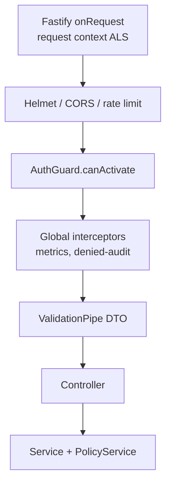
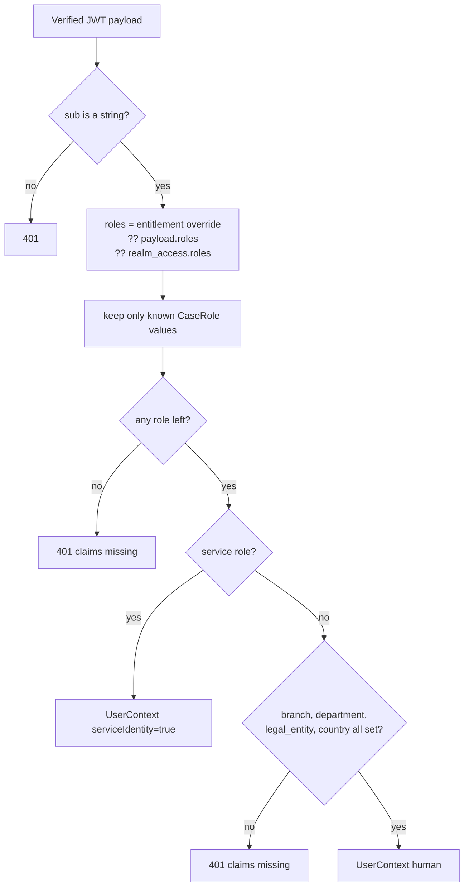

# Backend guard walkthrough (`AuthGuard`)

The staff authentication boundary is a NestJS guard: [apps/api/src/auth/auth.guard.ts](../../apps/api/src/auth/auth.guard.ts). It turns an untrusted `Authorization` header into the one identity object every service trusts: `request.user: UserContext`.

[Back to Auth index](README.md) · Terms used here: [concepts](concepts.md)

---

## 1. Where the guard sits in a request



Controllers opt in with `@UseGuards(AuthGuard)`, for example [tickets.controller.ts#L39-L40](../../apps/api/src/tickets/tickets.controller.ts#L39-L40). Because the guard runs **before** the `ValidationPipe`, an anonymous caller never learns anything about the DTO shape. They get 401 first. The test [unauthenticated.e2e-spec.ts#L15-L22](../../apps/api/test/unauthenticated.e2e-spec.ts#L15) proves this through the real Nest app.

---

## 2. Construction: configuration and keys

[auth.guard.ts#L37-L43](../../apps/api/src/auth/auth.guard.ts#L37-L43):

```ts
@Injectable()
export class AuthGuard implements CanActivate {
  private readonly issuer = process.env.OIDC_ISSUER ?? "";
  private readonly audience = process.env.OIDC_AUDIENCE ?? "";
  private readonly jwks = createRemoteJWKSet(new URL(process.env.OIDC_JWKS_URI ?? "http://invalid.local/jwks"));
```

- **`createRemoteJWKSet`** (from the `jose` library) returns a function that fetches the IdP's public keys on demand, caches them, and refetches when it sees an unknown `kid`. That is how **key rotation** works without a restart.
- The fallback URL `invalid.local` means a missing configuration fails verification instead of silently accepting anything.
- The guard is a **singleton provider** from [AuthModule](../../apps/api/src/auth/auth.module.ts#L6), so the key cache is shared by all requests.

---

## 3. `canActivate`, line by line

[auth.guard.ts#L45-L79](../../apps/api/src/auth/auth.guard.ts#L45-L79)

| Lines | Code | What happens | Why |
|---|---|---|---|
| [46-47](../../apps/api/src/auth/auth.guard.ts#L46-L47) | `getRequest<FastifyRequest>()` | Get the raw Fastify request | Guards run before Nest extracts parameters |
| [48-49](../../apps/api/src/auth/auth.guard.ts#L48-L49) | `startsWith("Bearer ")` | Require the exact scheme | No token in query strings or cookies |
| [50-51](../../apps/api/src/auth/auth.guard.ts#L50-L51) | `!this.issuer \|\| !this.audience` | Refuse if not configured | Fail closed, never "accept anything" |
| [53-57](../../apps/api/src/auth/auth.guard.ts#L53-L57) | `jwtVerify(token, jwks, { issuer, audience, algorithms })` | Verify signature + `iss` + `aud` + `exp`/`nbf` + algorithm | The core cryptographic check |
| [58](../../apps/api/src/auth/auth.guard.ts#L58) | `assertAllowedClient(payload)` | Check `azp`/`client_id` against an allow-list | Token issued by the right IdP but to the wrong app is refused |
| [59](../../apps/api/src/auth/auth.guard.ts#L59) | `assertTokenActive(token)` | Optional RFC 7662 introspection | Catch revocation before `exp` |
| [60-65](../../apps/api/src/auth/auth.guard.ts#L60-L65) | `toUserContext(payload, await lookupEntitlements(sub))` | Optional live entitlements, then normalise | Role/queue changes apply within a minute |
| [66-71](../../apps/api/src/auth/auth.guard.ts#L66-L71) | `requestContext.getStore()` | Copy `jti`, `acr`, `auth_time` into the per-request audit context | Every audit event later records how strongly the actor logged in |
| [72-74](../../apps/api/src/auth/auth.guard.ts#L72-L74) | `request.correlationId = header ?? randomUUID()` | Accept or create a correlation ID | Traceability across logs/audit/outbox |
| [75](../../apps/api/src/auth/auth.guard.ts#L75) | `return true` | Let Nest call the controller | |
| [76-78](../../apps/api/src/auth/auth.guard.ts#L76-L78) | `catch { throw new UnauthorizedException("Invalid or expired access token") }` | Collapse **every** failure to one generic 401 | Don't tell an attacker *which* check failed |

### Why `jwtVerify` and not `jwt.decode`
Decoding only base64-decodes the payload; anyone can forge one. `jwtVerify` checks the signature against a key the IdP published, so only the IdP could have produced it. **Decoding is reading; verifying is proving.**

### Why an explicit `algorithms` list
Without it, a library might accept whatever `alg` the token header claims. The famous attacks are `alg: none` (no signature at all) and `alg: HS256` (an HMAC keyed with the *public* key, which an attacker knows). Listing only asymmetric algorithms removes both. Test: [auth-hardening.spec.ts#L29](../../apps/api/test/auth-hardening.spec.ts#L29).

---

## 4. `toUserContext`: from claims to a trusted shape

[auth.guard.ts#L81-L139](../../apps/api/src/auth/auth.guard.ts#L81-L139)



Key details:

1. **Role source priority** ([L87-L92](../../apps/api/src/auth/auth.guard.ts#L87-L92)): entitlement-service override, then a `roles` claim, then Keycloak's `realm_access.roles`. This makes the guard work with different IdPs.
2. **Allow-listing** ([L93-L96](../../apps/api/src/auth/auth.guard.ts#L93-L96)): roles are filtered against the closed `ROLES` list ([L18-L29](../../apps/api/src/auth/auth.guard.ts#L18-L29)). A token claiming `superadmin` gets nothing.
3. **Queues** ([L98-L102](../../apps/api/src/auth/auth.guard.ts#L98-L102)) must be strings; anything else is dropped.
4. **Humans need full scope** ([L113-L119](../../apps/api/src/auth/auth.guard.ts#L113-L119)). A human without branch/department/entity/country cannot be scoped, so they are refused. That is safer than giving them an empty scope that some query might treat as "everything".
5. **Machines** ([L112](../../apps/api/src/auth/auth.guard.ts#L112), list at [L30-L35](../../apps/api/src/auth/auth.guard.ts#L30-L35)) are marked `serviceIdentity` and may omit human scope. Their single permission is the compensating control.
6. **Display fields** ([L134-L137](../../apps/api/src/auth/auth.guard.ts#L134-L137)): `name`, `preferred_username` and `email` are copied **for display only**. The comment says so explicitly.

The resulting interface, [user-context.ts#L3-L21](../../apps/api/src/auth/user-context.ts#L3-L21):

```ts
interface UserContext {
  subject: string; roles: CaseRole[];
  branch: string; queues: string[]; department: string; legalEntity: string; country: string;
  serviceIdentity?: boolean;
  tokenId?: string; tokenExpiresAt?: number; authTime?: number; acr?: string;
  displayName?: string; username?: string; email?: string;
}
```

TypeScript learns that `request.user` exists through **module augmentation** ([user-context.ts#L23](../../apps/api/src/auth/user-context.ts#L23)):

```ts
declare module 'fastify' { interface FastifyRequest { user?: UserContext; correlationId?: string; } }
```

---

## 5. How controllers use it

Controllers never read the JWT again. They pass `request.user!` and `request.correlationId!` into services, e.g. [tickets.controller.ts#L43-L53](../../apps/api/src/tickets/tickets.controller.ts#L43-L53):

```ts
@Post() create(@Req() request: FastifyRequest, @Headers("idempotency-key") key: string | undefined, @Body() dto: CreateTicketDto) {
  if (!key || key.length > 128) throw new BadRequestException("A valid Idempotency-Key header is required");
  return this.tickets.create(request.user!, dto, key, request.correlationId!);
}
```

The `!` is safe because the guard guarantees `user` and `correlationId` are set before the controller runs.

---

## 6. Workers use the same identity type

In-process workers do not have an HTTP request, so they construct a typed service identity and call the same service method a remote machine would call:

| Worker | Identity | Code |
|---|---|---|
| Attachment scanner | `system:attachment-scanner`, role `attachment-scanner` | [attachment-scan.worker.ts#L8](../../apps/api/src/tickets/attachment-scan.worker.ts#L8) |
| Email delivery | `system:email-delivery`, role `notification-provider` | [delivery.worker.ts#L11](../../apps/api/src/email/delivery.worker.ts#L11) |
| Inbound email | `system:email-intake`, role `intake-gateway` | [inbound.worker.ts#L13](../../apps/api/src/email/inbound.worker.ts#L13) |
| Portal adapter | `system:portal`, role `intake-gateway` | [portal.service.ts#L11](../../apps/api/src/portal/portal.service.ts#L11) |

This means the permission check, the state machine and the audit trail are **identical** whether the work came from a person, an external service or an internal worker.

---

## 7. The customer guard is a separate boundary

[portal-auth.guard.ts#L13-L31](../../apps/api/src/portal/portal-auth.guard.ts#L13-L31):

```ts
private readonly issuer = process.env.PORTAL_OIDC_ISSUER ?? '';
private readonly audience = process.env.PORTAL_OIDC_AUDIENCE ?? '';
...
if (!this.issuer || !this.audience || !this.jwks) throw new NotFoundException();
...
const { payload } = await jwtVerify(token, this.jwks, { issuer: this.issuer, audience: this.audience, algorithms: ['RS256','ES256','PS256'] });
request.customer = { subject: payload.sub };
```

| Aspect | Staff `AuthGuard` | Customer `PortalAuthGuard` |
|---|---|---|
| Issuer / audience | `OIDC_*` | `PORTAL_OIDC_*` (separate realm) |
| Writes | `request.user` (full `UserContext`) | `request.customer` (`{ subject }` only) |
| Roles / scope | Required | None: ownership is derived from `subject` |
| Not configured | 401 | **404**: the portal surface does not exist |

Because each guard checks its **own issuer and audience**, a valid staff token fails the portal guard and a valid customer token fails the staff guard. The test [portal.integration-spec.ts#L33](../../apps/api/test/portal.integration-spec.ts#L33) proves the separation.

A third kind of caller has **no login at all**: a customer holding a secure upload link. Its HMAC token is the credential. See [secure upload links](../attachments/secure-upload-links.md).

---

## 8. Failure map

| Condition | Result | Line |
|---|---|---|
| No header / not `Bearer ` | 401 "Missing bearer access token" | [L48-L49](../../apps/api/src/auth/auth.guard.ts#L48-L49) |
| Issuer/audience env missing | 401 "OIDC validation is not configured" | [L50-L51](../../apps/api/src/auth/auth.guard.ts#L50-L51) |
| Bad signature, wrong `iss`/`aud`, expired, bad `alg` | 401 generic | [L76-L78](../../apps/api/src/auth/auth.guard.ts#L76-L78) |
| Wrong client (`azp`) | 401 generic | [token-checks.ts#L13](../../apps/api/src/auth/token-checks.ts#L13) |
| Revoked (introspection) / lookup failed | 401 generic | [token-checks.ts#L43-L46](../../apps/api/src/auth/token-checks.ts#L43-L46) |
| No entitlement record (404) | 401 generic | [token-checks.ts#L64](../../apps/api/src/auth/token-checks.ts#L64) |
| No known role / missing human scope | 401 generic | [L108-L119](../../apps/api/src/auth/auth.guard.ts#L108-L119) |

**Note on audit:** 401s are *not* written to the hash-chained audit trail, because there is no trusted actor to attribute them to. They belong in edge or security logs. 403s (a known actor who was refused) **are** audited. See [audit/event-model.md](../audit/event-model.md#5-denied-actions).

Next: [Token hardening](token-hardening.md)
