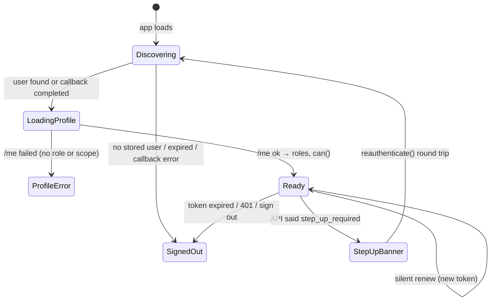
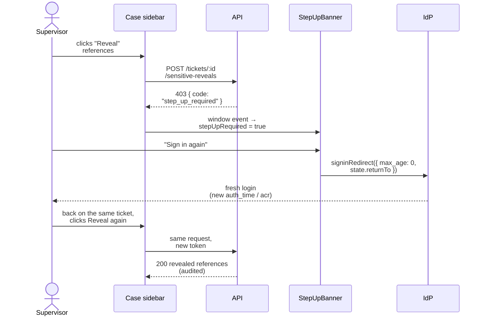

# Frontend session (staff console)

How the React app signs in, keeps the session alive, calls the API and reacts to 401 and step-up. The customer portal uses the same pattern in a simpler form ([../portal/frontend.md](../portal/frontend.md)).

[Back to Auth index](README.md) · Terms used here: [concepts](concepts.md)

---

## 1. The files and their jobs

| File | Job, in one sentence |
|---|---|
| [config.ts](../../apps/web/src/config.ts) | Reads OIDC authority, client ID and API URL from `/config.js` at runtime, so one container image serves every bank |
| [auth.ts](../../apps/web/src/auth.ts) | Owns the `UserManager`: sign-in, sign-out, step-up re-login, callback completion, safe return path |
| [session/session-provider.tsx](../../apps/web/src/session/session-provider.tsx) | React context: who is signed in, their `/me` profile, `can()`, step-up banner state |
| [session/roles.ts](../../apps/web/src/session/roles.ts) | Role → capability table (what to *show*) and the home path |
| [api.ts](../../apps/web/src/api.ts) | The only place that calls `fetch`: adds the token, handles 401 and step-up |
| [layout/login-page.tsx](../../apps/web/src/layout/login-page.tsx) | The sign-in screen |
| [layout/step-up-banner.tsx](../../apps/web/src/layout/step-up-banner.tsx) | "Please confirm it is you" banner |
| [app.tsx](../../apps/web/src/app.tsx) | Session gates and route-level `Require` |

---

## 2. `auth.ts`: the `UserManager`

[auth.ts#L12-L20](../../apps/web/src/auth.ts#L12-L20):

```ts
export const userManager = new UserManager({
  authority, client_id: clientId,
  redirect_uri: `${window.location.origin}/`,
  post_logout_redirect_uri: `${window.location.origin}/`,
  response_type: 'code', scope: 'openid profile',
  userStore: new WebStorageStateStore({ store: window.sessionStorage }),
  automaticSilentRenew: true, monitorSession: true
});
```

| Option | Plain meaning | Why we chose it |
|---|---|---|
| `response_type: 'code'` | Use Authorization Code + PKCE | Tokens never appear in the URL; a stolen code is useless without the verifier |
| `redirect_uri` = site root | IdP always returns to `/` | One registered callback URL; the real destination travels in `state` |
| `scope: 'openid profile'` | Ask for identity + basic profile | Roles and scope come as custom claims configured in the IdP |
| `userStore: sessionStorage` | Keep the user per tab | Cleared when the tab closes, not shared with other tabs |
| `automaticSilentRenew` | Renew before expiry | Users are not logged out mid-task |
| `monitorSession` | Watch the IdP session | Logging out at the IdP is noticed |

### The four exported actions

| Function | Code | What it does |
|---|---|---|
| `signIn(returnTo)` | [L36](../../apps/web/src/auth.ts#L36) | Redirect to the IdP, remembering the current page in `state` |
| `signOut()` | [L37](../../apps/web/src/auth.ts#L37) | Redirect to the IdP's logout, then back to `/` |
| `reauthenticate(returnTo)` | [L39](../../apps/web/src/auth.ts#L39) | Step-up: `max_age: 0` forces a fresh credential prompt |
| `completeSignIn()` | [L45-L46](../../apps/web/src/auth.ts#L45-L46) | Exchange the code once (promise cached for StrictMode) |

### `safeReturnPath` (open-redirect protection)

[auth.ts#L31-L34](../../apps/web/src/auth.ts#L31-L34):

```ts
return returnTo && returnTo.startsWith('/') && !returnTo.startsWith('//') ? returnTo : '/';
```

| Input | Result | Why |
|---|---|---|
| `/tickets/abc?tab=audit` | kept | same-site path |
| `//evil.example/phish` | `/` | protocol-relative URL leaves the site |
| `https://evil.example` | `/` | absolute URL |
| `undefined` | `/` | nothing to restore |

---

## 3. `SessionProvider`: the state machine



The context value ([session-provider.tsx#L23-L37](../../apps/web/src/session/session-provider.tsx#L23-L37)):

| Field | Meaning |
|---|---|
| `user` | The OIDC user (holds the access token), or null |
| `ready` | False until we know whether someone is signed in |
| `profile` | `/me` response (roles + scope) |
| `roles` | `profile.roles` or `[]` |
| `can(capability)` | `hasCapability(roles, capability)` |
| `error` | Sign-in or profile error to display |
| `stepUpRequired` / `dismissStepUp` | Banner state |

### Event listeners

[session-provider.tsx#L66-L78](../../apps/web/src/session/session-provider.tsx#L66-L78):

```ts
const renewed = (next: User) => setUser(next);   // silent renewal produced a fresh token
const expired = () => { void signOut(); };       // renewal failed and the token ran out
const stepUp  = () => setStepUpRequired(true);   // raised by api.ts
userManager.events.addUserLoaded(renewed);
userManager.events.addAccessTokenExpired(expired);
window.addEventListener('step-up-required', stepUp);
```

A **browser `CustomEvent`** decouples `api.ts`, which is not a React component, from the provider. Any API call anywhere can trigger the banner without passing callbacks around.

### `useSignedInUser()`

[session-provider.tsx#L112-L116](../../apps/web/src/session/session-provider.tsx#L112-L116) returns a non-null `User` for components that only render behind the login gate, so screens don't repeat `if (!user)` everywhere.

---

## 4. Session gates in `app.tsx`

[app.tsx#L34-L41](../../apps/web/src/app.tsx#L34-L41):

```ts
if (!ready) return <FullPageLoader />;            // still discovering
if (!user) return <LoginPage />;                  // signed out
if (error && !profile) return <ProfileErrorPage message={error} />;
if (!profile) return <FullPageLoader />;          // /me pending
```

Then routes are wrapped in `Require` ([app.tsx#L29-L32](../../apps/web/src/app.tsx#L29-L32)), which shows `NoAccessPage` when the capability is missing. **This is user experience, not security**: if someone forces the route, the API still answers 403.

---

## 5. Capabilities (`roles.ts`)

[roles.ts#L12-L23](../../apps/web/src/session/roles.ts#L12-L23):

| Capability | Roles | Used for |
|---|---|---|
| `readCases` | branch, call-centre, case agent, supervisor, auditor | Tickets screens, live feed, notification bell |
| `createTicket` | all agents + supervisor | "New ticket" button |
| `workTicket` | case agent, supervisor | Notes, status, attachments, communications |
| `supervise` | supervisor | Assign, approve, reveal, retention tab |
| `viewDashboard` | supervisor, auditor | Dashboard |
| `viewAudit` | auditor | Audit console and audit tab |
| `administer` | administrator | Administration |

The comment at [roles.ts#L1-L7](../../apps/web/src/session/roles.ts#L1-L7) states the rule explicitly: this file only decides what to **show**.

---

## 6. `api.ts`: one request helper for everything

[api.ts#L70-L83](../../apps/web/src/api.ts#L70-L83):

```ts
async function failure(response: Response): Promise<ApiError> {
  if (response.status === 401) { void signOut(); return new ApiError('Your session has expired. Sign in again.', 401); }
  const body = await response.json().catch(() => ({}));
  if (body.code === 'step_up_required') window.dispatchEvent(new CustomEvent('step-up-required'));
  const message = Array.isArray(body.message) ? body.message.join(' ') : body.message;
  return new ApiError(message ?? 'Request failed', response.status, body.code);
}
```

| Response | Behaviour | Why |
|---|---|---|
| 401 | Sign out | Retrying with a rejected token is pointless |
| 403 `step_up_required` | Banner, no automatic replay | Replaying a sensitive action automatically could duplicate it or surprise the user |
| 403 / 404 / 409 | `ApiError` with `status` | Callers react differently (e.g. 409 → refetch the ticket) |
| validation array | Joined into one message | `class-validator` returns arrays |

Special paths that bypass `request()` but reuse `authHeaders`: the paged list (reads the `X-Next-Cursor` header, [L115-L120](../../apps/web/src/api.ts#L115-L120)), CSV export (blob, [L252-L256](../../apps/web/src/api.ts#L252-L256)) and the SSE stream ([L191-L224](../../apps/web/src/api.ts#L191-L224)), which uses `fetch` instead of `EventSource` so the token goes in a header, never a URL.

---

## 7. Step-up, as the user experiences it



[step-up-banner.tsx#L11-L25](../../apps/web/src/layout/step-up-banner.tsx#L11-L25) · [auth.ts#L39](../../apps/web/src/auth.ts#L39)

---

## 8. Known limitations (be ready to say them)

- **`/me` is cached for the whole session** (`staleTime: Infinity`). If central entitlements change, the API enforces the change immediately, but menus may look stale until re-login. This is safe, but can be confusing. Fix: invalidate `queryKeys.me` on `addUserLoaded`.
- **Query cache is not explicitly cleared on sign-out.** The sign-out redirect reloads the page, which clears memory. A same-page account switch would need an explicit `queryClient.clear()`.
- **Tokens in sessionStorage are readable by JavaScript.** XSS defences stay essential.

Next: [Backend guard walkthrough](backend-guard.md)
