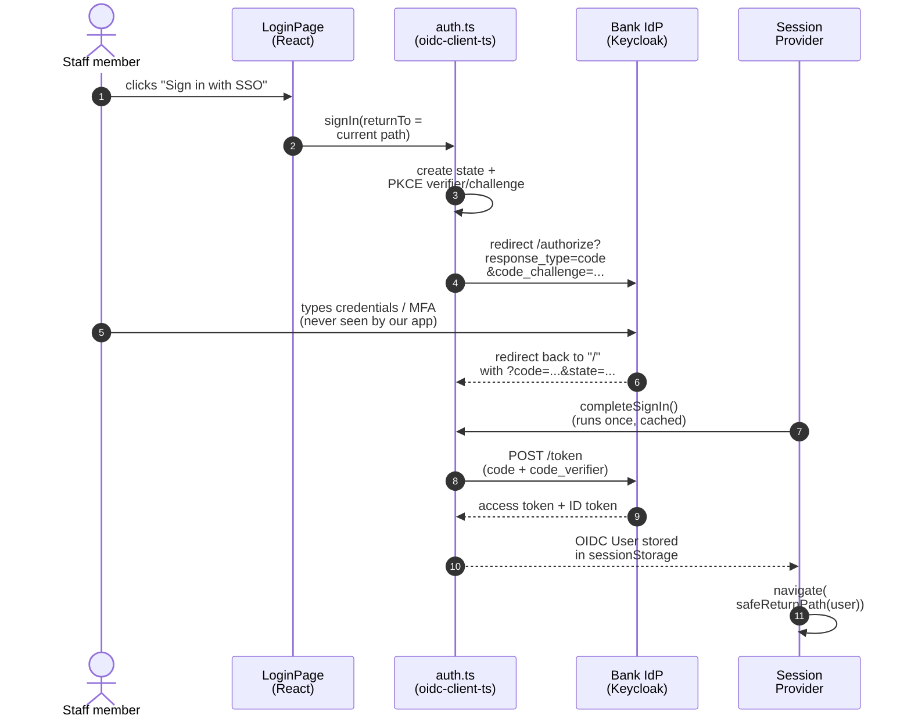
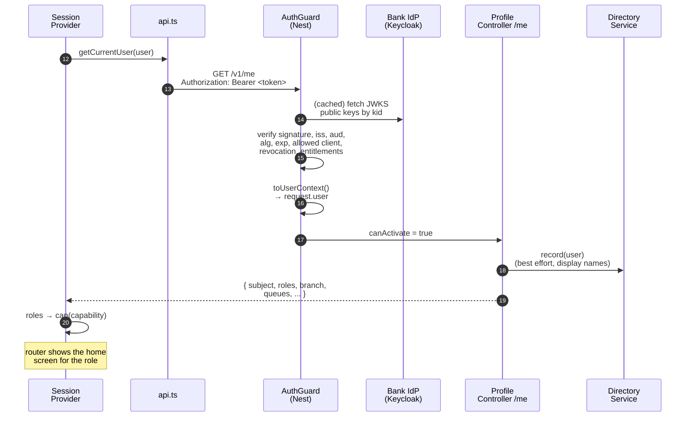
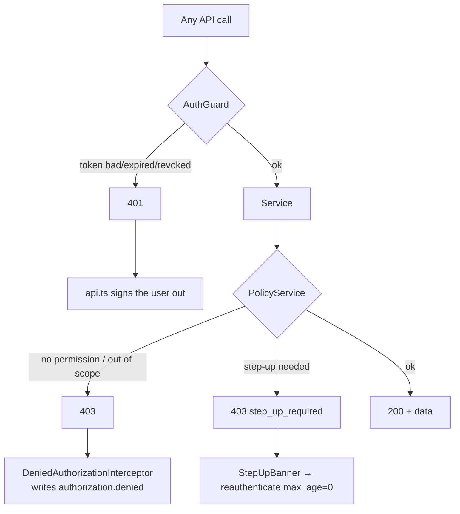

# Login flow, end to end

This page follows one staff member from pressing **Sign in with SSO** to a verified, authorised API request. Every step links to the code that performs it.

[Back to Auth index](README.md) · Terms used here: [concepts](concepts.md)

---

## 1. The sequence

**Part A: signing in (browser ↔ IdP)**



**Part B: the first API call (`/me`).** Numbering continues from part A.



---

## 2. Step by step, with code

### Step 1: the login page starts the redirect

[login-page.tsx#L27](../../apps/web/src/layout/login-page.tsx#L27) calls `signIn()`. [auth.ts#L36](../../apps/web/src/auth.ts#L36):

```ts
export const signIn = (returnTo = currentPath()) =>
  userManager.signinRedirect({ state: { returnTo } satisfies SignInState });
```

- **What:** `signinRedirect` builds the IdP authorize URL with `response_type=code`, a random `state`, and a PKCE `code_challenge`.
- **Plain:** "Send the user to the bank's login page, and remember they wanted `/tickets/123`."
- The verifier stays in the tab's sessionStorage; only its hash travels to the IdP.

### Step 2: the user logs in at the IdP

Passwords, MFA and device rules belong to the bank's IdP. Our app never sees a password. That is why the login page says "This application never handles passwords" ([login-page.tsx#L21](../../apps/web/src/layout/login-page.tsx#L21)).

### Step 3: the callback is completed exactly once

The IdP redirects to `https://console/` with `?code=...`. [session-provider.tsx#L49-L63](../../apps/web/src/session/session-provider.tsx#L49-L63):

```ts
const returningFromSignIn = window.location.search.includes('code=');
const current = returningFromSignIn ? await completeSignIn() : await userManager.getUser();
setUser(current && !current.expired ? current : null);
if (returningFromSignIn) navigate(safeReturnPath(current), { replace: true });
```

`completeSignIn` caches its promise ([auth.ts#L45-L46](../../apps/web/src/auth.ts#L45-L46)):

```ts
let pendingSignIn: Promise<User | null> | null = null;
export const completeSignIn = () => (pendingSignIn ??= userManager.signinCallback().then((u) => u ?? null));
```

- **Why the cache:** React StrictMode runs effects twice in development, but an authorization code is **one-time**. Redeeming it twice would fail the second time and show a false "sign-in failed".
- **Why `safeReturnPath`:** the return path came back through the IdP and could be tampered with. Only `/something` is accepted, never `//evil.example` ([auth.ts#L31-L34](../../apps/web/src/auth.ts#L31-L34)).

### Step 4: `/me` is loaded

[session-provider.tsx#L81-L86](../../apps/web/src/session/session-provider.tsx#L81-L86) runs a TanStack Query for `/me` once a user exists, with `staleTime: Infinity` (roles only change on re-login).

While it loads, [app.tsx#L37-L40](../../apps/web/src/app.tsx#L37-L40) shows a loader, so no protected screen ever renders against unknown roles.

### Step 5: every API call carries the token

[api.ts#L67](../../apps/web/src/api.ts#L67):

```ts
const authHeaders = (user: User) => ({
  Authorization: `Bearer ${user.access_token}`,
  'X-Correlation-Id': crypto.randomUUID(),
});
```

### Step 6: the API verifies independently

[AuthGuard.canActivate](../../apps/api/src/auth/auth.guard.ts#L45-L79) runs **on every request**. Nothing the browser concluded earlier is trusted. The detailed walkthrough is in [backend-guard.md](backend-guard.md).

### Step 7: `/me` returns the normalised identity

[profile.controller.ts#L16-L20](../../apps/api/src/auth/profile.controller.ts#L16-L20) records the person in the staff directory, so colleagues see their name, and returns `request.user`. See [profile-and-me.md](profile-and-me.md).

### Step 8: the router picks the home screen

[roles.ts#L32](../../apps/web/src/session/roles.ts#L32): case workers go to `/tickets`, administrators to `/admin`, anyone else to `/no-access`.

---

## 3. What happens on later requests



| Situation | What the code does | Link |
|---|---|---|
| Token renews silently | New `User` replaces the old one; the live stream reconnects with the new token | [session-provider.tsx#L67-L70](../../apps/web/src/session/session-provider.tsx#L67-L70), [use-live-updates.ts#L22](../../apps/web/src/live/use-live-updates.ts#L22) |
| Token expires and renewal failed | `addAccessTokenExpired` → `signOut()` | [session-provider.tsx#L68](../../apps/web/src/session/session-provider.tsx#L68) |
| API returns 401 | Client signs out instead of retrying a dead token | [api.ts#L71](../../apps/web/src/api.ts#L71) |
| API returns `step_up_required` | Browser event → banner → fresh login with `max_age: 0` | [api.ts#L74](../../apps/web/src/api.ts#L74), [auth.ts#L39](../../apps/web/src/auth.ts#L39) |
| Live SSE stream open when token expires | Server sends `event: expired` and closes it | [live-events.controller.ts#L31-L33](../../apps/api/src/live/live-events.controller.ts#L31-L33) |

---

## 4. Failure map

| Failure | Layer | What the user sees |
|---|---|---|
| OIDC authority/client not configured | `auth.ts` throws at import ([auth.ts#L10](../../apps/web/src/auth.ts#L10)) | App fails clearly at start |
| IdP callback fails | `SessionProvider` catch ([session-provider.tsx#L57-L58](../../apps/web/src/session/session-provider.tsx#L57-L58)) | Login page with an error message |
| Tampered `returnTo` | `safeReturnPath` | Lands on `/` |
| Token missing/expired/wrong issuer or audience | `AuthGuard` | 401, then sign-out |
| Token has no known role or misses branch/country | `toUserContext` | 401 "Required authorization claims are missing" |
| `/me` fails (account without role) | `ProfileErrorPage` ([status-pages.tsx#L31-L41](../../apps/web/src/pages/status-pages.tsx#L31-L41)) | "We could not load your profile" + Sign out |
| Authorised but not allowed | `PolicyService` | 403 toast; session stays valid |

---

## 5. Security boundaries to say out loud

1. **OIDC authenticates; our policy authorises.** The IdP has no idea about queues or ticket sensitivity.
2. **PKCE protects the code exchange.** It does not protect against XSS reading the token afterwards.
3. **sessionStorage is a storage choice, not a server session.** The API is stateless and re-verifies every request.
4. **`/me` is information, not proof.** Editing React state cannot give anyone a permission.
5. **Revocation timing** = token lifetime, or the introspection cache window (30 s by default) if introspection is enabled.
6. **Staff and customers are cryptographically separate.** Different issuer, audience and guard ([backend-guard.md](backend-guard.md#7-the-customer-guard-is-a-separate-boundary)).

Next: [Frontend session](frontend-session.md) · [Backend guard](backend-guard.md)
