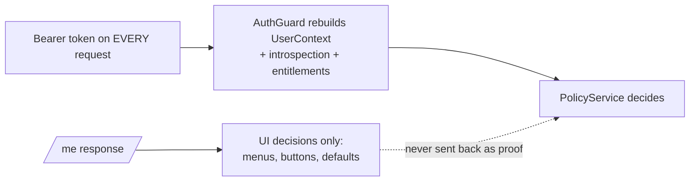

# `/me` and the user profile

`GET /v1/me` tells the frontend how the API understood the signed-in person: roles and organisational scope. It is **information for the UI, never proof for later requests**.

[Back to Auth index](README.md)

---

## 1. The code

[apps/api/src/auth/profile.controller.ts#L11-L21](../../apps/api/src/auth/profile.controller.ts#L11-L21):

```ts
@Controller('me')
@UseGuards(AuthGuard)
export class ProfileController {
  constructor(private readonly directory: DirectoryService) {}
  @Get()
  async current(@Req() request: FastifyRequest) {
    await this.directory.record(request.user!);
    return request.user;
  }
}
```

1. `AuthGuard` verifies the token and builds `request.user` ([backend-guard.md](backend-guard.md)).
2. `DirectoryService.record` upserts the person's display name into `staff_directory` ([directory.service.ts#L22-L37](../../apps/api/src/directory/directory.service.ts#L22-L37)). This is how colleagues later see "Priya Shah" instead of `dd8a043a-...`.
3. The normalised `UserContext` is returned.

### Response example

```json
{
  "subject": "dd8a043a-e38f-4025-9c1a-2b7e...",
  "roles": ["case-agent"],
  "branch": "BLR-01",
  "queues": ["customer-support", "payments"],
  "department": "operations",
  "legalEntity": "BANK-IN",
  "country": "IN",
  "serviceIdentity": false,
  "tokenId": "4c1e...",
  "tokenExpiresAt": 1761403200,
  "authTime": 1761399600,
  "acr": "1",
  "displayName": "Priya Shah",
  "username": "priya.shah",
  "email": "priya@bank.example"
}
```

It never returns the raw JWT, the signature, introspection credentials or entitlement-service responses.

---

## 2. Why the controller is registered in `DirectoryModule`

The file lives in `auth/`, but [directory.module.ts#L8](../../apps/api/src/directory/directory.module.ts#L8) registers it:

```ts
@Module({ imports: [AuthModule], controllers: [ProfileController, DirectoryController], providers: [DirectoryService], exports: [DirectoryService] })
```

- The controller needs `DirectoryService`, and Directory already imports Auth (for `PolicyService`).
- Registering it in `AuthModule` would make Auth import Directory, a **circular dependency**.
- The comment at [auth.module.ts#L5](../../apps/api/src/auth/auth.module.ts#L5) records this decision.

**Plain:** the code sits with its topic (auth), but it is wired where its dependencies are.

---

## 3. Directory refresh is best effort

[directory.service.ts#L22-L37](../../apps/api/src/directory/directory.service.ts#L22-L37):

```ts
async record(user: UserContext) {
  if (user.serviceIdentity) return;                 // robots are shown as "Automatic"
  try { await this.db.query(`INSERT INTO staff_directory ... ON CONFLICT (subject) DO UPDATE ...`, [...]); }
  catch (error) { this.logger.warn(`Staff directory update failed: ...`); }  // never block sign-in
}
```

A display-name problem must **never** turn into "nobody can log in". This is a deliberate fail-open, and it is safe because names are decoration, not authorization.

---

## 4. How the frontend uses it

[session-provider.tsx#L81-L97](../../apps/web/src/session/session-provider.tsx#L81-L97):

```ts
const { data: profile } = useQuery({ queryKey: queryKeys.me, queryFn: () => getCurrentUser(user!), enabled: Boolean(user), staleTime: Infinity });
...
can: (capability) => hasCapability(profile?.roles ?? [], capability)
```

| UI use | Example |
|---|---|
| Which nav items to show | [app-layout.tsx#L86](../../apps/web/src/layout/app-layout.tsx#L86) |
| Home screen | `homePath(roles)` ([roles.ts#L32](../../apps/web/src/session/roles.ts#L32)) |
| Scope footer "Branch BLR-01 · BANK-IN / IN" | [app-layout.tsx#L102-L108](../../apps/web/src/layout/app-layout.tsx#L102-L108) |
| Prefill create-ticket scope | [create-ticket-modal.tsx#L51](../../apps/web/src/features/tickets/create-ticket-modal.tsx#L51) |
| "Assigned to me" view | `profile.subject` ([tickets-page.tsx#L67](../../apps/web/src/features/tickets/tickets-page.tsx#L67)) |

---

## 5. The important distinction



The API **never** accepts a profile the browser received earlier. Every request re-sends the token and the guard rebuilds `UserContext`, including fresh revocation and entitlement checks. Editing React state or the `/me` JSON in DevTools can make a button appear, but the API still answers 403.

---

## 6. Known limitation

`staleTime: Infinity` means role changes from the entitlement service are enforced by the API immediately, but menus may look stale until re-login. This is safe, but can confuse users. Fix: invalidate `queryKeys.me` when the OIDC `userLoaded` event fires.

## 7. Interview answer

> After OIDC login, the console calls `/me` to get the API's normalised view of roles and scope, and the same call refreshes the staff directory so names display. It drives navigation only. Every later request re-sends the bearer token and the guard rebuilds the identity, so nobody can promote themselves by editing frontend state. The controller lives in the auth folder but is wired in the Directory module to avoid a circular import.

Next: [Testing](testing.md)
