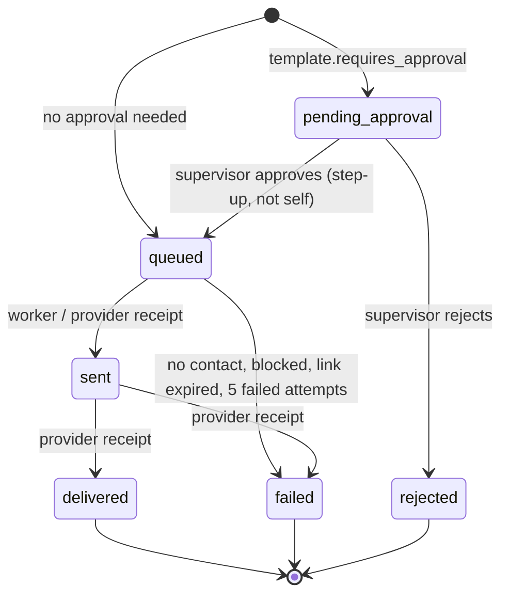

# Communications: governed customer messages

> **Customer communication**: a message from the bank to the customer (email, SMS or portal message), created from an approved **template**, optionally **approved** by a second person, then **delivered** by a background worker, with delivery **receipts** recorded.
> In plain words: staff never type free-text emails to customers. They pick a pre-approved letter; sensitive letters need a supervisor's sign-off; a mail room sends them later and logs "sent" and "delivered".

This is different from **staff notifications** (the bell in the console). Those are in [Notifications](../notifications/README.md). Inbound customer email (which creates tickets or replies) is in [Intake](../intake/README.md).

## Picture

## Where it lives

| File | Role |
|---|---|
| [tickets/tickets.service.ts#L270-L307](../../apps/api/src/tickets/tickets.service.ts#L270-L307) | `createCommunication` |
| [tickets/tickets.service.ts#L317-L349](../../apps/api/src/tickets/tickets.service.ts#L317-L349) | `requestApproval`, `decideApproval` (maker-checker) |
| [tickets/resolution-notice.service.ts](../../apps/api/src/tickets/resolution-notice.service.ts) | Automatic "your request is resolved" message |
| [email/delivery.worker.ts](../../apps/api/src/email/delivery.worker.ts) | Sends queued messages (SMTP, SMS gateway, portal) |
| [email/contact-resolver.ts](../../apps/api/src/email/contact-resolver.ts) | Opaque reference → email/mobile (CRM owns contact data) |
| [email/message-template.ts](../../apps/api/src/email/message-template.ts) | Placeholder rendering, customer-friendly status, HTML escaping |
| [integrations/integration.service.ts#L34-L66](../../apps/api/src/integrations/integration.service.ts#L34-L66) | Delivery receipts, monotonic state machine |
| [configuration/communication-template.dto.ts](../../apps/api/src/configuration/communication-template.dto.ts) | Placeholder allow-list |
| [ticket/tabs/communications-tab.tsx](../../apps/web/src/features/ticket/tabs/communications-tab.tsx) | Staff UI |
| [admin/sections/templates-section.tsx](../../apps/web/src/features/admin/sections/templates-section.tsx) | Template editor with preview |
| Tables | `communication_templates`, `ticket_communications`, `approval_requests`, `communication_delivery_receipts` |

## Read in this order

1. [Creating and approving](creating-and-approving.md): templates, recipients, portal rules, maker-checker approval.
2. [Resolution notice](resolution-notice.md): the automatic message in the resolve transaction.
3. [Delivery and receipts](delivery-and-receipts.md): worker leases, contact resolution, rendering, retries, monotonic receipts.
4. [Frontend](frontend.md): the Communications tab and the template editor.
5. [Interview Q&A](interview-qa.md)

## Glossary

| Term | Plain meaning |
|---|---|
| **Template** | Pre-written subject/body with only `{{ticketRef}}`, `{{status}}` (and `{{uploadLink}}` in bodies). It can't pull other case data into a message |
| **Requires approval** | A template flag: messages from it start `pending_approval` |
| **Maker-checker** | The person who created the message can't approve it |
| **Recipient reference** | An opaque customer reference (or `mailto:`/`PORTAL-…`), stored with a masked copy for display |
| **Contact resolver** | Asks the bank's CRM for the real address at send time, so the platform doesn't keep contact data |
| **Lease** | The worker reserves a message for 120 s by pushing `next_attempt_at` forward, so other instances skip it |
| **Monotonic** | Status only moves forward: queued → sent → delivered/failed, never backwards |
| **Receipt** | A provider's statement "message X was sent/delivered/failed"; duplicates are recognised |
| **Communication block** | A per-case switch (e.g. fraud investigation, "tipping-off") that stops all customer messages |

## 30-second answer

> Customer messages are durable rows, not emails fired from a request handler. Staff pick an active template; its `requires_approval` flag decides `queued` versus `pending_approval`. Approval is a locked maker-checker transaction with step-up that advances the message to `queued`. A worker leases queued rows with `FOR UPDATE SKIP LOCKED`, resolves the address from the CRM at send time, renders allow-listed placeholders, sends through SMTP, an SMS gateway or the portal, and records receipts through the same idempotent, monotonic state machine an external provider uses. Resolving a ticket queues the resolution notice in the same transaction. Communication blocks stop everything.

## Related

[Tickets](../tickets/README.md) · [Auth (maker-checker, step-up)](../auth/authorization-policy.md) · [Compliance (communication block)](../compliance/README.md) · [Secure upload links](../attachments/secure-upload-links.md) · [Outbox](../outbox/README.md) · [Portal](../portal/README.md) · [Intake (inbound email)](../intake/README.md)
