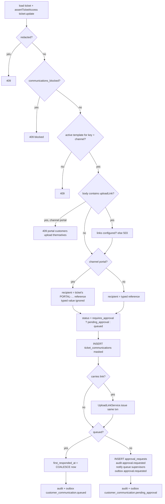
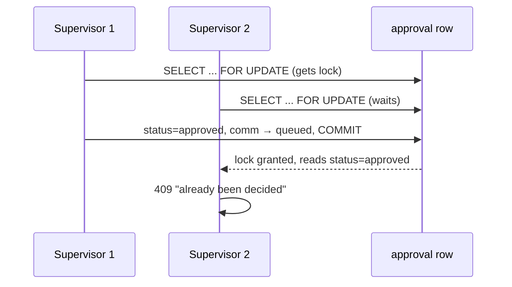

# Creating and approving communications

[Back to Communications index](README.md)

---

## 1. Creating a communication

`POST /v1/tickets/:id/communications` `{ channel: email|sms|portal, templateKey, recipientReference }` → [tickets.service.ts#L270-L307](../../apps/api/src/tickets/tickets.service.ts#L270-L307).



Key lines:

| Lines | Rule | Plain reason |
|---|---|---|
| [L273-L274](../../apps/api/src/tickets/tickets.service.ts#L273-L274) | Refuse if redacted or blocked | Tipping-off control; de-identified cases are frozen |
| [L275-L276](../../apps/api/src/tickets/tickets.service.ts#L275-L276) | Template must be active **for that channel** | An email template can't be sent as SMS by accident |
| [L278-L279](../../apps/api/src/tickets/tickets.service.ts#L278-L279) | `{{uploadLink}}` templates: not via portal; links must be configured | Portal customers upload directly; the link feature needs a secret and a public URL |
| [L282-L286](../../apps/api/src/tickets/tickets.service.ts#L282-L286) | **Portal recipient comes from the ticket**, never from input | Staff can't redirect a portal message to another customer |
| [L288](../../apps/api/src/tickets/tickets.service.ts#L288) | Template decides approval | Policy is in configuration, not in the click |
| [L291](../../apps/api/src/tickets/tickets.service.ts#L291) | Store `recipient_reference` + `recipient_masked` | The API only ever returns the masked form |
| [L292](../../apps/api/src/tickets/tickets.service.ts#L292) | Issue the upload link **in the same transaction** | The link exists if and only if its message does |
| [L293](../../apps/api/src/tickets/tickets.service.ts#L293) | `queued` counts as the first response | A message waiting for approval does not count |
| [L296-L303](../../apps/api/src/tickets/tickets.service.ts#L296-L303) | Linked approval + supervisor notification | Someone must know a decision is waiting |

The response: `{ id, channel, templateKey, recipientMasked, status, approvalId? }` ([L305](../../apps/api/src/tickets/tickets.service.ts#L305)). A successful POST means **"recorded and queued or awaiting approval"**, never "delivered".

---

## 2. Templates and placeholders

[communication-template.dto.ts#L3-L16](../../apps/api/src/configuration/communication-template.dto.ts#L3-L16):

```ts
const PLACEHOLDERS      = /^(?:(?!\{\{)[\s\S]|\{\{(?:ticketRef|status)\}\})*$/;              // subject
const BODY_PLACEHOLDERS = /^(?:(?!\{\{)[\s\S]|\{\{(?:ticketRef|status|uploadLink)\}\})*$/;   // body
```

**Plain:** the regex says "any text, but every `{{` must start exactly `{{ticketRef}}`, `{{status}}` or `{{uploadLink}}`". A template can **never** contain `{{customer.accountNumber}}`, so a template author can't leak case data into a message.

At send time, [message-template.ts#L18-L23](../../apps/api/src/email/message-template.ts#L18-L23) fills only those variables, shows customer-friendly status words (`pending_customer` → "waiting for your reply"; internal states → "being worked on", [L4-L13](../../apps/api/src/email/message-template.ts#L4-L13)), strips newlines from the subject (header injection), and HTML-escapes the body.

Seeded templates: `ticket_acknowledgement`, `resolution_notice`, `resolution_notice_portal`, `ticket_status_sms`, `portal_update`, `document_request_email`, `document_request_sms` ([migrations …07000](../../apps/api/migrations/1710000007000_communications.cjs), […22000](../../apps/api/migrations/1710000022000_notifications_and_email.cjs#L5-L8), […29000](../../apps/api/migrations/1710000029000_upload_links.cjs#L20-L23)).

Template list for staff is cached in Redis for 30 s and deleted when an admin saves ([configuration.service.ts#L48-L56](../../apps/api/src/configuration/configuration.service.ts#L48-L56), [L133](../../apps/api/src/configuration/configuration.service.ts#L133)). See [Cache](../cache/README.md).

---

## 3. Approval (maker-checker)

### Generic approval request
`POST /v1/tickets/:id/approvals` `{ actionType }` ([L317-L326](../../apps/api/src/tickets/tickets.service.ts#L317-L326)) creates a pending approval and notifies supervisors. Communications create theirs automatically.

### Deciding
`POST /v1/tickets/:id/approvals/:approvalId/decision` `{ decision: approved|rejected }` → [decideApproval, L328-L349](../../apps/api/src/tickets/tickets.service.ts#L328-L349):

```ts
const approval = await client.query('SELECT * FROM approval_requests WHERE id=$1 AND ticket_id=$2 FOR UPDATE', ...);  // lock
if (!approval) throw NotFound;
this.policy.assertTicketAccess(user, ticket, 'ticket:approve');     // supervisor, in scope
this.policy.assertStepUp(user, 'approve or reject this action');    // recent/strong login
this.policy.assertMakerChecker(approval.requested_by, user.subject); // not your own
if (approval.status !== 'pending') throw Conflict('already decided');
UPDATE approval_requests SET status = decision; audit approval.<decision>; outbox approval.<decision>
if (approval.communication_id) {
  const comm = SELECT ... FROM ticket_communications WHERE id=... FOR UPDATE;               // lock the message too
  if (comm.status !== 'pending_approval') throw Conflict;
  UPDATE ticket_communications SET status = approved ? 'queued' : 'rejected';
  if queued: first_responded_at = COALESCE(first_responded_at, now())
  audit + outbox customer_communication.<queued|rejected>
}
```



| Control | What it prevents |
|---|---|
| Row lock on approval | Two supervisors both approving or deciding differently |
| Step-up | A walk-up at an unlocked terminal approving |
| Maker-checker | Self-approval (403), [policy.service.ts#L21](../../apps/api/src/auth/policy.service.ts#L21) |
| Status check | Re-deciding |
| Communication lock + `pending_approval` check | Advancing a message that changed meanwhile |

Tests: [ticket.integration-spec.ts#L103](../../apps/api/test/ticket.integration-spec.ts#L103) (self-approval 403, independent supervisor ok) and the communication approval part of [L43](../../apps/api/test/ticket.integration-spec.ts#L43).

---

## 4. Communication block (tipping-off)

`PUT /v1/tickets/:id/communication-block` (supervisor) sets `communications_blocked` ([compliance.service.ts#L80-L89](../../apps/api/src/compliance/compliance.service.ts#L80-L89)). Fraud categories block by default ([migration …18000](../../apps/api/migrations/1710000018000_regulatory_complaints.cjs#L59)). Effects:

| Where | Behaviour |
|---|---|
| Create communication | 409 |
| Customer-visible note | 409 |
| Delivery worker | Marks the message **failed** with `COMMUNICATION_BLOCKED`, even if it was queued before the block ([delivery.worker.ts#L61](../../apps/api/src/email/delivery.worker.ts#L61)) |
| Resolution notice | Skipped, audited, and deliberately **no** "contact the customer" prompt |
| Inbound email auto-ack | Not sent |
| Subject-access export | Blocked cases withheld for review |

The block **reason** is stored in audit only, never in outbox events.

Next: [Resolution notice](resolution-notice.md)
