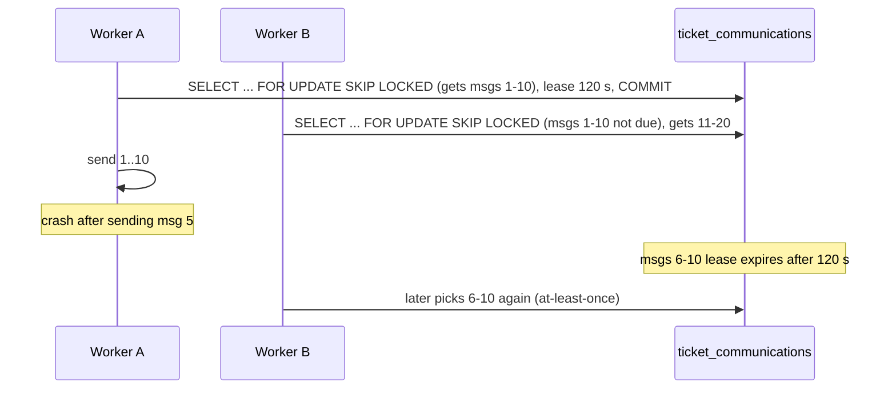

# Delivery and receipts

[Back to Communications index](README.md) · Code: [delivery.worker.ts](../../apps/api/src/email/delivery.worker.ts), [integration.service.ts](../../apps/api/src/integrations/integration.service.ts)

---

## 1. The delivery worker

Starts in `onModuleInit` if a database is configured and at least one channel is deliverable ([L32-L36](../../apps/api/src/email/delivery.worker.ts#L32-L36)):

| Channel | Enabled when | How it's sent |
|---|---|---|
| email | `SMTP_HOST` set | nodemailer SMTP ([L74-L78](../../apps/api/src/email/delivery.worker.ts#L74-L78)) |
| sms | `SMS_GATEWAY_URL` set | HTTP POST `{ to, message }` (320 characters max) ([L79-L86](../../apps/api/src/email/delivery.worker.ts#L79-L86)) |
| portal | `PORTAL_OIDC_ISSUER` set | Internal: recorded as sent + delivered (the customer reads it in the portal) ([L71-L73](../../apps/api/src/email/delivery.worker.ts#L71-L73)) |

Poll interval: `DELIVERY_POLL_MS` (5 s). Timers are chained `setTimeout` + `unref`, the same pattern as the [scheduler](../workflow/scheduler.md#3-start-stop-re-schedule).

### 1.1 Claiming with a lease

[runOnce, L40-L53](../../apps/api/src/email/delivery.worker.ts#L40-L53):

```sql
-- in a short transaction:
SELECT c.*, tpl.subject_template, tpl.body_template, t.communications_blocked
FROM ticket_communications c JOIN communication_templates tpl ON tpl.template_key=c.template_key JOIN tickets t ON t.id=c.ticket_id
WHERE c.status='queued' AND c.channel = ANY($1) AND c.next_attempt_at <= now() AND t.redacted_at IS NULL
ORDER BY c.created_at LIMIT 10 FOR UPDATE OF c SKIP LOCKED;
UPDATE ticket_communications SET delivery_attempts = delivery_attempts + 1, next_attempt_at = now() + 120 s WHERE id = ...;
-- COMMIT, then send outside the transaction
```

**Plain:** "Take up to 10 due messages nobody else is holding, and push their next-attempt time 2 minutes into the future (the lease)." Other instances' queries won't see them until the lease expires. Sending happens **after** commit, so a slow SMTP server never holds database locks.



### 1.2 Delivering one message

[deliver, L58-L93](../../apps/api/src/email/delivery.worker.ts#L58-L93):

| Check / step | Failure code | Line |
|---|---|---|
| Case is communication-blocked | `COMMUNICATION_BLOCKED` | [L61](../../apps/api/src/email/delivery.worker.ts#L61) |
| Template has no subject/body | `TEMPLATE_INCOMPLETE` | [L63](../../apps/api/src/email/delivery.worker.ts#L63) |
| Body has `{{uploadLink}}` but the link is missing, revoked or expired | `LINK_UNAVAILABLE` | [L65-L69](../../apps/api/src/email/delivery.worker.ts#L65-L69) |
| Render placeholders | n/a | [L70](../../apps/api/src/email/delivery.worker.ts#L70) |
| Resolve address via CRM | `NO_CONTACT` | [L75-L76](../../apps/api/src/email/delivery.worker.ts#L75-L76) |
| Send email with `Auto-Submitted: auto-generated` | n/a | [L77](../../apps/api/src/email/delivery.worker.ts#L77) |
| Exception → retry with backoff 30 s, 60 s, 120 s... (max 1 h); 5th attempt → `DELIVERY_FAILED` | `DELIVERY_FAILED` | [L87-L92](../../apps/api/src/email/delivery.worker.ts#L87-L92) |

The `Auto-Submitted` and `X-Auto-Response-Suppress` headers tell the customer's mail server "don't auto-reply to this", which prevents mail loops with our own inbound worker.

### 1.3 Recording results through the receipt API

The worker doesn't update status directly. It calls the **same service method an external provider's callback would**, with a typed service identity `system:email-delivery` holding `communication:deliver` ([L11](../../apps/api/src/email/delivery.worker.ts#L11), [L95-L97](../../apps/api/src/email/delivery.worker.ts#L95-L97)). One state machine, one audit trail.

---

## 2. Contact resolution (no contact data stored)

[contact-resolver.ts](../../apps/api/src/email/contact-resolver.ts), injected as a **custom provider** through a symbol token (`CONTACT_RESOLVER`, factory in [email.module.ts#L8](../../apps/api/src/email/email.module.ts#L8)):

| Implementation | When | Behaviour |
|---|---|---|
| `HttpContactResolver` | `CRM_CONTACT_URL` set | `GET {url}?reference=...` → `{ email, mobile }`; 5 s timeout; validates format ([L28-L39](../../apps/api/src/email/contact-resolver.ts#L28-L39)) |
| `DirectAddressResolver` | otherwise (dev) | Treat the reference as the address only if `ALLOW_DIRECT_ADDRESS_REFERENCES=true` ([L21-L25](../../apps/api/src/email/contact-resolver.ts#L21-L25)) |
| Both | n/a | `mailto:` references (from inbound email) are always honoured ([L19](../../apps/api/src/email/contact-resolver.ts#L19)) |

**Plain:** the platform stores "customer CRM-123", not "jane@example.com". The bank's CRM, which owns contact data and consent, is asked at the moment of sending. This minimises personal data and always uses the current address.

---

## 3. Delivery receipts (idempotent, monotonic)

`POST /v1/integrations/communications/:id/receipts` `{ provider, providerMessageId, status: sent|delivered|failed, failureCode? }`, needing `communication:deliver` → [recordCommunicationReceipt, L34-L57](../../apps/api/src/integrations/integration.service.ts#L34-L57):

1. `failureCode` is required **only** for `failed` ([L36-L37](../../apps/api/src/integrations/integration.service.ts#L36-L37)).
2. Lock the communication `FOR UPDATE`.
3. Refuse if still `pending_approval` or `rejected` (a provider can't deliver what was never approved).
4. **Exact duplicate** (same communication, provider, message ID and status) → return the stored receipt with `replayed: true`. A different failure code for the same key → 409.
5. `assertDeliveryTransition`: delivered and failed are terminal; nothing moves backwards ([L59-L63](../../apps/api/src/integrations/integration.service.ts#L59-L63)).
6. Insert the receipt; advance the communication **only if the new rank is higher** (`queued 0 < sent 1 < delivered/failed 2`, [L65](../../apps/api/src/integrations/integration.service.ts#L65)).
7. Audit `customer_communication.delivery_receipt_recorded` + outbox `customer_communication.delivery_updated`.

**Why monotonic?** Providers deliver callbacks out of order: "delivered" can arrive before "sent". Ranking prevents a late "sent" from downgrading a "delivered". The unique constraint `(communication_id, provider, provider_message_id, status)` ([migration …13000](../../apps/api/migrations/1710000013000_communication_delivery_receipts.cjs)) is the database-level guard against duplicate receipts.

Tests: [ticket.integration-spec.ts#L43](../../apps/api/test/ticket.integration-spec.ts#L43) (agent can't post receipts; sent → replay → delivered; stale "sent" after "delivered" rejected) and [email.integration-spec.ts#L40](../../apps/api/test/email.integration-spec.ts#L40) (real mail server round trip, with `EMAIL_TEST=1`).

---

## 4. At-least-once: what it means here

A worker crash after the SMTP server accepted the message, but before the "sent" receipt is recorded, leaves the row `queued`. After the lease it will be **sent again**. The customer could receive a duplicate. Mitigations: a stable `Message-ID`, provider idempotency keys where supported, and keeping the lease short relative to send time. **Exactly-once delivery across a database and an SMTP server is impossible**; we choose "maybe twice" over "maybe never".

## 5. Metrics

`communications{status}` gauge ([metrics.service.ts#L30-L31](../../apps/api/src/metrics/metrics.service.ts#L30-L31)). Alert on a growing `failed` or a stuck `queued` count.

Next: [Frontend](frontend.md)
