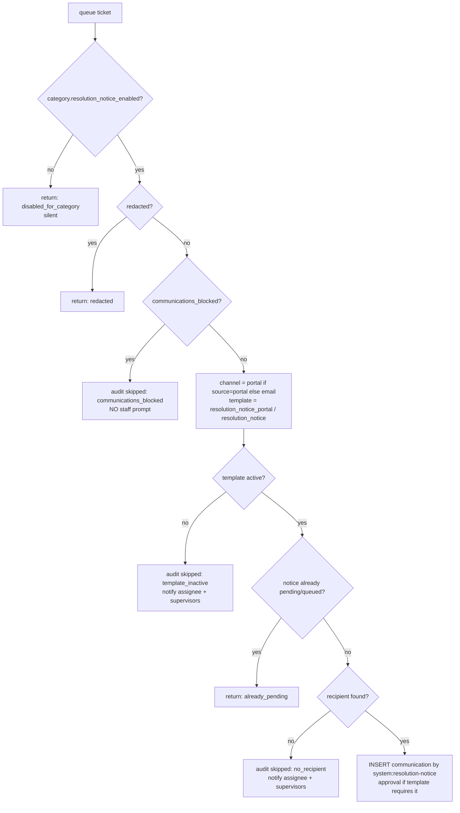

# Resolution notice

When a ticket is resolved, the customer must be told. The notice is queued **in the same transaction that resolves the ticket**, so a resolved ticket can never exist without either a notice or a recorded reason why there isn't one.

[Back to Communications index](README.md) · Code: [resolution-notice.service.ts](../../apps/api/src/tickets/resolution-notice.service.ts)

---

## 1. Trigger

[tickets.service.ts#L193](../../apps/api/src/tickets/tickets.service.ts#L193): `if (dto.toStatus === 'resolved') await this.resolutionNotice.queue(client, updated, correlationId);`

## 2. Decision tree

[queue(), L29-L59](../../apps/api/src/tickets/resolution-notice.service.ts#L29-L59):

| Outcome | Audit | Staff notified? | Why |
|---|---|---|---|
| Disabled for the category | none | no | Configuration choice |
| Already pending | none | no | Reopen → resolve again shouldn't spam |
| Blocked | `customer_communication.resolution_notice_skipped` | **no** | Prompting staff to contact the customer would defeat the block |
| Template inactive / no recipient | skipped event | **yes**: "No resolution notice could be sent; contact the customer directly" | Nobody tells the customer unless a person does ([L74](../../apps/api/src/tickets/resolution-notice.service.ts#L74)) |
| Queued / pending approval | `customer_communication.queued` / `.approval_requested` (`automatic: true`) | supervisors if approval is needed | Normal governed path |

## 3. Where the recipient comes from

[recipient(), L61-L69](../../apps/api/src/tickets/resolution-notice.service.ts#L61-L69):

| Ticket source | Recipient | Reason |
|---|---|---|
| Portal | The ticket's `PORTAL-<subject>` reference | Message appears in the customer's portal |
| Email | The `mailto:` address kept on the **acknowledgement** communication | The ticket's sender reference is a one-way HMAC pseudonym, so it can't be reversed into an address ([inbound.worker.ts#L61](../../apps/api/src/email/inbound.worker.ts#L61)) |
| Anything else | The first opaque customer reference | The bank's CRM resolves it at send time |

## 4. Why inside the resolve transaction?

If it were queued afterwards (say by an outbox consumer), a crash between commit and queueing could leave a resolved ticket and a customer who is never told: a regulatory failure for complaints. Doing it in-transaction gives **atomicity**: either both happen or neither does. Delivery itself still happens later, asynchronously and with retries.

## 5. Interview answer

> When the status becomes resolved, the same transaction asks `ResolutionNoticeService` to queue a governed communication: a portal message for portal tickets, otherwise email to the address kept from the acknowledgement or the CRM reference. It honours category settings, redaction, communication blocks, duplicate pending notices and template approval rules. If it can't send, it audits the reason and, except for blocks, tells the assignee and supervisors to contact the customer, so there's never a silent gap.

Next: [Delivery and receipts](delivery-and-receipts.md)
