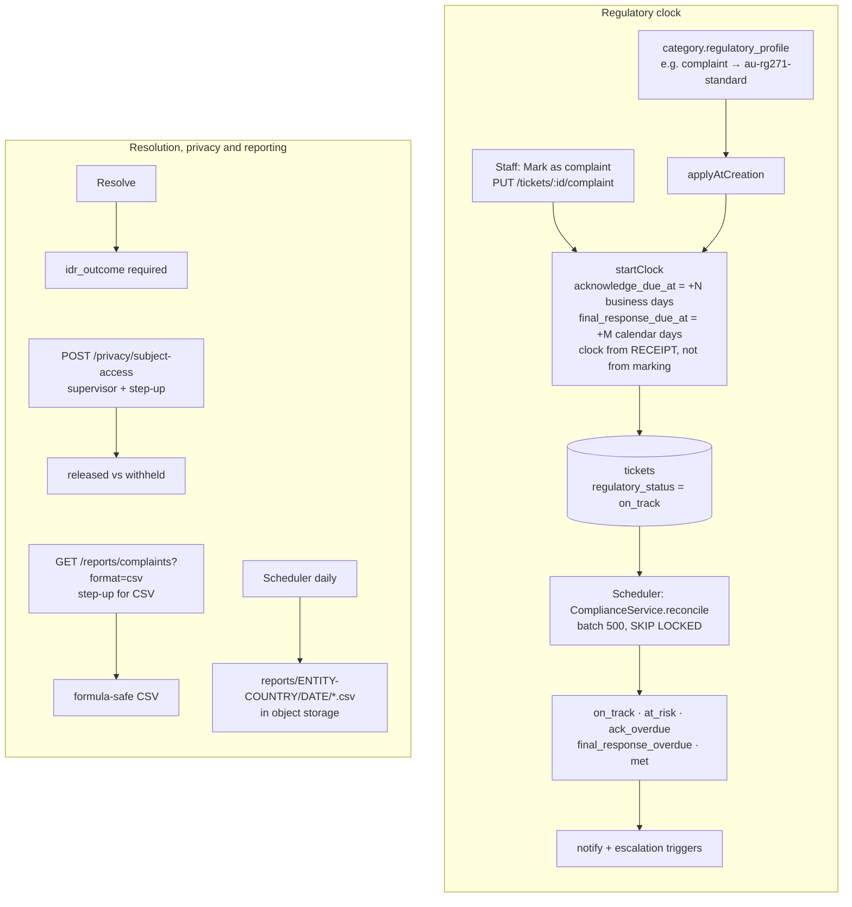

# Compliance: complaints, regulatory clocks, privacy and reports

> **Regulatory complaint handling (Australia: ASIC RG 271)**: when a customer expresses dissatisfaction, the bank must **acknowledge** it quickly (1 business day) and give a **final response** within a deadline (30 calendar days, or 21 for hardship). Unresolved complaints can go to the external dispute scheme **AFCA**.
> **Privacy Act (APP 12 / 13)**: customers can ask what the bank holds about them (subject access), and ask for corrections, each with deadlines.
> **Tipping-off control**: during fraud or suspicious-matter investigations, the customer must not be alerted, so customer communications can be **blocked** per case.
> In plain words: rules that differ by country are stored as **data** (regulatory profiles), so a bank in another market adds its own rules instead of asking for code changes.

## Picture

## Where it lives

| File | Role |
|---|---|
| [compliance/compliance.service.ts](../../apps/api/src/compliance/compliance.service.ts) | Classification, clocks, reconcile, AFCA, block, subject access, register, profiles, hours, holidays |
| [compliance/compliance.controller.ts](../../apps/api/src/compliance/compliance.controller.ts) | Routes |
| [compliance/compliance.dto.ts](../../apps/api/src/compliance/compliance.dto.ts) | Outcome lists and DTOs |
| [compliance/business-calendar.ts](../../apps/api/src/compliance/business-calendar.ts) | Business-day math ([SLA → business calendar](../sla/business-calendar.md)) |
| [compliance/csv.ts](../../apps/api/src/compliance/csv.ts) | Formula-injection-safe CSV |
| [operations/report-export.service.ts](../../apps/api/src/operations/report-export.service.ts) | Daily scoped report files |
| [ticket/tabs/compliance-tab.tsx](../../apps/web/src/features/ticket/tabs/compliance-tab.tsx) | Ticket compliance UI |
| [admin/sections/compliance-section.tsx](../../apps/web/src/features/admin/sections/compliance-section.tsx) | Profiles + holidays UI |
| Migrations | […18000 regulatory complaints](../../apps/api/migrations/1710000018000_regulatory_complaints.cjs), […27000 privacy correction](../../apps/api/migrations/1710000027000_privacy_correction.cjs) |

## Read in this order

1. [Regulatory clocks and case controls](regulatory-clocks.md): profiles, classification, deadlines, status formula, AFCA, communication block, outcomes.
2. [Reports and privacy](reports-and-privacy.md): subject-access export, complaints register, CSV safety, scheduled exports.
3. [Frontend](frontend.md): the Compliance tab and the admin section.
4. [Interview Q&A](interview-qa.md)

## Glossary

| Term | Plain meaning |
|---|---|
| **Regulatory profile** | A row with jurisdiction, case kind (complaint/privacy), acknowledge business days, final-response calendar days, and at-risk window |
| **IDR outcome** | Internal Dispute Resolution result: `upheld`, `partially_upheld`, `not_upheld`, `withdrawn`, `resolved_by_agreement` (complaints); `corrected`, `corrected_with_statement`, `refused_with_reasons` (privacy) |
| **AFCA** | Australian Financial Complaints Authority, the external scheme; status `none/referred/open/closed` + reference |
| **Vulnerability flag** | Customer in vulnerable circumstances (needs extra care; reported) |
| **Systemic issue** | A problem affecting many customers (reported) |
| **Subject access (APP 12)** | Export of what the platform holds about a customer reference |
| **Complaints register** | Period report of complaints: classifications, dates, outcomes, no free text |
| **CSV/formula injection** | A cell starting with `=`, `+`, `-` or `@` runs as a formula in Excel; neutralised by prefixing `'` |

## 30-second answer

> Jurisdiction rules are data: regulatory profiles define acknowledgement business days, final-response days and an at-risk window. A category can carry a profile, so its tickets start the clock at creation, or staff can mark a ticket as a complaint later, and the clock still starts from the receipt time. A scheduler re-derives regulatory status with one SQL `CASE` in skip-locked batches, notifying people and feeding escalation rules. Resolving needs a formal outcome. Supervisors can record AFCA referrals and block customer communications for investigations. Privacy exports and the complaints register are scoped, step-up protected and audited, and CSVs are formula-safe.

## Related

[SLA (shares the calendar)](../sla/README.md) · [Communications (block)](../communications/creating-and-approving.md#4-communication-block-tipping-off) · [Workflow scheduler](../workflow/scheduler.md) · [Escalation triggers](../assignment-and-routing/escalation.md) · [Dashboard (complaint tiles)](../dashboard/README.md) · [Retention](../retention/README.md) · [Security pack (APRA, Privacy Act mapping)](../security/security-pack.md)
