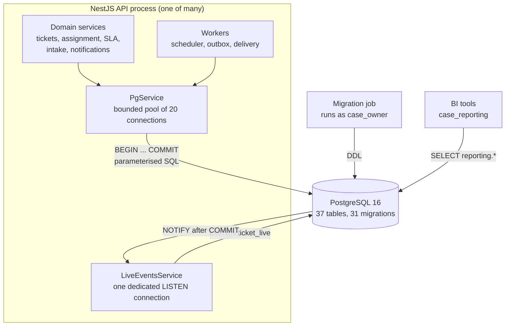
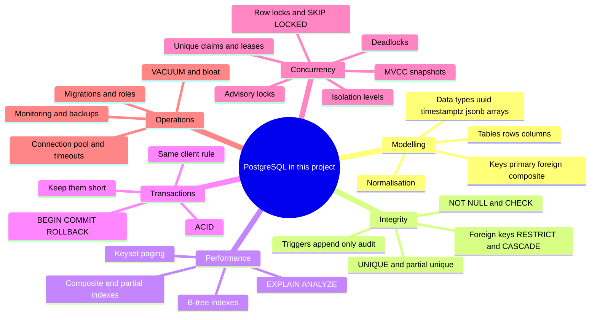

# Database: PostgreSQL from first principles, using this project

> **PostgreSQL** is a relational database: it stores data in tables of rows and columns, enforces rules about that data, and lets many programs read and change it at the same time without corrupting it.
> In plain words: it is the bank's ledger. Everything important is written there first, written carefully, and written so that two clerks writing at once never smudge each other's entries.

In this project PostgreSQL is the **single source of truth** (the one place whose answer wins when two places disagree). Tickets, audit evidence, the outbox, notifications, configuration and even live-update signals all go through it. Redis is an optional cache, Kafka is downstream, and object storage holds file bytes, but if any of those disagree with PostgreSQL, PostgreSQL is right.

This folder is a **course**. It teaches databases from the ground up, and every idea is proven against real code, real migrations, and experiments you can run on your laptop. The lab outputs quoted in these pages were captured on the project's own PostgreSQL 16 container.

---

## The big picture

Read it as three different kinds of conversation with the database:

1. **The API** talks to PostgreSQL through a pool of connections, always with parameterised SQL, and groups related writes into transactions.
2. **The migration job** is the only thing allowed to change the *shape* of the database (create tables, add columns), and it runs as a different account from the API.
3. **Reporting tools** get a narrow, read-only window (views) and never see case content.

---

## Mind map

---

## Where it lives in the code

| File | Role |
|---|---|
| [database/pg.service.ts](../../apps/api/src/database/pg.service.ts) | The bounded pool, `query()`, and the `transaction()` helper every service uses |
| [database/database-guard.service.ts](../../apps/api/src/database/database-guard.service.ts) | Startup check: could the account the app runs as tamper with the audit trail? |
| [database/database.module.ts](../../apps/api/src/database/database.module.ts) | `@Global()` module so any service can inject `PgService` |
| [live/live-events.service.ts](../../apps/api/src/live/live-events.service.ts) | A separate, long-lived connection that `LISTEN`s for `NOTIFY` messages |
| [apps/api/migrations/](../../apps/api/migrations/) | 31 numbered `node-pg-migrate` migrations: the schema's history |
| [scripts/migrate.mjs](../../apps/api/scripts/migrate.mjs) | Entry point for the container migration job |
| [infra/postgres/roles.sql](../../infra/postgres/roles.sql) | The owner, app and reporting accounts, and their privileges |
| [docker-compose.yml](../../docker-compose.yml#L2-L14) | Local PostgreSQL 16 on host port **5433** |

---

## Reading order (the course)

Work through these in order. Each page explains the idea in prose first, then shows it in our code, then gives an experiment.

| # | Page | You will learn |
|---|---|---|
| 0 | [Concepts glossary](concepts.md) | Every term in this folder: the technical name, a plain meaning, an analogy, and where it appears in our code. Keep it open while reading the rest |
| 1 | [Data types and modelling](data-types-and-modelling.md) | Tables, columns, types (`uuid`, `timestamptz`, `jsonb`, `text[]`), primary keys, natural vs surrogate keys, normalisation, and why our columns look the way they do |
| 2 | [Schema tour](schema-tour.md) | All 37 tables grouped by purpose, with entity-relationship diagrams and the story of how the schema grew |
| 3 | [Constraints and integrity](constraints-and-integrity.md) | `NOT NULL`, `CHECK`, `UNIQUE`, foreign keys (`RESTRICT` vs `CASCADE`), partial unique indexes, triggers: the database as the last line of defence |
| 4 | [Indexes and query plans](indexes-and-query-plans.md) | How a B-tree works, composite and partial indexes, reading `EXPLAIN ANALYZE`, keyset vs `OFFSET` paging, with measured plans from our data |
| 5 | [SQL patterns cookbook](sql-patterns.md) | Every SQL idiom the code uses (`RETURNING`, upsert, `UPDATE ... FROM`, `ANY($1::text[])`, anti-joins, row comparison, `IS DISTINCT FROM`), and SQL injection defence |
| 6 | [Transactions and ACID](transactions.md) | What a transaction guarantees, the `transaction()` helper line by line, the "same client" rule, aborted transactions, savepoints, keeping transactions short |
| 7 | [Connections and the pool](connection-pool.md) | Why a connection is expensive, how the pool works, each timeout and the failure it prevents, pool deadlock, the separate LISTEN connection, sizing across instances |
| 8 | [MVCC and isolation levels](mvcc-and-isolation.md) | How PostgreSQL lets readers and writers work at once, snapshots, the anomalies (lost update, non-repeatable read, phantom, write skew) and which isolation level stops which |
| 9 | [Locking and concurrency](locking-and-concurrency.md) | Row locks, `SKIP LOCKED`, advisory locks, unique-constraint claims, conditional updates, leases, deadlocks: each with a timeline, and the full catalogue of where we use them |
| 10 | [Migrations and roles](migrations-and-roles.md) | How the schema changes safely, `up`/`down`, backfills, owner vs app vs reporting accounts, grants and default privileges, reporting views |
| 11 | [Running PostgreSQL in production](production-operations.md) | VACUUM and dead rows, the outbox's churn, connection limits, PgBouncer, monitoring views, backups and point-in-time recovery |
| 12 | [Hands-on labs](hands-on-labs.md) | 16 experiments (two-terminal locking races included) you run against a scratch copy of our schema. Every expected output is real |
| 13 | [Interview Q&A](interview-qa.md) | 60+ questions from beginner to senior, each answered with this project's code |

**If you only have one hour:** read [Transactions](transactions.md) → [MVCC and isolation](mvcc-and-isolation.md) → [Locking](locking-and-concurrency.md), then do labs 4 to 9 in [Hands-on labs](hands-on-labs.md).

---

## 30-second answer

> PostgreSQL is our single source of truth. The API reaches it through one injectable, bounded pool with connection, statement and idle-in-transaction timeouts, and a `transaction(callback)` helper that always commits or rolls back and always releases the connection. Each use case passes that one `PoolClient` to the business writes, the audit insert, the outbox insert and `pg_notify`, so they commit or vanish together. We run at READ COMMITTED and, where a read-check-write matters, add the right primitive: row locks, `SKIP LOCKED` work queues, advisory locks for decisions that span rows, unique constraints as claim-once guards, and leases for work done outside a transaction. The schema enforces its own rules with keys, checks and triggers, it evolves through numbered migrations run by an owner account, and the app runs as a restricted account that cannot rewrite the audit trail.

## 2-minute answer (structure)

1. **Model:** surrogate UUID keys, composite natural keys where identity is a combination (`(actor_id, idempotency_key)`, `(channel, message_id)`), `timestamptz` everywhere, `jsonb` only for bank-defined custom fields.
2. **Integrity:** constraints in the database, not just validation in code (checks on enums, a notification must have an audience, a ticket cannot link to itself, append-only audit triggers).
3. **Atomicity:** one transaction, one client; network calls happen outside transactions.
4. **Concurrency:** READ COMMITTED plus targeted locks, and an honest gap: general ticket edits need a conditional update to stop lost updates.
5. **Performance:** indexes designed for the actual queries (the paging index, partial indexes for due work), keyset paging, bounded batches.
6. **Operations:** least-privilege roles, migrations as a job, timeouts that fail fast, and what we would add (PgBouncer, `pg_stat_statements`, retention for notifications).

---

## Related topics

[Audit: database protection](../audit/database-protection.md) · [Outbox: claims and retries](../outbox/how-it-works.md) · [Tickets: data model](../tickets/data-model.md) · [Tickets: the concurrency gap](../tickets/mutations-and-concurrency.md) · [Notifications](../notifications/README.md) · [Live updates](../live-updates/README.md) · [Reference: data and consistency map](../reference/data-and-consistency-map.md) · [Operations: capacity and DR](../operations/README.md)
