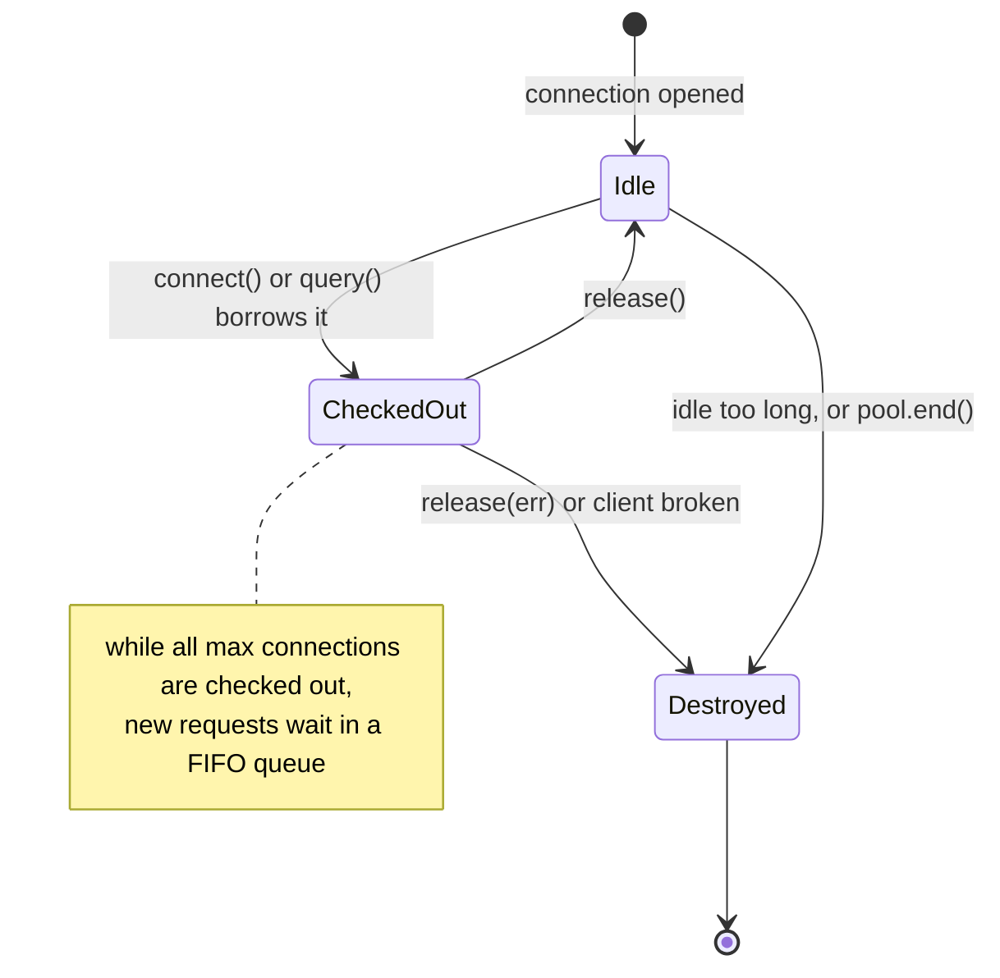

# Connections and the pool

[Back to Database index](README.md) · Previous: [Transactions](transactions.md) · Next: [MVCC and isolation](mvcc-and-isolation.md) · Code: [pg.service.ts](../../apps/api/src/database/pg.service.ts)

> **Connection pool**: a set of already-open database connections that requests borrow and give back, instead of each request opening its own.
> In plain words: a taxi rank. Buying a car for every journey (opening a connection per request) is slow and the roads (the database) fill up; a rank of 20 taxis that people share is fast and bounded.

---

## 1. Why a database connection is expensive

PostgreSQL uses a **process-per-connection** model. When a client connects, the server's main process starts a new operating-system process (a *backend*) dedicated to that one connection for its whole life. Opening a connection therefore costs:

- a TCP handshake, often a TLS handshake, and password or certificate authentication;
- starting a server process, which then uses several megabytes of memory and grows with the work it does;
- a slot from a hard limit, `max_connections`, which is **100** on our container (`SHOW max_connections`, [lab 15](hands-on-labs.md#lab-15-aborted-transactions-and-savepoints)), minus a few reserved for superusers.

Opening a connection per HTTP request would add milliseconds to every request, and under load would exhaust `max_connections` and start refusing everyone. So the API opens a small, **bounded** number of connections and reuses them.

---

## 2. How the pool works

[pg.service.ts#L8-L14](../../apps/api/src/database/pg.service.ts#L8-L14):

```ts
private readonly pool = new Pool({
  connectionString: process.env.DATABASE_URL,
  max: Number(process.env.DATABASE_POOL_MAX ?? 20),
  connectionTimeoutMillis: Number(process.env.DATABASE_CONNECT_TIMEOUT_MS ?? 10_000),
  statement_timeout: Number(process.env.DATABASE_STATEMENT_TIMEOUT_MS ?? 60_000),
  idle_in_transaction_session_timeout: Number(process.env.DATABASE_IDLE_IN_TRANSACTION_MS ?? 60_000)
});
```

`PgService` is a NestJS singleton provided by a `@Global()` module ([database.module.ts](../../apps/api/src/database/database.module.ts)), so there is **exactly one pool per API process**, shared by every request and worker in it.

The pool's behaviour (from the `pg-pool` library):



- **Lazy creation.** Connections are opened on demand, up to `max`.
- **Borrowing.** `pool.query(sql)` borrows a connection for one statement and returns it automatically. `pool.connect()` hands you the connection until you call `release()`, which is what `transaction()` uses.
- **Queueing.** When all `max` connections are checked out, further requests **wait in a queue** for one to be released.
- **Destroying broken connections.** On release, `pg-pool` destroys any client that errored or can no longer be queried, so a dead connection is never handed out again.
- **Shutdown.** `onModuleDestroy` calls `pool.end()` ([pg.service.ts#L22](../../apps/api/src/database/pg.service.ts#L22)), which closes idle connections and lets in-flight ones finish, so a rolling deploy does not cut transactions off mid-way.

---

## 3. The three timeouts, and the failures they prevent

The comment at [pg.service.ts#L6-L7](../../apps/api/src/database/pg.service.ts#L6-L7) summarises the design: "a bounded pool that fails fast". Each timeout exists to turn an **unbounded wait** (a request hanging forever, a lock held forever) into a **bounded error** that is logged, alerted on and recovered from.

### `connectionTimeoutMillis` (10 s): waiting for a free connection

**What:** how long a request may wait in the pool's queue for a connection. This is a client-side setting in `pg-pool`; PostgreSQL knows nothing about it.

**Failure it prevents:** without it, `pg-pool` waits **forever**. If the pool is saturated (all 20 connections busy with slow queries, or leaked), new requests pile up indefinitely, memory grows, and clients see hung requests rather than errors. With it, after 10 seconds the request fails with `timeout exceeded when trying to connect`. That is the line operators search for in the runbook ([runbooks.md](../operations/runbooks.md)).

### `statement_timeout` (60 s): one statement running too long

**What:** a PostgreSQL session setting, applied to every pooled connection. Any single statement running longer than this is cancelled by the server.

**Failure it prevents:** a runaway query (a missing index on a grown table, a bad plan, an accidental cross join) holding a connection, CPU, and **its locks** indefinitely. Lab output:

```text
SET statement_timeout = '300ms'; SELECT pg_sleep(1);
ERROR:  canceling statement due to statement timeout
```

The error aborts the transaction, so the helper rolls back cleanly.

### `idle_in_transaction_session_timeout` (60 s): a transaction left open

**What:** a PostgreSQL session setting. If a session has an **open transaction** and sends **no statement** for this long, the server terminates the whole session.

**Failure it prevents:** this is the subtle one, and the most important. Imagine a request that has started a transaction, written an audit event (taking the system-wide audit advisory lock, [transactions](transactions.md#why-this-matters-more-here-than-in-most-apps-the-audit-lock)), and is now stuck in JavaScript: awaiting a hung network call that slipped into the transaction, or a bug that never resolves a promise. The transaction is not *running* a statement, so `statement_timeout` never fires. It just sits there **holding the lock**, and every other audited write in every API instance queues behind it. The whole product freezes.

`idle_in_transaction_session_timeout` breaks that deadlock of the living: after 60 seconds of silence, PostgreSQL kills the session, which rolls back the transaction and **releases its locks**. Lab output:

```text
SET idle_in_transaction_session_timeout = '500ms';
BEGIN; SELECT 1;
\! sleep 1.5
SELECT 2;
FATAL:  terminating connection due to idle-in-transaction timeout
server closed the connection unexpectedly
```

Note it is `FATAL` (the session is gone), not `ERROR`. The application sees a broken connection, the helper's ROLLBACK fails too, and `pg-pool` destroys the client on release.

### Choosing the values

60 seconds is generous: no legitimate request should hold a transaction that long. A tighter production setting (5 to 15 seconds for the idle timeout, 15 to 30 for statements) would bound the worst-case freeze further. These are environment variables precisely so each bank can tune them.

---

## 4. Pool deadlock: the trap `nextStatuses` avoids

A **pool deadlock** is a deadlock between your code and the pool, not inside PostgreSQL:

1. 20 requests each start a transaction, so all 20 connections are checked out.
2. Inside its transaction, each request calls a helper that does `this.db.query(...)`, which asks the pool for **another** connection.
3. None is free, so all 20 wait in the queue. None can finish its transaction, so none releases a connection.
4. Nothing moves until `connectionTimeoutMillis` fails them all.

It only happens under load, which makes it painful to reproduce. `WorkflowDefinitionService.nextStatuses` takes an optional `client` for exactly this reason ([workflow-definition.service.ts#L45-L47](../../apps/api/src/workflow/workflow-definition.service.ts#L45-L47)):

```ts
async nextStatuses(category, from, roles, client?: PoolClient) {
  // Inside a transaction pass its client: asking the pool for a second connection while holding one can deadlock a busy pool.
  const runner = (client ?? this.db) as { query: PgService['query'] };
```

and the ticket detail read passes its client ([tickets.service.ts#L361](../../apps/api/src/tickets/tickets.service.ts#L361)). The general rule, which is the [same-client rule](transactions.md#4-the-same-client-rule) seen from the pool's side: **while holding a pooled connection, never borrow another one from the same pool.**

---

## 5. The second kind of connection: LISTEN

Live updates need a connection that stays open and `LISTEN`s for notifications ([live-events.service.ts#L81-L97](../../apps/api/src/live/live-events.service.ts#L81-L97)). This one is deliberately **not** from the pool:

```ts
const client = new Client({ connectionString: process.env.DATABASE_URL });
...
await client.query(`LISTEN ${CHANNEL}`);
```

Why a dedicated `Client`?

- A `LISTEN` belongs to a **session**. If the pool handed that connection to another request, or closed it as idle, the subscription would vanish silently.
- It is held for the life of the process, so taking it from the pool would permanently shrink the pool to 19.

Because it is outside the pool, it needs its own resilience: on `error` or `end` it schedules a reconnect with exponential backoff capped at 30 seconds ([L99-L105](../../apps/api/src/live/live-events.service.ts#L99-L105)), and after reconnecting it broadcasts `resync` to all browsers, because notifications sent while it was disconnected are lost ([L93-L94](../../apps/api/src/live/live-events.service.ts#L93-L94)). See [Notifications: live push](../notifications/live-push.md).

---

## 6. Sizing: how many connections in total?

Each API instance uses up to **20 pooled + 1 listener = 21** connections. Add the migration job (briefly), any reporting tool, and an operator's `psql`. Against `max_connections = 100`:

| API instances | Peak connections from the API | Headroom (of ~97 usable) |
|---|---|---|
| 1 | 21 | plenty |
| 2 | 42 | comfortable |
| 4 | 84 | tight once BI tools and admins connect |
| 5 | 105 | **over the limit**: new connections are refused |

[operations/capacity.md](../operations/capacity.md) records the rule "replicas × pool size must stay under the database's connection limit". Three ways to scale beyond it:

1. **Reduce `DATABASE_POOL_MAX`** per instance. More instances with smaller pools often perform as well, because a database with N CPU cores can only *execute* about N queries at once; extra connections just wait inside PostgreSQL instead of in the pool.
2. **Raise `max_connections`**, at the cost of memory per backend.
3. **Put PgBouncer in front**, which multiplexes many client connections onto few server connections. It has real caveats for this codebase ([production operations](production-operations.md#3-pgbouncer-and-what-it-would-break)).

A useful estimate is **Little's law**: connections in use ≈ requests per second × average time each request holds a connection. At 200 database-touching requests per second each holding a connection for 15 ms, that is 3 connections busy on average, so 20 is ample headroom for bursts. Pool exhaustion in practice almost always means **something holds connections far longer than it should**: a slow query, or a network call inside a transaction.

---

## 7. What to watch

| Signal | Where | Meaning |
|---|---|---|
| `timeout exceeded when trying to connect` in logs | API logs | Pool saturated for 10 s: look for slow queries or leaked transactions |
| `SELECT state, count(*) FROM pg_stat_activity GROUP BY 1` | PostgreSQL | How many sessions are `active`, `idle`, `idle in transaction` |
| Sessions `idle in transaction` for many seconds | `pg_stat_activity.xact_start`, `state_change` | A request is holding a transaction open while not talking to the database: the audit-lock danger |
| `canceling statement due to statement timeout` | API logs | A query needs an index or a rewrite |

[Production operations](production-operations.md#4-monitoring-what-to-look-at) has the full monitoring queries.

---

## 8. Check yourself

1. Why is opening a PostgreSQL connection per request a bad idea? Give two reasons.
2. Which timeout fires when a request is stuck in JavaScript inside an open transaction? Why does neither of the other two?
3. Describe a pool deadlock in four steps. How does `nextStatuses` avoid it?
4. Why is the LISTEN connection not taken from the pool?
5. You need 6 API instances. What breaks, and what are your three options?

Next: [MVCC and isolation levels](mvcc-and-isolation.md)
