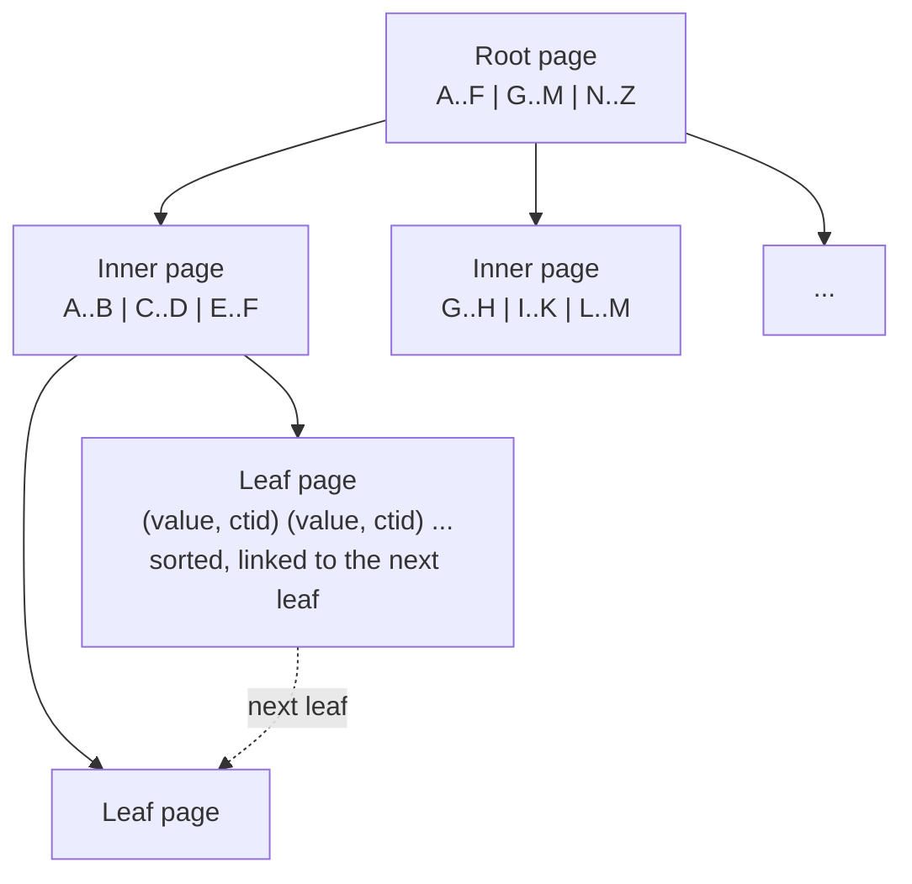

# Indexes and query plans

[Back to Database index](README.md) · Previous: [Constraints and integrity](constraints-and-integrity.md) · Next: [SQL patterns cookbook](sql-patterns.md)

An **index** is a separate, sorted data structure that lets PostgreSQL find rows without reading the whole table. A **query plan** is PostgreSQL's chosen strategy for running one query. This page teaches how indexes work inside, how to read a plan, and how the indexes in this schema were designed from the queries the code runs. The plans quoted are real, measured on a lab copy of our schema with 50,000 tickets and 20,000 notifications ([lab setup](hands-on-labs.md#setup-a-scratch-copy-of-our-schema)).

---

## 1. How a table is stored, and why that makes indexes necessary

PostgreSQL stores a table as a **heap**: a file of 8 KB **pages**, each holding as many rows as fit, in no particular order. Every row has a physical address called its `ctid` (page number, slot number), for example `(1428, 7)`.

To answer `SELECT * FROM tickets WHERE id = '...'` with only the heap, PostgreSQL must read every page and test every row. That is a **sequential scan**. For 50,000 tickets the heap is about 11 MB (1,400 pages); for 5 million it would be 1.1 GB. Reading all of it to find one row does not scale.

An index fixes this by storing, in sorted order, pairs of *(indexed value, ctid)*. Find the value in the sorted structure, then jump straight to that page.

---

## 2. The B-tree: what an index really is

The default index type is the **B-tree** (balanced tree). Picture a library catalogue:



- **Leaf pages** hold every indexed value with its row address, in sorted order, and each leaf links to the next. That linking is what makes range scans and `ORDER BY` cheap: find the starting point, then walk sideways.
- **Inner pages** hold separator values that say which child to descend into.
- The tree stays **balanced**: every leaf is the same distance from the root. With hundreds of entries per page, three or four levels cover millions of rows. Finding any row costs three or four page reads instead of thousands.

What a B-tree is good at: `=`, `<`, `<=`, `>`, `>=`, `BETWEEN`, `IN`/`= ANY(...)`, `IS NULL`, prefix matches (`LIKE 'abc%'` with the right operator class), and producing rows **already sorted**.

What it cannot do: find a value in the **middle** of a string (`ILIKE '%ticket 4999%'`), because sorted order says nothing about middles. That case is in [section 7](#7-search-when-an-index-cannot-help).

The price of an index: disk space (the paging index is 5.5 MB for 50,000 tickets, half the size of the table), and **every INSERT, and every UPDATE that changes an indexed column, must also update every index**. Indexes make reads fast and writes slower. Add them for queries you actually run.

---

## 3. Composite indexes: column order is everything

A **composite index** sorts by its first column, then by the second within equal firsts, and so on, like a phone book sorted by surname then first name. That gives the **leftmost-prefix rule**: the index helps a query that constrains a *leading* run of its columns.

Take the most important index in the schema, added for the paged ticket list ([migration 25000#L4](../../apps/api/migrations/1710000025000_paging_and_reporting.cjs#L4)):

```sql
CREATE INDEX tickets_paging_idx ON tickets (legal_entity, country, queue, created_at DESC, id DESC);
```

and the query it serves ([tickets.service.ts#L78-L79](../../apps/api/src/tickets/tickets.service.ts#L78-L79)):

```sql
SELECT * FROM tickets
WHERE legal_entity=$1 AND country=$2 AND queue = ANY($3::text[])
  AND ($4::timestamptz IS NULL OR (created_at, id) < ($4::timestamptz, $5::uuid))
ORDER BY created_at DESC, id DESC LIMIT $6
```

Why exactly this order?

1. `legal_entity`, `country`, `queue` come first because the query fixes them with equality. Within one `(entity, country, queue)` group the leaf entries are contiguous.
2. `created_at DESC, id DESC` come next, in the **same direction as the `ORDER BY`**. Within the group, entries are already in "newest first" order, so PostgreSQL can read the first 51 and stop, with no sorting.
3. `id` is included as a **tie-breaker**. Two tickets created in the same transaction share the same `created_at` (because `now()` is the transaction start time). Without `id`, the order of ties would be undefined and paging could skip or repeat rows.

| Query constrains | Can it use `tickets_paging_idx`? |
|---|---|
| `legal_entity, country, queue` + order by `created_at DESC, id DESC` | Yes, perfectly |
| `legal_entity, country` only | Yes, for the first two columns |
| `queue` only | Not efficiently: `queue` is the third column |
| `created_at` range only | No |

---

## 4. Reading EXPLAIN ANALYZE

`EXPLAIN` shows the plan; `EXPLAIN ANALYZE` runs the query and adds what really happened. Add `BUFFERS` to see how many 8 KB pages were touched; this is the best single measure of work. The lab uses `COSTS OFF, TIMING OFF` to keep the output short.

How to read a plan:

- It is a **tree**. The most indented node runs first and feeds its parent. Read from the inside out.
- `actual rows=N loops=M`: the node produced N rows on each of M executions.
- `Buffers: shared hit=X read=Y`: X pages found in PostgreSQL's memory cache, Y read from disk.
- `Rows Removed by Filter`: rows the node read and then threw away. A large number here is the most common sign of a missing or wrong index.
- `Execution Time` is the real total.

The node types you will see:

| Node | Plain meaning |
|---|---|
| `Seq Scan` | Read the whole table |
| `Index Scan` | Walk the index, fetch each matching row from the heap |
| `Index Only Scan` | The index holds every column the query needs, so the heap is (almost) skipped. `Heap Fetches` counts the exceptions |
| `Bitmap Index Scan` + `Bitmap Heap Scan` | Collect matching row addresses from one or more indexes into a bitmap, then read heap pages in physical order. `BitmapOr` combines two indexes for an `OR` |
| `Sort` (`top-N heapsort`) | Sort rows; with `LIMIT`, keep only the best N in memory |
| `Limit` | Stop after N rows |
| `Hash Join`, `Nested Loop`, `Merge Join` | The three ways to join two inputs |

---

## 5. Measured: keyset paging vs OFFSET

There are two ways to fetch "page 160" of a list.

**OFFSET paging** says "sort everything, skip the first 8,000, return the next 51". The database must still produce and discard the 8,000. **Keyset paging** (also called the seek method) says "return the 51 rows that come after the last row of the previous page", using that row's `(created_at, id)` as a bookmark. The code encodes the bookmark as an opaque base64url cursor ([tickets.service.ts#L73-L77](../../apps/api/src/tickets/tickets.service.ts#L73-L77) decodes it, [L84](../../apps/api/src/tickets/tickets.service.ts#L84) creates the next one).

Measured, for one queue, about 8,000 rows deep:

```text
=== keyset deep page
 Limit (actual rows=51 loops=1)
   Buffers: shared hit=4
   ->  Index Only Scan using tickets_paging_idx on tickets (actual rows=51 loops=1)
         Index Cond: (... AND (queue = 'payments') AND (ROW(created_at, id) < ROW('2026-09-29 ...', 'ce3c4e11-...')))
 Execution Time: 0.069 ms

=== offset deep page
 Limit (actual rows=51 loops=1)
   Buffers: shared hit=71
   ->  Index Only Scan using tickets_paging_idx on tickets (actual rows=8051 loops=1)
 Execution Time: 1.252 ms
```

Keyset touched **4 pages** and read exactly 51 index entries, because the row comparison `(created_at, id) < (...)` became part of the `Index Cond`: PostgreSQL jumped straight to the bookmark. OFFSET read 8,051 entries to return 51. Keyset cost stays constant however deep you go; OFFSET cost grows with the page number.

Keyset paging has a second advantage: **stable pages**. If new tickets arrive while someone is paging, OFFSET shifts every row down and the user sees duplicates. A bookmark is not affected by inserts above it. The integration test checks that pages never overlap ([workflow.integration-spec.ts#L312-L318](../../apps/api/test/workflow.integration-spec.ts#L312-L318)).

The trade-off: keyset cannot jump to "page 160" directly, only "next". That suits an infinite-scroll queue.

### A real finding: several queues defeat the "already sorted" property

Most staff hold more than one queue, so the real query uses `queue = ANY('{payments,cards}')`. Measured:

```text
=== keyset first page, two queues
 Limit (actual rows=51 loops=1)
   Buffers: shared hit=209
   ->  Sort (actual rows=51 loops=1)
         Sort Key: created_at DESC, id DESC
         Sort Method: top-N heapsort  Memory: 28kB
         ->  Index Only Scan using tickets_paging_idx on tickets (actual rows=16668 loops=1)
               Index Cond: ((legal_entity = 'BANK-IN') AND (country = 'IN') AND (queue = ANY ('{payments,cards}')))
 Execution Time: 5.351 ms
```

Each queue's entries are sorted, but the two groups sit in different parts of the index, so PostgreSQL reads **all 16,668** matching entries and keeps the newest 51 with a top-N sort. Still fast at this size (5 ms), but it grows with the size of the user's queues, not with the page size. Options if it ever matters: run one keyset query per queue and merge the results in code (each one is a 4-page read), or add an index whose leading columns are only `(legal_entity, country, created_at DESC, id DESC)` and filter queue afterwards. Measure before choosing; that is the lesson.

---

## 6. Partial indexes: index only the rows that matter

A **partial index** has a `WHERE` clause and contains only matching rows. It is ideal for **work queues**, where at any moment only a tiny fraction of rows are "due".

| Index | Contains only | Serves |
|---|---|---|
| `ticket_communications_due_idx (next_attempt_at) WHERE status='queued'` | messages waiting to be sent | the delivery worker's claim ([delivery.worker.ts#L44-L47](../../apps/api/src/email/delivery.worker.ts#L44-L47)) |
| `integration_outbox_in_flight_idx (claimed_at) WHERE status='in_flight'` | events currently claimed | stale-claim recovery ([outbox.service.ts#L30](../../apps/api/src/outbox/outbox.service.ts#L30)) |
| `tickets_retention_candidates_idx (closed_at) WHERE redacted_at IS NULL AND closed_at IS NOT NULL` | closed tickets not yet redacted | the retention job |
| `tickets_complaint_status_idx (regulatory_status) WHERE is_complaint` | complaints only | complaints register |
| `tickets_resolved_at_idx (resolved_at) WHERE resolved_at IS NOT NULL` | resolved tickets | trends and reporting |

Two benefits. The index is **small**: after a year, millions of messages are `delivered` and only a handful are `queued`, so the index stays tiny and hot in memory. And it is **cheap to maintain**: rows outside the condition do not touch it.

For the planner to use a partial index, the query's `WHERE` must imply the index's condition. Measured:

```text
EXPLAIN SELECT id FROM tickets WHERE redacted_at IS NULL AND closed_at IS NOT NULL AND closed_at < now() - interval '7 years';
 Index Scan using tickets_retention_candidates_idx on tickets
   Index Cond: (closed_at < (now() - '7 years'::interval))
```

The same experiment on the outbox showed a `Seq Scan`, because the lab outbox had six rows. **For a tiny table, a sequential scan is the right plan**: one page read beats an index descent. Do not panic when you see `Seq Scan` on a small table.

---

## 7. Search: when an index cannot help

The search endpoint ([tickets.service.ts#L89-L93](../../apps/api/src/tickets/tickets.service.ts#L89-L93)) uses `subject ILIKE '%term%'`. The leading `%` means "anywhere in the string", which a B-tree cannot answer. Measured:

```text
 Bitmap Heap Scan on tickets (actual rows=3 loops=1)
   Recheck Cond: ((queue)::text = ANY ('{payments}'::text[]))
   Filter: (((subject)::text ~~* '%ticket 4999%'::text) AND ...)
   Rows Removed by Filter: 8331
   ->  Bitmap Index Scan on tickets_queue_status_index (actual rows=8335 loops=1)
 Execution Time: 16.725 ms
```

PostgreSQL used the `(queue, status)` index to narrow to the user's queue (8,335 rows), then tested every one against the pattern and kept 3. That works because search is always scoped to the user's queues, but it grows with queue size. The standard upgrades:

- **Trigram index** (`pg_trgm` extension, `CREATE INDEX ... USING gin (subject gin_trgm_ops)`): indexes every three-letter fragment, so `ILIKE '%abc%'` becomes indexable.
- **Full-text search** (`tsvector` column + GIN index): word-based search with stemming and ranking ("disputes" matches "dispute").

Note the code escapes `%`, `_` and `\` in the user's term before wrapping it in `%...%` ([L89](../../apps/api/src/tickets/tickets.service.ts#L89)). That stops a user typing `%` from turning the search into "match everything". It is not about SQL injection (the term is a parameter); it is about the *meaning* of the LIKE pattern.

---

## 8. The other indexes, and the query each one serves

| Index | Query it serves |
|---|---|
| `tickets_pkey (id)` | every single-ticket load: `SELECT * FROM tickets WHERE id=$1` ([L380](../../apps/api/src/tickets/tickets.service.ts#L380)) |
| `tickets_queue_status_index (queue, status)` | queue-scoped filtering, search narrowing, open-count subquery in auto-assignment |
| `tickets_sla_status_resolution_due_at_index` | SLA dashboards and reconciliation |
| `ticket_notes (ticket_id, created_at)`, `ticket_status_history (ticket_id, changed_at)`, `attachments (ticket_id, created_at)`, `ticket_communications (ticket_id, created_at)` | the detail view's child queries, already in timeline order ([L354-L358](../../apps/api/src/tickets/tickets.service.ts#L354-L358)) |
| `ticket_relationships` PK + `(target_ticket_id, relationship_type)` | `WHERE source_ticket_id=$1 OR target_ticket_id=$1`: one index per side of the `OR`, combined with `BitmapOr` |
| `integration_outbox (status, next_attempt_at)` | the dispatcher's claim: `status IN ('pending','retry') AND next_attempt_at <= now()` |
| `notifications (recipient_user, created_at)` and `(recipient_queue, audience_role, created_at)` | the two halves of the inbox's audience `OR` (see [Notifications: data model and SQL](../notifications/data-model-and-sql.md)) |
| `audit_events (target_type, target_id, occurred_at)`, `(actor_id, sequence)`, `(action, sequence)`, `(occurred_at)` | auditor search by target, by actor, by action, by date |

And one deliberate **absence**: `notification_reads` has only its primary key `(notification_id, user_id)`. Queries that start from "all reads by user X" cannot use it, because `user_id` is the second column. The [notifications performance page](../notifications/performance-and-limits.md) measures that and the fix.

---

## 9. How to design an index (the method)

1. **Start from a real, frequent query**, never from a table. Write it down with its `WHERE`, `ORDER BY` and `LIMIT`.
2. **Equality columns first**, in any order, then **one range or sort column**, in the direction of the `ORDER BY`.
3. **Add a tie-breaker** (usually the primary key) if the sort column can repeat and you page.
4. **Consider a partial index** if the query always filters to a small, stable subset (`status='queued'`).
5. **Measure with `EXPLAIN (ANALYZE, BUFFERS)`** on realistic data volumes. An empty development table always shows `Seq Scan` and tells you nothing.
6. **Weigh the write cost.** Every index slows every insert. A table written constantly (the outbox, audit) should carry only indexes that earn their keep.
7. **Check foreign keys** you query by ([constraints](constraints-and-integrity.md#postgresql-does-not-index-foreign-key-columns-for-you)).

---

## 10. Check yourself

1. Why does `tickets_paging_idx` end with `id DESC`?
2. Explain in one sentence why keyset paging cost stays flat while OFFSET grows.
3. Why does a query with `queue = ANY('{a,b}')` need a sort node when a single queue does not?
4. You see `Seq Scan` on `integration_outbox` in development. Is that a problem?
5. Which index would make `subject ILIKE '%abc%'` fast, and what does it cost?

Next: [SQL patterns cookbook](sql-patterns.md)
