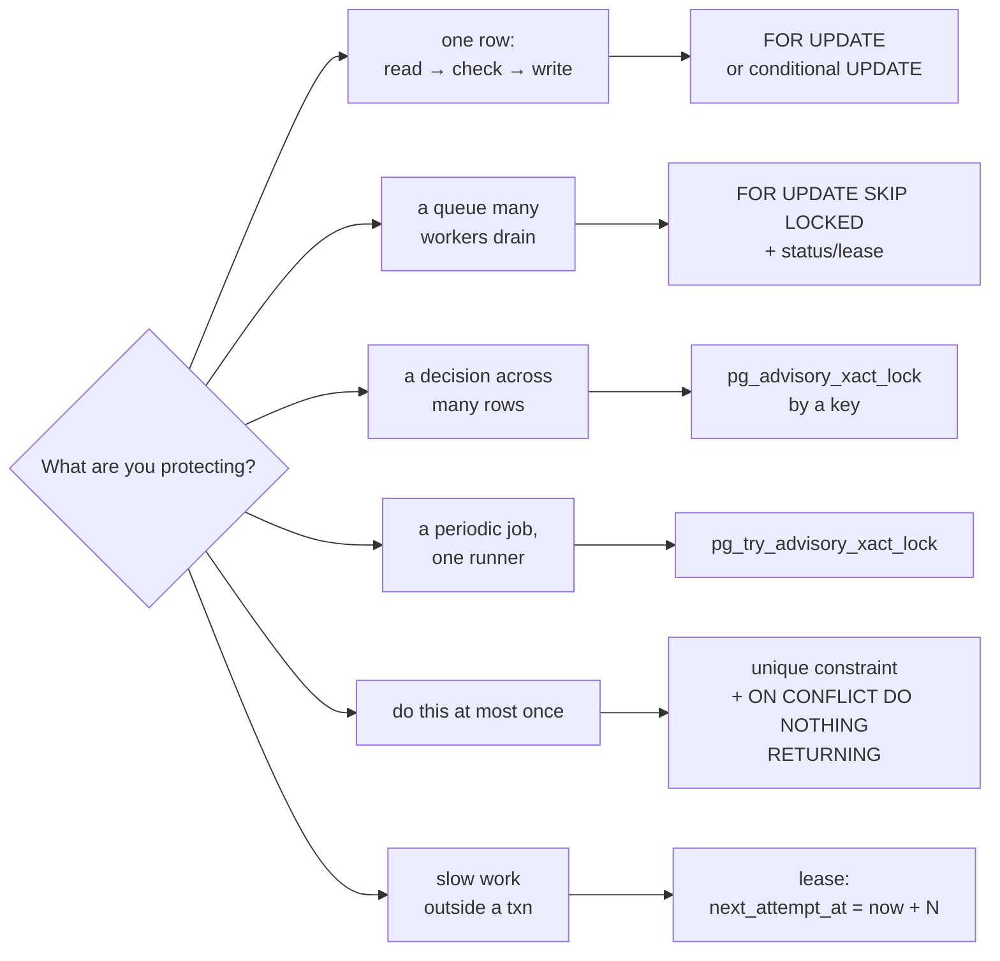

# Locking and concurrency catalogue

Every concurrency technique used in the codebase, what it protects, and why that technique was chosen. If an interviewer asks "what happens if two requests arrive at once?", the answer is in this table.

[Back to Database index](README.md)

---

## 1. The toolbox

| Technique | SQL | Plain meaning | Best for |
|---|---|---|---|
| **Row lock** | `SELECT ... FOR UPDATE` | "This row is mine until I commit; others wait" | Read-check-write on one row |
| **Skip-locked queue** | `... FOR UPDATE SKIP LOCKED LIMIT n` | "Give me rows nobody is holding; don't wait" | Many workers draining a queue |
| **Advisory lock (wait)** | `pg_advisory_xact_lock(key)` | A named "talking stick", released at commit | Serialising a decision that isn't one row |
| **Advisory lock (try)** | `pg_try_advisory_xact_lock(key)` | "Take the stick if free, else skip" | Leader election for a periodic job |
| **Unique constraint + `ON CONFLICT`** | `INSERT ... ON CONFLICT DO NOTHING RETURNING` | "Only one insert can win" | Idempotency, claim-once |
| **Conditional update** | `UPDATE ... WHERE ... AND <expected state> RETURNING` | "Change it only if it's still how I saw it" | Optimistic concurrency, state transitions |
| **Lease** | `UPDATE ... SET next_attempt_at = now() + 120s` | "Reserved for 2 minutes" | Work that happens outside a transaction |
| **Transactional NOTIFY** | `pg_notify` inside a txn | Delivered only on commit | Change signals |

## 2. Where each is used

| Where | Technique | Protects against | Code |
|---|---|---|---|
| Audit chain head | advisory `804231` (wait) | Two events linking to the same previous hash | [audit.service.ts#L16](../../apps/api/src/audit/audit.service.ts#L16) |
| Auto-assignment | advisory `hashtext('assign:'+queue)` | Simultaneous creates all picking the same "least loaded" person | [assignment.service.ts#L22](../../apps/api/src/tickets/assignment.service.ts#L22) |
| Channel intake | advisory `hashtext('intake:'+channel+':'+messageId)` | Concurrent redeliveries both creating tickets | [intake.service.ts#L32](../../apps/api/src/intake/intake.service.ts#L32) |
| Scheduler tick | advisory try `804232` | Several instances running the same tick | [workflow-scheduler.ts#L39-L40](../../apps/api/src/workflow/workflow-scheduler.ts#L39-L40) |
| Outbox claim | `SKIP LOCKED` + in-flight status | Two dispatchers publishing the same event | [outbox.service.ts#L35](../../apps/api/src/outbox/outbox.service.ts#L35) |
| Outbox batch replay | `SKIP LOCKED` | Concurrent replays | [outbox-admin.service.ts#L35](../../apps/api/src/operations/outbox-admin.service.ts#L35) |
| Delivery worker | `SKIP LOCKED` + **lease** (120 s) | Two workers sending the same message | [delivery.worker.ts#L44-L48](../../apps/api/src/email/delivery.worker.ts#L44-L48) |
| SLA timer | `SKIP LOCKED` batch | Timer blocking on rows users are editing | [sla.service.ts#L86](../../apps/api/src/tickets/sla.service.ts#L86) |
| Regulatory timer | `FOR UPDATE OF t2 SKIP LOCKED` | Same | [compliance.service.ts#L99](../../apps/api/src/compliance/compliance.service.ts#L99) |
| Escalation | row lock + **unique `(ticket_id, rule_key)` claim** | Ticket moved meanwhile; double escalation | [escalation.service.ts#L48-L51](../../apps/api/src/workflow/escalation.service.ts#L48-L51) |
| Approval decision | row lock on approval + communication | Two supervisors deciding | [tickets.service.ts#L330](../../apps/api/src/tickets/tickets.service.ts#L330), [L339](../../apps/api/src/tickets/tickets.service.ts#L339) |
| Attachment complete / scan | row lock | Double completion, double scan result | [L217](../../apps/api/src/tickets/tickets.service.ts#L217), [L230](../../apps/api/src/tickets/tickets.service.ts#L230) |
| Customer reply | row lock on ticket | Reply racing a staff transition | [customer-reply.service.ts#L23](../../apps/api/src/intake/customer-reply.service.ts#L23) |
| Retention | `FOR UPDATE OF t` re-check | Hold placed after candidate query | [retention.service.ts#L41](../../apps/api/src/retention/retention.service.ts#L41) |
| Upload link revoke | row lock | Double revoke | [upload-link.service.ts#L33](../../apps/api/src/tickets/upload-link.service.ts#L33) |
| Integration receipts | row lock + unique `(event, system)` | Duplicate or contradictory receipts | [integration.service.ts#L18](../../apps/api/src/integrations/integration.service.ts#L18) |
| Delivery receipts | row lock + unique `(comm, provider, msgId, status)` + rank | Duplicates, backwards transitions | [integration.service.ts#L39](../../apps/api/src/integrations/integration.service.ts#L39) |
| Staff create idempotency | `FOR UPDATE` lookup + **PK** `(actor, key)` | Double create (PK is the final guard) | [tickets.service.ts#L38](../../apps/api/src/tickets/tickets.service.ts#L38) |
| Outbox mark | conditional `WHERE status='in_flight'` | Marking a row another dispatcher re-claimed | [outbox.service.ts#L39-L43](../../apps/api/src/outbox/outbox.service.ts#L39-L43) |
| Replay | conditional `WHERE status='dead_letter'` | Replaying live events | [outbox-admin.service.ts#L34](../../apps/api/src/operations/outbox-admin.service.ts#L34) |
| Notification read | `ON CONFLICT DO NOTHING` | Double "mark read" | [notifications.service.ts#L46](../../apps/api/src/notifications/notifications.service.ts#L46) |
| Ticket relationships | PK + named-constraint → 409 | Duplicate links | [tickets.service.ts#L262-L263](../../apps/api/src/tickets/tickets.service.ts#L262-L263) |
| Live events | transactional NOTIFY | Pinging browsers about rolled-back changes | [live-events.service.ts#L47](../../apps/api/src/live/live-events.service.ts#L47) |

## 3. Where it is missing (be honest)

| Gap | Risk | Fix |
|---|---|---|
| General ticket mutations read without a lock and update without an expected-version predicate | **Lost update** under truly simultaneous edits | `UPDATE ... WHERE updated_at = $expected` (zero rows → 409) or `FOR UPDATE` ([details](../tickets/mutations-and-concurrency.md#3-the-concurrency-gap-be-honest-about-this)) |
| Staff create: first use of a key by two concurrent requests | The loser gets a 500, not the original | Catch `23505` and replay, or take an advisory lock on `(actor, key)` like intake does |
| Scan worker selects without a claim | Duplicate scanning work (safe, wasteful) | `SKIP LOCKED` + lease |
| Retention deletes files before the locked re-check | Files deleted for a just-held ticket | Pending-redaction state machine |

## 4. How to choose (rule of thumb)

## 5. Interview answer

> I pick the primitive per problem. Row locks protect read-check-write on an aggregate (approvals, attachments, replies, escalation re-checks). `SKIP LOCKED` lets many workers drain the outbox, deliveries and SLA batches in parallel. Advisory locks serialise decisions that span rows (the audit chain head, per-queue assignment, per-message intake), and a try-lock elects one scheduler instance. Unique constraints with `ON CONFLICT` give claim-once semantics for escalations, receipts and idempotency. Leases cover work done outside a transaction. And I'd name the gap: general ticket edits need a conditional update to stop lost updates.
