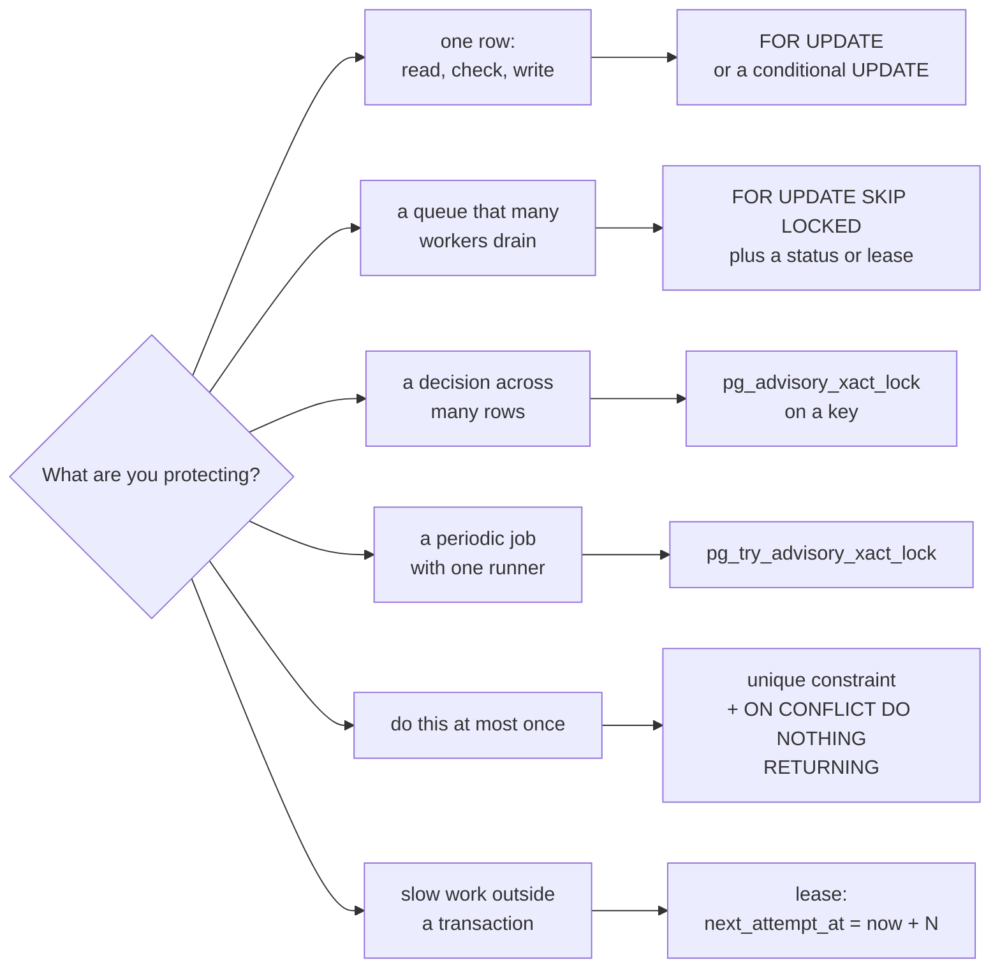
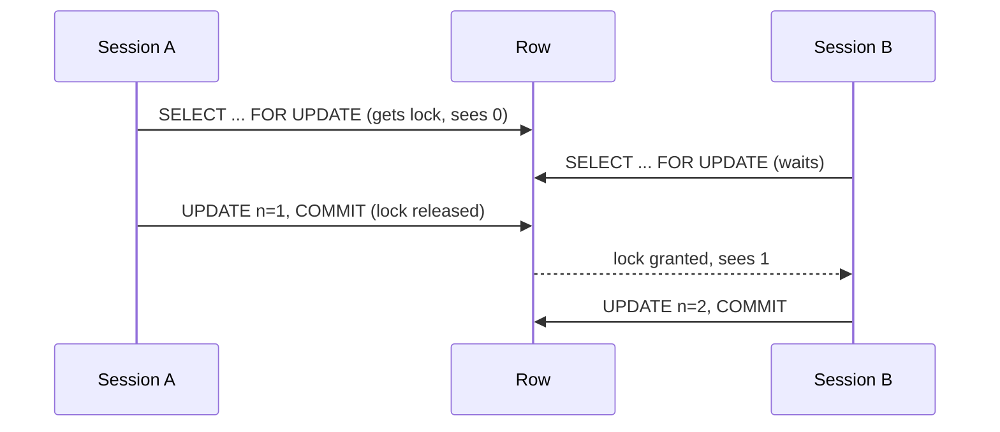

# Locking and concurrency

[Back to Database index](README.md) · Previous: [MVCC and isolation](mvcc-and-isolation.md) · Next: [Migrations and roles](migrations-and-roles.md)

> **Concurrency control**: the techniques that keep data correct when several transactions run at overlapping times.
> In plain words: rules for who may write which page of the ledger at the same moment, and what everyone else does while they wait.

[MVCC and isolation](mvcc-and-isolation.md) showed *why* problems happen at READ COMMITTED: a decision made in application code from an earlier `SELECT` can be invalidated before the write. This page is the **toolbox** for closing that gap. Each tool gets: what it is, how it behaves step by step, a real lab result, and where this codebase uses it. The last sections are the full catalogue and the honest list of gaps.

If an interviewer asks "what happens if two requests arrive at once?", the answer is somewhere in this page.

---

## 1. The toolbox at a glance

| Technique | SQL | Plain meaning | Best for |
|---|---|---|---|
| **Row lock** | `SELECT ... FOR UPDATE` | "This row is mine until I commit; others wait" | Read-check-write on one row |
| **Skip-locked queue** | `... FOR UPDATE SKIP LOCKED LIMIT n` | "Give me rows nobody is holding; do not wait" | Many workers draining a queue |
| **Advisory lock (wait)** | `pg_advisory_xact_lock(key)` | A named "talking stick", released at commit | Serialising a decision that is not one row |
| **Advisory lock (try)** | `pg_try_advisory_xact_lock(key)` | "Take the stick if free, otherwise skip" | Electing one runner for a periodic job |
| **Conditional update** | `UPDATE ... WHERE ... AND <expected state>` | "Change it only if it is still how I saw it" | Optimistic concurrency, state transitions |
| **Unique claim** | `INSERT ... ON CONFLICT DO NOTHING RETURNING` | "Only one insert can win" | Idempotency, do-at-most-once |
| **Lease** | `UPDATE ... SET next_attempt_at = now() + 120s` | "Reserved for 2 minutes" | Work done outside a transaction |
| **Transactional NOTIFY** | `pg_notify` inside a transaction | Delivered only on commit | Change signals |



---

## 2. Row locks: `SELECT ... FOR UPDATE`

### What it does

`SELECT ... FOR UPDATE` reads rows **and locks them** until your transaction ends. Any other transaction that tries to lock, update or delete those rows **waits** until you commit or roll back. Plain `SELECT`s are not blocked: thanks to MVCC, readers still see the last committed version.

This turns read-check-write into a safe sequence: you read, you decide, you write, and nobody can change the row in between.

### Lab 5c: the lost update, fixed with a lock

Two sessions each read the counter **with `FOR UPDATE`**, wait a second, and write back `seen + 1` ([lab 5](hands-on-labs.md#lab-5-the-lost-update-and-three-fixes)):

```text
final n = 2
elapsed 2.08 s (serialised ≈ 2s)
```

Without the lock the same script produced `n = 1`. With it, session B's `SELECT ... FOR UPDATE` waited for A to commit, then read the **new** value (1). The elapsed time shows the cost: the two transactions ran one after the other. Locks buy correctness with waiting, so **lock as late as possible and commit as soon as possible.**



### Where we use it

| Where | Locks | Protects against | Code |
|---|---|---|---|
| Approval decision | the approval, then its communication | Two supervisors deciding the same approval | [tickets.service.ts#L330](../../apps/api/src/tickets/tickets.service.ts#L330), [L339](../../apps/api/src/tickets/tickets.service.ts#L339) |
| Attachment complete / scan result | the attachment | Completing twice; two scan results | [L217](../../apps/api/src/tickets/tickets.service.ts#L217), [L230](../../apps/api/src/tickets/tickets.service.ts#L230) |
| Escalation | the ticket (re-check before acting) | A person moving or resolving the ticket since the candidate query | [escalation.service.ts#L48](../../apps/api/src/workflow/escalation.service.ts#L48) |
| Customer reply | the ticket | A reply racing a staff transition | [customer-reply.service.ts#L23](../../apps/api/src/intake/customer-reply.service.ts#L23) |
| Inbound email | the ticket | Same, for replies by email | [inbound.worker.ts#L102](../../apps/api/src/email/inbound.worker.ts#L102) |
| Retention | the ticket, `FOR UPDATE OF t` | A legal hold placed after the candidate query | [retention.service.ts#L41](../../apps/api/src/retention/retention.service.ts#L41) |
| Upload link revoke | the link | Double revoke | [upload-link.service.ts#L33](../../apps/api/src/tickets/upload-link.service.ts#L33) |
| Integration and delivery receipts | the outbox event / communication | Duplicate or contradictory receipts | [integration.service.ts#L18](../../apps/api/src/integrations/integration.service.ts#L18), [L39](../../apps/api/src/integrations/integration.service.ts#L39) |
| Staff create idempotency | the idempotency record, if it exists | Replaying while the original is mid-flight | [tickets.service.ts#L38](../../apps/api/src/tickets/tickets.service.ts#L38) |

`FOR UPDATE OF t` (in a join) locks only the rows of table `t`, not the rows of the joined tables. Retention joins `ticket_retention_controls` but only needs to lock the ticket.

### Lock strength matters: `FOR UPDATE` vs `FOR NO KEY UPDATE`

PostgreSQL has four row-lock strengths. From strongest: `FOR UPDATE`, `FOR NO KEY UPDATE`, `FOR SHARE`, `FOR KEY SHARE`. The two that matter here:

- A plain `UPDATE` that does not change a key column takes **`FOR NO KEY UPDATE`**.
- Inserting a child row with a foreign key makes PostgreSQL take **`FOR KEY SHARE`** on the parent, to stop the parent being deleted mid-insert.
- `FOR UPDATE` **conflicts with** `FOR KEY SHARE`. `FOR NO KEY UPDATE` does **not**.

So `SELECT * FROM tickets WHERE id=$1 FOR UPDATE` blocks **every insert that references that ticket** (notes, history rows, communications, notifications) until the locking transaction ends. Measured:

```text
FOR UPDATE held on ticket        -> note insert took 1.25 s   (waited for the lock)
FOR NO KEY UPDATE held on ticket -> note insert took 0.09 s   (no conflict)
```

The escalation, customer-reply and inbound-email paths use `FOR UPDATE` on tickets but never change the ticket's primary key, so **`FOR NO KEY UPDATE` would give the same protection with less blocking**. A small, safe hardening.

---

## 3. `FOR UPDATE SKIP LOCKED`: the work queue

### What it does

`SKIP LOCKED` changes what `FOR UPDATE` does when a row is already locked: instead of waiting, it **skips** the row as if it were not there. Several workers running the same "give me the next N due items" query therefore each get **different** items, and none waits for another.

Without it, two dispatchers would both select the oldest 25 events; the second would block on the first's locks and then, after the first commits, find those rows already processed. With it, they divide the work.

### Lab 6: two workers, disjoint batches

Six pending outbox events; two workers each claim 3 with `FOR UPDATE SKIP LOCKED LIMIT 3` and hold their locks for a second:

```text
worker A: t1,t2,t3
worker B: t4,t5,t6
```

### Locks end at commit, so the claim must be written down

A row lock lasts only until COMMIT. But the outbox dispatcher must commit its claim *before* talking to Kafka ([transactions, pattern B](transactions.md#pattern-b-claim-commit-external-work-mark)), so the lock alone cannot protect the work. The claim is therefore recorded **in the row itself**, in the same statement ([outbox.service.ts#L35](../../apps/api/src/outbox/outbox.service.ts#L35)):

```sql
WITH candidates AS (SELECT id FROM integration_outbox WHERE status IN ('pending','retry') AND next_attempt_at <= now()
                    ORDER BY created_at FOR UPDATE SKIP LOCKED LIMIT $1)
UPDATE integration_outbox AS o SET status='in_flight', claimed_at=now(), attempts=o.attempts+1
FROM candidates WHERE o.id=candidates.id RETURNING ...
```

`SKIP LOCKED` stops two dispatchers claiming the same row **during** the claim; `status='in_flight'` stops anyone claiming it **after** the claim commits. If the dispatcher then crashes, `claimed_at` lets `releaseStale` return the row to the queue ([outbox.service.ts#L29-L32](../../apps/api/src/outbox/outbox.service.ts#L29-L32)).

### Where we use it

| Where | Claims | Code |
|---|---|---|
| Outbox dispatcher | up to 25 due events | [outbox.service.ts#L35](../../apps/api/src/outbox/outbox.service.ts#L35) |
| Outbox batch replay | up to 500 dead letters | [outbox-admin.service.ts#L35](../../apps/api/src/operations/outbox-admin.service.ts#L35) |
| Delivery worker | up to 10 queued messages, plus a **lease** | [delivery.worker.ts#L44-L48](../../apps/api/src/email/delivery.worker.ts#L44-L48) |
| SLA reconciler | up to 500 tickets whose status must change | [sla.service.ts#L86](../../apps/api/src/tickets/sla.service.ts#L86) |
| Regulatory reconciler | up to 500 complaints, `FOR UPDATE OF t2` | [compliance.service.ts#L99](../../apps/api/src/compliance/compliance.service.ts#L99) |

For the reconcilers `SKIP LOCKED` has a second purpose: a ticket a user is editing right now is **skipped** and picked up on the next tick, so the background job never makes a user's request wait.

Caveat: `SKIP LOCKED` does not give strict ordering. If worker A holds the oldest events, worker B takes newer ones and may publish them first. For the outbox that is acceptable because consumers handle each event independently; if per-aggregate ordering ever mattered, you would claim by aggregate.

---

## 4. Advisory locks: locking an idea, not a row

### What they are

An **advisory lock** is a lock on a **number** (a 64-bit key, or two 32-bit keys). PostgreSQL attaches no meaning to it; the meaning is whatever your code agrees. Two transactions asking for the same number serialise; different numbers do not interact.

Use them when the thing you need to protect **is not a single existing row**: "the head of the audit chain", "the act of choosing an assignee in queue *payments*", "processing message *M* from channel *email*". There may be no row to lock yet (the ticket for message *M* does not exist), or the decision may span many rows (every member of the queue).

Variants:

| Function | Waits? | Released |
|---|---|---|
| `pg_advisory_xact_lock(k)` | yes | automatically at COMMIT or ROLLBACK |
| `pg_try_advisory_xact_lock(k)` | no: returns `true` or `false` | same |
| `pg_advisory_lock(k)` / `pg_try_advisory_lock(k)` | yes / no | only by an explicit unlock or the session ending |

The project uses **only the `xact` forms**. Session-level advisory locks are dangerous with a connection pool: if code forgets to unlock, the lock stays with a pooled connection and the next, unrelated request inherits it.

Text keys are turned into numbers with `hashtext('assign:payments')`, a 32-bit hash. Two different texts can collide on the same number. That is **safe**, just slightly pessimistic: two unrelated queues would occasionally serialise against each other.

### Where we use them

| Key | Wait or try | Protects | Code |
|---|---|---|---|
| `804231` | wait | **The audit chain head.** Each event stores the previous event's hash, so two transactions must not both read "the latest event" and link to it | [audit.service.ts#L16-L17](../../apps/api/src/audit/audit.service.ts#L16-L17) |
| `hashtext('assign:' + queue)` | wait | **Auto-assignment per queue.** Without it, ten tickets created at once would all see the same "least loaded" member and all go to them | [assignment.service.ts#L22](../../apps/api/src/tickets/assignment.service.ts#L22) |
| `hashtext('intake:' + channel + ':' + messageId)` | wait | **Intake of one source message.** Two deliveries of the same email would both find "no ledger row yet" and both create a ticket | [intake.service.ts#L32](../../apps/api/src/intake/intake.service.ts#L32) |
| `804232` (`LOCK_KEY`) | **try** | **One scheduler tick at a time** across all instances; the others skip | [workflow-scheduler.ts#L39-L40](../../apps/api/src/workflow/workflow-scheduler.ts#L39-L40) |

### Lab 7: the try-lock election, and seeing locks in `pg_locks`

Two "instances" try for `804232` at once:

```text
instance 1: t
instance 2: f
```

While a transaction holds `pg_advisory_xact_lock(hashtext('assign:payments'))`, the lock is visible in the `pg_locks` system view:

```text
 locktype |   objid    |     mode      | granted
 advisory | 2753804881 | ExclusiveLock | t
```

`pg_locks` is the first place to look when something is waiting: rows with `granted = false` are waiters.

### The intake lock, step by step

Intake is the clearest example of why an advisory lock is sometimes the *only* tool. The code is ([intake.service.ts#L30-L37](../../apps/api/src/intake/intake.service.ts#L30-L37)):

```ts
await client.query('SELECT pg_advisory_xact_lock(hashtext($1))', [`intake:${channel}:${dto.messageId}`]);
const seen = (await client.query('SELECT ... FROM intake_messages m JOIN tickets t ... WHERE m.channel=$1 AND m.message_id=$2', [...])).rows[0];
if (seen) { /* same hash → return the original ticket; different hash → 409 */ }
// ... create the ticket, then INSERT INTO intake_messages ...
```

Without the lock, two redeliveries arriving together would both run the `SELECT`, both find nothing (there is no row to lock, so `FOR UPDATE` could not help), both create a ticket, and one would then fail on the `intake_messages` primary key, leaving the sender with a 500. With the lock, the second waits at the first line; when the first commits, it runs the `SELECT`, finds the ledger row, and returns the original ticket as a clean duplicate. The primary key remains as the last-resort guard.

### The scheduler's outer transaction: a subtle point

`tick()` opens a transaction, takes the try-lock, and then calls the SLA, compliance, escalation and retention services ([workflow-scheduler.ts#L37-L57](../../apps/api/src/workflow/workflow-scheduler.ts#L37-L57)). Those services open **their own** transactions on other pooled connections. The outer transaction exists only to hold the lock: it runs no statements while the work happens, so its session is **idle in transaction** for the length of the tick.

Two consequences worth knowing. A tick uses at least two connections at once, which is the "hold one, borrow another" shape the [pool page](connection-pool.md#4-pool-deadlock-the-trap-nextstatuses-avoids) warns about; it is safe here only because each process runs one tick at a time, so it can never hold more than one extra connection. And if a tick ever ran longer than `idle_in_transaction_session_timeout` (60 s), PostgreSQL would terminate the lock-holding session, the lock would be released, and another instance could start a tick while the first is still working. That is tolerable here because each step is independently safe to overlap (`SKIP LOCKED` batches, unique claims, row re-checks), but it means the try-lock is an **efficiency** guarantee, not a correctness one. The correctness lives in the steps.

---

## 5. Conditional update: optimistic concurrency

### What it is

Instead of locking before you work (**pessimistic** concurrency), you state your assumption in the `WHERE` clause of the write and let PostgreSQL check it atomically (**optimistic** concurrency):

```sql
UPDATE ... SET ... WHERE id = $1 AND <the state I expect>     -- then look at rowCount
```

At READ COMMITTED, if another transaction changed the row first, your UPDATE waits, **re-reads the latest version and re-evaluates the WHERE** ([MVCC, section 4](mvcc-and-isolation.md#what-happens-when-two-transactions-update-the-same-row)). If your assumption no longer holds, it updates zero rows. One statement, no explicit lock, no window between check and write.

### Lab 5d

Two sessions read `version = 0`, wait, then `UPDATE ... WHERE id = 1 AND version = 0`:

```text
UPDATE 1
UPDATE 0
final n = 1, version = 1
```

The loser knows it lost (`rowCount = 0`) and can return 409 or retry.

### Where we use it

| Where | Assumption in the `WHERE` | Code |
|---|---|---|
| Outbox mark published / failed | `status = 'in_flight'` (nobody re-claimed it) | [outbox.service.ts#L39](../../apps/api/src/outbox/outbox.service.ts#L39), [L43](../../apps/api/src/outbox/outbox.service.ts#L43) |
| Stale-claim release | `status = 'in_flight' AND claimed_at < now() - N` | [outbox.service.ts#L30](../../apps/api/src/outbox/outbox.service.ts#L30) |
| Dead-letter replay | `status = 'dead_letter'` (do not replay live events) | [outbox-admin.service.ts#L34](../../apps/api/src/operations/outbox-admin.service.ts#L34) |
| SLA / regulatory reconcile | `sla_status IS DISTINCT FROM <new value>` | [sla.service.ts#L86](../../apps/api/src/tickets/sla.service.ts#L86) |
| Resume a paused SLA | `sla_paused_at IS NOT NULL` | [customer-reply.service.ts#L32](../../apps/api/src/intake/customer-reply.service.ts#L32) |

### Where it is missing: general ticket edits

Ticket edits compare `expectedUpdatedAt` in JavaScript and then run an **unconditional** `UPDATE ... WHERE id=$4` ([tickets.service.ts#L122-L123](../../apps/api/src/tickets/tickets.service.ts#L122-L123), [L369-L371](../../apps/api/src/tickets/tickets.service.ts#L369-L371)). The fix is one clause:

```sql
UPDATE tickets SET ..., updated_at = now()
WHERE id = $4 AND ($5::timestamptz IS NULL OR updated_at = $5)
RETURNING *
-- zero rows → 409 stale_ticket
```

---

## 6. Unique constraint as a claim

### Why it is safe when "check in code" is not

"Has this happened already?" answered with `SELECT` then `INSERT` is a race: both requests can check before either inserts. A **unique index** answers the question atomically. When two transactions insert the same key, the second **waits** for the first. If the first commits, the second fails (or, with `ON CONFLICT DO NOTHING`, inserts nothing). If the first rolls back, the second proceeds. Exactly one wins, always.

### The escalation claim

```sql
INSERT INTO ticket_escalations (...) VALUES (...) ON CONFLICT (ticket_id, rule_key) DO NOTHING RETURNING id
```

([escalation.service.ts#L50-L51](../../apps/api/src/workflow/escalation.service.ts#L50-L51).) One row back: this transaction owns the escalation and goes on to move the ticket. Zero rows: someone else already did; stop. [Lab 3](hands-on-labs.md#lab-3-constraints-refuse-bad-data) shows `claimed = t`, then zero rows. Combined with the row lock on the ticket and the `NOT EXISTS` candidate filter, a ticket escalates at most once per rule regardless of ticks, instances or crashes.

### Every claim key in the schema

| Unique key | Claims |
|---|---|
| `ticket_escalations (ticket_id, rule_key)` | escalation once per rule |
| `idempotency_records (actor_id, idempotency_key)` | one ticket per client retry key |
| `intake_messages (channel, message_id)` | one ticket per source message |
| `integration_receipts (outbox_event_id, external_system)` | one receipt per system per event |
| `communication_delivery_receipts (communication_id, provider, provider_message_id, status)` | one record per provider callback |
| `notification_reads (notification_id, user_id)` | one read marker per person |
| `ticket_relationships (source, target, type)` | no duplicate links (translated to 409) |

### The first-use race in staff ticket creation

Staff creation looks up the idempotency key `FOR UPDATE` and inserts the record later in the same transaction ([tickets.service.ts#L38-L52](../../apps/api/src/tickets/tickets.service.ts#L38-L52)). `FOR UPDATE` only locks rows that **exist**. On the very first use of a key there is no row, so two simultaneous requests with the same new key both pass the lookup, both create a ticket, and both reach the `idempotency_records` insert. The second waits on the unique index; when the first commits, it fails with `23505`, its transaction rolls back (so no duplicate ticket survives, which is good), and the client gets a **500** instead of the replayed original. The PK is doing its job as the last line of defence; the response is just unfriendly.

Two fixes, both already used elsewhere in the codebase: take an advisory lock on `(actor, key)` first, as intake does; or catch `23505` on that constraint and re-run the lookup to replay.

---

## 7. Leases: claims that survive a commit and expire on a crash

A **lease** is a claim stored in the row with an **expiry time**. It solves the problem that row locks end at commit while the real work (sending an email) happens afterwards.

The delivery worker's claim ([delivery.worker.ts#L43-L50](../../apps/api/src/email/delivery.worker.ts#L43-L50)):

```sql
SELECT ... FROM ticket_communications c ... WHERE c.status='queued' AND c.next_attempt_at <= now() ...
  ORDER BY c.created_at LIMIT 10 FOR UPDATE OF c SKIP LOCKED;
UPDATE ticket_communications SET delivery_attempts=delivery_attempts+1, next_attempt_at=now() + (120 * interval '1 second') WHERE id=$2;
COMMIT
```

The row stays `queued`, but `next_attempt_at` is pushed 120 seconds into the future, so no other worker considers it due. The worker sends the message and marks it sent. If it crashes mid-send, the lease simply **expires** after 120 seconds and the message becomes due again: crash recovery with no extra code.

The outbox uses a variant: a status (`in_flight`) plus a timestamp (`claimed_at`), with an explicit sweep (`releaseStale`) to expire old claims.

The inherent limit of leases: if the worker *succeeded* externally and crashed before recording it, the work is done **again** when the lease expires. That is why delivery and publishing are **at least once**, and why receipts are deduplicated by unique keys downstream.

---

## 8. Deadlocks

### What they are

A **deadlock** is two (or more) transactions each holding a lock the other needs. Neither can continue. PostgreSQL checks for deadlocks after waiting `deadlock_timeout` (1 second by default), picks one victim and aborts it.

### Lab 9

Session 1 updates account 1 then account 2; session 2 updates account 2 then account 1:

```text
ERROR:  deadlock detected
DETAIL:  Process 194 waits for ShareLock on transaction 49587; blocked by process 195.
         Process 195 waits for ShareLock on transaction 49586; blocked by process 194.
```

One transaction failed and rolled back; the other completed. Deadlocks are not data corruption. They are an error the application sees, so the request fails (here it would become a 500 unless mapped and retried).

### Preventing them: lock in a consistent order

Deadlocks need two transactions acquiring the **same locks in different orders**. The cure is a global order. This codebase mostly gets this for free because almost every transaction locks **the ticket (or its child) first** and calls `audit.write` (the global advisory lock) after its row locks.

The pattern to watch for in review is the reverse: a transaction that takes the audit lock and **then** takes a row lock another transaction might hold while waiting for the audit lock. For example, `decideApproval` locks the approval, writes an audit event (audit lock), and only then locks the communication ([tickets.service.ts#L330-L339](../../apps/api/src/tickets/tickets.service.ts#L330-L339)). Any other transaction that held that communication's lock and then wanted to write audit would deadlock with it. Today no such path exists for a communication awaiting approval, but the safe habit is: **take all row locks before the first audit write.**

---

## 9. Where it is missing (be honest)

| Gap | Risk | Fix |
|---|---|---|
| Ticket edits, assign, transition: unlocked read + unconditional update | **Lost update** under truly simultaneous edits | Conditional `UPDATE ... AND updated_at = $expected` (zero rows → 409), or `FOR NO KEY UPDATE` on the read ([details](../tickets/mutations-and-concurrency.md)) |
| Staff create: first use of a key by two concurrent requests | Loser gets a 500, not the replay | Advisory lock on `(actor, key)` like intake, or catch `23505` and replay |
| `FOR UPDATE` on tickets where `FOR NO KEY UPDATE` suffices | Blocks note/history inserts on that ticket while held (measured 1.25 s wait) | Use `FOR NO KEY UPDATE` |
| Scan worker selects without a claim | Duplicate scanning work (safe, wasteful) | `SKIP LOCKED` + lease |
| Retention deletes files before the locked re-check | Files deleted for a just-held ticket | Pending-redaction state that hold changes coordinate with |
| Manual assignee not validated against queue membership | Assign to someone outside the queue | Check active membership inside the transaction |

---

## 10. The full catalogue

| Where | Technique | Protects against | Code |
|---|---|---|---|
| Audit chain head | advisory `804231` (wait) | Two events linking to the same previous hash | [audit.service.ts#L16](../../apps/api/src/audit/audit.service.ts#L16) |
| Auto-assignment | advisory `hashtext('assign:'+queue)` | Simultaneous creates all picking the same "least loaded" person | [assignment.service.ts#L22](../../apps/api/src/tickets/assignment.service.ts#L22) |
| Channel intake | advisory `hashtext('intake:'+channel+':'+messageId)` | Concurrent redeliveries both creating tickets | [intake.service.ts#L32](../../apps/api/src/intake/intake.service.ts#L32) |
| Scheduler tick | advisory try `804232` | Several instances running the same tick | [workflow-scheduler.ts#L39-L40](../../apps/api/src/workflow/workflow-scheduler.ts#L39-L40) |
| Outbox claim | `SKIP LOCKED` + `in_flight` status | Two dispatchers publishing the same event | [outbox.service.ts#L35](../../apps/api/src/outbox/outbox.service.ts#L35) |
| Outbox batch replay | `SKIP LOCKED` | Concurrent replays | [outbox-admin.service.ts#L35](../../apps/api/src/operations/outbox-admin.service.ts#L35) |
| Delivery worker | `SKIP LOCKED` + **lease** (120 s) | Two workers sending the same message | [delivery.worker.ts#L44-L48](../../apps/api/src/email/delivery.worker.ts#L44-L48) |
| SLA timer | `SKIP LOCKED` batch + `IS DISTINCT FROM` | Blocking on rows users are editing; no-op writes | [sla.service.ts#L86](../../apps/api/src/tickets/sla.service.ts#L86) |
| Regulatory timer | `FOR UPDATE OF t2 SKIP LOCKED` | Same | [compliance.service.ts#L99](../../apps/api/src/compliance/compliance.service.ts#L99) |
| Escalation | row lock + **unique `(ticket_id, rule_key)` claim** | Ticket moved meanwhile; double escalation | [escalation.service.ts#L48-L51](../../apps/api/src/workflow/escalation.service.ts#L48-L51) |
| Approval decision | row lock on approval + communication | Two supervisors deciding | [tickets.service.ts#L330](../../apps/api/src/tickets/tickets.service.ts#L330), [L339](../../apps/api/src/tickets/tickets.service.ts#L339) |
| Attachment complete / scan | row lock | Double completion, double scan result | [L217](../../apps/api/src/tickets/tickets.service.ts#L217), [L230](../../apps/api/src/tickets/tickets.service.ts#L230) |
| Customer reply | row lock on ticket | Reply racing a staff transition | [customer-reply.service.ts#L23](../../apps/api/src/intake/customer-reply.service.ts#L23) |
| Inbound email | row lock on ticket | Same | [inbound.worker.ts#L102](../../apps/api/src/email/inbound.worker.ts#L102) |
| Retention | `FOR UPDATE OF t` re-check | Hold placed after candidate query | [retention.service.ts#L41](../../apps/api/src/retention/retention.service.ts#L41) |
| Upload link revoke | row lock | Double revoke | [upload-link.service.ts#L33](../../apps/api/src/tickets/upload-link.service.ts#L33) |
| Integration receipts | row lock + unique `(event, system)` | Duplicate or contradictory receipts | [integration.service.ts#L18](../../apps/api/src/integrations/integration.service.ts#L18) |
| Delivery receipts | row lock + unique `(comm, provider, msgId, status)` + rank | Duplicates, backwards transitions | [integration.service.ts#L39](../../apps/api/src/integrations/integration.service.ts#L39) |
| Staff create idempotency | `FOR UPDATE` lookup + **PK** `(actor, key)` | Double create (PK is the final guard) | [tickets.service.ts#L38](../../apps/api/src/tickets/tickets.service.ts#L38) |
| Outbox mark | conditional `WHERE status='in_flight'` | Marking a row another dispatcher re-claimed | [outbox.service.ts#L39-L43](../../apps/api/src/outbox/outbox.service.ts#L39-L43) |
| Replay | conditional `WHERE status='dead_letter'` | Replaying live events | [outbox-admin.service.ts#L34](../../apps/api/src/operations/outbox-admin.service.ts#L34) |
| Notification read | `ON CONFLICT DO NOTHING` | Double "mark read" | [notifications.service.ts#L46](../../apps/api/src/notifications/notifications.service.ts#L46) |
| Ticket relationships | PK + named-constraint → 409 | Duplicate links | [tickets.service.ts#L262-L263](../../apps/api/src/tickets/tickets.service.ts#L262-L263) |
| Retention control | upsert `ON CONFLICT (ticket_id) DO UPDATE` | Two first holds racing | [tickets.service.ts#L109-L112](../../apps/api/src/tickets/tickets.service.ts#L109-L112) |
| Live events | transactional NOTIFY | Pinging browsers about rolled-back changes | [live-events.service.ts#L47](../../apps/api/src/live/live-events.service.ts#L47) |

---

## 11. Interview answer

> I pick the primitive per problem. Row locks protect read-check-write on one aggregate: approvals, attachments, customer replies, escalation and retention re-checks. `SKIP LOCKED` lets many workers drain the outbox, deliveries and SLA batches in parallel without blocking each other or users. Advisory locks serialise decisions that are not one row: the audit chain head, per-queue assignment, per-message intake; and a try-lock elects one scheduler instance. Unique constraints with `ON CONFLICT` give claim-once semantics for escalations, receipts and idempotency, which is safe under concurrency where a check in code is not. Leases cover work done outside a transaction and give crash recovery for free. I would name the gaps too: general ticket edits need a conditional update to stop lost updates, the first use of an idempotency key returns a 500 to the loser, and the ticket re-check locks could be `FOR NO KEY UPDATE` so they do not block child inserts.

Next: [Migrations and roles](migrations-and-roles.md)
