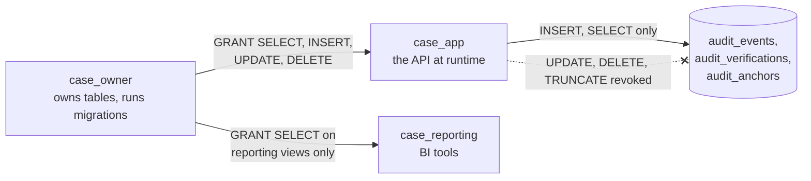

# Migrations and roles

[Back to Database index](README.md) · Previous: [Locking and concurrency](locking-and-concurrency.md) · Next: [Running PostgreSQL in production](production-operations.md)

> **Migration**: a versioned script that changes the database's structure (or seeds data), applied once per database, in order.
> **Role**: a database account. **Privilege**: a permission a role has on an object (SELECT, INSERT, UPDATE, DELETE, TRUNCATE on a table).
> In plain words: migrations are the building's renovation log, applied in order so every copy of the building ends up the same. Roles are the keys: the builder has the master key, the staff have room keys, the auditors can only look through the window.

---

## 1. Why migrations exist

The schema must be **identical** on every developer laptop, in CI, in each bank's test environment and in production, and it must change over time without losing data. Editing tables by hand cannot achieve that. Migrations make schema change **code**: reviewed, versioned, repeatable.

The tool is **node-pg-migrate**. Each migration is a JavaScript file in [apps/api/migrations/](../../apps/api/migrations/) named with a sortable number (`1710000022000_notifications_and_email.cjs`) and exporting two functions:

```js
exports.up = (pgm) => { /* apply the change */ };
exports.down = (pgm) => { /* undo it */ };
```

`pgm` is a builder that generates SQL (`pgm.createTable`, `pgm.addColumn`, `pgm.createIndex`), with `pgm.sql('...')` for raw SQL such as triggers, views and seed data.

### How "run once" works

The tool keeps a table, `pgmigrations`, listing every migration already applied with its timestamp. Running migrations means: read the folder, compare with `pgmigrations`, and apply the missing ones **in name order**, each recorded in `pgmigrations` as it completes. Running the command twice is harmless: the second run finds nothing to do. You can see the bookkeeping in the tool's output:

```text
INSERT INTO "public"."pgmigrations" (name, run_on) VALUES ('1710000030000_staff_directory', NOW());
Migrations complete!
```

Two defaults of node-pg-migrate 9 (the version installed, see its `bin/node-pg-migrate.js` options) matter:

- **`--single-transaction` is on**: all pending migrations run inside **one** transaction. PostgreSQL, unlike some databases, can roll back DDL (`CREATE TABLE`, `ALTER TABLE`), so if migration 5 of 5 fails, migrations 1 to 4 are rolled back too and the database is left exactly as it was. (Some statements, notably `CREATE INDEX CONCURRENTLY`, cannot run inside a transaction; see section 4.)
- **`--lock` is on**: the tool takes a lock before migrating, so if two migration jobs start at once (two pods, a retried job), the second waits instead of both applying the same migration.

### Running them

| Where | Command |
|---|---|
| Locally | `npm run migration:run --workspace=@bank-case/api`, which runs `node-pg-migrate up -m migrations -d DATABASE_URL` ([package.json](../../apps/api/package.json)) |
| Containers / Kubernetes | [scripts/migrate.mjs](../../apps/api/scripts/migrate.mjs) finds the installed tool wherever npm placed it and runs `up`; the Helm chart runs it as a **job** before the new API version starts ([migrate-job.yaml](../../deploy/helm/bank-case/templates/migrate-job.yaml)) |
| A scratch database | `DATABASE_URL=postgresql://.../case_lab npm run migration:run ...` (how the [labs](hands-on-labs.md#setup-a-scratch-copy-of-our-schema) build their copy) |

`-d DATABASE_URL` names the **environment variable** to read, not the URL itself. In Kubernetes the job is given `MIGRATION_DATABASE_URL`, which points at the **owner** account (section 5), not the API's account ([values.yaml#L37](../../deploy/helm/bank-case/values.yaml#L37)).

---

## 2. The migrations, in story order

| # | Migration | Adds |
|---|---|---|
| 0000 | initial | tickets, references, idempotency, approvals, audit_events |
| 1000 | case_activity | notes, status history |
| 2000 | sla_policies | SLA policies + ticket SLA columns |
| 3000 | attachments | attachments |
| 4000 | ticket_relationships | links |
| 5000 | integration_outbox | outbox |
| 6000 | case_configuration | queues, categories (+ seeds) |
| 7000-8000 | communications, approvals | templates, communications, approval link |
| 9000 | retention_controls | legal hold table |
| 10000 | audit_immutability | append-only trigger |
| 11000 | sla_status_width | column widening |
| 12000-13000 | receipts | integration + delivery receipts |
| 14000 | outbox_claim_tracking | `claimed_at` + partial index |
| 15000 | routing_and_escalation | members, assignment & escalation rules, escalations |
| 16000 | intake_channels | channels, intake ledger, `source_channel` |
| 17000 | sla_accuracy_root_cause | first response, resolved, root cause |
| 18000 | regulatory_complaints | profiles, holidays, complaint columns, AU seeds |
| 19000 | workflow_definitions | workflows + the `standard` lifecycle |
| 20000 | retention_enforcement | `closed_at`, `redacted_at`, `retention_years` + backfill |
| 21000 | audit_integrity | `hash_version`, verifications, anchors |
| 22000 | notifications_and_email | template wording, delivery columns, notifications |
| 23000 | audit_truncate_guard | TRUNCATE trigger |
| 24000 | audit_archive_and_signing | anchor signatures, chain bases |
| 25000 | paging_and_reporting | paging index, `reporting.*` views |
| 26000 | sla_calendars_and_pause | calendar, pause, business hours |
| 27000 | privacy_correction | case kind, APP 13 profile |
| 28000 | resolution_notice | category flag |
| 29000 | upload_links | links + document-request templates |
| 30000 | staff_directory | directory |

The [schema tour](schema-tour.md#how-the-schema-grew) draws this as a timeline.

---

## 3. Kinds of change, with examples from our history

Reading the migrations teaches the standard moves:

**Add a table** (the easy case: nothing depends on it yet). [Migration 22000#L16-L36](../../apps/api/migrations/1710000022000_notifications_and_email.cjs#L16-L36) creates `notifications` and `notification_reads` with their constraint and indexes.

**Add a nullable column.** Instant. [Migration 14000#L4](../../apps/api/migrations/1710000014000_outbox_claim_tracking.cjs#L4): `claimed_at timestamptz`.

**Add a NOT NULL column to a table with rows.** Must have a default, which becomes the value for existing rows. [Migration 16000#L3](../../apps/api/migrations/1710000016000_intake_channels.cjs#L3): `source_channel ... NOT NULL DEFAULT 'staff'`.

**Backfill.** Fill a new column for existing rows with an `UPDATE`. [Migration 20000#L7](../../apps/api/migrations/1710000020000_retention_enforcement.cjs#L7): existing closed tickets get `closed_at = updated_at` so retention applies to them too. [Migration 27000#L8](../../apps/api/migrations/1710000027000_privacy_correction.cjs#L8) sets `case_kind='complaint'` for existing complaints.

**Widen a column.** [Migration 11000](../../apps/api/migrations/1710000011000_sla_status_width.cjs#L2): `varchar(20)` → `varchar(40)`. Increasing a `varchar` limit is a catalogue-only change in PostgreSQL; *decreasing* one, or changing to an incompatible type, rewrites the table.

**Change a CHECK constraint.** Drop and re-add with the new rule ([migration 18000#L50-L51](../../apps/api/migrations/1710000018000_regulatory_complaints.cjs#L50-L51), [27000#L9-L10](../../apps/api/migrations/1710000027000_privacy_correction.cjs#L9-L10)).

**Seed configuration.** `INSERT` starter rows, using `ON CONFLICT ... DO NOTHING` so a row an administrator already created is left alone ([migration 28000#L6-L8](../../apps/api/migrations/1710000028000_resolution_notice.cjs#L6-L8)).

**Raw SQL for things the builder does not cover.** Triggers and functions ([10000](../../apps/api/migrations/1710000010000_audit_immutability.cjs)), schemas and views ([25000](../../apps/api/migrations/1710000025000_paging_and_reporting.cjs#L8-L15)).

### About `down`

Every migration has a `down`, and they are useful in development (undo, edit, redo). In production, rolling **forward** with a new corrective migration is usually safer: a `down` that drops a column also drops its data, and after the new code has written rows in the new shape, going back can lose information. Treat `down` as a development tool and a statement of intent.

---

## 4. Writing a safe migration

On a busy production database, the danger in a migration is not usually the SQL being wrong. It is **locks**. Most `ALTER TABLE` forms take an `ACCESS EXCLUSIVE` lock, which blocks **every** read and write on the table while held. Worse, a DDL statement that is *waiting* for its lock (because a long transaction is reading the table) blocks everyone queued behind it. A two-second `ALTER` can become a two-minute outage.

| Change | Lock and cost | Safer approach on a large, busy table |
|---|---|---|
| `CREATE TABLE` | none on existing tables | fine |
| `ADD COLUMN` nullable, or with a constant default | brief exclusive lock, no rewrite (PostgreSQL 11+) | fine |
| `ADD COLUMN ... DEFAULT now()` or another volatile default | **rewrites the table** | add nullable, backfill in batches, then set the default |
| `CREATE INDEX` | blocks **writes** for the whole build | `CREATE INDEX CONCURRENTLY` (slower, no write block, cannot run in a transaction: in node-pg-migrate pass `{ concurrently: true }` and disable the migration's transaction) |
| `ADD CONSTRAINT ... CHECK` | scans the table under a lock | `ADD CONSTRAINT ... NOT VALID`, then `VALIDATE CONSTRAINT` separately (weaker lock) |
| `ADD FOREIGN KEY` | scans the child, locks both tables | same `NOT VALID` + `VALIDATE` pattern |
| Big backfill `UPDATE` | locks every row it touches, creates a dead tuple per row | batch it: `UPDATE ... WHERE id IN (SELECT id ... LIMIT 1000)` in a loop |
| Rename or drop a column the running code uses | breaks the old code instantly | **expand, migrate, contract**: add the new column, deploy code that writes both, backfill, deploy code that reads the new one, then drop the old in a later release |

Two habits make all of this safer:

- Set `lock_timeout` (for example `SET lock_timeout = '5s'`) at the top of risky migrations, so a migration that cannot get its lock **fails** instead of queuing everyone behind it.
- Because the migration job runs **before** the new API starts, while old instances are still serving, every migration must be **backward compatible** with the previous release's code. That is the real reason for expand-migrate-contract.

At this project's current data sizes, the plain forms used in the migrations are fine. The [recommended `ticket_references` index](constraints-and-integrity.md#postgresql-does-not-index-foreign-key-columns-for-you) is a good first candidate for `CONCURRENTLY` once data grows.

---

## 5. Roles: owner, app, reporting

[infra/postgres/roles.sql](../../infra/postgres/roles.sql) separates the account that **owns** the schema from the account the application **runs as**, plus a read-only reporting account.



### Why separate the owner from the app

In PostgreSQL the **owner** of a table can do anything to it: alter it, disable its triggers, drop it, and grant or revoke privileges. If the API ran as the owner, any flaw in the API (SQL injection, a stolen credential, a malicious insider with access to the config) could disable the append-only trigger and rewrite the audit trail. Running as a separate, non-owner account removes that power from the running application entirely. This is **least privilege**: give each account only what its job needs.

### What `roles.sql` does, line by line

| Lines | Effect |
|---|---|
| [L10-L13](../../infra/postgres/roles.sql#L10-L13) | Create `case_owner` and `case_app` if missing; `case_app` is `NOSUPERUSER NOCREATEDB NOCREATEROLE` |
| [L15-L20](../../infra/postgres/roles.sql#L15-L20) | Let the app connect and use the `public` schema; give the owner the schema |
| [L23-L26](../../infra/postgres/roles.sql#L23-L26) | Hand ownership of existing tables and sequences to `case_owner` (uses `format('%I', name)` to quote identifiers safely) |
| [L28-L29](../../infra/postgres/roles.sql#L28-L29) | Grant the app read/write on existing tables and sequences |
| [L31-L32](../../infra/postgres/roles.sql#L31-L32) | **Default privileges**: tables the owner creates *in future migrations* automatically get the same grants. Without this, every new table would be invisible to the app until someone remembered a manual GRANT |
| [L36-L40](../../infra/postgres/roles.sql#L36-L40) | **Revoke** UPDATE, DELETE and TRUNCATE on the audit tables from the app |
| [L44-L51](../../infra/postgres/roles.sql#L44-L51) | Create `case_reporting` with access only to the `reporting` schema |

### Proof (lab 16)

Applying `roles.sql` (with renamed lab roles) to the scratch database and connecting as the app role:

```text
SELECT count(*) > 0 FROM audit_events;            → t                    (can read)
INSERT INTO audit_events ...;                      → INSERT 0 1           (can append)
UPDATE audit_events SET outcome='denied';          → ERROR: permission denied for table audit_events
DELETE FROM audit_events;                          → ERROR: permission denied for table audit_events
TRUNCATE audit_events;                             → ERROR: permission denied for table audit_events
ALTER TABLE audit_events DISABLE TRIGGER ...;      → ERROR: must be owner of table audit_events
UPDATE tickets SET priority='high' WHERE ...;      → UPDATE 1             (normal business writes work)
```

Note the layering: privileges refuse the UPDATE *before* the trigger is even reached, and the trigger would refuse it anyway. Two independent controls.

### The startup self-check

`DatabaseGuardService` asks PostgreSQL, at startup, what the current account could do ([database-guard.service.ts#L7-L15](../../apps/api/src/database/database-guard.service.ts#L7-L15)):

```sql
SELECT current_user AS role,
       has_table_privilege(current_user,'audit_events','UPDATE')   AS can_update,
       has_table_privilege(current_user,'audit_events','DELETE')   AS can_delete,
       has_table_privilege(current_user,'audit_events','TRUNCATE') AS can_truncate,
       COALESCE((SELECT rolsuper FROM pg_roles WHERE rolname=current_user), false) AS superuser,
       COALESCE((SELECT pg_get_userbyid(relowner)=current_user FROM pg_class WHERE oid = to_regclass('public.audit_events')), false) AS owner
```

If any answer is "yes", it logs a warning, or **refuses to start** when `AUDIT_REQUIRE_RESTRICTED_DB_ROLE=true` ([L27-L34](../../apps/api/src/database/database-guard.service.ts#L27-L34)). It uses the database's own view of privileges rather than trusting configuration, so a misconfigured deployment cannot silently run with too much power.

Locally, Docker Compose runs the API as `case_user`, the container's superuser, so the check reports `can_update = t, superuser = t` and warns. That is expected in development and exactly what production must never do ([runbooks](../operations/runbooks.md)).

---

## 6. Reporting views: a narrow, safe window

BI tools need case statistics, not case content. [Migration 25000#L8-L15](../../apps/api/migrations/1710000025000_paging_and_reporting.cjs#L8-L15) creates a `reporting` schema with four **views**:

| View | Exposes | Leaves out |
|---|---|---|
| `reporting.tickets` | classifications, dates, statuses, SLA and complaint outcomes, opaque IDs | subject, description, custom fields, references |
| `reporting.status_history` | from/to status, who, when | the free-text reason |
| `reporting.escalations` | rule, trigger, queues, when | |
| `reporting.communications` | channel, template, status, dates | recipient |

A **view** is a stored query. When `case_reporting` selects from a view, PostgreSQL checks the **view owner's** privileges on the underlying tables, not the caller's. That is what lets the reporting role read the view while having **no access to the `tickets` table at all**. Lab 16:

```text
SELECT count(*) FROM reporting.tickets;        → 50000
SELECT subject FROM tickets LIMIT 1;           → ERROR: permission denied for table tickets
SELECT subject FROM reporting.tickets LIMIT 1; → ERROR: column "subject" does not exist
```

The integration test asserts the view's columns exclude free text ([workflow.integration-spec.ts#L323-L326](../../apps/api/test/workflow.integration-spec.ts#L323-L326)).

---

## 7. Backups and recovery

See [operations/disaster-recovery.md](../operations/disaster-recovery.md) and [production operations](production-operations.md#5-backups-and-point-in-time-recovery). One database-specific point: because the audit chain has **anchors** stored outside the database, a restored database can still be **verified** against them, so a restore cannot quietly drop recent evidence.

---

## 8. Check yourself

1. How does node-pg-migrate know which migrations to run?
2. Why must a NOT NULL column added to an existing table have a default?
3. Why is `CREATE INDEX` risky on a busy table, and what is the alternative?
4. Explain expand-migrate-contract for renaming a column.
5. Why does the API not run as the table owner? Name the two independent controls that protect audit rows from it.
6. How can `case_reporting` read `reporting.tickets` without any privilege on `tickets`?

Next: [Running PostgreSQL in production](production-operations.md)
