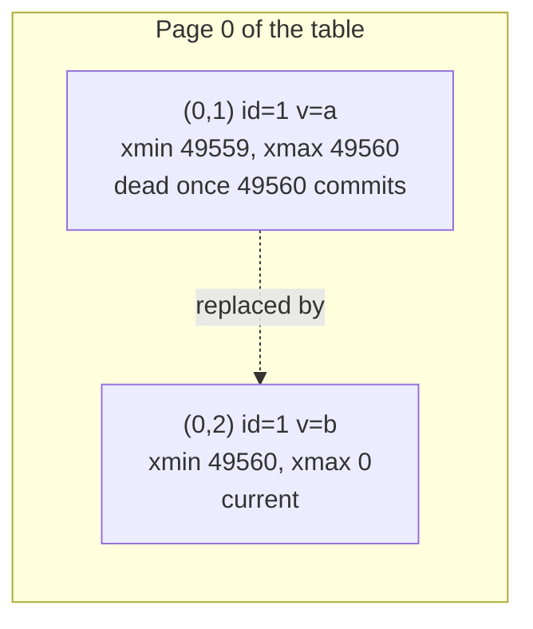
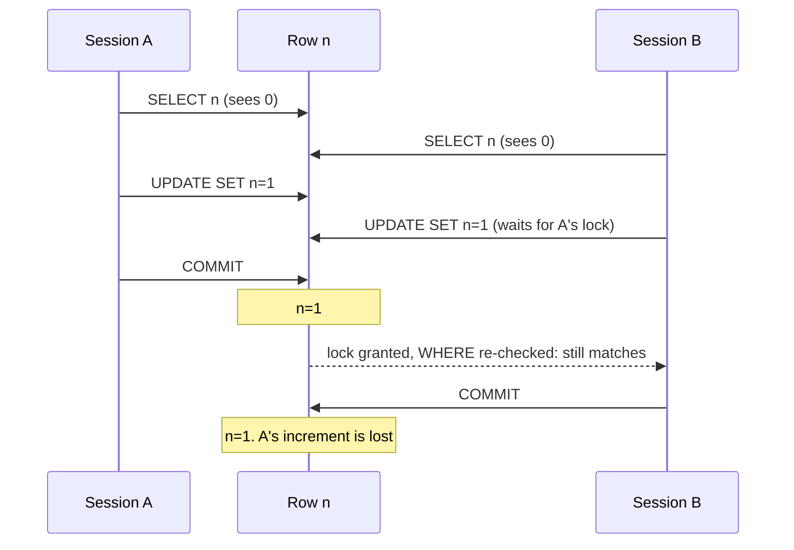

# MVCC and isolation levels

[Back to Database index](README.md) · Previous: [Connections and the pool](connection-pool.md) · Next: [Locking and concurrency](locking-and-concurrency.md)

> **MVCC (multi-version concurrency control)**: PostgreSQL keeps several versions of a row at once, so each transaction can read a consistent picture of the data while others are changing it.
> **Isolation level**: the rule for *which* versions a transaction is allowed to see.
> In plain words: instead of rubbing out an entry in the ledger, the clerk writes a new dated line and crosses the old one out. Someone who started reading before the change still sees the old line; someone who starts afterwards sees the new one. Nobody has to wait for the clerk to finish.

This is the page that explains *why* concurrency bugs happen. Every lock in the [next page](locking-and-concurrency.md) exists to close a gap described here. All outputs below are from real two-session experiments ([labs 2, 4, 5 and 8](hands-on-labs.md#lab-2-see-mvcc-row-versions)).

---

## 1. The problem MVCC solves

Two simple ways to let many people use one database both fail:

- **Lock everything you read.** Readers then block writers and writers block readers. A long report would freeze every update to the tables it reads.
- **Lock nothing.** Readers see half-finished changes: a ticket's status updated but its history row not yet written.

MVCC avoids both. **Writers create new row versions instead of overwriting**, and each reader is given a **snapshot** that says which versions it may see. The headline guarantee:

> In PostgreSQL, **readers never block writers, and writers never block readers.** Only writers that touch the *same row* wait for each other.

---

## 2. Row versions: `xmin`, `xmax`, `ctid`

Every physical row version (a **tuple**) carries hidden system columns you can select:

- `xmin`: the ID of the transaction that **created** this version;
- `xmax`: the ID of the transaction that **deleted or replaced** it (0 if none);
- `ctid`: its physical location, (page, slot).

Watch an UPDATE ([lab 2](hands-on-labs.md#lab-2-see-mvcc-row-versions)):

```text
INSERT INTO demo VALUES (1,'a');
 xmin  | xmax | ctid  | id | v
 49559 |    0 | (0,1) |  1 | a

UPDATE demo SET v='b' WHERE id=1;
 xmin  | xmax | ctid  | id | v
 49560 |    0 | (0,2) |  1 | b
```

The row now lives at a **new location** `(0,2)` with a **new creator** `49560`. The old version at `(0,1)` still exists on disk with `xmax = 49560` ("replaced by transaction 49560"); you no longer see it because your snapshot says 49560 has committed. So:

- **UPDATE = INSERT a new version + mark the old one dead.** It is never an in-place overwrite.
- **DELETE = mark the version dead** (set `xmax`). The space is reclaimed later by VACUUM.



This has a direct cost: every update leaves a **dead tuple** behind. A table updated constantly, like `integration_outbox` (each event is updated at least twice: claimed, then published), produces dead tuples just as fast. In the lab, 16 updates to one counter row left `n_live_tup = 1, n_dead_tup = 16`. Cleaning them up is VACUUM's job ([production operations](production-operations.md#1-vacuum-dead-rows-and-bloat)). It is also why the SLA job skips rows whose status would not change ([SQL patterns 15](sql-patterns.md#15-is-distinct-from-null-safe-comparison-and-skipping-no-op-writes)).

---

## 3. Snapshots

A **snapshot** is, in effect, a list: "transactions up to here that had committed when I looked; ignore anything in progress or later". A row version is visible to you if its `xmin` committed before your snapshot and its `xmax` (if any) did not.

The one question that separates the isolation levels is: **when is the snapshot taken?**

| Level | Snapshot taken | Plain meaning |
|---|---|---|
| READ COMMITTED (default, **ours**) | at the start of **each statement** | every statement sees everything committed before it began |
| REPEATABLE READ | at the **first statement** of the transaction, kept until the end | the whole transaction sees one frozen picture |
| SERIALIZABLE | like REPEATABLE READ, **plus** tracking of read/write dependencies | the result is as if transactions ran one at a time, or one is aborted |

PostgreSQL also accepts `READ UNCOMMITTED` but treats it as READ COMMITTED: **dirty reads (seeing uncommitted data) never happen in PostgreSQL.**

The project never sets a level, so everything runs at READ COMMITTED (`SHOW default_transaction_isolation` → `read committed`).

---

## 4. READ COMMITTED: our level

### Each statement gets a fresh snapshot

Inside one transaction, two identical `SELECT`s can return different values if someone commits in between. That is a **non-repeatable read**. Lab 4, where a second session changed the value from 10 to 99 between the two reads:

```text
READ COMMITTED:  first_read 10   second_read 99
REPEATABLE READ: first_read 10   second_read 10
```

### What happens when two transactions UPDATE the same row

This is the most important behaviour to understand, because the project relies on it. When an `UPDATE` (or `DELETE`, or `SELECT ... FOR UPDATE`) finds that its target row is being changed by another, **uncommitted** transaction, it **waits**. When that transaction commits, READ COMMITTED does something special: it **re-reads the latest committed version of the row and re-checks the `WHERE` clause against it**, then applies its change to that new version.

That one rule explains three results from lab 5, where two sessions each add one to a counter:

**Atomic increment: correct.**

```sql
UPDATE lab_counter SET n = n + 1 WHERE id = 1;     -- run by two sessions at once
```

Session B waits for A, then re-reads the row (now `n = 1`) and computes `1 + 1`. **Final n = 2.**

**Read, then write back a computed value: wrong. The lost update.**

```sql
SELECT n FROM lab_counter WHERE id = 1;            -- both sessions read 0
-- ... application computes 0 + 1 ...
UPDATE lab_counter SET n = 1 WHERE id = 1;         -- both write 1
```

B's `UPDATE` does wait for A and re-check the row, but the *new value* was computed in application code from a stale read. Both write `1`. **Final n = 1, expected 2.** One increment vanished, and neither session got an error.



**Conditional update: correct.**

```sql
UPDATE lab_counter SET n = :seen + 1, version = version + 1 WHERE id = 1 AND version = :v;
```

B waits, re-reads the row, and re-checks `version = 0` against the new version (now 1). It no longer matches, so B updates **0 rows**. Lab output: `UPDATE 1` and `UPDATE 0`; final `n = 1, version = 1`. B *knows* it lost and can tell the user. This is optimistic concurrency, and it is exactly how the outbox's `WHERE id=$1 AND status='in_flight'` works ([outbox.service.ts#L39](../../apps/api/src/outbox/outbox.service.ts#L39)).

### What this means for our code

Look at the shared ticket-mutation skeleton ([tickets/mutations-and-concurrency.md](../tickets/mutations-and-concurrency.md)):

```ts
const ticket = await this.ticket(client, ticketId);          // plain SELECT: no lock
this.assertFresh(ticket, dto.expectedUpdatedAt);              // compare in JavaScript
await client.query('UPDATE tickets SET ... WHERE id=$4', ...); // unconditional
```

That is the read-then-write pattern. `assertFresh` catches a browser that loaded the ticket long ago (the [stale-edit test](../../apps/api/test/workflow.integration-spec.ts#L304-L310) proves it), but **two requests that arrive at the same moment** both read the same `updated_at`, both pass the check, and the second overwrites the first. That is the honest gap the docs keep naming. The fix is to move the check into the `WHERE` clause (`... WHERE id=$4 AND updated_at=$5`, zero rows → 409), or lock first with `SELECT ... FOR UPDATE` ([locking](locking-and-concurrency.md#9-where-it-is-missing-be-honest)).

---

## 5. REPEATABLE READ: one snapshot per transaction

The snapshot is taken at the first statement and kept. Every read in the transaction sees the same picture, so non-repeatable reads cannot happen, and in PostgreSQL neither can **phantoms** (a re-run query finding new rows).

But a frozen snapshot creates a new problem for writes. If you try to update a row that another transaction changed and committed **after your snapshot**, PostgreSQL cannot "re-read and re-check" as READ COMMITTED does, because that would break your frozen picture. Instead it aborts you. [Lab 8](hands-on-labs.md#lab-8-stronger-isolation-serialization-failures-and-write-skew) output, two sessions incrementing at REPEATABLE READ:

```text
Session A: COMMIT
Session B: ERROR:  could not serialize access due to concurrent update
           ROLLBACK
```

This is a **serialization failure** (SQLSTATE `40001`). The data is safe (no lost update), but the application **must retry** the whole transaction. Code that uses REPEATABLE READ or SERIALIZABLE without a retry loop will turn harmless contention into user-facing errors.

REPEATABLE READ is the natural choice for **consistent multi-query reads**: a report or dashboard that runs several aggregates and needs them to add up, or a detail view where the ticket and its notes must come from the same instant. Read-only transactions never get serialization failures, so they need no retry.

---

## 6. SERIALIZABLE and write skew

There is one anomaly REPEATABLE READ still allows: **write skew**. Two transactions each read an overlapping set of rows, check a rule, and each write a *different* row. Neither write conflicts with the other's, but together they break the rule.

The classic example, run in [lab 8](hands-on-labs.md#lab-8-stronger-isolation-serialization-failures-and-write-skew): a rule says at least one doctor must be on call. Two doctors are on call. Each, at the same moment, checks "are at least 2 on call?" (yes), and takes themselves off.

```text
REPEATABLE READ -> still on call: 0                    ← the rule is broken; no error
SERIALIZABLE    -> ERROR:  could not serialize access due to read/write dependencies among transactions
                -> still on call: 1                    ← the rule holds; one transaction must retry
```

SERIALIZABLE (PostgreSQL's implementation is called **Serializable Snapshot Isolation**, SSI) tracks which transactions read data that others wrote, and aborts one when the pattern could not have happened in any one-at-a-time order.

A banking-flavoured version in this domain would be "a queue must always have at least one active member": two administrators deactivating the last two members at once. Today that rule is not enforced; if it were, SERIALIZABLE (with retries) or a lock on the queue row would be the tools.

---

## 7. Anomalies by level, in PostgreSQL

| Anomaly | Plain meaning | READ COMMITTED | REPEATABLE READ | SERIALIZABLE |
|---|---|---|---|---|
| Dirty read | see uncommitted data | never | never | never |
| Non-repeatable read | same row, different value | **possible** | prevented | prevented |
| Phantom read | same query, new rows | **possible** | prevented (in PostgreSQL) | prevented |
| Lost update (read-modify-write in app code) | one write silently overwrites another | **possible** | prevented (serialization failure) | prevented |
| Write skew | each checks, each writes a different row | **possible** | **possible** | prevented |

(The SQL standard allows phantoms at REPEATABLE READ; PostgreSQL's snapshot implementation is stricter than the standard requires.)

---

## 8. Why we run at READ COMMITTED

It is a deliberate trade-off, and a common one:

- **No serialization failures**, so no retry loops in every service. Stronger levels move the cost of contention into "abort and retry", which needs code everywhere.
- **Statement-level re-checking** makes the most common write patterns safe on their own: atomic increments (`attempts = attempts + 1`), conditional updates, `INSERT ... ON CONFLICT`, `UPDATE ... WHERE id IN (... FOR UPDATE SKIP LOCKED)`.
- **Where a read-check-write must be safe**, the code adds an explicit, targeted lock: `FOR UPDATE` on the approval, attachment, escalation and customer-reply rows; advisory locks for the audit chain, assignment and intake; unique constraints as claims.

The rule that makes this work: **at READ COMMITTED, any decision you make in application code from an earlier `SELECT` is only safe if a lock, a constraint or a conditional `WHERE` protects it.** The [locking page](locking-and-concurrency.md) is the toolbox for exactly that.

---

## 9. Check yourself

1. What does an UPDATE physically do in PostgreSQL? Where does the old version go?
2. Explain the difference between READ COMMITTED and REPEATABLE READ in terms of *when the snapshot is taken*.
3. Two sessions run `UPDATE t SET n = n + 1`. Why is the result correct at READ COMMITTED, while "SELECT n, then UPDATE SET n = n_from_select + 1" is not?
4. What is a serialization failure, and what must the application do about it?
5. Describe write skew with an example from a ticketing system.
6. Why is `assertFresh` alone not enough to prevent lost updates? Give the one-line fix.

Next: [Locking and concurrency](locking-and-concurrency.md)
