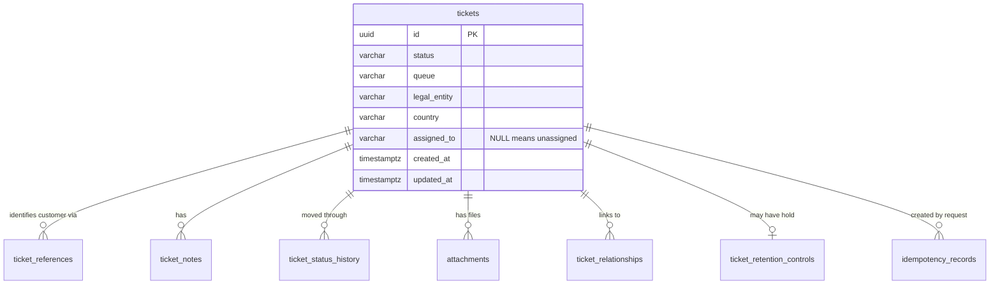
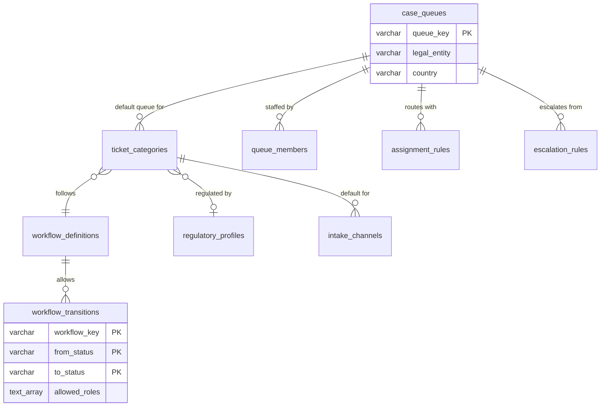
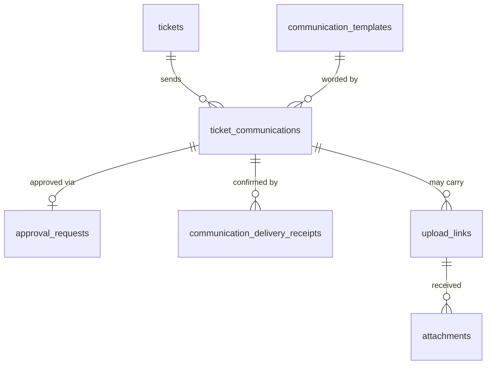
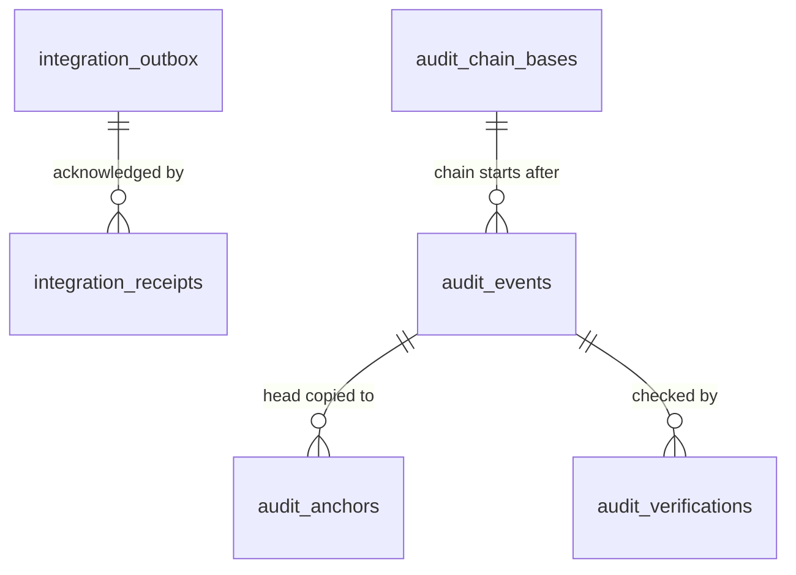
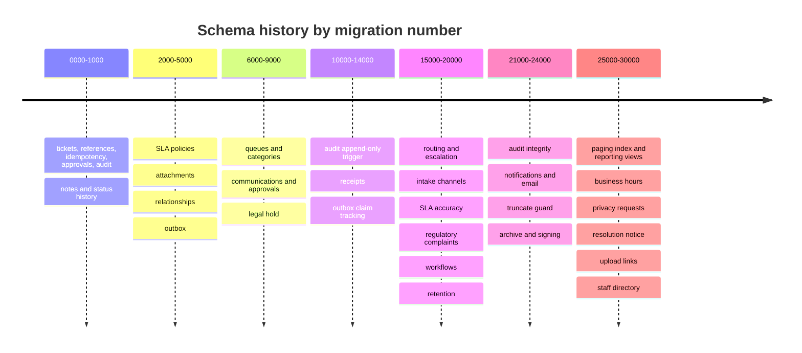

# Schema tour: all 37 tables

[Back to Database index](README.md) · Previous: [Data types and modelling](data-types-and-modelling.md) · Next: [Constraints and integrity](constraints-and-integrity.md)

The schema has 36 application tables plus `pgmigrations`, which records which migrations have run. Thirty-six tables is a lot to hold in your head, so this page sorts them into **five groups by purpose**. Learn the groups first, then the tables inside each.

| Group | Question it answers | Tables |
|---|---|---|
| A. The case | "What is this case and what happened to it?" | 8 |
| B. Configuration | "How does this bank want cases handled?" | 13 |
| C. Customer communications | "What did we send the customer, and who approved it?" | 4 |
| D. Evidence and integration | "Can we prove what happened, and did other systems hear about it?" | 6 |
| E. Staff workflow and idempotency | "Who needs to look, and have we seen this input before?" | 5 |

To look at the live schema yourself: `psql -h localhost -p 5433 -U case_user -d case_platform`, then `\dt` lists tables, `\d tickets` shows one table with its indexes, constraints and triggers.

---

## A. The case (the aggregate)

An **aggregate** (a term from domain-driven design) is a cluster of rows that change together and are owned by one root. The root here is `tickets`. Every other table in this group has a `ticket_id` foreign key and makes no sense without its ticket.

| Table | One row is | Key design points | Added in |
|---|---|---|---|
| `tickets` | one case | 40 columns and 8 indexes after many migrations: SLA due times and status, complaint clock fields, retention timestamps (`closed_at`, `redacted_at`), root cause | [0000](../../apps/api/migrations/1710000000000_initial.cjs#L3) and many later |
| `ticket_references` | one external identifier (customer number, account) | Stores an `opaque_reference` and a pre-computed `masked_value` so lists never need the real value | [0000#L5](../../apps/api/migrations/1710000000000_initial.cjs#L5) |
| `ticket_notes` | one note, internal or customer-visible | `visibility` column; index `(ticket_id, created_at)` for the timeline | [1000](../../apps/api/migrations/1710000001000_case_activity.cjs#L3-L11) |
| `ticket_status_history` | one status change | Append-only by convention; `from_status`, `to_status`, `reason`, `changed_by` | [1000#L12-L21](../../apps/api/migrations/1710000001000_case_activity.cjs#L12-L21) |
| `attachments` | one file's metadata (the bytes live in object storage) | `object_key UNIQUE`, two status columns (`upload_status`, `malware_status`) as small state machines | [3000](../../apps/api/migrations/1710000003000_attachments.cjs) |
| `ticket_relationships` | one link between two tickets | Composite PK `(source, target, type)`; CHECK `source <> target` | [4000](../../apps/api/migrations/1710000004000_ticket_relationships.cjs) |
| `ticket_retention_controls` | a legal hold / retention override | **One-to-one** with tickets: its PK *is* `ticket_id`. Written with an upsert | [9000](../../apps/api/migrations/1710000009000_retention_controls.cjs) |
| `idempotency_records` | "this person already sent this request" | PK `(actor_id, idempotency_key)` + `request_hash` | [0000#L6-L7](../../apps/api/migrations/1710000000000_initial.cjs#L6-L7) |

**Why is `ticket_retention_controls` a separate table rather than columns on `tickets`?** Most tickets never get a hold. A separate one-to-one table keeps `tickets` focused, and the upsert `INSERT ... ON CONFLICT (ticket_id) DO UPDATE` ([tickets.service.ts#L109-L112](../../apps/api/src/tickets/tickets.service.ts#L109-L112)) creates the row on first use. Retention reads it with a `LEFT JOIN` and `COALESCE(rc.legal_hold, false)` ([retention.service.ts#L26-L28](../../apps/api/src/retention/retention.service.ts#L26-L28)).

---

## B. Configuration: the bank's rules as data

The product is sold to several banks, so behaviour that differs between banks is stored in tables rather than written in code. A new bank changes rows, not the product.

| Table | Holds | Interesting detail |
|---|---|---|
| `case_queues` | work queues, each in one legal entity and country | Natural PK `queue_key`; seeded with six queues ([6000#L19-L20](../../apps/api/migrations/1710000006000_case_configuration.cjs#L19-L20)) |
| `ticket_categories` | case types | FKs to its default queue, its workflow and (optionally) its regulatory profile |
| `sla_policies` | response and resolution targets per priority | Composite PK `(policy_key, priority)`; `calendar` CHECK `('wall','business')` |
| `business_hours` | working hours per country | `working_days integer[]`; CHECK `start_minute < end_minute` |
| `business_holidays` | public holidays | PK `(country, holiday_date)`, type `date` |
| `regulatory_profiles` | complaint/privacy clocks (for example ASIC RG 271) | CHECK that the day counts are sensible |
| `workflow_definitions` / `workflow_transitions` | the status graph | Composite PK on transitions makes each edge unique; `ON DELETE CASCADE` from the definition |
| `queue_members` | who can be auto-assigned | PK `(queue_key, user_id)`; `last_assigned_at` drives round-robin |
| `assignment_rules` | which strategy a queue uses | CHECK `strategy IN ('least_loaded','round_robin')` |
| `escalation_rules` | where overdue tickets go | CHECK the two queues differ |
| `intake_channels` | defaults for email/portal/phone intake | CHECK on the channel key |
| `communication_templates` | message wording | Natural PK `template_key`; seeded wording, no customer data |

**Seeds inside migrations.** Several migrations `INSERT` starter rows (queues, categories, the standard workflow, Australian regulatory profiles). Later migrations use `ON CONFLICT ... DO NOTHING` when seeding, so running against a database where an administrator already created that row is harmless ([migration 27000#L13](../../apps/api/migrations/1710000027000_privacy_correction.cjs#L13)).

---

## C. Customer communications

| Table | Holds | Interesting detail |
|---|---|---|
| `ticket_communications` | one outgoing message | Is also a **work queue**: `status`, `delivery_attempts`, `next_attempt_at`, `last_error` drive the delivery worker; partial index on `next_attempt_at WHERE status='queued'` |
| `approval_requests` | maker-checker approvals | Partial **unique** index: one approval per communication ([8000#L6](../../apps/api/migrations/1710000008000_communication_approvals.cjs#L6)) |
| `communication_delivery_receipts` | provider callbacks (sent/delivered/failed) | UNIQUE `(communication_id, provider, provider_message_id, status)` makes each receipt idempotent |
| `upload_links` | secure links for customers to send documents | The link token is *not* stored; it is derived from the ID with a server secret |

---

## D. Evidence and integration

(The audit links are logical, by sequence number, not foreign keys.)

| Table | Holds | Interesting detail |
|---|---|---|
| `integration_outbox` | events waiting to be published to Kafka | A work queue: `status` (`pending`, `in_flight`, `retry`, `published`, `dead_letter`), `attempts`, `next_attempt_at`, `claimed_at`. Index `(status, next_attempt_at)`. See [Outbox](../outbox/how-it-works.md) |
| `integration_receipts` | "system X accepted event Y" | UNIQUE `(outbox_event_id, external_system)`; CHECK outcome |
| `audit_events` | the hash-chained evidence trail | `bigserial sequence` PK; append-only triggers; indexes for auditor search |
| `audit_verifications` | result of each chain check | Next run resumes from the last valid one |
| `audit_anchors` | copies of the chain head published outside the DB | UNIQUE `sequence`; optional signature |
| `audit_chain_bases` | where the chain restarts after archiving | PK `sequence` |

The audit tables are covered in depth in [Audit](../audit/README.md).

---

## E. Staff workflow and idempotency ledgers

| Table | Holds | Interesting detail |
|---|---|---|
| `notifications` | the staff inbox | Audience is a person **or** a queue+role, enforced by CHECK. See [Notifications](../notifications/README.md) |
| `notification_reads` | who read which notification | PK `(notification_id, user_id)`: per-person read state |
| `staff_directory` | subject ID → display name | Upserted from each user's token; arrays for queues and roles |
| `ticket_escalations` | "rule R escalated ticket T" | UNIQUE `(ticket_id, rule_key)`: the claim that makes escalation idempotent |
| `intake_messages` | "we already turned message M into ticket T" | PK `(channel, message_id)` + `request_hash` |

Notice a pattern: **three tables exist mainly so a unique key can say "this already happened"** (`idempotency_records`, `intake_messages`, `ticket_escalations`), and receipts tables do the same with UNIQUE constraints. Using the database's uniqueness check as the arbiter of "has this happened?" is one of the most important patterns in the codebase. [Locking and concurrency](locking-and-concurrency.md#6-unique-constraint-as-a-claim) explains why it is safe under concurrency when an `if (exists)` check in code is not.

---

## How the schema grew

The 31 migrations read like the product's history: one capability per migration.

Two lessons from this history:

1. **Tables are cheap to add, columns on `tickets` accumulate.** `tickets` gained columns in 0000, 2000, 16000, 17000, 18000, 20000, 26000 and 27000. That is normal for an aggregate root, and it is why `SELECT *` on tickets is heavier than it looks.
2. **Indexes arrive when a query needs them.** The paging index came in 25000, when the list became paged. The retention index came in 20000 with the retention job. Good indexes are designed from queries, not guessed up front ([Indexes and query plans](indexes-and-query-plans.md)).

Next: [Constraints and integrity](constraints-and-integrity.md)
