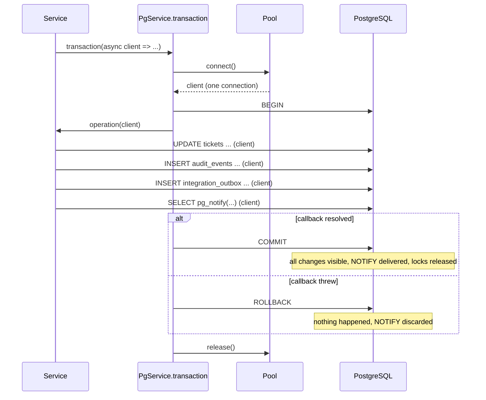

# Transactions and ACID

[Back to Database index](README.md) · Previous: [SQL patterns](sql-patterns.md) · Next: [Connections and the pool](connection-pool.md) · Code: [pg.service.ts](../../apps/api/src/database/pg.service.ts)

> **Transaction**: a sequence of statements that the database treats as one indivisible unit. Either every change becomes permanent and visible together (**COMMIT**), or none of them ever happened (**ROLLBACK**).
> In plain words: a bank transfer. Taking £100 from one account and adding it to another must both happen or both not happen. A transfer that only half-happens is the worst possible outcome.

In this project a single user action changes several tables: the ticket, its history, an audit event, an outbox event, a notification. If any part failed and the rest stayed, you would have a ticket change with no audit evidence, or an event sent to Kafka about a change that never happened. Transactions are what make that impossible.

---

## 1. What a transaction promises: ACID

**Atomicity: all or nothing.** If anything fails before COMMIT, every change made in the transaction is undone. Example: a status change inserts a history row, updates the ticket, writes an audit event and an outbox event ([tickets.service.ts#L168-L196](../../apps/api/src/tickets/tickets.service.ts#L168-L196)). If the root cause is missing, the code throws at [L179](../../apps/api/src/tickets/tickets.service.ts#L179), *after* the history row was inserted. The rollback removes that row too. [Lab 1](hands-on-labs.md#lab-1-atomicity-all-or-nothing) proves it: two inserts, an error, and the table count is unchanged.

**Consistency: the rules hold before and after.** Every constraint (NOT NULL, CHECK, UNIQUE, FK) is satisfied at the end of every committed transaction. A transaction cannot commit in a state that breaks a constraint. (This is the database's guarantee; your *business* consistency depends on your code using transactions correctly.)

**Isolation: concurrent transactions do not see each other's unfinished work.** Another request reading the ticket while the status change is in progress sees the old status, never a half-updated mixture. *How much* isolation you get depends on the isolation level, which is the subject of [MVCC and isolation](mvcc-and-isolation.md). It is the subtlest of the four.

**Durability: committed means permanent.** Once COMMIT returns, the change survives a crash or power loss. PostgreSQL achieves this with the **write-ahead log** (WAL): before COMMIT returns, a record of the change is flushed to the WAL on disk. Data files are updated later; after a crash, PostgreSQL replays the WAL. (The `synchronous_commit` setting can trade a little durability for speed; the default, which we use, is fully durable.)

---

## 2. Autocommit vs explicit transactions

Without `BEGIN`, PostgreSQL runs every statement in its own tiny transaction that commits automatically when the statement ends. This is **autocommit**. `PgService.query()` ([pg.service.ts#L15](../../apps/api/src/database/pg.service.ts#L15)) runs in autocommit mode: it borrows any pooled connection, runs one statement, and returns the connection.

A single statement is always atomic on its own. `UPDATE tickets SET ... WHERE id IN (...)` either updates all matching rows or none. So `query()` is fine for one-statement work: listing tickets, the notification inbox, `releaseStale` ([outbox.service.ts#L30](../../apps/api/src/outbox/outbox.service.ts#L30)), `markRead` (one `INSERT ... SELECT`).

You need an explicit transaction as soon as **two or more statements must succeed or fail together**, or when a statement's decision depends on something an earlier statement read.

---

## 3. The `transaction()` helper, line by line

[pg.service.ts#L16-L21](../../apps/api/src/database/pg.service.ts#L16-L21):

```ts
async transaction<T>(operation: (client: PoolClient) => Promise<T>): Promise<T> {
  const client = await this.pool.connect();
  try { await client.query('BEGIN'); const result = await operation(client); await client.query('COMMIT'); return result; }
  catch (error) { await client.query('ROLLBACK'); throw error; }
  finally { client.release(); }
}
```

| Step | What happens | Why it matters |
|---|---|---|
| `pool.connect()` | Borrow **one** connection and keep it for the whole callback | A transaction lives on one connection. Every statement in it must use this client |
| `BEGIN` | Start the transaction on that connection | |
| `operation(client)` | Run the caller's code, handing it the client | The caller does all its reads and writes through `client` |
| `COMMIT` | Make every change permanent and visible at once | Also the moment `pg_notify` messages are delivered and locks are released |
| `catch → ROLLBACK → throw` | Any error (a SQL error, a `ForbiddenException` from the policy, a `ConflictException`) undoes everything, then is **re-thrown** | Re-throwing lets NestJS turn it into the right HTTP status (403, 409...). The caller never sees a half-done change |
| `finally → release()` | Return the connection to the pool, success or failure | Without it, every error would leak a connection and the pool would slowly run dry |



**Policy checks inside the transaction are a feature.** Most services load the ticket and run `policy.assertTicketAccess(...)` *inside* the callback ([tickets.service.ts#L122](../../apps/api/src/tickets/tickets.service.ts#L122)). The decision is made on the same snapshot the write uses, and if access is denied the throw rolls everything back.

Two fine points:

- If the connection itself is broken, `ROLLBACK` will also fail and *its* error replaces the original one in the `catch`. The `pg-pool` library (3.14 here) checks on `release()` whether the client is still usable and destroys it if not, so a dead connection is never handed out again. A small hardening would be to wrap the `ROLLBACK` in its own `try` so the original error is the one reported.
- The helper never retries. That is correct at READ COMMITTED, where PostgreSQL does not raise serialization failures. If the project ever moved a transaction to SERIALIZABLE, it would need a retry loop for error `40001` ([MVCC and isolation](mvcc-and-isolation.md#6-serializable-and-write-skew)).

---

## 4. The "same client" rule

**A transaction only covers statements run on its own client.** This is the single most important rule in this page, and the easiest to break.

```ts
// RIGHT: atomic
await db.transaction(async (client) => {
  await client.query('UPDATE tickets ...');
  await audit.write(client, ...);          // same client
  await outbox.enqueue(client, ...);       // same client
});

// WRONG: audit could commit while the ticket update rolls back
await db.transaction(async (client) => {
  await client.query('UPDATE tickets ...');
  await db.query('INSERT INTO audit_events ...');   // a DIFFERENT pooled connection, in autocommit mode
});
```

In the wrong version, the audit insert runs on another connection and commits immediately. If the transaction later rolls back, the audit row stays: evidence of something that never happened. Worse, the second connection **cannot see** the first's uncommitted update, so any read there gets stale data.

That is why every helper that participates in a business change takes a `client` parameter:

| Function | Signature | Lines |
|---|---|---|
| `AuditService.write` | `(client, input)` | [audit.service.ts#L14](../../apps/api/src/audit/audit.service.ts#L14) |
| `OutboxService.enqueue` | `(client, event)` | [outbox.service.ts#L14](../../apps/api/src/outbox/outbox.service.ts#L14) |
| `LiveEventsService.notify` / `notifyPerson` | `(client, ...)` | [live-events.service.ts#L43](../../apps/api/src/live/live-events.service.ts#L43), [L51](../../apps/api/src/live/live-events.service.ts#L51) |
| `NotificationsService.create` / `ticketAttention` | `(client, ...)` | [notifications.service.ts#L20](../../apps/api/src/notifications/notifications.service.ts#L20), [L27](../../apps/api/src/notifications/notifications.service.ts#L27) |
| `AssignmentService.autoAssign` | `(client, ticket, ...)` | [assignment.service.ts#L20](../../apps/api/src/tickets/assignment.service.ts#L20) |
| `CustomerReplyService.add` | `(client, ...)` | [customer-reply.service.ts#L22](../../apps/api/src/intake/customer-reply.service.ts#L22) |
| `WorkflowDefinitionService.nextStatuses` | `(..., client?)` optional | [workflow-definition.service.ts#L45-L47](../../apps/api/src/workflow/workflow-definition.service.ts#L45-L47) |

The pattern has a name: passing a **unit of work** (here, the client) explicitly down the call chain. Some frameworks hide it in thread-local or async-local storage; this code keeps it visible in every signature, which makes mistakes easy to spot in review: **inside a `transaction` callback, any `this.db.query` deserves a second look.**

### When a separate connection is deliberately right

Not every query in a request belongs in its transaction:

- **Audit of denied access.** When a policy check fails, the business transaction rolls back, which would also roll back an audit event recording the denial. Denied-access evidence is therefore written in its own separate, best-effort transaction ([data and consistency map](../reference/data-and-consistency-map.md#modulesubsystem-matrix)).
- **List and search auditing.** `auditListing` runs `db.transaction(...)` after the read ([tickets.service.ts#L63-L66](../../apps/api/src/tickets/tickets.service.ts#L63-L66)). The list query itself is a single autocommit statement; the audit write is its own small transaction.
- **Worker re-reads.** The delivery worker reads the ticket's current status with `db.query` *after* the lease transaction committed ([delivery.worker.ts#L62](../../apps/api/src/email/delivery.worker.ts#L62)). It wants the latest committed state, and holding no transaction while talking to an SMTP server is the point ([section 7](#7-keep-transactions-short)).

---

## 5. Errors inside a transaction: the aborted state

When a statement fails inside a transaction, PostgreSQL marks the transaction **aborted**. Every later statement is refused until you end it:

```text
BEGIN
ERROR:  duplicate key value violates unique constraint "ticket_escalations_ticket_rule_uq"
SELECT 1;
ERROR:  current transaction is aborted, commands ignored until end of transaction block
ROLLBACK
```

(Real output from [lab 15](hands-on-labs.md#lab-15-aborted-transactions-and-savepoints).) The consequence for application code: **you cannot catch a SQL error and carry on in the same transaction.** Catch it, translate it, re-throw it, as `linkTicket` does ([tickets.service.ts#L262-L263](../../apps/api/src/tickets/tickets.service.ts#L262-L263)), and the helper rolls back.

This distinction matters in [customer-reply.service.ts#L29-L34](../../apps/api/src/intake/customer-reply.service.ts#L29-L34):

```ts
try {
  await this.workflows.assertTransition(client, ticket.category, 'pending_customer', 'in_progress', ['intake-gateway']);
  await client.query("UPDATE tickets SET status='in_progress' ...");
  ...
} catch { /* the category's workflow does not allow it; leave the status alone */ }
```

`assertTransition` runs a SQL query that **succeeds**, then throws a *JavaScript* error if the transition is not allowed. A JavaScript error does not abort the PostgreSQL transaction, so swallowing it is safe and the reply is still recorded. But if one of the `UPDATE`s inside the `try` failed with a *SQL* error, the catch would swallow it, the transaction would be aborted, and the very next statement would fail with "current transaction is aborted", a confusing error far from its cause.

The tool for "try something, and if the database rejects it, carry on" is a **savepoint**:

```sql
SAVEPOINT try_insert;
INSERT ... ;                          -- fails: duplicate key
ROLLBACK TO SAVEPOINT try_insert;     -- undo only back to the savepoint
SELECT 'still usable';                -- works
COMMIT;
```

Savepoints are not used in this codebase. If you ever need to swallow a SQL error inside a transaction, wrap the risky statements in `SAVEPOINT` / `ROLLBACK TO SAVEPOINT`. Usually a better design avoids the error altogether, for example `ON CONFLICT DO NOTHING` instead of catching a unique violation.

---

## 6. Transaction boundary patterns in this project

Where to begin and end a transaction is a design decision. Four shapes recur.

### Pattern A: one business change, with its evidence

Business writes, audit, outbox, notifications and `pg_notify` in one transaction. This is almost every user action: create, update, assign, transition, add note, approve ([data and consistency map: pattern A](../reference/data-and-consistency-map.md#pattern-a-business-state-plus-evidenceoutbox)). The guarantee: the change and its evidence exist together or not at all.

### Pattern B: claim, commit, external work, mark

```text
transaction 1: claim due rows (lock + mark as taken), COMMIT
(no transaction) talk to Kafka / SMTP / object storage
transaction 2: mark success or schedule a retry, COMMIT
```

Used by the outbox dispatcher ([outbox.service.ts#L18-L26](../../apps/api/src/outbox/outbox.service.ts#L18-L26)) and the delivery worker ([delivery.worker.ts#L43-L51](../../apps/api/src/email/delivery.worker.ts#L43-L51)). Locks and connections are held only for milliseconds. The cost is a crash window: if the process dies after Kafka accepted the event but before transaction 2, the event is published again later. That makes delivery **at least once**, and consumers must be idempotent ([Outbox](../outbox/how-it-works.md)).

### Pattern C: one transaction per item in a batch

The escalation job runs **one transaction per ticket** ([escalation.service.ts#L45-L62](../../apps/api/src/workflow/escalation.service.ts#L45-L62)), and retention one per ticket ([retention.service.ts#L35-L52](../../apps/api/src/retention/retention.service.ts#L35-L52)). One failing ticket does not roll back the others, and no transaction grows large. The SLA and compliance reconcilers take the opposite choice, one transaction per bounded batch of up to 500 rows ([sla.service.ts#L83-L96](../../apps/api/src/tickets/sla.service.ts#L83-L96)), because their per-row work is tiny and uniform.

### Pattern D: a read inside a transaction

`get()` wraps the detail read in a transaction ([tickets.service.ts#L99-L101](../../apps/api/src/tickets/tickets.service.ts#L99-L101)) so the `ticket.viewed` audit event is written atomically with the read it records, and the policy check, the child queries and the audit all use the same connection.

Note that at READ COMMITTED each statement in that transaction takes a **fresh snapshot**, so the ticket row and its notes are not guaranteed to be from exactly the same instant. A REPEATABLE READ transaction would give a single snapshot for the whole read ([MVCC and isolation](mvcc-and-isolation.md#4-read-committed-our-level)).

---

## 7. Keep transactions short

An open transaction holds three scarce things: a **pooled connection** (only 20 per instance), any **locks** it has taken, and an old **snapshot** that stops VACUUM from cleaning up rows changed since it began ([production operations](production-operations.md#1-vacuum-dead-rows-and-bloat)). So: **never wait on the network inside a transaction.**

| Network call | Where it happens instead | Code |
|---|---|---|
| Presigning an S3 upload URL | After commit, in `.then()` | [tickets.service.ts#L208-L211](../../apps/api/src/tickets/tickets.service.ts#L208-L211) |
| Presigning a download URL | After the metadata transaction | [tickets.service.ts#L253](../../apps/api/src/tickets/tickets.service.ts#L253) |
| Publishing to Kafka | Between the claim and mark transactions | [outbox.service.ts#L22](../../apps/api/src/outbox/outbox.service.ts#L22) |
| Sending email or SMS | After the lease transaction | [delivery.worker.ts#L51](../../apps/api/src/email/delivery.worker.ts#L51) |
| Deleting S3 objects | Before the redaction transaction | [retention.service.ts#L37-L38](../../apps/api/src/retention/retention.service.ts#L37-L38) |
| Streaming a file to ClamAV | Outside any transaction | [attachment-scan.worker.ts](../../apps/api/src/tickets/attachment-scan.worker.ts) |

### Why this matters more here than in most apps: the audit lock

`AuditService.write` begins with `pg_advisory_xact_lock(804231)` ([audit.service.ts#L16](../../apps/api/src/audit/audit.service.ts#L16)). That lock is the same number for **every** audited write in the whole system, and as an `xact` lock it is held **until the transaction commits or rolls back**. The audit hash chain needs it: each event links to the previous event's hash, so only one transaction at a time may append ([locking](locking-and-concurrency.md#4-advisory-locks-locking-an-idea-not-a-row)).

So **all audited transactions across all API instances are serialised from their first `audit.write` until their COMMIT.** Whatever a transaction does after its first audit write (more inserts, assignment, the detail re-read in `create` at [L58](../../apps/api/src/tickets/tickets.service.ts#L58)) extends a critical section everyone shares. If that tail took 5 ms, the whole system could commit at most about 200 audited changes per second, however many instances you ran.

Two practical rules follow. Write the audit event **as late as possible** in the transaction. And treat `idle_in_transaction_session_timeout` as essential: a request stuck between statements while holding this lock would freeze every audited write ([connection pool](connection-pool.md#3-the-three-timeouts-and-the-failures-they-prevent)). The [concurrency stress test](../../apps/api/test/workflow.integration-spec.ts#L329-L340) runs dozens of concurrent audited writes and verifies the chain is still valid.

---

## 8. Why not one transaction across PostgreSQL and Kafka?

A transaction covering two different systems is a **distributed transaction**, usually done with **two-phase commit** (2PC): a coordinator asks every participant "can you commit?", and only if all say yes tells them all to commit. Kafka does not take part in 2PC with PostgreSQL, and 2PC is slow and fragile anyway (if the coordinator dies between phases, participants wait holding locks).

The project uses the **transactional outbox** instead: the event is written to `integration_outbox` **in the same local transaction** as the business change, and a separate dispatcher publishes it afterwards (pattern B). One local ACID transaction plus at-least-once publishing gives the guarantee that matters: an event exists if and only if its change committed. See [Outbox](../outbox/README.md).

---

## 9. Check yourself

1. Name the four ACID properties and give one example of each from this codebase.
2. Why does `AuditService.write` take a `client` and not use `this.db`?
3. A colleague catches a unique-violation error inside a transaction and continues. What happens next, and what should they do instead?
4. Why is the S3 presign done in `.then()` after the transaction?
5. Explain why the audit advisory lock makes "time after the first audit write" a system-wide throughput limit.
6. What does the outbox give you that 2PC would, and what does it not?

Next: [Connections and the pool](connection-pool.md)
