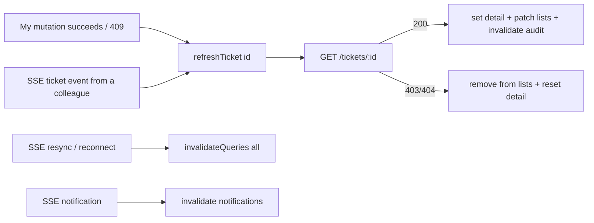

# Data fetching with TanStack Query

[Back to Frontend architecture index](README.md)

---

## 1. What TanStack Query is (plain words)

A cache for **server data** in the browser. You give each piece of data a **key** (`['ticket', id]`) and a function to fetch it. The library handles loading and error states, de-duplicates identical requests, caches results, refetches stale data, and lets you **invalidate** keys after changes so every screen showing that data refreshes. The alternative (`useState` + `useEffect` in every component) duplicates requests and drifts out of sync ([query-client.ts comment L1-L8](../../apps/web/src/lib/query-client.ts#L1-L8)).

## 2. Defaults

[query-client.ts#L14-L31](../../apps/web/src/lib/query-client.ts#L14-L31):

| Setting | Value | Plain reason |
|---|---|---|
| `retry` | only network/5xx, max 2 | Retrying can't fix 4xx (not allowed, not found, invalid) |
| `staleTime` | 30 s | Data is "fresh" for 30 s; SSE refreshes changed tickets sooner |
| `refetchOnWindowFocus` | false | SSE already keeps things current; avoid request storms on tab switches |
| `mutations.retry` | false | A retried POST could act twice |
| `MutationCache.onError` | toast for every failed mutation (opt-out with `meta.silent`) | No screen forgets to show an error |

## 3. Keys are folders

[query-keys.ts#L10-L25](../../apps/web/src/lib/query-keys.ts#L10-L25):

```ts
me: ['me'],
ticketLists: ['tickets'],                 ticketList: (search) => ['tickets', 'list', search],
ticket: (id) => ['ticket', id],           ticketAudit: (id) => ['ticket', id, 'audit'],
notifications: ['notifications'],
dashboard: ['dashboard', 'summary'],      trends: (weeks) => ['dashboard', 'trends', weeks],
chainStatus: ['audit', 'chain'],          auditSearch: (filters) => ['audit', 'search', filters],
config: (name, ...args) => ['config', name, ...args],
```

Invalidating `['ticket', id]` also invalidates `['ticket', id, 'audit']`; invalidating `['tickets']` refreshes every list and search. **Building keys only through this file** keeps those relationships correct.

## 4. Patterns used

| Pattern | Where | What it does |
|---|---|---|
| `useQuery` | `useTicket`, dashboard, notifications | One resource |
| `useInfiniteQuery` | ticket list, audit search | Pages with a cursor (`getNextPageParam`) |
| `keepPreviousData` | ticket list | Old rows stay visible while the next search runs |
| `enabled` | audit search (after submit), `/me` (after login), profiles | Don't fetch until it makes sense |
| `staleTime` per query | categories 10 min, templates 10 min, names 10 min, `/me` infinite, audit 0 | Tune freshness to how often data changes |
| `setQueryData` | create ticket, `refreshTicket` | Write fresh data directly, no extra request |
| `setQueriesData` / `getQueriesData` | `patchTicketInLists`, `removeTicketFromLists` | Update every list that contains a ticket |
| `invalidateQueries` | after saves, notifications, resync | Mark stale and refetch what's on screen |
| `resetQueries` | ticket lost access | Back to "not loaded", which shows "not available" |
| Shared mutation hook | `useTicketMutation` | Consistent success and 409 behaviour |
| Wrapper hooks | `useConfigList` / `useConfigSave` | Admin sections declare what, not how |

## 5. Convergence model



**The frontend never trusts event payloads or its own cache over the server.** It always converges by asking the API.

## 6. Known caveats

- Query data isn't explicitly cleared on sign-out (the redirect reloads the page). A same-page account switch would need `queryClient.clear()`.
- Quick-view counts are over loaded pages, not server totals.
