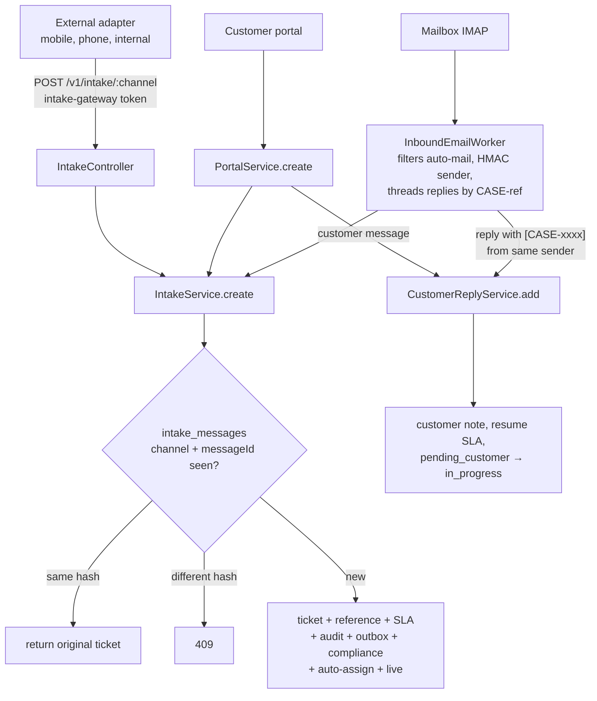

# Intake: tickets from channels

> **Intake**: turning a message from an outside channel (email, portal, mobile app, phone system, internal tool) into a ticket, or into a reply on an existing ticket.
> **Channel adapter**: a small piece of code that speaks the channel's protocol (IMAP for email, OIDC + REST for the portal) and hands the platform one **normalised message**.
> In plain words: the post room. Letters arrive in many forms, and the post room puts each one in a standard envelope, checks it isn't a duplicate, and files it in the right queue.

## Picture

## Where it lives

| File | Role |
|---|---|
| [intake/intake.service.ts](../../apps/api/src/intake/intake.service.ts) | Normalised message → ticket, idempotent |
| [intake/intake.controller.ts](../../apps/api/src/intake/intake.controller.ts) | `POST /v1/intake/:channel` for external adapters |
| [intake/intake.dto.ts](../../apps/api/src/intake/intake.dto.ts) | The normalised message contract |
| [intake/customer-reply.service.ts](../../apps/api/src/intake/customer-reply.service.ts) | Shared portal/email reply behaviour |
| [email/inbound.worker.ts](../../apps/api/src/email/inbound.worker.ts) | IMAP mailbox adapter |
| [configuration/routing.service.ts#L87-L111](../../apps/api/src/configuration/routing.service.ts#L87-L111) | Intake channel configuration |
| [admin/sections/intake-section.tsx](../../apps/web/src/features/admin/sections/intake-section.tsx) | Channel defaults UI |
| Tables | `intake_channels`, `intake_messages` ([migration …16000](../../apps/api/migrations/1710000016000_intake_channels.cjs)) |

## Read in this order

1. [Channel intake](channel-intake.md): the normalised message, idempotency ledger, routing, the shared create path.
2. [Inbound email](inbound-email.md): loop protection, pseudonymised senders, threading replies, auto-acknowledgement.
3. [Customer replies](customer-replies.md): one behaviour for portal and email replies.
4. [Interview Q&A](interview-qa.md)

## Glossary

| Term | Plain meaning |
|---|---|
| **Normalised message** | `{ messageId, senderReference, subject, body, category?, priority? }`, the same shape whatever the channel |
| **messageId** | The source's unique ID (email `Message-ID`, portal submission key), used for de-duplication |
| **Intake ledger** | `intake_messages(channel, message_id, request_hash, ticket_id)`, the memory of what was already turned into a ticket |
| **Service identity `intake-gateway`** | The robot role adapters use; it may only create intake tickets |
| **HMAC pseudonym** | `EMAIL-<HMAC(secret, address)>`: a stable ID for an email sender that can't be reversed without the secret |
| **Mail loop** | Two auto-responders replying to each other forever; prevented by ignoring automatic mail |
| **Threading** | Recognising that a new email is a reply to an existing ticket (by the `[CASE-XXXXXXXX]` tag in the subject) |

## 30-second answer

> Every channel produces one normalised message and authenticates as the narrow `intake-gateway` identity. `IntakeService` takes a transaction advisory lock on channel plus message ID, then checks the `intake_messages` ledger: the same ID and same content returns the original ticket, the same ID with different content is a 409. Otherwise it routes by channel configuration, never across entities, and runs the same SLA, audit, outbox, compliance, auto-assignment and live path as staff-created tickets. The email adapter ignores automatic mail, stores senders only as HMAC pseudonyms, rate-limits, and threads replies only when the sender owns the ticket.

## Related

[Portal](../portal/README.md) · [Tickets creation](../tickets/create-read-search.md) · [Communications (auto-ack)](../communications/README.md) · [SLA](../sla/README.md) · [Assignment](../assignment-and-routing/auto-assignment.md) · [Configuration](../configuration/README.md)
