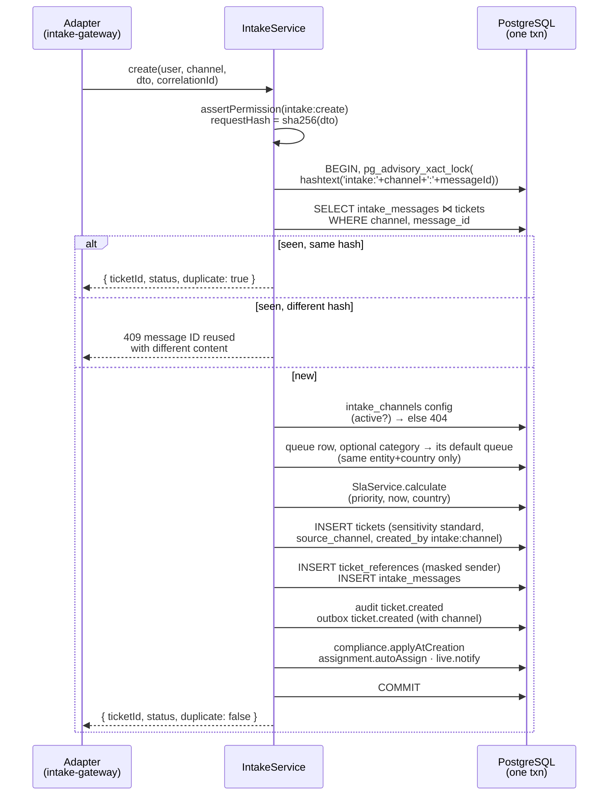

# Channel intake

[Back to Intake index](README.md) · Code: [intake.service.ts](../../apps/api/src/intake/intake.service.ts)

---

## 1. The contract

[IntakeMessageDto, intake.dto.ts#L7-L17](../../apps/api/src/intake/intake.dto.ts#L7-L17):

| Field | Rule | Plain meaning |
|---|---|---|
| `messageId` | 1-200 printable ASCII | The source's unique ID, for de-duplication |
| `senderReference` | 8-255 | Opaque customer reference resolved by the adapter. **Never** raw account, card or national-ID numbers |
| `subject` | 1-200 | |
| `body` | 1-20,000, plain text | HTML must be stripped by the adapter; the UI renders text too |
| `category` | optional | Lets an adapter classify (portal "complaint") |
| `priority` | optional | Otherwise the channel default |

Channels: `email`, `portal`, `mobile`, `phone`, `internal` ([L3](../../apps/api/src/intake/intake.dto.ts#L3)).

## 2. The external endpoint

[intake.controller.ts#L12-L17](../../apps/api/src/intake/intake.controller.ts#L12-L17): `POST /v1/intake/:channel`, guarded by `AuthGuard`, unknown channel → 400, and `@HttpCode(200)` for both first delivery and redelivery (the adapter just needs "ok, here's the ticket").

The portal and email adapters run **in-process** and call `IntakeService.create` directly with a typed service identity ([portal.service.ts#L11](../../apps/api/src/portal/portal.service.ts#L11), [inbound.worker.ts#L13](../../apps/api/src/email/inbound.worker.ts#L13)), so the same rules apply.

## 3. `create()` step by step

[intake.service.ts#L27-L66](../../apps/api/src/intake/intake.service.ts#L27-L66):

| Lines | Detail | Why |
|---|---|---|
| [L32](../../apps/api/src/intake/intake.service.ts#L32) | Advisory lock on `intake:<channel>:<messageId>` | Two concurrent redeliveries of the **same** message serialise; the second sees the first's ledger row. This closes the race the staff-create path has ([tickets idempotency race](../tickets/create-read-search.md#24-the-idempotency-race-know-this-one)) |
| [L33-L37](../../apps/api/src/intake/intake.service.ts#L33-L37) | Ledger check with hash | Exact redelivery returns the original; conflicting reuse is refused |
| [L38-L39](../../apps/api/src/intake/intake.service.ts#L38-L39) | Channel config must be active | 404 "not configured" (the portal maps it to 503 "service unavailable") |
| [L42-L49](../../apps/api/src/intake/intake.service.ts#L42-L49) | A message may pick a category, but **never routes outside the channel's entity/country** | An Australian portal can't drop tickets into an Indian queue |
| [L54-L55](../../apps/api/src/intake/intake.service.ts#L54-L55) | `sensitivity='standard'`, `created_by='intake:email'` | External tickets start standard; the actor shows the channel |
| [L56](../../apps/api/src/intake/intake.service.ts#L56) | Sender stored as a masked customer reference | Same masking as staff tickets |
| [L58-L63](../../apps/api/src/intake/intake.service.ts#L58-L63) | Same audit/outbox/compliance/assignment/live as staff create | One behaviour for every door |

The audit `actorId` is the adapter's subject (e.g. `system:email-intake`), and `created_by` is `intake:<channel>`.

## 4. Channel configuration

`intake_channels(channel_key, default_category, default_queue, branch_code, default_priority, active)`.

[upsertIntakeChannel, routing.service.ts#L94-L111](../../apps/api/src/configuration/routing.service.ts#L94-L111): known channel key only; queue in the admin's scope; category active; an existing channel owned by another entity can't be taken over; the previous row is audited.

UI: [intake-section.tsx#L16-L60](../../apps/web/src/features/admin/sections/intake-section.tsx#L16-L60), with defaults (branch code `DIGITAL`, priority normal).

## 5. Tests

| Claim | Test |
|---|---|
| Intake de-duplicates by message ID | [workflow.integration-spec.ts#L31](../../apps/api/test/workflow.integration-spec.ts#L31) |
| Email creates a ticket, acknowledges, threads a reply, ignores automatic mail | [email.integration-spec.ts#L40](../../apps/api/test/email.integration-spec.ts#L40) |
| Portal requests go through intake | [portal.integration-spec.ts#L33](../../apps/api/test/portal.integration-spec.ts#L33) |
| Local simulator | [scripts/simulate-intake.mjs](../../apps/api/scripts/simulate-intake.mjs) |

Next: [Inbound email](inbound-email.md)
