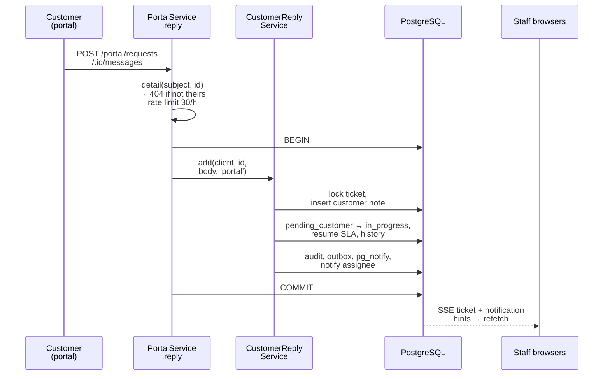

# Customer replies

One shared service makes portal messages, portal document uploads, secure-link uploads and email replies behave identically on the staff side.

[Back to Intake index](README.md) · Code: [customer-reply.service.ts](../../apps/api/src/intake/customer-reply.service.ts)

---

## 1. `add(client, ticketId, body, channel)`

[L22-L41](../../apps/api/src/intake/customer-reply.service.ts#L22-L41):

```ts
const ticket = (await client.query('SELECT * FROM tickets WHERE id=$1 FOR UPDATE', [ticketId])).rows[0];   // lock
if (!ticket) throw NotFound; if (ticket.redacted_at || ticket.status === 'cancelled') throw Conflict;
const author = `customer:${channel}`;                         // customer:portal | customer:email | customer:link
INSERT ticket_notes (visibility 'customer', body ≤ 10,000, author_id = author)
if (ticket.status === 'pending_customer') {
  try {
    await workflows.assertTransition(client, ticket.category, 'pending_customer', 'in_progress', ['intake-gateway']);
    UPDATE tickets SET status='in_progress';
    UPDATE tickets SET deadlines += (now() - sla_paused_at), sla_paused_at = NULL;   // resume SLA
    INSERT status history ("Customer replied by portal")
  } catch { /* workflow doesn't allow it: leave the status alone */ }
} else UPDATE tickets SET updated_at = now();
audit ticket.customer_replied · outbox ticket.customer_replied · live.notify(note_added)
notifications.ticketAttention(customer_replied, assignee: true, supervisors: if resolved/closed)
```

| Behaviour | Plain reason |
|---|---|
| `FOR UPDATE` on the ticket | Serialise with staff edits and other replies |
| Author `customer:<channel>` | The UI shows "Customer (portal)"; it never looks like a staff note |
| **Does not set `first_responded_at`** | A customer writing to the bank is not the bank responding, so it must not stop the SLA clock ([comment L13-L16](../../apps/api/src/intake/customer-reply.service.ts#L13-L16)) |
| Waiting on customer → in progress, **if the workflow allows** | The ball is back in the bank's court; respects custom workflows |
| Resume the SLA in the same transaction | Waiting time doesn't count |
| Supervisors notified when the ticket was already resolved/closed | A customer replying to a "done" case needs a senior's attention |

**The caller must prove ownership** before calling `add`: the portal checks the subject's reference ([portal.service.ts#L60](../../apps/api/src/portal/portal.service.ts#L60)), email checks the HMAC sender ([inbound.worker.ts#L92](../../apps/api/src/email/inbound.worker.ts#L92)), and links check the token ([uploads.service.ts](../../apps/api/src/uploads/uploads.service.ts)).

## 2. Callers

| Caller | When | Code |
|---|---|---|
| Portal message | Customer posts a reply | [portal.service.ts#L59-L64](../../apps/api/src/portal/portal.service.ts#L59-L64) |
| Portal / link document upload | After a completed upload: "The customer attached a document: x.pdf" | [portal-attachments.service.ts#L96](../../apps/api/src/portal/portal-attachments.service.ts#L96) |
| Inbound email | Reply threaded to an owned ticket | [inbound.worker.ts#L94](../../apps/api/src/email/inbound.worker.ts#L94) |

## 3. Sequence (portal reply to a waiting ticket)



## 4. Interview answer

> All customer replies go through one service that locks the ticket, adds a customer-authored visible note, and, if the ticket was waiting on the customer and the workflow permits, moves it back to in progress and resumes the SLA by the paused time, with audit, outbox, a live hint and a notification to the assignee. It deliberately doesn't count as a first response, so a customer can't stop the bank's clock. Each channel proves ownership before calling it.
