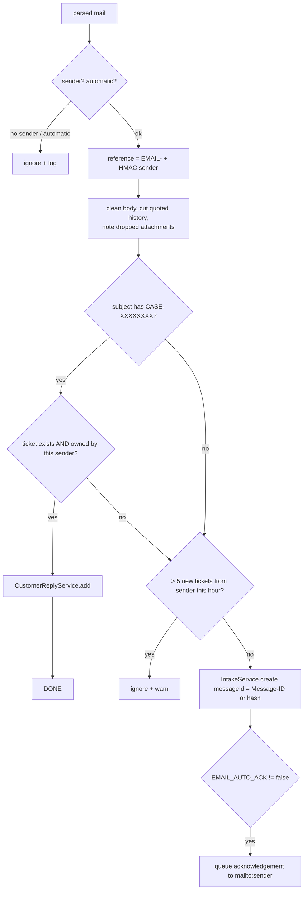

# Inbound email

[Back to Intake index](README.md) · Code: [inbound.worker.ts](../../apps/api/src/email/inbound.worker.ts)

---

## 1. Lifecycle

Starts only if `IMAP_HOST`, `EMAIL_REFERENCE_SECRET` and `DATABASE_URL` are set ([L33-L37](../../apps/api/src/email/inbound.worker.ts#L33-L37)). Polls every `IMAP_POLL_MS` (15 s) with chained, unref'd timers.

## 2. One pass

[runOnce, L41-L56](../../apps/api/src/email/inbound.worker.ts#L41-L56):

```ts
const client = new ImapFlow({ host, port: 993, secure: true, auth: {...} });
await client.connect();
const lock = await client.getMailboxLock('INBOX');              // IMAP-level lock on the mailbox
const uids = await client.search({ seen: false }, { uid: true });
for (const uid of uids.slice(0, 20)) {                           // bounded batch
  const message = await client.fetchOne(uid, { source: true }, { uid: true });
  try { await this.handle(await simpleParser(message.source), message.source);
        await client.messageFlagsAdd(uid, ['\\Seen'], { uid: true }); }   // mark Seen ONLY after success
  catch { /* leave unread → retried next pass */ }
}
```

**Plain:** read up to 20 unread emails, process each one, and only mark it read once it has been safely turned into a ticket or reply. If something fails, it stays unread and is retried. That is at-least-once processing, made safe by the intake ledger's de-duplication.

## 3. Handling one email

[handle, L58-L72](../../apps/api/src/email/inbound.worker.ts#L58-L72):



### 3.1 Loop and spam protection: `isAutomatic`

[L74-L80](../../apps/api/src/email/inbound.worker.ts#L74-L80). An email is ignored if any of these hold:

| Signal | Meaning |
|---|---|
| `Auto-Submitted` present and not `no` | RFC 3834 auto-generated or auto-replied |
| `Precedence: bulk/junk/list/auto_reply` | Mailing lists, bulk mail |
| `X-Auto-Response-Suppress`, `List-Id`, `X-Autoreply` | Microsoft, list and auto-reply markers |
| `Content-Type: multipart/report` | Bounce or delivery status notification |
| Sender local part like `mailer-daemon`, `postmaster`, `no-reply`, `bounce`, `notifications` | [NO_REPLY_SENDERS L14](../../apps/api/src/email/inbound.worker.ts#L14) |
| Sender equals our own `MAIL_FROM` | Never ingest our own mail |

Our outbound mail sets `Auto-Submitted: auto-generated` ([delivery.worker.ts#L77](../../apps/api/src/email/delivery.worker.ts#L77)), so two systems can't ping-pong.

### 3.2 Pseudonymous sender

```ts
const reference = `EMAIL-${createHmac('sha256', process.env.EMAIL_REFERENCE_SECRET!).update(sender).digest('hex').slice(0, 24)}`;
```

- **HMAC** (keyed hash): the same address always gives the same reference, so the system can tell "this is the same person", but without the secret nobody can reverse it or guess-check addresses. A plain SHA-256 of an email address *could* be brute-forced from a list of addresses.
- The raw address is kept in exactly one place: the `mailto:` recipient on the acknowledgement communication, which is needed to reply ([L107](../../apps/api/src/email/inbound.worker.ts#L107)).
- The production safety check refuses the development secret value ([production-safety.ts#L14](../../apps/api/src/production-safety.ts#L14)).

### 3.3 Body cleaning

[cleanBody, L82-L87](../../apps/api/src/email/inbound.worker.ts#L82-L87): prefer the text part; otherwise strip HTML (removes `script`/`style`, converts `<br>` and `</p>` to newlines, removes tags, decodes basic entities); cut quoted history at "On ... wrote:", "--Original Message--" or "From:/Sent:"; drop `>` lines; collapse blank lines; cap at 20,000 characters. Attachments are **not imported**; the body notes "[N attachment(s) were not imported]" (customers can use the portal or a secure link instead).

### 3.4 Threading replies safely

[addReply, L90-L97](../../apps/api/src/email/inbound.worker.ts#L90-L97):

```sql
SELECT t.id FROM tickets t
WHERE t.id::text LIKE $1                                     -- 'abcd1234%' from [CASE-ABCD1234]
  AND t.redacted_at IS NULL
  AND EXISTS (SELECT 1 FROM ticket_references r WHERE r.ticket_id=t.id AND r.opaque_reference=$2)  -- sender owns it
```

**Plain:** knowing or guessing a case number isn't enough. The reply is attached only if the email comes from the **same sender** (the same HMAC reference) who raised the ticket. Otherwise it is treated as a new ticket (subject to the rate limit). This prevents note injection into someone else's case.

### 3.5 Rate limit

At most `EMAIL_MAX_TICKETS_PER_SENDER_HOUR` (5) new tickets per sender per hour ([L62-L68](../../apps/api/src/email/inbound.worker.ts#L62-L68)). Replies aren't limited this way.

### 3.6 Auto-acknowledgement

[acknowledge, L100-L112](../../apps/api/src/email/inbound.worker.ts#L100-L112): in its own transaction, lock the ticket; skip if communications are blocked or any communication already exists; insert a `queued` communication with template `ticket_acknowledgement` to `mailto:<address>` (masked as `••••x@domain`), set `first_responded_at`, then audit and outbox. The delivery worker sends it ([Communications](../communications/delivery-and-receipts.md)).

## 4. Configuration

`IMAP_HOST/PORT/SECURE/USER/PASSWORD`, `IMAP_ALLOW_INSECURE_TLS` (dev only), `EMAIL_REFERENCE_SECRET`, `EMAIL_MAX_TICKETS_PER_SENDER_HOUR`, `EMAIL_AUTO_ACK`, `MAIL_FROM`, `IMAP_POLL_MS`.

## 5. Test

[email.integration-spec.ts#L40](../../apps/api/test/email.integration-spec.ts#L40) (run with `EMAIL_TEST=1` and the docker mail server): creates a ticket from an email, sends the acknowledgement, threads a reply into the same ticket, and ignores automatic mail.

## 6. Interview answer

> The inbound worker polls IMAP in bounded batches under a mailbox lock and only marks a message seen after it's processed, so failures retry and the intake ledger de-duplicates. It drops automatic mail by RFC 3834 and list/bounce headers to prevent loops, stores senders as HMAC pseudonyms, strips HTML and quoted history, and rate-limits new tickets per sender. Replies thread by the case tag only if the sender's pseudonym matches the ticket's reference. New tickets get an auto-acknowledgement queued to the original address, which is the one place that address is kept.

Next: [Customer replies](customer-replies.md)
