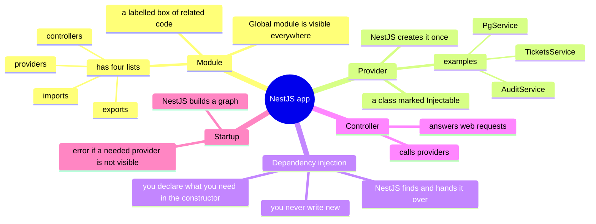
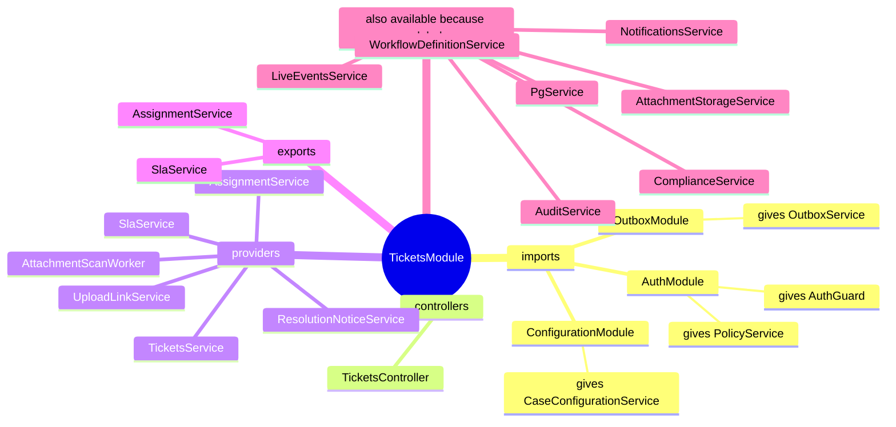

# Lesson 1: Modules, providers and dependency injection

Goal: after this lesson you can open any `*.module.ts` in this project and say what the app can use, what it shares, and why. You can also read the most common NestJS startup error and fix it.

---

## 1. The big picture (mind map)



Plain-text version:

```
NestJS app
├── Module (a labelled box of related code)
│   ├── providers    what this box creates and manages
│   ├── exports      which of those other boxes may use
│   ├── imports      other boxes whose exports I want
│   └── controllers  classes that answer web requests
├── Provider (a class marked @Injectable)
│   ├── created once by NestJS, shared by everyone who asks
│   └── examples here: PgService, AuditService, TicketsService
├── Dependency injection (DI)
│   ├── you list what you need in the constructor
│   ├── NestJS looks it up and passes it in
│   └── you never write "new SomeService()"
└── At startup NestJS builds a graph of who needs whom
    └── if a needed provider is not visible to a box, the app refuses to start
```

---

## 2. The ideas, one at a time

### Provider
- **Technical:** a class decorated with `@Injectable()` that NestJS can create and inject.
- **Plain words:** a worker the app keeps one of. Anyone who needs that worker is handed the same one.
- **In this project:** [pg.service.ts](../../apps/api/src/database/pg.service.ts) is a provider. It owns the database connection pool. Because NestJS creates it once, there is one pool for the whole app, not one per class.

### Dependency injection (DI)
- **Technical:** instead of a class creating its dependencies, it declares them (in the constructor) and the framework supplies them.
- **Plain words:** you write down the tools you need, and someone brings them. You don't build them yourself.
- **In this project:**

```ts
// apps/api/src/dashboard/dashboard.controller.ts
constructor(private readonly dashboard: DashboardService, private readonly sla: SlaService) {}
```

NestJS reads the *types* in the constructor (`DashboardService`, `SlaService`), finds a provider for each, and passes them in. This is why tests can swap the real database for a fake: the class never created it.

### Module
- **Technical:** a class decorated with `@Module({...})` that groups providers and controllers and controls what is shared.
- **Plain words:** a labelled box. Things inside can use each other freely. Things outside can use only what the box *exports*.

The four lists:

| List | Technical meaning | Plain words |
|---|---|---|
| `providers` | classes this module instantiates | what lives in this box |
| `exports` | providers other modules may use | what the box lets outsiders use |
| `imports` | modules whose exports I want | other boxes I'm allowed to borrow from |
| `controllers` | classes that handle HTTP requests | the doors to the outside world |

### Global module
- **Technical:** a module marked `@Global()`; its exports are visible in every module without importing it.
- **Plain words:** a box whose exported tools are on the shared workbench for everyone.
- **Use sparingly:** it hides who depends on what. This project uses it for things nearly everything needs (database, audit log, outbox).

---

## 3. Walk through a real module: `TicketsModule`

File: [tickets.module.ts](../../apps/api/src/tickets/tickets.module.ts)

```ts
@Module({
  imports:     [AuthModule, OutboxModule, ConfigurationModule],
  controllers: [TicketsController],
  providers:   [TicketsService, SlaService, AssignmentService, ResolutionNoticeService, UploadLinkService, AttachmentScanWorker],
  exports:     [SlaService, AssignmentService]
})
export class TicketsModule {}
```

### Mind map of this module



```
TicketsModule
├── imports (borrowed from other boxes)
│   ├── AuthModule           -> PolicyService, AuthGuard
│   ├── OutboxModule         -> OutboxService
│   └── ConfigurationModule  -> CaseConfigurationService
├── controllers (doors)
│   └── TicketsController    -> the /v1/tickets routes
├── providers (lives in this box)
│   ├── TicketsService            the main ticket logic
│   ├── SlaService                deadlines and clocks
│   ├── AssignmentService         auto-assignment
│   ├── ResolutionNoticeService   "your request is resolved" message
│   ├── UploadLinkService         secure upload links
│   └── AttachmentScanWorker      background virus-scan loop
├── exports (shared with other boxes)
│   ├── SlaService
│   └── AssignmentService
└── available WITHOUT importing, because their modules are @Global
    PgService, AuditService, NotificationsService, LiveEventsService,
    AttachmentStorageService, ComplianceService, WorkflowDefinitionService
```

### Where each constructor dependency comes from

`TicketsService` asks for 14 things. Here is where each one is found:

| Needs | Where it comes from | Why it is visible |
|---|---|---|
| `PgService` | `DatabaseModule` | global |
| `PolicyService` | `AuthModule` | **imported** by TicketsModule |
| `AuditService` | `AuditModule` | global |
| `OutboxService` | `OutboxModule` | imported (and also global) |
| `CaseConfigurationService` | `ConfigurationModule` | **imported** |
| `AttachmentStorageService` | `StorageModule` | global |
| `LiveEventsService` | `LiveModule` | global |
| `ComplianceService` | `ComplianceModule` | global |
| `WorkflowDefinitionService` | `WorkflowModule` | global |
| `NotificationsService` | `NotificationsModule` | global |
| `SlaService`, `AssignmentService`, `ResolutionNoticeService`, `UploadLinkService` | this same module | listed in `providers` |

### Things worth noticing

1. **`AuthModule` is NOT global.** It is imported by name in many modules (`AuditModule`, `LiveModule`, `DashboardModule`, `TicketsModule` and others). Each one that needs `PolicyService` or `AuthGuard` imports it.
2. **`OutboxModule` is imported even though it is global.** That is harmless but redundant. Being explicit about a dependency is a style choice; the app works either way.
3. **Why `WorkflowModule` is global instead of imported.** `WorkflowModule` imports `TicketsModule` (it needs `SlaService`). If `TicketsModule` also imported `WorkflowModule` to get `WorkflowDefinitionService`, the two files would import each other, which is a circular import and breaks. Making `WorkflowModule` global lets `TicketsModule` use it without importing it. This is a good example of a legitimate reason for `@Global()`.
4. **`exports` is the public front door.** Only `SlaService` and `AssignmentService` leave this box. `TicketsService` is *not* exported, so other modules cannot use it directly. That is on purpose: other code should create tickets through the controller or the intake service, not reach inside.
5. **`controllers` need their guards' module.** `TicketsController` uses `@UseGuards(AuthGuard)`. The guard is provided by `AuthModule`, so the import is required.

---

## 4. A second example: a module that borrows from another one

[dashboard.module.ts](../../apps/api/src/dashboard/dashboard.module.ts):

```ts
@Module({ imports: [AuthModule, OutboxModule, TicketsModule], controllers: [DashboardController], providers: [DashboardService] })
```

`DashboardController` needs `SlaService`. `SlaService` lives in `TicketsModule`, which exports it. So `DashboardModule` imports `TicketsModule`. Remove `SlaService` from `TicketsModule.exports` and the app stops starting.

Added in this project recently (good to study):
- `UploadsModule` imports `PortalModule` to use `PortalAttachmentsService`, which I added to `PortalModule`'s `exports` for that reason.
- `UploadLinkService` was added to `TicketsModule.providers` and injected into `TicketsService`.

---

## 5. How to read the most common NestJS error

```
Nest can't resolve dependencies of the TicketsService (?, PolicyService, ...).
Please make sure that the argument PgService at index [0] is available in the TicketsModule context.
```

Read it as: "In the TicketsModule box, I tried to build TicketsService. Its first constructor argument is a PgService, and I cannot see one."

There are only three fixes. Check them in this order:

| # | Check | Fix |
|---|---|---|
| 1 | Is the provider listed in some module's `providers`? | Add it to `providers` |
| 2 | Is it in a *different* module? Does that module `export` it? | Add it to that module's `exports` |
| 3 | Does the module that needs it `import` that other module (or is the other module `@Global()`)? | Add to `imports` |

Another message you will meet: `A circular dependency between modules`. It means two modules import each other. Fix by restructuring (as with the global `WorkflowModule` above), or `forwardRef()` as a last resort.

---

## 6. Rules to remember

1. A class can only receive something that is **visible in its own module**: its own providers, exports of modules it imports, or exports of global modules.
2. `exports` must be listed to share; `imports` must be listed to borrow.
3. NestJS creates each provider **once** (a singleton) unless told otherwise.
4. You never write `new` for a provider.
5. Constructor *types* are how NestJS knows what to inject. (TypeScript compiler option `emitDecoratorMetadata` makes this possible.)
6. Use `@Global()` rarely, for things almost everything needs, or to break a circular import.

---

## 7. Questions

1. Why does `PgService` have `@Injectable()` and yet there is no `new PgService()` anywhere?
2. `DashboardModule` imports `TicketsModule`. What breaks if `TicketsModule` stops exporting `SlaService`?
3. `UploadLinkService` is in `TicketsModule.providers`. Why is that line needed?
4. `AttachmentScanWorker` needs `PgService`, `AttachmentStorageService` and `TicketsService`. For each, say where it comes from.
5. Is it a bug that `OutboxModule` is imported by `TicketsModule` while also being `@Global()`?
6. Why can't `TicketsModule` just import `WorkflowModule`?

## 8. Exercise

Pick three modules you have not seen yet (for example `portal.module.ts`, `email.module.ts`, `intake.module.ts`). For each, draw the same mind map: imports, controllers, providers, exports, and which global modules it silently uses. Then run `npm run build --workspace=@bank-case/api` and read the file `apps/api/src/app.module.ts` to see how all the boxes are assembled into one app.

Optional experiment (then undo it with git): remove `SlaService` from `exports` in `tickets.module.ts`, start the API, and read the error message. Match it to the table in section 5.

---

## 9. Answers (try the questions first)

1. `@Injectable()` tells NestJS it may create and share this class. NestJS builds it once and passes it to anyone whose constructor asks for the type.
2. `DashboardController` asks for `SlaService`, which would no longer be visible in `DashboardModule`. Startup fails with "can't resolve dependencies of the DashboardController".
3. `providers` is the list of classes this module is responsible for creating. Without it, NestJS would not know how to create `UploadLinkService`, so `TicketsService` could not receive it.
4. `PgService`: global `DatabaseModule`. `AttachmentStorageService`: global `StorageModule`. `TicketsService`: the same module's own `providers`.
5. Not a bug. Importing something that is also global is redundant but harmless. It makes the dependency visible to the reader.
6. `WorkflowModule` already imports `TicketsModule`. If `TicketsModule` imported `WorkflowModule` too, the two modules would depend on each other in a circle. Marking `WorkflowModule` as `@Global()` avoids the import.

---

## 10. Glossary

| Term | Plain meaning |
|---|---|
| Decorator (`@Something`) | A label attached to a class or method that tells the framework how to treat it |
| Provider | A class the framework creates and shares |
| Injectable | "This class may be created and handed out by the framework" |
| Dependency | Something a class needs in order to work |
| Dependency injection | The framework supplies a class's dependencies instead of the class building them |
| Singleton | Only one instance exists and everyone shares it |
| Module | A labelled box of related providers and controllers |
| Import / export | Borrow from another box / offer to other boxes |
| Global module | A box whose exports everyone can use without importing |
| Controller | A class that answers web requests |
| Circular dependency | A needs B and B needs A, so neither can be built first |
