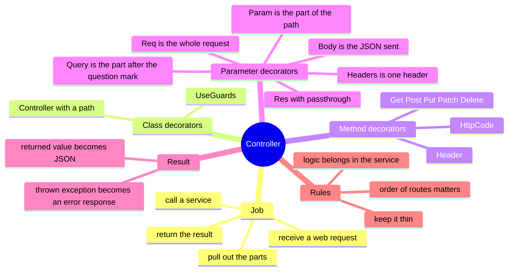

# Lesson 2: Controllers and routing

Lesson navigation: **core chapter** · [repository code trace](code-walkthrough.md) · [practice and interview drill](practice-and-interview.md) · [course index](../README.md)

Goal: after this lesson you can look at any URL the API serves, find the exact method that answers it, and say what each decorator on that method does. You can also write a new route correctly.

Builds on Lesson 1: a controller is a class listed in a module's `controllers`, and it receives providers through its constructor.

---

## 1. The big picture (mind map)



Plain-text version:

```
Controller  (the receptionist: takes the request, hands it to the right person, returns the answer)
├── Class decorators
│   ├── @Controller('tickets')   all routes here start with /tickets
│   └── @UseGuards(AuthGuard)    every route here needs a signed-in caller
├── Method decorators  (which verb + path reaches this method)
│   ├── @Get() @Post() @Put() @Patch() @Delete()
│   ├── @HttpCode(200)           change the success status
│   └── @Header('Cache-Control', 'no-store')   add a fixed response header
├── Parameter decorators  (what to pull out of the request)
│   ├── @Param('ticketId')   a piece of the path        /tickets/:ticketId
│   ├── @Query('limit')      a query-string value       ?limit=20
│   ├── @Body()              the JSON body, already validated
│   ├── @Headers('x-upload-token')   one header
│   ├── @Req()               the whole request
│   └── @Res({ passthrough: true })  the response, only to set headers
├── What you return becomes the JSON response
├── What you throw becomes an error response (BadRequestException -> 400)
└── Golden rule: thin controller, real logic in a service
```

---

## 2. The ideas, one at a time

### Controller
- **Technical:** a class marked `@Controller('prefix')` whose methods handle HTTP requests for routes under that prefix.
- **Plain words:** the front desk. It reads the request, passes it to the right worker (a service), and gives back the answer. It should not do the real work itself.

### Route
- **Technical:** the combination of an HTTP verb and a path, declared with `@Get()`, `@Post()`, etc.
- **Plain words:** the address a request must match to reach a particular method. `GET /v1/tickets/123` means "show me ticket 123".

### The full path is built from three parts

```
app.setGlobalPrefix('v1')      main.ts          -> /v1
@Controller('tickets')         class decorator  -> /tickets
@Get(':ticketId')              method decorator -> /:ticketId
                                                =  GET /v1/tickets/:ticketId
```

### Path parameter, query parameter, body, header
| Piece | Example request | Decorator | Value in the method |
|---|---|---|---|
| Path parameter | `GET /v1/tickets/abc` | `@Param('ticketId')` | `'abc'` |
| Query parameter | `GET /v1/tickets?limit=20` | `@Query('limit')` | `'20'` (always text) |
| Body | `POST` with JSON `{"subject":"x"}` | `@Body()` | an object (validated, Lesson 3) |
| Header | `Idempotency-Key: k1` | `@Headers('idempotency-key')` | `'k1'` |

### Status codes you get for free
- A returned value becomes a JSON response automatically.
- Default status: **200** for GET, PUT, PATCH, DELETE; **201** for POST.
- `@HttpCode(200)` overrides it. Used on `POST /tickets/:id/sensitive-reveals` and `POST /intake/:channel`, because those do not create a new thing, they just return a result.

---

## 3. Real code, read slowly

### 3a. The smallest controller: health

[health.controller.ts](../../../apps/api/src/health.controller.ts)

```ts
@Controller('health')
export class HealthController {
  constructor(private readonly db: PgService) {}

  @Get('live')  live()  { return { status: 'ok' }; }

  @Get('ready') async ready() {
    await this.db.query('SELECT 1');
    return { status: 'ok', database: 'reachable' };
  }
}
```

- Two routes: `GET /v1/health/live` and `GET /v1/health/ready`.
- No guard, so anyone can call them (load balancers need that).
- `PgService` arrives by dependency injection (Lesson 1).
- Returning an object makes NestJS send it as JSON with status 200.

### 3b. A real controller: tickets

[tickets.controller.ts](../../../apps/api/src/tickets/tickets.controller.ts)

```ts
@Controller('tickets')
@UseGuards(AuthGuard)
export class TicketsController {
  constructor(private readonly tickets: TicketsService) {}

  @Post() create(@Req() request, @Headers('idempotency-key') key, @Body() dto: CreateTicketDto) { ... }

  @Get() async list(@Req() request, @Res({ passthrough: true }) reply, @Query('cursor') cursor?, @Query('limit') limit?) { ... }

  @Get('search')      search(@Req() request, @Query() query: SearchTicketsQuery) { ... }
  @Get(':ticketId')   get(@Req() request, @Param('ticketId') ticketId: string) { ... }
  @Patch(':ticketId') update(...)
  @Post(':ticketId/assignments') assign(...)
  @Post(':ticketId/sensitive-reveals') @HttpCode(200) reveal(...)
}
```

Routes this produces (all under `/v1`):

| Verb and path | Method | What it does |
|---|---|---|
| `POST /tickets` | `create` | create a ticket (needs `Idempotency-Key` header) |
| `GET /tickets` | `list` | one page of tickets |
| `GET /tickets/search?q=…` | `search` | search |
| `GET /tickets/:ticketId` | `get` | one ticket |
| `PATCH /tickets/:ticketId` | `update` | change some fields |
| `POST /tickets/:ticketId/assignments` | `assign` | assign it |
| `POST /tickets/:ticketId/sensitive-reveals` | `reveal` | reveal masked references (status 200) |

Things to notice:

1. **`@UseGuards(AuthGuard)` is on the class**, so every route needs a signed-in user. The guard also fills in `request.user` and `request.correlationId`, which the methods read. (Guards: Lesson 4.)
2. **Route order matters.** `@Get('search')` is declared *before* `@Get(':ticketId')`. If it were after, a request for `/tickets/search` would match `:ticketId` with the value `"search"`. NestJS tries routes in the order they are written, and a parameter route matches almost anything.
3. **`@Res({ passthrough: true })`** gives the method access to the response so it can set a header (`X-Next-Cursor`) while still *returning* the data normally. Without `passthrough`, you take over the whole response and NestJS stops doing it for you.
4. **The controller is thin.** `get` is one line: pass the user, the id and the correlation id to `TicketsService.get`. All checks, database work and auditing live in the service.
5. **Tiny checks may live in the controller.** `create` rejects a missing `Idempotency-Key` header by throwing `BadRequestException`, because that is about the *shape of the request*, not business logic.
6. **Query values are always text.** `limit` arrives as `'20'`, so the code converts it with `Number(limit)`.

### 3c. Fixed response headers and path-parameter checking

[portal.controller.ts](../../../apps/api/src/portal/portal.controller.ts)

```ts
@Header('Cache-Control', 'no-store') @Get('requests/:id')
detail(@Req() r, @Param('id', ParseUUIDPipe) id: string) { ... }
```

- `@Header('Cache-Control', 'no-store')` adds that header to every response from the method, so browsers and proxies never cache a customer's data.
- `ParseUUIDPipe` is a *pipe*: it checks the path value is a valid UUID and rejects anything else with a 400 before the method runs. (Pipes: Lesson 3.)

### 3d. A controller with no guard: secure upload links

[uploads.controller.ts](../../../apps/api/src/uploads/uploads.controller.ts)

```ts
@Controller('upload')
export class UploadsController {
  @Get('status') status(@Headers('x-upload-token') token?: string) { ... }
}
```

- No `@UseGuards`, so no sign-in is needed. The secure link's token, sent in a header, is the credential and is checked by `UploadsService`.
- Because no guard runs, nothing sets `request.correlationId`. That is why I generate one in this controller. This is a real bug I hit while building it: an audit write failed with "null value in correlation_id" until I added that line.

### 3e. How the app is told to use the controller

A controller does nothing until it is listed in a module (Lesson 1):

```ts
@Module({ ... controllers: [TicketsController], providers: [TicketsService, ...] })
export class TicketsModule {}
```

---

## 4. Try it yourself (the stack is running)

```bash
# 1. No guard: works for anyone
curl -s localhost:3000/v1/health/live
#  {"status":"ok"}

# 2. Guard present, no token: refused before the method runs
curl -s -i localhost:3000/v1/tickets | head -1
#  HTTP/1.1 401 Unauthorized

# 3. A route that does not exist for that verb
curl -s -X POST localhost:3000/v1/health/live
#  {"message":"Cannot POST /v1/health/live","error":"Not Found","statusCode":404}

# 4. The public upload controller with no token: a uniform plain refusal
curl -s localhost:3000/v1/upload/status
#  {"message":"This link is not valid or has expired. Please contact the bank.","error":"Not Found","statusCode":404}
```

What each teaches: (1) a simple controller, (2) a guard blocks the whole class, (3) a route is a verb *and* a path, (4) a thrown `NotFoundException` becomes a JSON error with the right status.

---

## 5. Rules to remember

1. Full path = global prefix + controller prefix + method path.
2. One decorator for the verb, parameter decorators for what you need.
3. Return a value for success; throw an `HttpException` subclass (such as `BadRequestException`) for failure.
4. Put a literal route (`search`) **before** a parameter route (`:ticketId`) that could swallow it.
5. Keep controllers thin. If you are writing an `if` about business rules, it belongs in the service.
6. `@UseGuards` on the class protects every route; a controller without it is public.
7. A controller must be listed in a module's `controllers`.

---

## 6. Questions

1. What is the full URL of the method `@Get('summary')` in `@Controller('dashboard')`?
2. Why does `POST /tickets/:ticketId/sensitive-reveals` use `@HttpCode(200)`?
3. What goes wrong if `@Get(':ticketId')` is moved above `@Get('search')`?
4. Why does `list` use `@Res({ passthrough: true })`?
5. `limit` is read with `@Query('limit') limit?: string`. Why is it a string, and where does it become a number?
6. Which of these controllers is public and which is protected: `HealthController`, `TicketsController`, `UploadsController`? How can you tell from the code?

## 7. Exercise

Trace one request from the browser to the database without running it:

1. Open [portal.controller.ts](../../../apps/api/src/portal/portal.controller.ts) and find the route for "send a message on my request".
2. Write its full URL and verb.
3. List the decorators on the method and say what each does.
4. Follow the call into `PortalService.reply`, then into `CustomerReplyService.add`. Write one sentence for each class on what it adds.
5. Say where authentication happens for this controller (hint: which guard is on the class).

Optional: add a read-only route `GET /v1/health/version` that returns `{ version: '0.1.0' }`. Run `npm run build --workspace=@bank-case/api`, restart the API and curl it. Then undo it with git.

---

## 8. Answers (try the questions first)

1. `GET /v1/dashboard/summary` (global prefix `v1`, controller `dashboard`, method path `summary`).
2. A `POST` returns 201 by default, meaning "something was created". Revealing references creates nothing, so `200` ("OK") is the honest status.
3. `GET /tickets/search` would match `:ticketId` with the value `"search"`, so the search method is never reached and the ticket lookup fails with a not-found or validation error.
4. It needs to set a response header (`X-Next-Cursor`) but still return the list normally. `passthrough: true` lets it do both; without it, NestJS would expect the method to send the whole response itself.
5. Query-string values are always text. The method converts with `Number(limit)` before passing it to the service.
6. `HealthController` and `UploadsController` are public (no `@UseGuards`; the upload controller is protected by its token instead). `TicketsController` is protected by `@UseGuards(AuthGuard)` on the class.

---

## 9. Glossary

| Term | Plain meaning |
|---|---|
| Route | A verb plus a path that reaches one method |
| HTTP verb | GET read, POST create or act, PUT replace, PATCH change part, DELETE remove |
| Path parameter | A variable part of the address, like the ticket id |
| Query string | The `?key=value` part of an address |
| Body | The data sent with a request, here JSON |
| Header | A named extra piece of information sent with a request or response |
| Status code | The number that says how it went: 200 OK, 201 created, 400 bad request, 401 not signed in, 403 not allowed, 404 not found |
| Pass-through response | Using the response object only to add things while NestJS still sends the returned value |
| Thin controller | A controller that only translates the request and calls a service |
