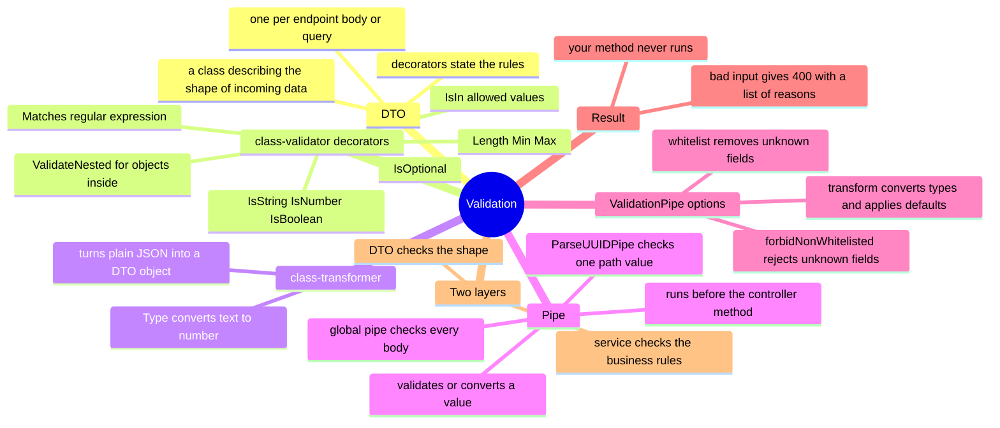

# Lesson 3: DTOs and validation (pipes)

Goal: after this lesson you can read any `*.dto.ts` file, say exactly which requests it accepts and rejects, and write a new DTO correctly. You will also understand why this layer is a security control, not just tidiness.

Builds on Lesson 2: `@Body()`, `@Query()` and `@Param()` hand your controller method data from the outside world. This lesson is about checking that data before your code ever sees it.

---

## 1. The big picture (mind map)



Plain-text version:

```
Validation
├── DTO (Data Transfer Object): a class that describes the shape of incoming data
│   └── one per request body / query, rules written as decorators on each field
├── class-validator decorators (the rules)
│   ├── @IsString() @IsNumber() @IsBoolean()      the type
│   ├── @IsIn([...])                               only these values
│   ├── @Length(2, 80) @Min(1) @Max(50)            size limits
│   ├── @Matches(/regex/)                          a pattern
│   ├── @IsOptional()                              may be missing
│   └── @ValidateNested() + @Type(() => X)         check objects inside objects
├── class-transformer
│   └── @Type(() => Number)   turn the text "20" into the number 20
├── Pipe: code that runs BEFORE your controller method
│   ├── global ValidationPipe (main.ts)   checks every @Body() / @Query() DTO
│   └── ParseUUIDPipe                      checks one value, e.g. a path id
├── ValidationPipe settings in this project
│   ├── whitelist: true             silently drop fields not in the DTO
│   ├── forbidNonWhitelisted: true  ...but reject the request instead
│   └── transform: true             convert types, fill defaults, give you a real DTO object
├── Outcome: bad input -> HTTP 400 with the list of reasons; your method never runs
└── Two layers: the DTO checks the SHAPE, the service checks the BUSINESS RULES
```

---

## 2. The ideas, one at a time

### DTO (Data Transfer Object)
- **Technical:** a class that defines the expected structure of data crossing a boundary, such as a request body. Each field carries validation decorators.
- **Plain words:** a form with rules printed on it. "Subject: text, 3 to 200 characters. Priority: one of low, normal, high, critical." A request that doesn't fit the form is turned away at the door.
- **Why a class and not an interface?** TypeScript interfaces vanish when the code is compiled, so there is nothing left to check at runtime. A class and its decorators survive, so the framework can read the rules.

### Decorator-based validation (class-validator)
Real example from [ticket.dto.ts](../../apps/api/src/tickets/ticket.dto.ts):

```ts
export class CreateAttachmentDto {
  @IsString() @Length(1, 255) filename!: string;
  @IsIn(ATTACHMENT_CONTENT_TYPES) contentType!: (typeof ATTACHMENT_CONTENT_TYPES)[number];
  @IsNumber() @Min(1) @Max(26214400) sizeBytes!: number;
  @IsIn(['confidential', 'restricted']) classification!: 'confidential' | 'restricted';
}
```

Reading it: filename is text of 1 to 255 characters; contentType must be exactly one of four values; sizeBytes is a number from 1 byte to 25 MB; classification is one of two words.

| Decorator | Plain meaning |
|---|---|
| `@IsString()` `@IsNumber()` `@IsBoolean()` | the value must be this type |
| `@IsIn([...])` | only these exact values allowed |
| `@Length(a, b)` | text length between a and b |
| `@Min(n)` `@Max(n)` | numeric range |
| `@Matches(/regex/)` | text must fit a pattern |
| `@IsUUID()` `@IsISO8601()` | must look like a UUID / a date-time |
| `@IsOptional()` | the field may be missing (without it, missing is an error) |
| `@IsArray()` `@ArrayMaxSize(10)` | a list, at most 10 items |
| `@ValidateNested()` + `@Type(() => X)` | also check each object inside, using class X's rules |

Two TypeScript details:
- `field!: string` the `!` tells TypeScript "this will be set, trust me" (the framework fills it in).
- `field?: string` with `@IsOptional()` means the field may be absent.

### Pipe
- **Technical:** a class with a `transform` step that runs on an argument before the controller method receives it. It can validate (throw on bad data) or convert (change the value).
- **Plain words:** a checkpoint on the way in. Good data passes; bad data is sent back before the method ever runs.

Two kinds of pipe are used here:

1. **Global `ValidationPipe`**, set in [main.ts](../../apps/api/src/main.ts):

```ts
app.useGlobalPipes(new ValidationPipe({ whitelist: true, forbidNonWhitelisted: true, transform: true }));
```

2. **A pipe on one parameter**, in the controllers:

```ts
@Param('id', ParseUUIDPipe) id: string     // rejects anything that is not a UUID
```

### The three ValidationPipe switches

| Setting | What it does | Why it matters here |
|---|---|---|
| `whitelist: true` | removes fields the DTO doesn't declare | the method only ever sees declared fields |
| `forbidNonWhitelisted: true` | rejects the request if an undeclared field is present | loud failure instead of silent drop |
| `transform: true` | converts the plain JSON into a real DTO object, converts types where told to, applies defaults | `limit` becomes a number, `limit = 25` default is applied |

**Security meaning:** this blocks *mass assignment*, where an attacker adds extra fields like `"status": "closed"` or `"assignedTo": "me"` hoping the code copies them blindly into the database. Here, an unknown field is an error before any code runs.

---

## 2b. How does NestJS know which DTO a request must pass through?

The request knows nothing about the DTO. NestJS reads the **type you wrote on the controller parameter**.

```ts
@Post() create(@Req() request, @Headers('idempotency-key') key, @Body() dto: CreateTicketDto) { ... }
```

1. **You write a type.** `dto: CreateTicketDto` is the only link between the endpoint and the DTO.
2. **The compiler keeps it.** TypeScript normally erases types. Two settings in `tsconfig.json`, `experimentalDecorators` and `emitDecoratorMetadata`, make it leave a note on every decorated method. Real compiled output from this project (`dist/tickets/tickets.controller.js`):
   ```js
   __metadata("design:paramtypes", [Object, Object, CreateTicketDto]),
   ```
   That is the list of the method's parameter types in order. Plain words: a sticky note saying "parameter 3 is a CreateTicketDto".
3. **The note is stored where NestJS can read it.** The library `reflect-metadata` (imported on line 1 of `main.ts`) gives classes and methods a place to hold such notes.
4. **At startup NestJS reads the notes.** It sees that `@Body()` is parameter 3 and the note says its type is `CreateTicketDto`.
5. **On each request the global `ValidationPipe` uses that note.** It receives the raw JSON and the type, builds a `CreateTicketDto` from the JSON, and checks it against the decorators on that class. Pass: your method runs. Fail: the caller gets a 400.

| Question | Answer |
|---|---|
| Who chooses the DTO? | You, by typing the parameter |
| How does NestJS find out? | The compiler's saved note, read through `reflect-metadata` |
| Who runs the check? | The global `ValidationPipe`, on every `@Body()` and `@Query()` |
| What does the caller do? | Nothing. They just send JSON |

This is the same mechanism dependency injection uses (Lesson 1): `constructor(private readonly tickets: TicketsService)` works because the compiler saves the type `TicketsService` the same way.

Consequences:
- **Type the parameter with a class.** With `any` or an interface, the note says `Object` and nothing is validated. You can see `Object` in the output above for `@Req()` parameters.
- **No `@Body()` means no DTO.** The `reveal` route has no body, so there is nothing to validate.

Try it: open `dist/tickets/tickets.controller.js`, find the line containing `CreateTicketDto`, then match each `@Body()` in `tickets.controller.ts` to its DTO class.

---

## 3. See it happen (the stack is running)

The public upload endpoint `POST /v1/upload/attachments` needs no sign-in, so you can try validation with just `curl`. It uses [PortalAttachmentDto](../../apps/api/src/portal/portal.dto.ts):
`filename` (text 1 to 255), `contentType` (one of four), `sizeBytes` (number 1 to 26214400).

```bash
H='Content-Type: application/json'; U=localhost:3000/v1/upload/attachments
```

| Try | Command | Real response |
|---|---|---|
| Empty body | `curl -s -X POST -H "$H" -d '{}' $U` | 400 with six messages: filename must be a string and at least 1 character, contentType must be one of the allowed values, sizeBytes must be a number between 1 and 26214400 |
| Extra field | `... -d '{"filename":"a.txt","contentType":"text/plain","sizeBytes":5,"hack":true}'` | 400 `"property hack should not exist"` |
| Wrong values | `... -d '{"filename":"a.exe","contentType":"application/x-msdownload","sizeBytes":"big"}'` | 400: contentType must be one of the following values: application/pdf, image/jpeg, image/png, text/plain; sizeBytes must be a number |
| Body is an array | `... -d '[1,2]'` | 400 `"property 0 should not exist"`, `"property 1 should not exist"`, plus the missing-field messages |
| Broken JSON | `... -d '{bad json'` | 400 `"Expected property name or '}' in JSON at position 1"` (rejected by the web server before validation) |
| Bad id in the path | `curl -s -X POST -H "$H" -d '{"checksumSha256":"aaaa…64 characters…","sizeBytes":5}' localhost:3000/v1/upload/attachments/not-a-uuid/complete` | 400 `"Validation failed (uuid is expected)"` from `ParseUUIDPipe` |
| Valid shape | `... -d '{"filename":"a.txt","contentType":"text/plain","sizeBytes":5}'` | passes validation, reaches the service, which says 404 "This link is not valid or has expired" because there is no token |

What this shows:
- The error is a **list of every problem at once**, so a client can fix them in one go.
- A **valid shape still can fail**. Passing the DTO only proves the request is well-formed, not that it is allowed. The 404 on the last row comes from the service (Lesson 1's providers doing real work).
- When a request has both a bad body and a bad path id, you see the body messages first. Fix those and the id message appears.

---

## 4. Real code, read slowly

### 4a. Nested objects: creating a ticket

```ts
export class ReferenceDto {
  @IsIn(['customer', 'account', 'card', 'loan', 'transaction']) referenceType!: ...;
  @IsString() @Length(2, 80) sourceSystem!: string;
  @IsString() @Length(8, 255) opaqueReference!: string;
}

export class CreateTicketDto {
  ...
  @IsArray() @ArrayMaxSize(10) @ValidateNested({ each: true }) @Type(() => ReferenceDto) references!: ReferenceDto[];
}
```

`references` is a list of objects. Each one is checked against `ReferenceDto`'s rules (`each: true`), and `@Type(() => ReferenceDto)` tells the transformer what class to build for each item. Without `@Type`, nested validation silently does nothing, a classic NestJS trap.

### 4b. Converting text to a number: search

```ts
export class SearchTicketsQuery {
  @IsString() @Length(1, 80) q!: string;
  @IsOptional() @Type(() => Number) @IsInt() @Min(1) @Max(50) limit = 25;
}
```

- Lesson 2 said query values are always text. `@Type(() => Number)` converts `"20"` into `20` so `@IsInt()` can check it.
- `limit = 25` is a default; `transform: true` makes it apply when the caller omits `limit`.

### 4c. A pattern as a security rule: message templates

[communication-template.dto.ts](../../apps/api/src/configuration/communication-template.dto.ts)

```ts
const BODY_PLACEHOLDERS = /^(?:(?!\{\{)[\s\S]|\{\{(?:ticketRef|status|uploadLink)\}\})*$/;
@Matches(BODY_PLACEHOLDERS, { message: 'Only {{ticketRef}}, {{status}} and {{uploadLink}} may be used as placeholders' }) bodyTemplate?: string;
```

An administrator edits the wording of customer messages. This rule lets `{{ticketRef}}`, `{{status}}` and `{{uploadLink}}` appear, and rejects any other `{{...}}`. So a template can never be made to pull other case data (names, balances) into a message to a customer. Validation here is a data-protection control.

### 4d. One list, two uses

```ts
export const ATTACHMENT_CONTENT_TYPES = ['application/pdf', 'image/jpeg', 'image/png', 'text/plain'] as const;
@IsIn(ATTACHMENT_CONTENT_TYPES) contentType!: (typeof ATTACHMENT_CONTENT_TYPES)[number];
```

`as const` makes the array a fixed list. It feeds the runtime check (`@IsIn`) *and* the TypeScript type from the same source, so they can never disagree. The portal DTO imports the same list.

### 4e. Two layers: shape vs rules

The DTO allows files up to 25 MB (`@Max(26214400)`). But the customer portal service enforces **10 MB**, controlled by an environment setting, and rejects with 413. Why both?
- The DTO is a fixed ceiling that protects the server from absurd input. It cannot read settings.
- The service holds business rules that can change by configuration and need the database or user context.

Rule of thumb: **if it can be decided from the request alone, put it in the DTO; if it needs the database, the user, or settings, put it in the service.**

---

## 5. Rules to remember

1. Every `@Body()` and `@Query()` should be typed with a DTO *class*, never an interface or `any`.
2. A field with no decorator is not validated, and with `whitelist` it is stripped. Always decorate every field.
3. Nested objects need `@ValidateNested()` **and** `@Type(() => Class)`.
4. Query and path values are text. Convert with `@Type(() => Number)` or a pipe such as `ParseUUIDPipe`.
5. `@IsOptional()` is needed for any field that may be absent.
6. The DTO checks shape; the service checks rules. Passing validation does not mean permission is granted.
7. Always bound size: `@Length`, `@Max`, `@ArrayMaxSize`. Unbounded input is a denial-of-service and storage risk.

---

## 6. Questions

1. Why is a DTO a class instead of a TypeScript interface?
2. A client sends `{"subject":"x","status":"closed"}` to an endpoint whose DTO has only `subject`. What happens, and which setting causes it?
3. What does `transform: true` do for `limit` in `SearchTicketsQuery`?
4. What breaks if you remove `@Type(() => ReferenceDto)` from `CreateTicketDto.references`?
5. `sizeBytes` allows 25 MB in the DTO but the portal limit is 10 MB. Where is the 10 MB enforced and why not in the DTO?
6. A request passes validation but still gets a 404. Is that a contradiction?

## 7. Exercise

Write (on paper or in your notes, no need to commit it) a DTO for a new endpoint where a customer rates how their request was handled:

- `rating`: whole number 1 to 5, required
- `comment`: text up to 500 characters, optional
- nothing else is accepted

Then predict the response for each input:

1. `{"rating":5}`
2. `{"rating":"5"}`
3. `{"rating":6,"comment":"ok"}`
4. `{"rating":3,"comment":"fine","userId":"abc"}`
5. `{}`

Check your prediction against the answers below. Optional: look at [intake.dto.ts](../../apps/api/src/intake/intake.dto.ts) and explain why `messageId` uses `@Matches(/^[\x21-\x7e]+$/)`.

---

## 8. Answers (try the questions first)

1. Interfaces are erased when TypeScript compiles, so nothing is left to check at runtime. A class and its decorators remain, so the framework can read the rules.
2. The request is rejected with 400 `"property status should not exist"`. `forbidNonWhitelisted: true` (together with `whitelist: true`) causes it. This also prevents mass assignment.
3. It applies the default: when the caller omits `limit`, the object has `limit = 25`. Together with `@Type(() => Number)` it also turns a supplied `"20"` into 20.
4. NestJS would no longer know which class to build for each item, so the nested rules are skipped and bad references pass through unchecked.
5. In the portal service, from an environment setting. The DTO is a fixed ceiling and cannot read settings; business limits that may change belong in the service.
6. No. The DTO checks the shape only. The service can still say not found, not allowed, or conflict.

Exercise answers (with `@IsInt() @Min(1) @Max(5) rating` and `@IsOptional() @IsString() @Length(1, 500) comment`):
1. Accepted.
2. Rejected: rating must be an integer. `"5"` is text, and there is no `@Type(() => Number)` on a body field, so it is not converted.
3. Rejected: rating must not be greater than 5.
4. Rejected: `property userId should not exist`.
5. Rejected: rating must be an integer number (and must not be less than 1).

Intake `messageId` pattern: `^[\x21-\x7e]+$` allows only visible ASCII characters, with no spaces, control characters or line breaks, so an ID can't smuggle hidden characters into logs, headers or the database.

---

## 9. Glossary

| Term | Plain meaning |
|---|---|
| DTO | A class describing the exact shape of data allowed in or out |
| Validation | Checking that data meets the rules before using it |
| Pipe | A checkpoint that validates or converts a value before the method runs |
| Whitelist | Keep only the fields we named |
| Mass assignment | An attack that adds extra fields hoping they are saved blindly |
| Transform | Convert plain data into a proper object and fix its types |
| Nested validation | Checking objects inside objects |
| Regular expression (regex) | A compact pattern describing allowed text |
| Constant assertion (`as const`) | Treat an array as a fixed list so its values become a type |
