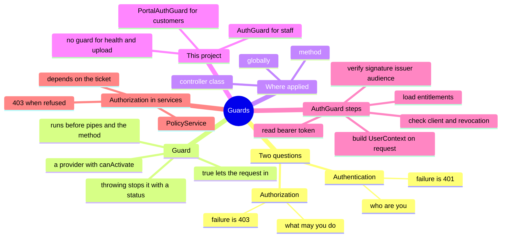

# Lesson 4: Guards and request identity

Lesson navigation: **core chapter** · [repository code trace](code-walkthrough.md) · [practice and interview drill](practice-and-interview.md) · [course index](../README.md)

Goal: after this lesson you can explain how a request proves who it is, where "you may not do that" decisions are made, and why this project splits those two jobs between a guard and a policy service. You can also write a simple guard.

Builds on Lessons 1 to 3: a guard is a provider (Lesson 1) attached to a controller (Lesson 2), and it runs before the validation pipe (Lesson 3).

This lesson explains the NestJS guard boundary. For the implementation-specific code walk-through, continue with [Authentication](../../modules/authentication/README.md), [Authorization](../../modules/authorization.md), and [Audit](../../modules/audit/README.md).

---

## 1. The big picture (mind map)



Plain-text version:

```
Guards
├── Two different questions
│   ├── Authentication: WHO are you?          failure -> 401 Unauthorized
│   └── Authorization:  WHAT may you do?      failure -> 403 Forbidden
├── Guard = a provider with a canActivate() method
│   ├── returns true -> the request continues
│   ├── throws       -> the request stops with that status
│   └── runs BEFORE pipes (validation) and before your controller method
├── Where you attach it
│   ├── @UseGuards(X) on a method   one route
│   ├── @UseGuards(X) on a class    every route in the controller   <- used here
│   └── globally                    every route in the app          <- not used here
├── This project
│   ├── AuthGuard         staff tokens (staff identity provider)
│   ├── PortalAuthGuard   customer tokens (customer identity provider)
│   └── no guard          /health and /upload (public by design)
├── What AuthGuard does, in order
│   ├── 1. read "Authorization: Bearer <token>"
│   ├── 2. verify signature, issuer, audience, allowed algorithms
│   ├── 3. check the calling app is allowed, and the token is not revoked
│   ├── 4. look up central entitlements
│   ├── 5. build a UserContext and put it on request.user
│   └── 6. set request.correlationId, then return true
└── Authorization (PolicyService) is NOT a guard here: it needs the ticket from the database
```

---

## 2. The ideas, one at a time

### Authentication vs authorization
| | Question | Example here | Failure |
|---|---|---|---|
| Authentication (authn) | Who are you? | Is this token genuine, unexpired and issued by our identity provider? | **401** Unauthorized |
| Authorization (authz) | What are you allowed to do? | May a case agent assign a ticket? May this supervisor open a ticket from another queue? | **403** Forbidden |

Plain words: authentication is showing your ID at the door. Authorization is the list of rooms that ID lets you into. The guard checks the ID; the policy decides the rooms.

(Confusing but true: HTTP calls the first one "Unauthorized". 401 means "I don't know who you are". 403 means "I know who you are, and no".)

### Guard
- **Technical:** a class implementing `CanActivate` with a `canActivate(context)` method. Returning `true` lets the request continue; throwing an exception (or returning `false`) stops it before the controller method.
- **Plain words:** a bouncer at the door of a route. It looks at the request, and either waves it through or turns it away. Your controller method never runs for a turned-away request.

### ExecutionContext
`canActivate(context: ExecutionContext)` receives a wrapper around the current call. NestJS can serve HTTP, WebSockets and more, so you ask the wrapper for the kind you need:

```ts
const request = context.switchToHttp().getRequest<FastifyRequest>();
```

### Where a guard is attached
```ts
@Controller('tickets')
@UseGuards(AuthGuard)          // every route in this class needs a signed-in user
export class TicketsController { ... }
```
You can also put `@UseGuards(...)` on a single method, or register one globally. This project attaches it per controller because some controllers are deliberately public (`HealthController`, `UploadsController`).

---

## 3. Real code, read slowly: `AuthGuard`

File: [auth.guard.ts](../../../apps/api/src/auth/auth.guard.ts)

```ts
@Injectable()
export class AuthGuard implements CanActivate {
  async canActivate(context: ExecutionContext): Promise<boolean> {
    const request = context.switchToHttp().getRequest<FastifyRequest>();
    const authorization = request.headers.authorization;
    if (!authorization?.startsWith('Bearer ')) throw new UnauthorizedException('Missing bearer access token');
    try {
      const { payload } = await jwtVerify(token, this.jwks, { issuer, audience, algorithms: ['RS256', 'ES256', 'PS256'] });
      assertAllowedClient(payload);
      await assertTokenActive(token);
      request.user = this.toUserContext(payload, await lookupEntitlements(payload.sub));
      request.correlationId = ... ?? crypto.randomUUID();
      return true;
    } catch {
      throw new UnauthorizedException('Invalid or expired access token');
    }
  }
}
```

Step by step:

| Step | Code | Plain words |
|---|---|---|
| 1 | read the `Authorization` header | "Show me your ticket" |
| 2 | no `Bearer ` prefix: throw 401 "Missing bearer access token" | no ticket at all |
| 3 | `jwtVerify(...)` | check the token's signature against the identity provider's published keys, and that it was issued by the right issuer, for this API, and has not expired |
| 4 | `algorithms: ['RS256','ES256','PS256']` | only accept strong, expected signature types (blocks a known attack where a forged token claims to need no signature) |
| 5 | `assertAllowedClient` | the app that asked for the token must be on our allow-list |
| 6 | `assertTokenActive` | ask the identity provider whether the token has been revoked (a fired employee's token stops working quickly) |
| 7 | `lookupEntitlements` | optional central override of roles and queues |
| 8 | `toUserContext(...)` | turn the token's claims into one tidy `UserContext` object (roles, branch, queues, department, legal entity, country). Missing claims mean 401. Only known roles survive |
| 9 | `request.user = ...` | **attach the result to the request** so controllers and services can use it |
| 10 | `return true` | let the request in |

Two design points to remember:

1. **One uniform failure message.** Everything in the `try` block collapses to `"Invalid or expired access token"`. The caller (and an attacker) cannot tell whether the signature, expiry, audience or revocation failed. Details would help an attacker, not an honest user.
2. **The guard's output is `request.user`.** That is how a guard passes information forward. The TypeScript line `declare module 'fastify' { interface FastifyRequest { user?: UserContext; correlationId?: string } }` in [user-context.ts](../../../apps/api/src/auth/user-context.ts) teaches the compiler that the field exists, which is why controllers can write `request.user!` and `request.correlationId!`.

### The `UserContext`

```ts
interface UserContext { subject; roles; branch; queues; department; legalEntity; country; serviceIdentity?; ... }
```

Every service method receives this, never the raw token. It is the single object that says who is calling and from which branch, queues and legal entity.

---

## 4. The customer guard and why there are two

File: [portal-auth.guard.ts](../../../apps/api/src/portal/portal-auth.guard.ts)

`PortalAuthGuard` has the same shape but checks the **customer** identity provider: a different issuer, audience and keys. It puts `{ subject }` on `request.customer`.

Consequence: a staff token fails on portal routes and a customer token fails on staff routes, because each guard checks its own issuer and audience. This defends against *token confusion*: using a valid token from one system on another. It is also tested.

It also returns **404** when the portal is not configured, so an unconfigured system doesn't advertise the endpoints.

Everything else in this project's public surface has no guard:
- `HealthController`: load balancers must reach it.
- `UploadsController`: the secure link's token is the credential, checked inside the service.

---

## 5. Why authorization is NOT a guard in this project

Open [policy.service.ts](../../../apps/api/src/auth/policy.service.ts). It is an ordinary provider, called from inside services:

```ts
this.policy.assertTicketAccess(user, ticket, 'ticket:assign');
```

`assertTicketAccess` runs four checks:
1. Does the user's **role** hold this permission?
2. Is the ticket in the user's **legal entity and country and queue**?
3. For agents: is it their **branch**, or created by or assigned to them?
4. If the ticket is `restricted`: is the user a supervisor or auditor?

Checks 2 to 4 need the **ticket's data**, which lives in the database. A guard runs *before* the method and only knows the request (headers, path). Loading the ticket just to decide, and then loading it again in the service, would be wasteful and error-prone. So the rule of thumb here is:

| Decision | Needs | Where it lives |
|---|---|---|
| Is this a genuine signed-in caller? | only the request | **Guard** |
| May this role do this kind of action at all? | the user | could be a guard |
| May this user act on *this particular* ticket? | the ticket from the database | **Service, via `PolicyService`** |

This is called *object-level* (or record-level) authorization, and it is the one most often forgotten in real systems.

### The common tutorial pattern (not used here, good to know)

Most NestJS tutorials do role checks with a custom decorator and a guard:

```ts
@Roles('supervisor')                       // custom decorator stores the allowed roles as metadata
@UseGuards(AuthGuard, RolesGuard)          // RolesGuard reads that metadata through Reflector
@Post(':id/assignments') assign(...) { ... }
```

It is neat for pure role checks. This project needs more than roles (queue, branch, entity, sensitivity), so it keeps one rule set in `PolicyService` where it is easy to read, test and audit.

---

## 6. See it happen (the stack is running)

```bash
curl -s localhost:3000/v1/tickets
#  {"message":"Missing bearer access token","error":"Unauthorized","statusCode":401}

curl -s -H "Authorization: Bearer abc.def.ghi" localhost:3000/v1/tickets
#  {"message":"Invalid or expired access token","error":"Unauthorized","statusCode":401}

curl -s -H "Authorization: Basic abc" localhost:3000/v1/tickets
#  {"message":"Missing bearer access token", ...}      (wrong scheme counts as missing)

curl -s -X POST -H "Content-Type: application/json" -d '{"nonsense":true}' localhost:3000/v1/tickets
#  {"message":"Missing bearer access token", ...}      <- 401, NOT a validation error

curl -s localhost:3000/v1/portal/requests
#  401 Missing bearer access token

curl -s -H "Authorization: Bearer abc.def.ghi" localhost:3000/v1/portal/requests
#  401 Invalid or expired access token

curl -s localhost:3000/v1/health/live
#  {"status":"ok"}                                      (no guard)
```

The fourth one matters: the body is invalid, yet the answer is "Missing bearer access token". **The guard runs before the validation pipe.** Unauthenticated callers never get to learn what a valid request looks like. (The full order of everything is Lesson 6.)

---

## 7. Rules to remember

1. 401 means "who are you?" and 403 means "you may not". Do not mix them.
2. A guard decides from the request alone; deeper decisions that need data belong in a service.
3. A guard's job is to either throw or `return true`, and to attach what later code needs (`request.user`).
4. Never reveal *why* authentication failed. One message for all causes.
5. Attach guards per controller unless the whole app is private. Public routes must be a conscious choice.
6. Always check issuer, audience and signature algorithm. Missing any one is a classic vulnerability.
7. Authorization needs checking on every action, on the server. Hiding buttons in the web page is not security.

---

## 8. Questions

1. What is the difference between a 401 and a 403? Give one example of each from this project.
2. Why does `AuthGuard` end with a `catch` that throws one generic message?
3. Where does `request.user` come from, and how does TypeScript know the field exists?
4. A valid staff token is sent to `GET /v1/portal/requests`. What status do you expect and why?
5. `GET /v1/tickets/{id}` from a case agent for a ticket in another queue: is the 403 raised by the guard? Explain.
6. Why is the validation error never shown to a caller who is not signed in?
7. Why does `UploadsController` have no guard, and what protects it instead?

## 9. Exercise

Predict the status code for each case, then check against the answers:

1. Supervisor token, `GET /v1/tickets`.
2. Case-agent token, `POST /v1/tickets/{id}/assignments` for a ticket in the agent's own queue.
3. Customer-portal token, `GET /v1/tickets`.
4. Valid case-agent token, `POST /v1/tickets` with an empty body `{}` and an `Idempotency-Key`.
5. No token, `GET /v1/upload/status`.
6. Auditor token, `PATCH /v1/tickets/{id}` with a valid body.

Optional: open [auth.guard.spec.ts](../../../apps/api/test/auth.guard.spec.ts) and [auth-hardening.spec.ts](../../../apps/api/test/auth-hardening.spec.ts) and list three ways a token can be rejected.

---

## 10. Answers (try the questions first)

1. 401: no token or an invalid one, for example `GET /v1/tickets` with no header. 403: signed in but not allowed, for example a case agent calling the assign route (the supervisor-only permission).
2. So an attacker learns nothing about *why* a token failed (bad signature, expired, wrong audience, revoked). Honest users just sign in again.
3. `AuthGuard` sets it after verifying the token. The line `declare module 'fastify' { interface FastifyRequest { user?: UserContext } }` extends Fastify's request type so the compiler accepts it.
4. 401. `AuthGuard` is not even used on portal routes; `PortalAuthGuard` is. It checks the customer issuer and audience, and a staff token has neither, so it fails verification.
5. No. The guard only proves identity. The 403 comes from `PolicyService.assertTicketAccess` inside `TicketsService`, which loads the ticket and sees the queue does not match.
6. Guards run before pipes. The request is turned away at the door, so the body is never examined.
7. It is deliberately public for people without accounts. The secure link's signed token is the credential, verified in `UploadsService`, and every failure returns the same plain 404.

Exercise answers:
1. 200 (a page of tickets).
2. 403. The assign permission belongs to supervisors; a case agent lacks it, even in their own queue.
3. 401. Customer token has the wrong issuer and audience for the staff guard.
4. 400. Authentication and permission pass (a case agent may create tickets), then validation rejects the empty body.
5. 404 with "This link is not valid or has expired". No guard, and the missing token fails inside the service with the uniform message.
6. 403. The auditor role has read-only permissions and no `ticket:update`.

---

## 11. Glossary

| Term | Plain meaning |
|---|---|
| Authentication (authn) | Proving who you are |
| Authorization (authz) | Deciding what you may do |
| 401 Unauthorized | "I don't know who you are" |
| 403 Forbidden | "I know who you are, and no" |
| Guard | A bouncer class that lets a request in or turns it away before the method runs |
| `canActivate` | The guard's method: return true to allow, throw to refuse |
| ExecutionContext | A wrapper around the current call, used to reach the request |
| Bearer token | A signed proof of identity sent in the `Authorization` header |
| JWT | The format of that token: signed JSON with claims such as subject, issuer, expiry |
| JWKS | The identity provider's published public keys, used to check signatures |
| Claim | One statement inside a token, such as roles or branch |
| Issuer / audience | Who created the token / which system it is meant for |
| Token confusion | Using a valid token from one system on another |
| Object-level authorization | Checking permission for one specific record, not just the action type |
| Step-up | Requiring a recent or stronger login for risky actions |
