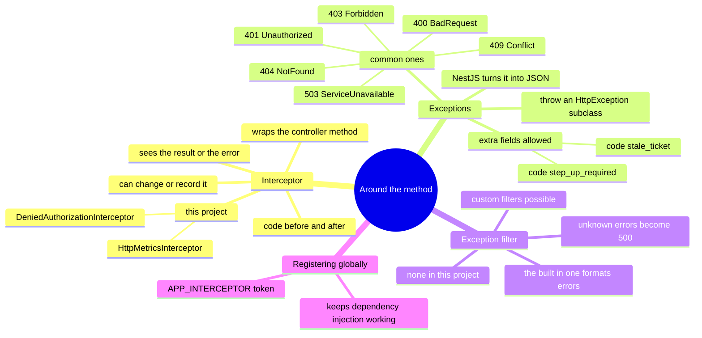

# Lesson 5: Interceptors and exception handling

Lesson navigation: **core chapter** · [repository code trace](code-walkthrough.md) · [practice and interview drill](practice-and-interview.md) · [course index](../README.md)

Goal: after this lesson you can explain how this project records every refused action in the audit trail and counts every request in its metrics without any controller knowing about it, and how errors become the JSON responses callers see.

Builds on Lessons 2 to 4: your controller method can return a value or throw an error. This lesson is about what happens around that: code that wraps the method, and how a thrown error turns into a response.

---

## 1. The big picture (mind map)



Plain-text version:

```
Around the method
├── Interceptor: code that WRAPS your controller method
│   ├── code before the method runs
│   ├── code after: sees the result, or the error
│   ├── can record, transform, time, or replace it
│   └── in this project
│       ├── DeniedAuthorizationInterceptor   writes an audit event for every 403
│       └── HttpMetricsInterceptor           counts and times every request
├── Exceptions: how you report failure
│   ├── throw a subclass of HttpException
│   ├── NestJS turns it into a JSON response with that status
│   └── 400 BadRequest, 401 Unauthorized, 403 Forbidden, 404 NotFound,
│       409 Conflict, 503 ServiceUnavailable (and any status via HttpException)
├── Exception filter: the code that formats the error response
│   ├── built-in filter handles HttpException  -> {statusCode, message, error}
│   ├── anything else                          -> 500 "Internal server error" (details hidden)
│   └── custom filters (@Catch) possible, none needed in this project
└── Registered globally with { provide: APP_INTERCEPTOR, useClass: X }
    └── so the interceptor can still receive injected providers (PgService, AuditService)
```

---

## 2. The ideas, one at a time

### Interceptor
- **Technical:** a class implementing `NestInterceptor` with an `intercept(context, next)` method. Calling `next.handle()` runs the rest of the chain (including your controller method) and returns an **Observable** you can attach logic to.
- **Plain words:** a wrapper around the method, like a security camera on a door. It sees who goes in, and what comes out or what goes wrong, and can log it, time it, or change it, while the method itself stays unaware.

### Observable (just enough to read the code)
`next.handle()` does not return the result directly. It returns a **stream** that will deliver the result (or the error) later. You attach steps to the stream with `.pipe(...)`:

| Step | Plain meaning |
|---|---|
| `tap({ next, error })` | peek at the result or error without changing it |
| `map(fn)` | change the result |
| `catchError(fn)` | react to an error (and re-throw it or replace it) |

You do not need to learn RxJS (the library behind this) to use interceptors; you need only these three.

### Exception
- **Technical:** an `HttpException` (or subclass) thrown anywhere in the call stack becomes an HTTP error response with that status.
- **Plain words:** instead of "return an error", you *throw* one, from any depth, and NestJS turns it into the right response.

```ts
throw new NotFoundException('Request not found');       // 404
throw new ConflictException('This request is closed');  // 409
throw new BadRequestException('A valid Idempotency-Key header is required'); // 400
```

### Exception filter
- **Technical:** the component that turns a thrown error into a response. NestJS ships a built-in one.
- **Plain words:** the one who writes the apology letter. Known HTTP exceptions become `{"statusCode":..,"message":..,"error":..}`. Any other error (a bug, a database failure) becomes a bare `500 Internal Server Error` with no details, so internals never leak.
- **In this project:** no custom filter; the built-in behaviour is exactly what is wanted.

---

## 3. Real code 1: recording every refusal

File: [denied-authorization.interceptor.ts](../../../apps/api/src/audit/denied-authorization.interceptor.ts)

```ts
@Injectable()
export class DeniedAuthorizationInterceptor implements NestInterceptor {
  constructor(private readonly db: PgService, private readonly audit: AuditService) {}

  intercept(context: ExecutionContext, next: CallHandler): Observable<unknown> {
    return next.handle().pipe(catchError((error) => {
      const status = ... error.getStatus() ... : 500;
      const request = context.switchToHttp().getRequest<FastifyRequest>();
      if (status === 403 && request.user && request.correlationId) {
        return from(this.db.transaction((client) => this.audit.write(client, {
          actorId: request.user!.subject, action: 'authorization.denied', ... outcome: 'denied',
          metadata: { path: request.url.slice(0, 160) } }))).pipe(
            mergeMap(() => throwError(() => error)),          // after saving, re-throw the SAME 403
            catchError(() => throwError(() => error)));       // if saving fails, still re-throw the 403
      }
      return throwError(() => error);
    }));
  }
}
```

Read it as: "Run the request. If it fails with a 403 for a signed-in user, write an `authorization.denied` row to the audit trail, then let the 403 continue to the caller as if nothing happened."

**Why an interceptor and not code in the service?** The refusal is thrown inside a database transaction (`PolicyService` is called in the middle of the work). When an error is thrown, that transaction is **rolled back**, and anything written inside it, including an audit row, would be rolled back too. The interceptor runs *outside*, after the rollback, and writes the audit row in its own transaction. This is a real design reason, not just tidiness.

**Why "even if saving fails, still re-throw"?** Failing to record a denial must never turn a clean 403 into a confusing 500 for the caller.

Real data from this project's own database (created when the automated tests tried forbidden actions):

```
 sequence | actor_id | action               | outcome | path
    37539 | b76e9acc… | authorization.denied | denied  | /v1/tickets/bf88620b…/status
    37537 | b76e9acc… | authorization.denied | denied  | /v1/tickets/bf88620b…/notes
```

Why this matters in a bank: auditors want evidence of attempted misuse, not only of successful actions. A burst of denied rows from one person is something worth investigating.

## 4. Real code 2: counting every request

File: [http-metrics.interceptor.ts](../../../apps/api/src/metrics/http-metrics.interceptor.ts)

```ts
intercept(context, next) {
  const route = request.routeOptions?.url ?? 'unknown';
  const end = this.metrics.httpDuration.startTimer({ method, route });          // start the stopwatch
  const done = (status: number) => { end(); this.metrics.httpRequests.inc({ method, route, status: String(status) }); };
  return next.handle().pipe(tap({ next: () => done(reply.statusCode), error: (e) => done(e.getStatus?.() ?? 500) }));
}
```

- Code **before** `next.handle()` starts a timer. `tap` **after** records the status and stops the timer, for success and for failure alike.
- `request.routeOptions.url` is the route *pattern* (`/v1/tickets/:ticketId`), not the real URL. Using real URLs would create a new metric label for every ticket id, which explodes monitoring storage. Using the pattern keeps the number of series small. This is a standard metrics rule.
- Result: Prometheus can answer "how many requests per route, per status, how slow" and the alert rules in `deploy/monitoring/alert-rules.yaml` use it.

## 5. How an interceptor is switched on for every request

```ts
// app.module.ts
providers: [{ provide: APP_INTERCEPTOR, useClass: DeniedAuthorizationInterceptor }]
// metrics.module.ts
providers: [MetricsService, { provide: APP_INTERCEPTOR, useClass: HttpMetricsInterceptor }]
```

- `APP_INTERCEPTOR` is a special token. Registering a provider under it makes the interceptor global (every route in the app).
- The alternative, `app.useGlobalInterceptors(new X())` in `main.ts`, would create the object by hand with `new` and could not receive `PgService` or `AuditService` through dependency injection (Lesson 1). Using the token keeps DI working.
- It does not matter which module declares it; the effect is app-wide.

Other places you can attach one: `@UseInterceptors(X)` on a controller or a single method.

---

## 6. Exceptions that carry extra information

Normally you throw with a message. You can also throw with an **object** to add fields, which lets the web console react to a specific situation.

From [token-checks.ts](../../../apps/api/src/auth/token-checks.ts), step-up login:

```ts
throw new ForbiddenException({ statusCode: 403, error: 'Forbidden', code: 'step_up_required', message: 'Please sign in again to ...' });
```

The console (`apps/web/src/api.ts`) checks for `code === 'step_up_required'` and raises a `step-up-required` event, which sends the user back through a fresh login instead of just showing an error.

From [tickets.service.ts](../../../apps/api/src/tickets/tickets.service.ts), stale edits:

```ts
throw new ConflictException({ statusCode: 409, error: 'Conflict', code: 'stale_ticket', message: 'This ticket was changed by someone else...' });
```

The `code` is there for clients to use. Today the console just shows the message ("changed by someone else, reload"); it does not react to this code specially, so a nice improvement would be to offer a one-click reload. This is a good example of a field that exists before a consumer does.

### Which exception for which situation

| Situation in this project | Exception | Status |
|---|---|---|
| Header or input the DTO can't catch is wrong | `BadRequestException` | 400 |
| Missing or invalid token | `UnauthorizedException` | 401 |
| Signed in but not allowed | `ForbiddenException` | 403 |
| Ticket / request / link not found, or hidden on purpose | `NotFoundException` | 404 |
| State conflict (ticket changed, request closed, file limit reached) | `ConflictException` | 409 |
| Too many requests | `HttpException(..., HttpStatus.TOO_MANY_REQUESTS)` | 429 |
| File too large | `HttpException(..., HttpStatus.PAYLOAD_TOO_LARGE)` | 413 |
| Needed service not configured (uploads, upload links) | `ServiceUnavailableException` | 503 |
| A bug or database failure nobody planned for | (any other error) | 500, details hidden |

Using the right status matters: clients, monitoring and alert rules all key off it.

### A custom exception filter (NOT in this project, shown for understanding)

```ts
@Catch(HttpException)
export class MyFilter implements ExceptionFilter {
  catch(exception: HttpException, host: ArgumentsHost) {
    const reply = host.switchToHttp().getResponse<FastifyReply>();
    reply.status(exception.getStatus()).send({ error: exception.message, time: new Date().toISOString() });
  }
}
```

You would write one to change the shape of every error response (for example to match a bank's API standard). The built-in shape is fine here.

---

## 7. See it happen (the stack is running)

```bash
# A route that doesn't exist: the built-in filter formats it
curl -s localhost:3000/v1/nothing-here
#  {"message":"Cannot GET /v1/nothing-here","error":"Not Found","statusCode":404}

# A thrown NotFoundException with our own message
curl -s localhost:3000/v1/upload/status
#  {"message":"This link is not valid or has expired. Please contact the bank.","error":"Not Found","statusCode":404}

# A thrown BadRequest from the pipe (Lesson 3)
curl -s -X POST -H 'Content-Type: application/json' -d '{}' localhost:3000/v1/upload/attachments

# See the 403 audit rows the interceptor wrote
docker compose exec -T postgres psql -U case_user -d case_platform \
  -c "select sequence, actor_id, action, outcome, metadata->>'path' as path from audit_events where action='authorization.denied' order by sequence desc limit 5"
```

To create a fresh denial yourself: sign in to the staff console as `local-case-agent` and try to assign a ticket (the console hides that button, so call the API with the browser's developer tools, or run the browser test suite which contains denials). Then re-run the SQL.

---

## 8. Rules to remember

1. Throw the exception that matches the situation. Callers and monitoring rely on the status code.
2. Never put internal details in an error message that reaches the caller. Unknown errors become a bare 500 for this reason.
3. An interceptor wraps the method: use it for work that applies to many routes (audit, metrics, logging, timing, response shaping), not for business rules.
4. A refusal thrown inside a transaction rolls back that transaction. Record the refusal *outside* it, as the interceptor does.
5. Register global interceptors with `APP_INTERCEPTOR` so dependency injection keeps working.
6. Metrics labels must be low-cardinality: route patterns, not real URLs.
7. Whatever the interceptor does after an error, re-throw the original error so the caller sees the true outcome.

---

## 9. Questions

1. What does `next.handle()` do, and why does it return an Observable?
2. Why is the "denied" audit row written by an interceptor and not by `PolicyService` at the moment it refuses?
3. What happens to the caller if writing the denial audit row fails?
4. Why does the metrics interceptor use `request.routeOptions.url` instead of `request.url`?
5. Why is `DeniedAuthorizationInterceptor` registered with `APP_INTERCEPTOR` instead of `app.useGlobalInterceptors(new ...)`?
6. A bug throws `new Error('column x does not exist')` deep inside a service. What does the caller see, and why?
7. What does passing an object (with `code: 'stale_ticket'`) to `ConflictException` allow?

## 10. Exercise

1. Open `apps/api/src/tickets/tickets.service.ts` and list five different exceptions it throws, with the situation for each.
2. For each, decide whether you would have picked the same status code. Argue one you would change, or say why none should change.
3. Write (in your notes) a small interceptor called `SlowRequestInterceptor` that logs a warning when a request takes longer than 2 seconds. Hint: record `Date.now()` before `next.handle()`, and use `tap` after. Where would you register it, and with which token?

---

## 11. Answers (try the questions first)

1. It runs the rest of the chain, including the controller method. It returns an Observable because the work finishes later (it is asynchronous), so you attach steps (`tap`, `map`, `catchError`) to the stream instead of getting a value immediately.
2. The refusal happens inside a database transaction that is rolled back when the error is thrown, which would also discard any audit row written inside it. The interceptor writes after the rollback in its own transaction.
3. Nothing changes for the caller: the `catchError` re-throws the original 403, so they still get a clean 403 rather than a 500.
4. `routeOptions.url` is the pattern (`/v1/tickets/:ticketId`). `request.url` includes the real id, which would create a separate metric series for every ticket, overloading the monitoring system.
5. `useGlobalInterceptors(new X())` constructs it by hand, so `PgService` and `AuditService` cannot be injected. The `APP_INTERCEPTOR` token lets NestJS build it with dependency injection.
6. A bare `500 Internal Server Error` with no details. The built-in exception filter only formats `HttpException`s; any other error is hidden so internal names and queries don't leak. The real error goes to the server log.
7. It adds a machine-readable field alongside the status, so a client can react to that exact condition rather than parsing the message text. The console already does this for `step_up_required` (sends the user to sign in again).

Exercise 3 sketch:
```ts
@Injectable()
export class SlowRequestInterceptor implements NestInterceptor {
  intercept(context: ExecutionContext, next: CallHandler): Observable<unknown> {
    const started = Date.now();
    return next.handle().pipe(tap(() => { const ms = Date.now() - started; if (ms > 2000) new Logger('Slow').warn(`${ms} ms`); }));
  }
}
// register:  providers: [{ provide: APP_INTERCEPTOR, useClass: SlowRequestInterceptor }]
```

---

## 12. Glossary

| Term | Plain meaning |
|---|---|
| Interceptor | A wrapper around the controller method that can watch, record or change what goes in and out |
| Observable | A stream that delivers a result or error later |
| `tap` / `map` / `catchError` | Peek at / change / react to an error in that stream |
| Exception | A failure you throw instead of returning |
| HttpException | An exception that carries an HTTP status |
| Exception filter | The component that turns a thrown error into a response |
| `APP_INTERCEPTOR` | The special token that makes an interceptor global while keeping dependency injection |
| Transaction rollback | Undoing everything a database transaction did when it fails |
| Cardinality | How many different values a metric label can take; high is expensive |
| Prometheus metric | A named number the monitoring system collects over time |
