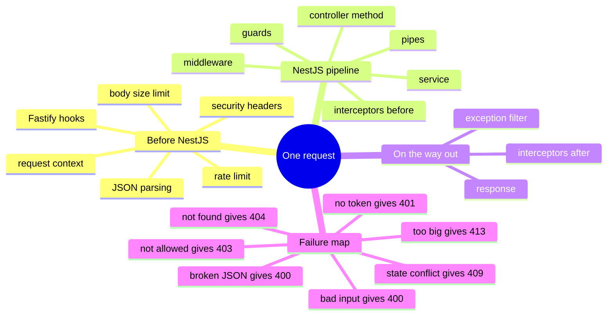

# Lesson 6: The request lifecycle (the order everything runs in)

Lesson navigation: **core chapter** · [repository code trace](code-walkthrough.md) · [practice and interview drill](practice-and-interview.md) · [course index](../README.md)

Goal: after this lesson you can take any request to this API and say, in order, which layer touches it, which layer would reject it for each kind of mistake, and which status code the caller gets. This lesson ties Lessons 2 to 5 into one picture.

---

## 1. The big picture (mind map)



The order, as one line:

```
request -> Fastify (rate limit, headers, context, size, JSON parse)
        -> middleware -> GUARD -> INTERCEPTOR(before) -> PIPE -> CONTROLLER -> SERVICE
        -> INTERCEPTOR(after) -> EXCEPTION FILTER (only on error) -> response
```

Plain-text version:

```
One request
├── 1. BEFORE NestJS (the web server, Fastify, and its plugins)
│   ├── rate limit            too many requests from one client        -> 429
│   ├── security headers      added to every response (helmet)
│   ├── request context       remembers IP and user agent for the audit trail
│   ├── CORS                  which browser origins may call us
│   ├── body size limit       larger than 1 MB                         -> 413
│   └── JSON parsing          broken JSON                              -> 400
├── 2. INSIDE NestJS
│   ├── routing               global prefix + controller + method path  -> 404 if no match
│   ├── middleware            (none used in this project)
│   ├── GUARD                 who are you?                              -> 401
│   ├── INTERCEPTOR (before)  start the metrics timer
│   ├── PIPE                  validate and convert the input            -> 400
│   ├── CONTROLLER method     thin: hands over to the service
│   └── SERVICE               business rules, permission, database      -> 403 / 404 / 409 ...
└── 3. ON THE WAY OUT
    ├── INTERCEPTOR (after)   record metrics; audit a 403
    ├── EXCEPTION FILTER      turn an error into a JSON response (errors only)
    └── response              with the security headers added
```

---

## 2. See the order for real

The file [examples/lifecycle-demo.ts](../examples/lifecycle-demo.ts) is a tiny NestJS app (no database, no network) that has one of every layer and prints a line each time one runs. Run it:

```bash
cd docs/learn-nestjs/examples
npx tsx --tsconfig tsconfig.json lifecycle-demo.ts
```

Real output:

```
=== SUCCESS: GET /demo?mode=ok -> 200 {"result":"done"}
    1. Fastify onRequest hook (before NestJS)
    2. middleware
    3. guard
    4. interceptor (before the method)
    5. pipe
    6. controller method
    7. service
    8. interceptor (after the method, on success)

=== PIPE REJECTS: GET /demo?mode=bad -> 400 {"handledBy":"DemoFilter","message":"the pipe rejected the value"}
    1. Fastify onRequest hook (before NestJS)
    2. middleware
    3. guard
    4. interceptor (before the method)
    5. pipe
    8. interceptor (after, on error)
    9. exception filter (turns the error into the response)

=== SERVICE REFUSES: GET /demo?mode=forbidden -> 403 {"handledBy":"DemoFilter","message":"the service refused"}
    1. Fastify onRequest hook (before NestJS)
    2. middleware
    3. guard
    4. interceptor (before the method)
    5. pipe
    6. controller method
    7. service
    8. interceptor (after, on error)
    9. exception filter (turns the error into the response)
```

What to notice:

1. **The interceptor opens before the pipe** and closes after the method. It brackets everything in between, which is why it can time the whole thing and see any error.
2. **When the pipe rejects, the controller method never runs** (step 6 is missing), but the interceptor still sees the error.
3. **The exception filter only appears on failure**, and it comes last. It is the final step that writes the response.
4. **A guard that refused would stop at step 3.** No interceptor, pipe or method would run. (Try it: change `canActivate` to return `false`, or throw.)

This is the official NestJS order: middleware, guards, interceptors (before), pipes, handler, interceptors (after), exception filters.

---

## 3. The same pipeline in this project

Where each layer lives in the real code. (Rows 1 to 5 are Fastify-level; the exact order among them follows how they are registered in `main.ts` and is not important. What matters is that all of them run before NestJS routing, guards and pipes.)

| Order | Layer | Where | What it does here |
|---|---|---|---|
| 1 | Rate limit | `main.ts` (`@fastify/rate-limit`) | max 600 requests a minute per client by default; health, metrics and live stream are exempt |
| 2 | Security headers | `main.ts` (`@fastify/helmet`) | strict content-security-policy, no sniffing, no framing, HTTPS-only hint, no referrer |
| 3 | Request context | `audit/request-context.ts` | a Fastify `onRequest` hook stores IP and user agent so the audit trail can include them without every method passing them along |
| 4 | CORS | `main.ts` (`enableCors`) | only the configured browser origins, allowed methods and headers |
| 5 | Body size and JSON parsing | Fastify (`bodyLimit`, 1 MB) and `acceptEmptyJsonBodies` | too big: 413; broken JSON: 400; an empty body with a JSON content type is treated as `{}` |
| 6 | Routing | NestJS + `setGlobalPrefix('v1')` | `/v1` + controller path + method path; no match: 404 |
| 7 | Guard | `AuthGuard` / `PortalAuthGuard` | verifies the token, sets `request.user`; fails with 401 |
| 8 | Interceptors (before) | `HttpMetricsInterceptor` | starts the timer |
| 9 | Pipes | global `ValidationPipe`, `ParseUUIDPipe` | DTO and id checks; fails with 400 |
| 10 | Controller method | `*.controller.ts` | one line: calls the service |
| 11 | Service | `*.service.ts` | `PolicyService` (403), lookups (404), rule conflicts (409), the transaction, audit, outbox |
| 12 | Interceptors (after) | `HttpMetricsInterceptor`, `DeniedAuthorizationInterceptor` | record metrics; write `authorization.denied` for a 403 |
| 13 | Exception filter | built into NestJS | turns the error into `{statusCode, message, error}` |
| 14 | Response | Fastify | helmet's headers are added to this response too |

### Proof from the live API (the stack is running)

```bash
# A. Larger than 1 MB, no token: stopped by the body limit, before any guard
python3 -c "import json;print(json.dumps({'a':'x'*2200000}))" > /tmp/big.json
curl -s -o /dev/null -w "%{http_code}\n" -X POST -H 'Content-Type: application/json' --data @/tmp/big.json localhost:3000/v1/tickets
#  413

# B. Broken JSON, no token: stopped by the JSON parser, before the guard
curl -s -X POST -H 'Content-Type: application/json' -d '{bad' localhost:3000/v1/tickets
#  400 "Expected property name or '}' in JSON at position 1"

# C. Valid JSON but no token: now the guard answers
curl -s -X POST -H 'Content-Type: application/json' -d '{}' localhost:3000/v1/tickets
#  401 "Missing bearer access token"

# D. The guard comes before the validation pipe: an invalid body gets 401, not 400
curl -s -X POST -H 'Content-Type: application/json' -d '{"nonsense":true}' localhost:3000/v1/tickets
#  401 "Missing bearer access token"

# E. Even a refusal carries the security headers
curl -s -i localhost:3000/v1/tickets | grep -i "x-content-type\|strict-transport"
#  X-Content-Type-Options: nosniff
#  Strict-Transport-Security: max-age=31536000; includeSubDomains
```

Reading A to D together: each request reached a different layer before being stopped, and the layer that stops it fixes the status code. That is the whole lifecycle in four commands.

---

## 4. Which layer rejects what

| Mistake | Layer that rejects | Status |
|---|---|---|
| Hundreds of requests a second from one client | rate limit | 429 |
| 5 MB body | Fastify body limit | 413 |
| `{bad json` | JSON parser | 400 |
| Browser from a forbidden origin | CORS | blocked by the browser |
| URL that matches no route | routing | 404 |
| No or invalid token | guard | 401 |
| Missing or wrong fields, a non-UUID id | pipe | 400 |
| Signed in but not allowed to do this | service (`PolicyService`) | 403 |
| Ticket does not exist or is hidden from you | service | 404 |
| Ticket changed since you opened it | service | 409 |
| A bug or database failure | service, then the exception filter | 500 |

Design rule that follows: **reject at the earliest, cheapest layer that has enough information.** A size limit needs no token; a token check needs no database; a permission check needs the ticket. Putting each check where its information first exists keeps the system fast and means attackers meet the cheapest checks first.

---

## 5. Rules to remember

1. Order: Fastify, middleware, guard, interceptor (before), pipe, controller, service, interceptor (after), exception filter.
2. A layer that rejects stops everything after it.
3. The interceptor wraps pipe, method and service, so it sees every error from them.
4. Guards run before pipes: unauthenticated callers can't probe your validation rules.
5. The exception filter only runs on errors, and it is the last step before the response.
6. Fastify's own checks (size, JSON, rate limit, headers) happen before NestJS even starts.
7. Put each check at the earliest layer that has the information it needs.

---

## 6. Questions

1. A caller sends a 3 MB JSON body with a valid token. Which layer answers and with what status?
2. A caller sends valid JSON, a valid token, and a ticket id that isn't a UUID. Which layer answers?
3. In what order do the guard, pipe and interceptor run for a request that passes everything?
4. Why does a request with an invalid body and no token get 401 and not 400?
5. Why can the interceptor record a 403 even though the 403 was thrown deep in the service?
6. Where would you put a check for "the `Idempotency-Key` header must be present" and why is that where it is today?
7. Where is `request.user` set, and which later layers rely on it?

## 7. Exercise

Take `POST /v1/tickets/{ticketId}/communications` (queue a message). For each scenario, name the layer that rejects it and the status:

1. The request body is `{"channel":"carrier-pigeon","templateKey":"x","recipientReference":"12345678"}`.
2. A valid body, but the token belongs to a branch agent.
3. A valid body, valid case agent, but the ticket is in another queue.
4. A valid body, valid case agent, ticket in their queue, but customer communications are blocked on that case.
5. A valid body, but the `ticketId` is in the wrong format, and there is no token.
6. 700 requests in one minute from one IP, each valid.

Optional: add a `console.log` line to the guard and the metrics interceptor in a throwaway branch, send one request, and watch the order in the API log. Undo it afterwards.

---

## 8. Answers (try the questions first)

1. The Fastify body limit answers with 413, before NestJS routing, the guard or the pipe.
2. The pipe (`ParseUUIDPipe`, where used) answers 400. The guard and the token have already passed.
3. Guard, then interceptor (before), then pipe. After the method returns, the interceptor's "after" runs.
4. The guard runs before the pipe, so the request is turned away at authentication and the body is never examined.
5. Because the interceptor wraps the whole call including the service. `next.handle()` returns a stream that carries the error back up, and the interceptor's `catchError` sees it.
6. It's in the controller (`create` throws `BadRequestException`) because it's about the shape of the request rather than a business rule, and the DTO can't validate a header. It could also be a small pipe or custom decorator.
7. The guard sets it. Controllers read it, `PolicyService` checks it, services use it as the actor in audit events, and the interceptor uses it to decide whether to record a denial.

Exercise answers:
1. The pipe (the DTO's `@IsIn` on `channel`). 400.
2. The service (`assertTicketAccess` with `ticket:update`; a branch agent lacks it). 403, recorded by the interceptor as `authorization.denied`.
3. The service (queue scope in `assertTicketAccess`). 403.
4. The service (the case has communications blocked). 409.
5. The guard. 401, because it runs before the id check and there is no token.
6. The rate limit, once the limit (600 a minute by default, so 700 exceeds it). 429. It runs before NestJS.

---

## 9. Glossary

| Term | Plain meaning |
|---|---|
| Request lifecycle | The ordered journey of one request through every layer |
| Middleware | Code that runs before routing and guards (none used here) |
| Hook (Fastify) | A function the web server runs at a fixed moment in a request |
| Rate limit | A cap on requests per client per time |
| CORS | The browser rule about which websites may call this API |
| Body limit | The largest request body accepted |
| Pipeline | The ordered chain of layers a request passes through |
| Earliest-cheapest rejection | Refuse bad requests at the first layer able to tell |
