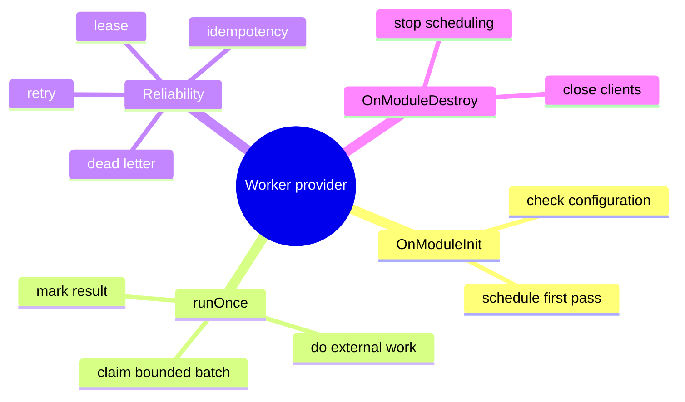

# Lesson 7: Lifecycle hooks and background workers

Lesson navigation: **core chapter** · [repository code trace](code-walkthrough.md) · [practice and interview drill](practice-and-interview.md) · [course index](../README.md)

Goal: after this lesson you can explain when a Nest provider starts and stops, build a safe polling worker, and recognize the database patterns that make several API instances cooperate without duplicate work.

---

## 1. The big picture



---

## 2. Providers can have a lifetime

Nest creates providers while it builds the module graph. Some providers need to do something after construction, or release resources before the application closes. The lifecycle interfaces make those moments explicit:

| Hook | When it runs | Use it for |
|---|---|---|
| `OnModuleInit.onModuleInit` | after the module's dependencies are ready | start a worker only when its configuration exists |
| `OnApplicationBootstrap` | after all modules have initialized | work that needs the whole application |
| `OnModuleDestroy.onModuleDestroy` | while the application is shutting down | stop timers, close clients, release resources |
| `OnApplicationShutdown` | during application shutdown signals | final process-wide cleanup |

The project uses `OnModuleInit` and `OnModuleDestroy` in workers such as [outbox-dispatcher.ts](../../../apps/api/src/outbox/outbox-dispatcher.ts), [inbound.worker.ts](../../../apps/api/src/email/inbound.worker.ts), and [delivery.worker.ts](../../../apps/api/src/email/delivery.worker.ts).

---

## 3. The safe polling pattern

The outbox dispatcher is opt-in:

```ts
onModuleInit(): void {
  if (process.env.OUTBOX_DISPATCHER_ENABLED !== 'true' ||
      !process.env.DATABASE_URL) return;
  this.schedule(0);
}

async onModuleDestroy(): Promise<void> {
  this.stopped = true;
  if (this.timer) clearTimeout(this.timer);
  await this.publisher.close?.();
}
```

The `stopped` flag handles a timer callback already queued when shutdown begins. `setTimeout`, not `setInterval`, is used so the next pass is scheduled only after the current pass finishes:

```ts
private schedule(delayMs: number): void {
  if (this.stopped) return;
  this.timer = setTimeout(() => { void this.tick(); }, delayMs);
  this.timer.unref();
}

private async tick(): Promise<void> {
  try {
    await this.outbox.processBatch(this.publisher, 25);
  } catch (error) {
    this.logger.error('Outbox dispatch failed');
  }
  this.schedule(Number(process.env.OUTBOX_POLL_MS ?? 2000));
}
```

Why this matters:

- `setInterval` can start overlapping passes when one pass is slow.
- a `try/catch` prevents one transient provider failure from killing the loop silently.
- `unref()` means an idle timer does not keep a one-off script alive forever.
- shutdown clears the timer and closes the publisher.

---

## 4. Multi-instance coordination: claim, do, mark

The worker is safe to run on every API instance because `OutboxService.claim` uses a database transaction and `FOR UPDATE SKIP LOCKED`:

```sql
WITH candidates AS (
  SELECT id
  FROM integration_outbox
  WHERE status IN ('pending', 'retry')
    AND next_attempt_at <= now()
  ORDER BY created_at
  FOR UPDATE SKIP LOCKED
  LIMIT $1
)
UPDATE integration_outbox AS o
SET status = 'in_flight', claimed_at = now(), attempts = o.attempts + 1
FROM candidates
WHERE o.id = candidates.id
RETURNING ...;
```

The state machine is:

```text
pending -> in_flight -> published
                    \-> retry -> in_flight
                    \-> dead_letter
```

If a process crashes after claiming, `releaseStale` moves old `in_flight` rows back to `retry`. Publishing is at-least-once, so consumers need an idempotency key such as the outbox event id. The dispatcher uses exponential backoff and dead-letters after five attempts.

This is the same idea as a distributed lock, but the database row is also the durable work record. A JavaScript boolean cannot coordinate separate Node processes.

---

## 5. Worker example: inbound email

[InboundEmailWorker](../../../apps/api/src/email/inbound.worker.ts) illustrates a longer workflow:

1. Start only when IMAP, the email reference secret and the database are configured.
2. Connect, lock the mailbox and fetch a bounded number of unread messages.
3. Ignore auto-replies, bounces, bulk mail and the platform's own address.
4. Use an HMAC of the sender as a pseudonymous reference rather than storing the raw address in the ticket.
5. Attach a reply only when the sender owns the referenced ticket.
6. Create new intake work through `IntakeService` using the `intake-gateway` service identity.
7. Mark the message seen only after processing succeeds; failures remain unread for retry.
8. Log and continue per message so one bad email does not lose the rest of the batch.

The worker is not a controller. It calls application services directly, supplies a service `UserContext`, and uses the same database/audit/outbox conventions as an HTTP request.

---

## 6. Worker boundaries and tests

Good worker design makes one pass callable without starting the loop:

```ts
async runOnce(): Promise<number> { /* one bounded pass */ }
```

That method can be tested deterministically. `onModuleInit` only wires scheduling around it. Keep external clients behind providers or tokens so tests can inject a fake publisher/contact resolver. A worker should also expose metrics for claimed, published, retried and dead-lettered work.

---

## 7. How to read worker failures

| Symptom | Likely layer | First thing to inspect |
|---|---|---|
| Worker never starts | lifecycle/configuration | `onModuleInit` feature flags and required environment variables |
| Same event is delivered twice | delivery semantics | consumer idempotency by outbox event id |
| Rows remain `in_flight` | crash or stuck process | stale-release interval and `claimed_at` |
| Queue grows forever | provider or database failure | retry counts, dead letters and publisher logs |
| Process will not exit | cleanup | timer `clearTimeout`, `unref`, and provider `close()` |

## 8. Questions and exercise

1. Why is `setTimeout` rescheduled after a pass instead of using `setInterval`?
2. What happens if a dispatcher crashes after the database claims an event?
3. Why must an outbox consumer be idempotent?
4. Add a `runOnce` method to a toy worker that processes at most ten rows and returns a count. Which part belongs in `onModuleInit`?

Answers: `setTimeout` prevents overlap; stale leases return the row to retry; at-least-once delivery can publish the same event again; `onModuleInit` should only check configuration and schedule the method, not contain business processing.
