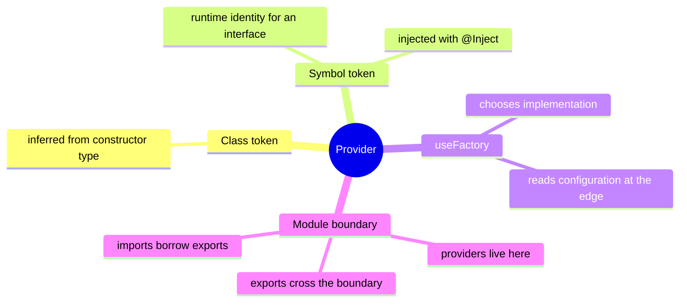

# Lesson 8: Custom providers, global modules and configuration

Lesson navigation: **core chapter** · [repository code trace](code-walkthrough.md) · [practice and interview drill](practice-and-interview.md) · [course index](../README.md)

Goal: after this lesson you can choose between a class provider, a value token and a factory provider, understand why `@Inject()` is needed for interfaces, and keep environment-dependent wiring out of business logic.

---

## 1. The big picture



---

## 2. A class is not the only provider

The simplest provider is a class:

```ts
providers: [OutboxService]
```

Nest can infer the class token from a constructor type. But TypeScript interfaces disappear at runtime. When a dependency is a contract with multiple implementations, use an explicit token:

```ts
export const OUTBOX_PUBLISHER = Symbol('OUTBOX_PUBLISHER');

export interface OutboxPublisher {
  publish(event: OutboxRecord): Promise<void>;
}

@Injectable()
export class OutboxDispatcher {
  constructor(
    @Inject(OUTBOX_PUBLISHER)
    private readonly publisher: OutboxPublisher,
  ) {}
}
```

The module binds the token:

```ts
@Module({
  providers: [
    OutboxDispatcher,
    { provide: OUTBOX_PUBLISHER, useFactory: createOutboxPublisher },
  ],
})
export class OutboxModule {}
```

The token is the runtime identity. The interface is only the compile-time shape.

---

## 3. Factory providers select behavior from configuration

[outbox-publishers.ts](../../../apps/api/src/outbox/outbox-publishers.ts) chooses a publisher based on environment settings. [contact-resolver.ts](../../../apps/api/src/email/contact-resolver.ts) uses the same pattern. This keeps `process.env` checks at the composition edge:

```ts
{ provide: CONTACT_RESOLVER, useFactory: createContactResolver }
```

Business code asks for `ContactResolver`, not for `process.env.CRM_URL`. That makes the worker testable with a fake and makes the production choice visible in one module.

Useful provider forms:

| Form | Use |
|---|---|
| `{ provide: Token, useClass: RealService }` | select a class implementation |
| `{ provide: Token, useValue: fake }` | fixed object or test double |
| `{ provide: Token, useFactory: factory }` | create from configuration or dependencies |
| `{ provide: Token, useExisting: ExistingService }` | alias another provider |
| `ClassName` | class token inferred from the constructor type |

If the factory needs another provider, list it in `inject`:

```ts
{
  provide: CLIENT,
  useFactory: (config: ConfigService) => makeClient(config.url),
  inject: [ConfigService],
}
```

---

## 4. Global modules are shared infrastructure

`DatabaseModule`, `CacheModule`, `StorageModule`, `AuditModule` and `OutboxModule` are global because many feature modules need their services. A global module still must export the provider:

```ts
@Global()
@Module({
  providers: [PgService],
  exports: [PgService],
})
export class DatabaseModule {}
```

Do not make every feature module global. Global modules hide dependencies and make tests harder to reason about. `AuthModule` remains explicit because `PolicyService` is a security dependency that should be visible in the module imports.

The rule is still: providers live in a module, exports cross the boundary, imports borrow exports. `@Global()` removes repeated imports; it does not remove the provider/export relationship.

---

## 5. How to read provider errors

| Error | Meaning | Fix |
|---|---|---|
| `Nest can't resolve dependencies ...` | the class token is not visible in this module | add the provider, export it, and import its module |
| `Nest can't resolve dependencies ... Object` | the constructor type was an interface or plain object | use a symbol token and `@Inject(TOKEN)` |
| Factory is `undefined` at startup | a required setting was not present or parsed | validate configuration in the factory and fail clearly |
| Test unexpectedly calls Kafka/CRM | the test used the production module binding | override the token with `useValue` or a fake provider |

## 6. Configuration checklist

`main.ts` owns process-level configuration such as body limits, rate limits, CORS, global pipes and the `/v1` prefix. Feature services read only the settings they need. Production safety is checked by [production-safety.ts](../../../apps/api/src/production-safety.ts) before the app starts.

For every setting, decide:

1. What is the safe default?
2. Should a missing value disable an optional feature or refuse startup?
3. Is fail-open or fail-closed acceptable?
4. Is the value bounded and parsed as the correct type?
5. Does changing it alter an authorization, retention or audit guarantee?

Never log secrets. Never use a local IdP or demo database password in production. Keep operational scripts and migrations on the owner account, while the API uses the restricted runtime account.

---

## 7. Exercise

Create a `Clock` interface with `now(): Date`, a `SYSTEM_CLOCK` symbol, a production factory returning `new Date()`, and a test value returning a fixed date. Inject the token into a service. Explain why using the token is better than calling `new Date()` throughout the service: the dependency is visible, replaceable and testable.
