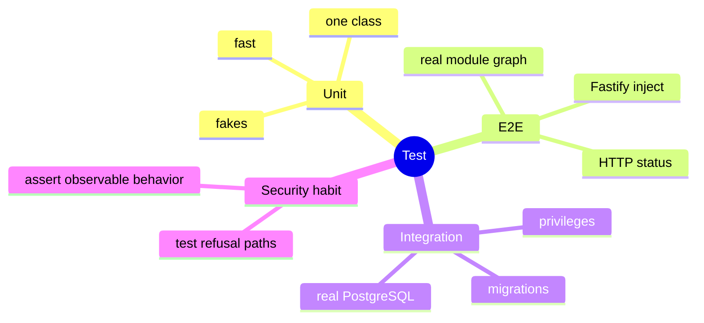

# Lesson 9: Testing NestJS code

Lesson navigation: **core chapter** · [repository code trace](code-walkthrough.md) · [practice and interview drill](practice-and-interview.md) · [course index](../README.md)

Goal: after this lesson you can choose the smallest test that proves a behavior, mock providers without bypassing Nest's dependency graph, and distinguish unit, end-to-end and database integration tests.

---

## 1. The big picture



---

## 2. Three useful test levels

| Level | Example here | Proves | Needs |
|---|---|---|---|
| Unit | `security.policy.spec.ts`, `auth.guard.spec.ts` | one class's decision | fakes or a local test server |
| E2E | `unauthenticated.e2e-spec.ts` | HTTP routing, guards and response status | Nest app with Fastify |
| Integration | `roles.integration-spec.ts`, ticket/email specs | real PostgreSQL/storage/provider interaction | Docker/services and migrations |

Start with a unit test for a pure policy rule. Use an E2E test when the boundary itself matters. Use integration tests for transactions, SQL constraints, database privileges and external adapter behavior that mocks cannot prove.

---

## 3. Testing a guard with a real signed token

`auth.guard.spec.ts` generates an RSA key pair, serves a tiny JWKS HTTP endpoint and signs tokens with `jose`. That is stronger than passing a fake payload into `toUserContext`: it proves the guard really verifies a signature, issuer, audience, expiry and key id.

The test also verifies a service token. The production guard allows `attachment-scanner` to omit human branch/entity claims, but still gives it only its narrow `attachment:scan` permission in `PolicyService`.

`auth-hardening.spec.ts` then tests the negative paths: `HS256` forgery, allowed client ids, revoked tokens, introspection outages, entitlement outages and step-up requirements. Security tests should spend more attention on refusal paths than on the happy path.

---

## 4. Unit testing a policy

The policy test constructs a `UserContext` and a ticket subject directly:

```ts
const policy = new PolicyService();

expect(() => policy.assertTicketAccess(
  caseAgent,
  { ...ticket, queue: 'fraud' },
  'ticket:read',
)).toThrow(ForbiddenException);
```

This is fast because the policy is a pure decision component. Each test names one security property: outside queue, restricted sensitivity, auditor read-only, administrator default deny, maker-checker self-approval.

Avoid testing only that a method was called. Test the observable rule: which input is allowed, which input is refused, and which exception/code is returned.

---

## 5. E2E tests start the real module graph

`unauthenticated.e2e-spec.ts` compiles `AppModule`, creates a `FastifyAdapter`, sets the same `v1` prefix and injects requests without opening a network port:

```ts
const module = await Test.createTestingModule({
  imports: [AppModule],
}).compile();

app = module.createNestApplication(new FastifyAdapter());
app.setGlobalPrefix('v1');
await app.init();
await app.getHttpAdapter().getInstance().ready();

const response = await app.inject({ method: 'GET', url: '/v1/me' });
expect(response.statusCode).toBe(401);
```

This catches wrong module imports, missing guard providers, route prefixes and HTTP status behavior that a direct class test cannot see.

---

## 6. Integration tests prove the database boundary

`roles.integration-spec.ts` creates a temporary database, applies the role SQL and migrations, then connects as owner, app and reporting roles. It proves the runtime account cannot update, delete, truncate, disable the append-only trigger or drop the audit table. This cannot be honestly proven with a mocked `PgService`.

When an integration test creates external state, give it a unique database name and clean it up in `afterAll`. Keep it opt-in (`RUN_DB_INTEGRATION=1`) so ordinary unit runs do not require Docker.

---

## 7. How to read test failures

| Failure | What it usually means |
|---|---|
| Unit test gets a 401 unexpectedly | the guard was not given the expected token/header or environment |
| E2E gets a dependency-resolution error | a module provider/export/import is missing |
| E2E gets 401 instead of 400 | the guard ran before the validation pipe |
| Integration cannot connect | Docker/database prerequisites or `DATABASE_URL` are missing |
| Test passes with a mock but production fails | the test did not prove the real adapter, SQL or transaction behavior |

## 8. Commands and debugging

```bash
npm run build --workspace=@bank-case/api
npm test --workspace=@bank-case/api
npm run test:e2e --workspace=@bank-case/api
npm run test:integration --workspace=@bank-case/api
```

If Jest reports that a module cannot resolve a `.js` import, inspect the ESM mapper in `apps/api/jest.config.cjs`. If Nest cannot resolve a dependency, inspect the module `providers`, `exports` and `imports` before changing the class. If an E2E test gets 401 instead of a validation error, remember the lifecycle order: the guard runs before pipes.

---

## 9. Exercise

Add tests for a hypothetical `GET /v1/tickets/:id/export` endpoint:

1. Unit-test that `case-agent` lacks `ticket:reveal`.
2. Unit-test that a supervisor with an old `auth_time` gets `step_up_required` when enabled.
3. E2E-test that no token returns 401.
4. Integration-test that a successful export and its audit event commit together, and that a simulated audit insert failure rolls back the business row.

The fourth test is the one a mock cannot replace: it proves the transaction boundary.
