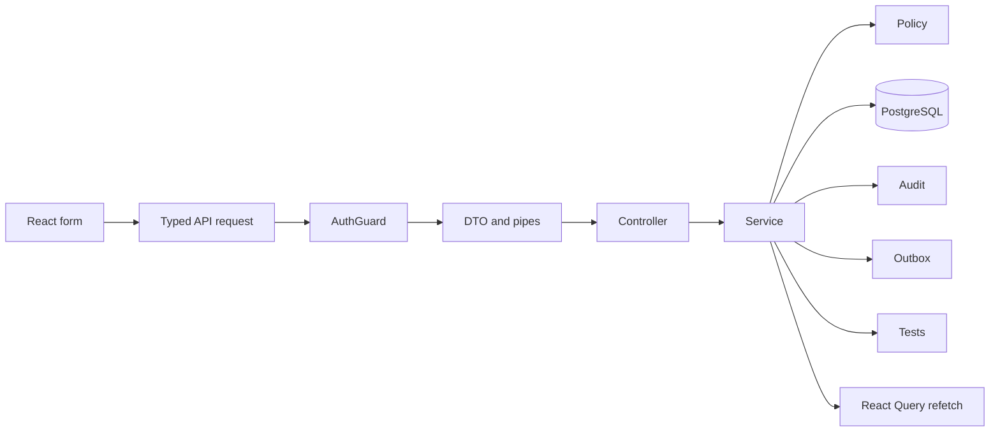

# Lesson 10: Build a complete feature

Lesson navigation: **core chapter** · [backend code lab](backend-code-lab.md) · [frontend code lab](frontend-code-lab.md) · [tests, delivery and interview drill](practice-and-interview.md) · [course index](../README.md)

Goal: use the course as a checklist to add one complete, protected feature without putting business logic in a controller or weakening the security boundary.

The exercise is a `POST /v1/tickets/:ticketId/ratings` feature: a staff member can record a 1–5 rating and optional comment after a ticket is resolved. The example is deliberately small but crosses every NestJS layer and the React client. It is a guided feature design; it is not present in the source tree until you implement the lab.

---

## 1. The big picture



---

## 2. Write the contract first

Decide the route and behavior:

```text
POST /v1/tickets/:ticketId/ratings
Authorization: Bearer <staff token>
Content-Type: application/json

{ "rating": 5, "comment": "Clear and helpful" }
```

Rules:

- authenticated staff only;
- caller must have `ticket:update` access to the ticket;
- ticket must be resolved;
- `rating` is an integer from 1 to 5;
- comment is optional and at most 500 characters;
- one rating per ticket per actor;
- success and refusal are auditable;
- database uniqueness prevents races.

This list separates shape rules, authorization, business state, and database integrity.

---

## 3. DTO and controller

```ts
export class CreateRatingDto {
  @IsInt()
  @Min(1)
  @Max(5)
  rating!: number;

  @IsOptional()
  @IsString()
  @Length(1, 500)
  comment?: string;
}

@Controller('tickets')
@UseGuards(AuthGuard)
export class RatingsController {
  constructor(private readonly ratings: RatingsService) {}

  @Post(':ticketId/ratings')
  create(
    @Req() request: FastifyRequest,
    @Param('ticketId', ParseUUIDPipe) ticketId: string,
    @Body() dto: CreateRatingDto,
  ) {
    return this.ratings.create(
      request.user!, ticketId, dto, request.correlationId!,
    );
  }
}
```

The controller does routing, extraction and delegation. The global validation pipe rejects unknown fields and invalid ratings before the service runs. It does not decide whether the ticket is resolved or whether the caller owns the ticket.

---

## 4. Module and service

The module imports the module that exports `AuthGuard`/`PolicyService` and provides the controller/service. Database, audit and outbox are available through the project's global modules.

The service shape should be:

```ts
@Injectable()
export class RatingsService {
  constructor(
    private readonly db: PgService,
    private readonly policy: PolicyService,
    private readonly audit: AuditService,
  ) {}

  async create(
    user: UserContext,
    ticketId: string,
    dto: CreateRatingDto,
    correlationId: string,
  ) {
    return this.db.transaction(async (client) => {
      const ticket = (await client.query<TicketPolicySubject>(
        'SELECT ... FROM tickets WHERE id=$1 FOR UPDATE',
        [ticketId],
      )).rows[0];
      if (!ticket) throw new NotFoundException('Ticket not found');

      this.policy.assertTicketAccess(user, ticket, 'ticket:update');
      if (ticket.status !== 'resolved') {
        throw new ConflictException('Ratings are available after resolution');
      }

      const result = await client.query(
        `INSERT INTO ticket_ratings (ticket_id, actor_id, rating, comment)
         VALUES ($1,$2,$3,$4)
         RETURNING id, rating, comment, created_at`,
        [ticketId, user.subject, dto.rating, dto.comment ?? null],
      );

      await this.audit.write(client, {
        actorId: user.subject,
        action: 'ticket.rating_created',
        targetType: 'ticket',
        targetId: ticketId,
        correlationId,
        outcome: 'success',
        metadata: { rating: dto.rating, hasComment: Boolean(dto.comment) },
      });
      return result.rows[0];
    });
  }
}
```

Use a unique constraint on `(ticket_id, actor_id)`, catch its conflict and return 409. Do not check for an existing row and then insert without a constraint: two concurrent requests can both pass the check.

Do not put raw comments into audit metadata. The rating and `hasComment` flag are enough evidence for the action without duplicating user content into the immutable trail.

---

## 5. Implement it in order

1. Add the migration and unique constraint.
2. Add the DTO with bounded fields.
3. Add the service and transaction.
4. Add the controller and module wiring.
5. Add unit tests for the policy/state decision.
6. Add an E2E test for 401 and DTO 400.
7. Add an integration test for the unique constraint and atomic audit.
8. Run build, unit, E2E and integration checks.
9. Update the relevant access/security documentation and event catalogue.

At each step ask: what is the earliest layer that can reject this input, and what evidence should exist after success or denial?

---

## 6. How to read implementation failures

| Failure | Likely cause |
|---|---|
| Request reaches the service with extra fields | DTO is missing a decorator or global whitelist settings are not active |
| Actor id comes from the request body | the service is trusting caller input instead of `request.user.subject` |
| Duplicate ratings appear | application-only existence check; add a database unique constraint |
| Ticket changes but audit is absent | audit did not use the same transaction client |
| Route returns the wrong handler | a parameter route was declared before a more specific static route |

## 7. Review checklist

| Area | Check |
|---|---|
| Module | provider is declared; imports/exports are correct |
| Route | static paths precede parameter paths; id uses `ParseUUIDPipe` |
| DTO | every field is decorated; bounds exist; unknown fields fail |
| Auth | guard supplies `request.user`; no caller-provided actor id |
| Policy | permission and ticket scope are checked in the service |
| Transaction | business row, audit row and outbox row use the same client |
| Audit | action/target/correlation/outcome are present; metadata is minimized |
| Database | uniqueness and state constraints protect against races |
| Errors | 400 shape, 401 identity, 403 policy, 404 hiding, 409 conflict are distinct |
| Tests | happy path and refusal paths exist at the right level |

That checklist is the point of the course: NestJS decorators are the visible surface, but a production feature is the whole module graph, lifecycle, transaction, policy, database and test boundary working together.

---

## 8. Complete the vertical slice

The chapter above is the design overview. Continue in this order:

1. [Backend code lab](backend-code-lab.md): migration, DTO, module, controller, transaction, conflict mapping, audit, outbox and response projection.
2. [Frontend code lab](frontend-code-lab.md): typed API contract, React Query mutation, component state, safe errors, accessibility and live-update behavior.
3. [Tests, delivery and interview drill](practice-and-interview.md): unit/E2E/database/frontend proof, concurrency test, rollout checklist and a full code-level answer.

The feature is complete only when the browser, API, database, evidence path and failure recovery agree on the same contract.
