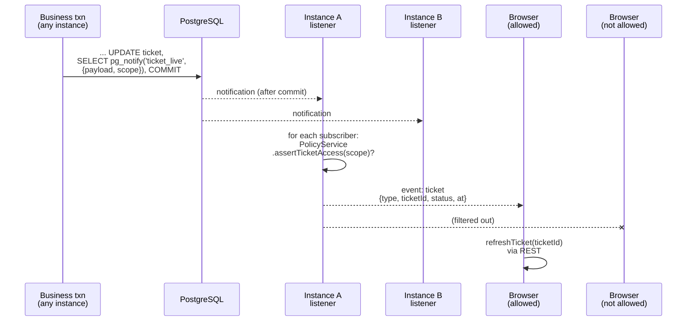

# Live updates (SSE + PostgreSQL NOTIFY)

> **Server-Sent Events (SSE)**: a long-lived HTTP response that the server keeps writing small text messages into. One-way, server → browser.
> **PostgreSQL LISTEN/NOTIFY**: a built-in publish/subscribe channel. A transaction calls `pg_notify('ticket_live', payload)`, and every connection that ran `LISTEN ticket_live` receives the message, **only after the transaction commits**.
> In plain words: when a colleague changes a ticket, every browser allowed to see that ticket gets a tiny "ticket X changed" ping and refetches it. The ping never contains the ticket's content.

## Picture

## Where it lives

| File | Role |
|---|---|
| [live/live-events.service.ts](../../apps/api/src/live/live-events.service.ts) | `notify`, `notifyPerson`, listener connection, fan-out with policy, resync |
| [live/live-events.controller.ts](../../apps/api/src/live/live-events.controller.ts) | `GET /v1/events/stream` (SSE) |
| [web/src/api.ts#L191-L224](../../apps/web/src/api.ts#L191-L224) | `subscribeToLiveEvents`: fetch-based SSE client with backoff |
| [web/src/live/use-live-updates.ts](../../apps/web/src/live/use-live-updates.ts) | React hook → cache refresh |
| [web/src/layout/app-layout.tsx#L39](../../apps/web/src/layout/app-layout.tsx#L39) | "Live / Offline" badge |

## Read in this order

1. [How live updates work](how-it-works.md): producer, listener, policy fan-out, the SSE endpoint, expiry, resync.
2. [Frontend](frontend.md): fetch-based SSE, reconnect, cache refresh.
3. [Interview Q&A](interview-qa.md)

## Glossary

| Term | Plain meaning |
|---|---|
| **Transactional NOTIFY** | NOTIFY issued inside a transaction is delivered on commit and discarded on rollback, so browsers never hear about changes that didn't happen |
| **Fan-out** | One message in, many subscribers out (per instance) |
| **Subscriber** | One open SSE connection with its user's `UserContext` |
| **Minimised payload** | `{ type, ticketId, status, at }`, which reveals nothing if leaked |
| **Resync** | "You may have missed events, refetch everything on screen" |
| **Heartbeat** | A comment line every 25 s so proxies don't close an idle connection |
| **Hijack** | Telling Fastify "I'll write the raw response myself" (needed for streaming) |

## 30-second answer

> Business transactions call `pg_notify` with a minimised payload plus the ticket's policy scope; PostgreSQL delivers it only on commit. Each API instance holds one `LISTEN` connection and fans messages out to its own SSE subscribers, re-checking `PolicyService.assertTicketAccess` per subscriber, so no extra broker is needed for multiple instances. The stream is authenticated, capped at five per user, heartbeats every 25 s and closes when the token expires. If the listener reconnects, clients get `resync`. The browser treats events as hints and refetches through the normal API.

## Related

[Tickets cache patching](../tickets/frontend-queue.md#6-cache-patching-ticket-cachets) · [Notifications](../notifications/README.md) · [Auth (token expiry)](../auth/token-hardening.md) · [Observability (`live_event_streams`)](../observability/README.md)
